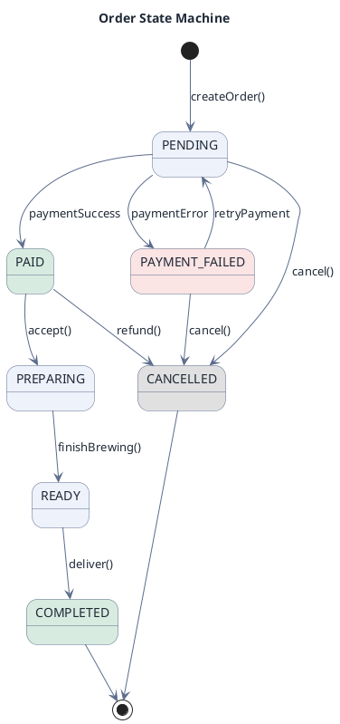
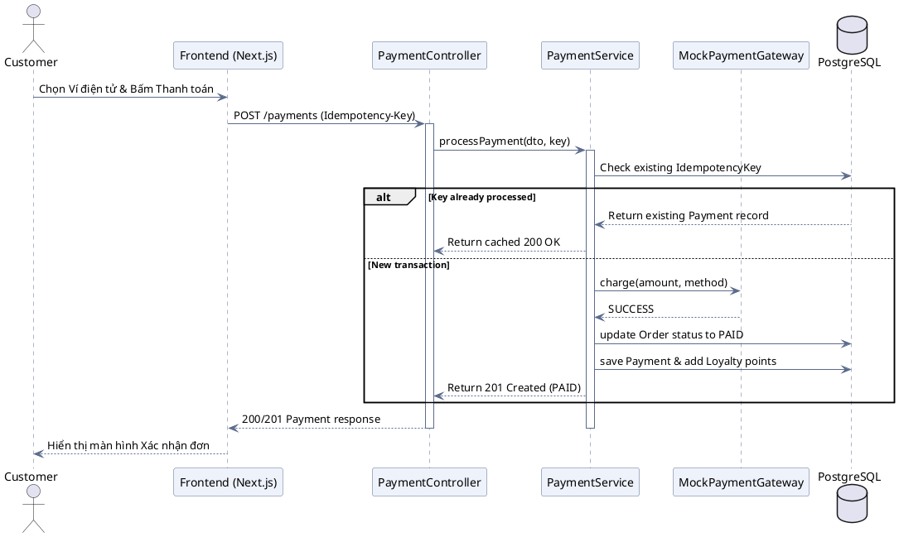
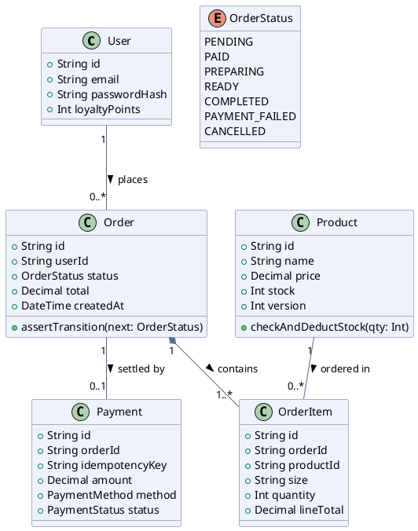
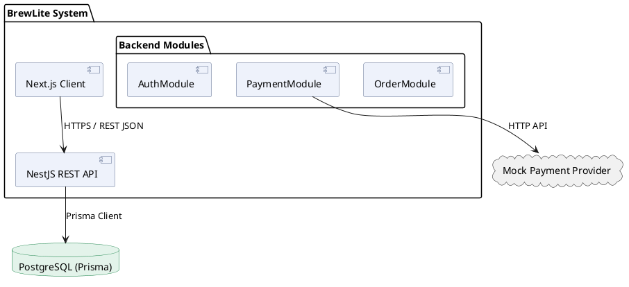

# UML Diagrams (PlantUML)

Use this skill whenever generating technical UML diagrams for software engineering, architecture, system design, or documentation.

This skill is powered by the **PlantUML engine** (`@markdown-viewer/draw-uml` / `@markdown-viewer/documd`), inheriting complete styling and pattern standards from [`../documd-visuals`](../documd-visuals/SKILL.md).

---

## 1. Iron Rules for UML Blocks

1. **Code Fence:** Always use ````plantuml```` (or ````puml````).
2. **Start & End tags:** Always wrap diagram definitions between `@startuml` and `@enduml`.
3. **Multi-line Declarations:** Prefer multi-line definitions (`class User {\n  +String name\n}`) rather than single-line shorthands for maximum parser compatibility.
4. **Consistent Styling:** Always include clean theme skinparams to avoid raw default monochrome styles. Use the **Default Theme** skinparams (or Slate/Contrast from `../documd-visuals/styles/palette.md`).
5. **Single Diagram per Fence:** Do not combine multiple diagram engines or nest fences.

---

## 2. Common Theme Skinparams

Add this standard styling block at the top of every diagram right after `@startuml`:

```plantuml
skinparam DefaultFontColor #1f2937
skinparam ArrowColor #5b6b8c
skinparam ArrowFontColor #1f2937
skinparam PackageBackgroundColor #f8fafc
skinparam PackageBorderColor #94a3b8
skinparam ClassBackgroundColor #eef2fb
skinparam ClassBorderColor #5b6b8c
skinparam ClassFontColor #1f2937
skinparam StateBackgroundColor #eef2fb
skinparam StateBorderColor #5b6b8c
skinparam StateFontColor #1f2937
skinparam ComponentBackgroundColor #eef2fb
skinparam ComponentBorderColor #5b6b8c
skinparam SequenceParticipantBackgroundColor #eef2fb
skinparam SequenceParticipantBorderColor #5b6b8c
skinparam SequenceLifeLineBorderColor #5b6b8c
skinparam NoteBackgroundColor #fef3c7
skinparam NoteBorderColor #d97706
skinparam NoteFontColor #1f2937
```

---

## 3. Standard Diagram Patterns

### A. State Machine Diagram (e.g. Order State Machine)
*Best for: Order lifecycles, connection states, workflow progression.*



### B. Sequence Diagram (e.g. Payment & Checkout Flow)
*Best for: API request/response flows, inter-service communication, asynchronous callbacks.*



### C. Class Diagram (e.g. Domain Entities & Database Models)
*Best for: Entity modeling, attributes, methods, inheritance, and relations.*



### D. Component Diagram (System Architecture)
*Best for: Service boundaries, packages, external systems, and API boundaries.*



---

## 4. Deep References & Specialized Scenarios

For comprehensive technical guides, see:
- Engine rules & icon library: [`../documd-visuals/engines/plantuml.md`](../documd-visuals/engines/plantuml.md)
- Software design scenarios (C4, Packages, Use cases): [`../documd-visuals/goals/software-design.md`](../documd-visuals/goals/software-design.md)
- Software behavior scenarios (Lifecycle, Sequences): [`../documd-visuals/goals/software-behaviour.md`](../documd-visuals/goals/software-behaviour.md)
- Palettes and styling tokens: [`../documd-visuals/styles/palette.md`](../documd-visuals/styles/palette.md)
