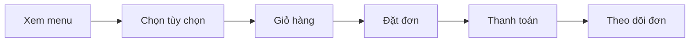
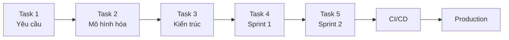
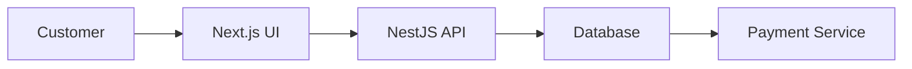
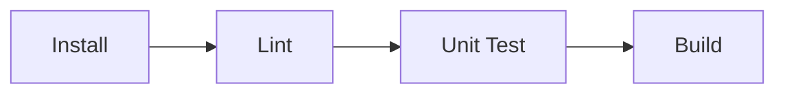
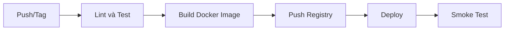

**TRƯỜNG ĐẠI HỌC SÀI GÒN**
**KHOA CÔNG NGHỆ THÔNG TIN**

<p align="center">
  
</p>

# SOFTWARE ENGINEERING

---

**Bài tập lớn:**

## BrewLite – Assignment 2

**REQUIREMENTS TO DEPLOYMENT**

**VER 1.0**

---

| | |
|---|---|
| **Môn học:** | Công nghệ Phần mềm |
| **Công nghệ:** | Next.js, NestJS, PostgreSQL và Docker |
| **Học kỳ:** | I – Năm học 2026–2027 |

TP. HỒ CHÍ MINH, NĂM 2026

---

## Mục lục

1. [Tổng quan Assignment 2](#1-tổng-quan-assignment-2)
   - 1.1 [Phạm vi sản phẩm](#11-phạm-vi-sản-phẩm)
2. [Quy trình từ yêu cầu đến triển khai](#2-quy-trình-từ-yêu-cầu-đến-triển-khai)
3. [Task 1 – Khai thác và đặc tả yêu cầu](#3-task-1--khai-thác-và-đặc-tả-yêu-cầu)
   - 3.1 Task 1.1 – Bối cảnh, stakeholder và phạm vi
   - 3.2 Task 1.2 – Yêu cầu chức năng và phi chức năng
   - 3.3 Task 1.3 – Đặc tả một use-case trọng tâm
4. [Task 2 – Mô hình hóa hệ thống](#4-task-2--mô-hình-hóa-hệ-thống)
   - 4.1 Task 2.1 – Activity diagram
   - 4.2 Task 2.2 – Sequence diagram
   - 4.3 Task 2.3 – Class diagram
5. [Task 3 – Thiết kế kiến trúc](#5-task-3--thiết-kế-kiến-trúc)
   - 5.1 Task 3.1 – Phương pháp và quyết định kiến trúc
   - 5.2 Task 3.2 – Deployment diagram
6. [Task 4 – Triển khai Sprint 1](#6-task-4--triển-khai-sprint-1)
   - 6.1 Task 4.1 – Thiết lập repository
   - 6.2 Task 4.2 – Quản lý tài liệu
   - 6.3 Task 4.3 – MVP Sprint 1
   - 6.4 Task 4.4 – Continuous Integration
7. [Task 5 – Triển khai Sprint 2, CI/CD và Delivery](#7-task-5--triển-khai-sprint-2-cicd-và-delivery)
   - 7.1 Task 5.1 – Hoàn thiện MVP
   - 7.2 Task 5.2 – Tích hợp và kiểm thử
   - 7.3 Task 5.3 – Continuous Delivery/Deployment
   - 7.4 Task 5.4 – Triển khai và bàn giao
8. [Truy vết](#8-truy-vết)
   - 8.1 Truy vết bắt buộc
9. [Cấu trúc repository](#9-cấu-trúc-repository)
   - 9.1 Checklist nộp bài

---

## 1 Tổng quan Assignment 2

Assignment 2 tiếp tục sử dụng đề tài **BrewLite** của Assignment 1. Nhóm phải phát triển dự án theo một chuỗi công việc hoàn chỉnh, bắt đầu từ khai thác yêu cầu, mô hình hóa và thiết kế kiến trúc, sau đó hiện thực qua hai Sprint, thiết lập CI/CD và triển khai hệ thống lên môi trường có thể truy cập được.

> **Quy tắc thực hiện tuần tự:** năm task phải được hoàn thành theo đúng thứ tự. Task sau chỉ được nghiệm thu khi các tạo phẩm bắt buộc của task trước đã có trên kho mã nguồn và có lịch sử thay đổi rõ ràng.

### 1.1 Phạm vi sản phẩm

Luồng nghiệp vụ tối thiểu của BrewLite:



*(Dạng văn bản: Xem menu → Chọn tùy chọn → Giỏ hàng → Đặt đơn → Thanh toán → Theo dõi đơn)*

Frontend sử dụng **Next.js** theo hướng mobile-first/PWA; backend sử dụng **NestJS**; dữ liệu được lưu trong **PostgreSQL**. Nhóm có thể bổ sung công nghệ khác nhưng không được thay thế ba thành phần bắt buộc này.

---

## 2 Quy trình từ yêu cầu đến triển khai



*(Dạng văn bản: Task 1 Yêu cầu → Task 2 Mô hình hóa → Task 3 Kiến trúc → Task 4 Sprint 1 → Task 5 Sprint 2 → CI/CD → Production)*

| Task | Giai đoạn | Tạo phẩm chính | Điểm |
|:---:|---|---|:---:|
| 1 | Khai thác và đặc tả yêu cầu | Stakeholder, phạm vi, SRS, use-case tổng quát và đặc tả use-case | 2 |
| 2 | Mô hình hóa hệ thống | Activity diagram, sequence diagram và class diagram | 2 |
| 3 | Thiết kế kiến trúc | Mô tả kiến trúc, quyết định kiến trúc và deployment diagram | 2 |
| 4 | Triển khai Sprint 1 | Repository, tài liệu, CI cơ bản và MVP đầu tiên | 2 |
| 5 | Triển khai Sprint 2 và Delivery | MVP hoàn chỉnh, CD, production, kiểm thử và bàn giao | 2 |
| | | **Tổng cộng** | **10** |

---

## 3 Task 1 – Khai thác và đặc tả yêu cầu

### 3.1 Task 1.1 – Bối cảnh, stakeholder và phạm vi

Nhóm phải mô tả:

- vấn đề nghiệp vụ BrewLite cần giải quyết;
- stakeholder chính: khách hàng, nhân viên quầy, quản lý cửa hàng, giảng viên/khách hàng nghiệm thu, nhóm phát triển và đơn vị thanh toán;
- mục tiêu và kỳ vọng của từng stakeholder;
- phạm vi trong MVP, phạm vi mở rộng và các nội dung không thực hiện;
- giả định, ràng buộc và các rủi ro ban đầu.

> **Bắt buộc:** Tệp `docs/requirements/context-and-scope.md` có bảng stakeholder, in-scope, out-of-scope, giả định và ràng buộc.

### 3.2 Task 1.2 – Yêu cầu chức năng và phi chức năng

Nhóm xây dựng tài liệu SRS rút gọn, bao gồm:

1. yêu cầu chức năng có mã định danh `FR-01`, `FR-02`, …;
2. yêu cầu phi chức năng có mã `NFR-01`, `NFR-02`, …;
3. mức ưu tiên theo MoSCoW: Must, Should, Could, Won't;
4. tiêu chí chấp nhận có thể kiểm chứng cho từng yêu cầu;
5. sơ đồ use-case tổng quát của toàn hệ thống.

Các nhóm yêu cầu tối thiểu gồm: menu, chi tiết sản phẩm, giỏ hàng, xác thực, đặt đơn, thanh toán, lịch sử đơn, quản lý trạng thái đơn, hiệu năng, bảo mật, tính khả dụng và khả năng triển khai.

### 3.3 Task 1.3 – Đặc tả một use-case trọng tâm

Chọn một use-case có giá trị nghiệp vụ rõ ràng, khuyến nghị **Đặt và thanh toán đơn hàng**. Nhóm phải:

- vẽ use-case diagram cho phạm vi use-case đã chọn;
- mô tả actor, trigger, tiền điều kiện và hậu điều kiện;
- mô tả luồng chính, luồng thay thế và luồng ngoại lệ;
- liên kết use-case với các mã yêu cầu tương ứng.

> **Tiêu chí nghiệm thu:** Người đọc có thể xác định rõ hệ thống làm gì, không làm gì và có thể dùng tiêu chí chấp nhận để viết test ở các task sau.

---

## 4 Task 2 – Mô hình hóa hệ thống

### 4.1 Task 2.1 – Activity diagram

Vẽ activity diagram cho các chức năng chính của luồng end-to-end. Sơ đồ phải có:

- điểm bắt đầu và kết thúc;
- hành động của người dùng và hệ thống;
- decision/merge cho các nhánh thành công và thất bại;
- swimlane nếu luồng liên quan nhiều actor hoặc thành phần;
- trường hợp hết hàng, chưa đăng nhập và thanh toán thất bại.

### 4.2 Task 2.2 – Sequence diagram

Vẽ **sequence diagram** cho use-case đã đặc tả trong Task 1.3. Các lifeline tối thiểu:



*(Dạng văn bản: Customer → Next.js UI → NestJS API → Database → Payment Service)*

Sơ đồ phải thể hiện:

- request/response và thứ tự gọi API;
- kiểm tra JWT và validate dữ liệu;
- transaction khi tạo đơn và cập nhật tồn kho;
- nhánh `alt` cho thanh toán thành công/thất bại;
- idempotency khi client gửi lại yêu cầu thanh toán;
- thông báo kết quả cuối cùng cho người dùng.

> **Bắt buộc:** Lưu cả tệp nguồn và ảnh/PDF kết xuất, ví dụ: `docs/diagrams/sequence-checkout.puml` và `docs/diagrams/sequence-checkout.svg`.

### 4.3 Task 2.3 – Class diagram

Vẽ class diagram ở mức domain cho tối thiểu các lớp: `User`, `Product`, `Order`, `OrderItem`, `Payment`, `Promotion` và `LoyaltyTransaction`. Sơ đồ phải có thuộc tính chính, quan hệ, multiplicity và enum trạng thái.

> **Tiêu chí nghiệm thu:** Ba loại sơ đồ không mâu thuẫn với SRS, use-case hoặc mô hình dữ liệu.

---

## 5 Task 3 – Thiết kế kiến trúc

### 5.1 Task 3.1 – Phương pháp và quyết định kiến trúc

Nhóm trình bày kiến trúc đề xuất theo C4 hoặc kiến trúc phân lớp:

- frontend Next.js/PWA;
- backend NestJS theo module/domain;
- PostgreSQL và cơ chế migration;
- dịch vụ thanh toán mô phỏng;
- logging, health check và quản lý cấu hình;
- lý do chọn kiến trúc, ưu điểm, hạn chế và trade-off.

Mỗi quyết định quan trọng phải được ghi thành ADR ngắn trong thư mục `docs/architecture/adr`, ví dụ tệp `001-monorepo.md`.

### 5.2 Task 3.2 – Deployment diagram

Vẽ **UML deployment diagram** cho môi trường production. Sơ đồ tối thiểu phải thể hiện:

- thiết bị người dùng chạy trình duyệt/PWA;
- dịch vụ/CDN phục vụ Next.js;
- container hoặc dịch vụ chạy NestJS API;
- PostgreSQL có persistent storage;
- container registry và nền tảng triển khai;
- giao thức HTTPS, kết nối nội bộ và cổng cần thiết;
- secret/environment variables, health check và log;
- ranh giới giữa local, CI và production.

Nhóm có thể chọn Render, Railway, Fly.io, Azure, AWS, VPS hoặc nền tảng tương đương. Deployment diagram phải phản ánh đúng nền tảng thực tế mà nhóm sử dụng, không chỉ là sơ đồ lý thuyết.

> **Tiêu chí nghiệm thu:** Có thể truy vết mỗi container/dịch vụ trong deployment diagram đến một thành phần trong mô tả kiến trúc và mã nguồn.

---

## 6 Task 4 – Triển khai Sprint 1

> **Sprint Goal:** tạo nền tảng kỹ thuật, tài liệu có kiểm soát phiên bản và một MVP đầu tiên chạy được cho luồng xem menu.

### 6.1 Task 4.1 – Thiết lập repository

Tạo repository GitHub, Bitbucket hoặc nền tảng tương đương. Repository tối thiểu:

- cấu trúc `apps/web`, `apps/api`, `docs`;
- chiến lược branch và pull request;
- `README.md`, `.gitignore`, `.env.example`;
- issue board/Product Backlog cho Sprint 1 và Sprint 2;
- quy ước commit và Definition of Done.

### 6.2 Task 4.2 – Quản lý tài liệu

Đưa toàn bộ tạo phẩm của Task 1–3 vào thư mục `docs`. Mọi thay đổi yêu cầu, sơ đồ hoặc kiến trúc phải đi qua commit/pull request và ghi rõ lý do.

### 6.3 Task 4.3 – MVP Sprint 1

Hiện thực phiên bản đầu tiên:

- API `GET /products` và `GET /products/:id`;
- màn hình menu mobile-first bằng Next.js;
- trạng thái loading, empty và error;
- dữ liệu mẫu hoặc database seed;
- kiểm thử tối thiểu cho API và component/luồng chính.

**MVP** là phiên bản nhỏ nhất chạy được với tính năng cốt lõi để kiểm chứng giả thuyết và nhận phản hồi. MVP không đồng nghĩa với mockup tĩnh hoặc mã nguồn không thể chạy.

### 6.4 Task 4.4 – Continuous Integration

Thiết lập pipeline CI chạy tự động khi mở pull request:



*(Dạng văn bản: Install → Lint → Unit Test → Build)*

> **Bắt buộc:** Pull request không được merge nếu lint, test hoặc build thất bại.

**Minh chứng:** Link pull request đã chạy CI; ảnh hoặc log của một lần pipeline thành công và một lần pipeline phát hiện lỗi.

---

## 7 Task 5 – Triển khai Sprint 2, CI/CD và Delivery

> **Sprint Goal:** hoàn thành luồng end-to-end, tự động hóa đóng gói và triển khai một phiên bản production có thể truy cập được.

### 7.1 Task 5.1 – Hoàn thiện MVP

Nhóm hiện thực các chức năng còn lại:

- chi tiết sản phẩm, size và topping;
- giỏ hàng và tính tổng tiền;
- đăng ký, đăng nhập và JWT;
- tạo đơn hàng;
- thanh toán Ví/Thẻ mô phỏng;
- xác nhận, trạng thái và lịch sử đơn;
- xử lý lỗi và validate ở cả frontend/backend.

### 7.2 Task 5.2 – Tích hợp và kiểm thử

Hệ thống phải có:

- unit test cho nghiệp vụ quan trọng;
- integration test cho API tạo đơn/thanh toán;
- ít nhất một end-to-end test cho luồng từ menu đến xác nhận đơn;
- migration/seed có thể tái tạo database;
- `docker-compose.yml` chạy web, API và database ở local;
- health endpoint, ví dụ `GET /health`.

### 7.3 Task 5.3 – Continuous Delivery/Deployment

Pipeline cuối cùng phải thể hiện đầy đủ:



*(Dạng văn bản: Push/Tag → Lint và Test → Build Docker Image → Push Registry → Deploy → Smoke Test)*

Pipeline phải:

1. chạy quality gate: lint, test và build;
2. tạo image có tag bằng commit SHA hoặc semantic version;
3. push image lên container registry nếu nền tảng yêu cầu;
4. triển khai vào production bằng secret của CI;
5. chạy migration theo cách an toàn;
6. gọi health check/smoke test sau triển khai;
7. dừng pipeline và cung cấp cách rollback khi triển khai thất bại.

### 7.4 Task 5.4 – Triển khai và bàn giao

Sản phẩm bàn giao phải có:

- URL frontend production truy cập được qua HTTPS;
- URL API và health check;
- database production không public trực tiếp;
- secret không xuất hiện trong repository hoặc log CI;
- release/tag phiên bản và release notes;
- README hướng dẫn chạy local, test, build, deploy và rollback;
- video/demo trực tiếp luồng end-to-end;
- Sprint Review và Sprint Retrospective.

> **Tiêu chí nghiệm thu:** Một người không thuộc nhóm có thể clone repository, chạy hệ thống theo README và truy cập phiên bản production từ các URL được cung cấp.

---

## 8 Truy vết

### 8.1 Truy vết bắt buộc

Nhóm tạo `docs/traceability-matrix.md` theo mẫu:

| Mã yêu cầu | Use-case/User Story | Thiết kế/Sơ đồ | Code/API | Test |
|---|---|---|---|---|
| FR-01 | US-01 Xem menu | Activity-01, Class-01 | `GET /products` | API-T01 |
| FR-05 | UC-01 Thanh toán | Sequence-01 | `POST /payments` | INT-T03 |

Nếu task trước chưa có tạo phẩm bắt buộc, task sau không được tính điểm phần truy vết. Nếu không có URL production hoạt động tại thời điểm chấm, phần triển khai của Task 5 không được tính là hoàn thành.

---

## 9 Cấu trúc repository

```text
brewlite/
|-- apps/
|   |-- web/                    # Next.js mobile-first/PWA
|   `-- api/                    # NestJS
|-- docs/
|   |-- requirements/           # Task 1
|   |-- diagrams/               # Task 2
|   |-- architecture/           # Task 3
|   |-- traceability-matrix.md
|   `-- deployment.md
|-- tests/                      # Integration/E2E
|-- .github/workflows/          # CI/CD
|-- docker-compose.yml
|-- .env.example
`-- README.md
```

### 9.1 Checklist nộp bài

- [ ] Link repository và quyền truy cập cho giảng viên.
- [ ] SRS, đặc tả use-case và ma trận truy vết.
- [ ] Activity, sequence, class và deployment diagram.
- [ ] Source code frontend, backend và migration.
- [ ] Unit, integration và end-to-end test.
- [ ] Pipeline CI/CD chạy thành công.
- [ ] URL production, API và health check.
- [ ] Release notes, README và hướng dẫn rollback.
- [ ] Video/demo và Sprint Retrospective.
