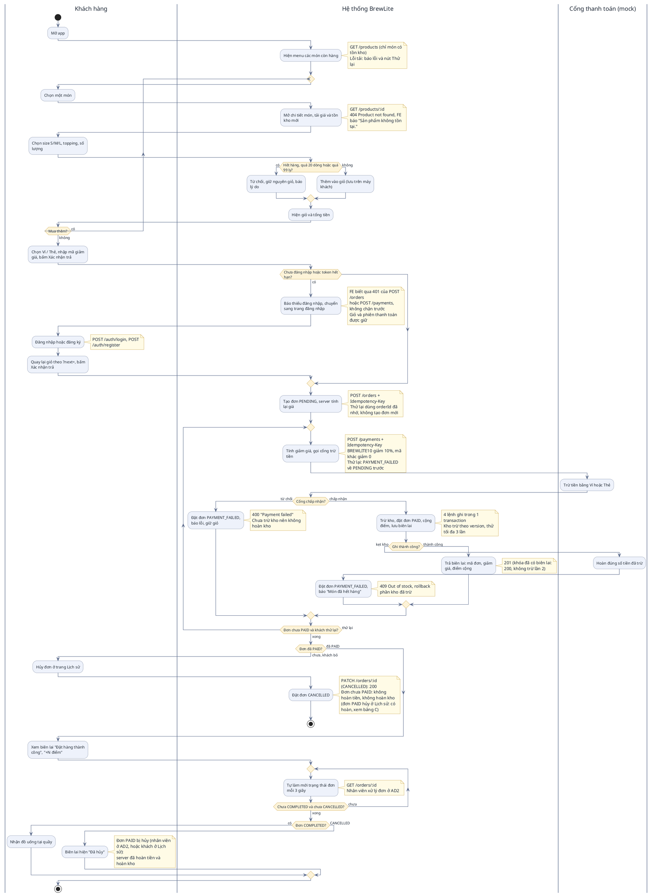
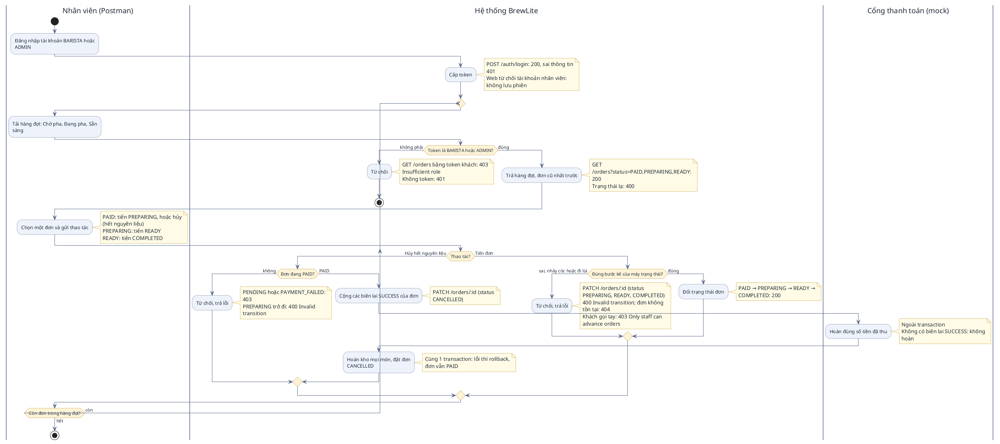

# BIỂU ĐỒ HOẠT ĐỘNG (ACTIVITY DIAGRAM) – BREWLITE
## LUỒNG ĐẶT MÓN, THANH TOÁN & XỬ LÝ HÀNG ĐỢI QUẦY

> **Dự án:** BrewLite – Ứng dụng đặt cà phê không tiền mặt  
> **Môn học:** Công nghệ Phần mềm (Bài tập lớn 10 Task Agile Scrum)  
> **Tài liệu tham chiếu:** [BrewLite-CongNghePhanMem-fixed.md](BrewLite-CongNghePhanMem-fixed.md) (đề), [product-backlog.md](product-backlog.md) (user story và tiêu chí chấp nhận)  
> **Phạm vi:** 2 biểu đồ hoạt động ở mức nghiệp vụ. **AD1** là luồng khách đặt món và thanh toán không tiền mặt (đề §5; UC01–UC07, UC05a). **AD2** là luồng nhân viên xử lý hàng đợi quầy (UC08–UC12, mở rộng ngoài đề §3.2). Hai biểu đồ vẽ theo **mã nguồn hiện tại**: đề là nguồn yêu cầu, code là nguồn để vẽ.

---

## QUY ƯỚC ĐỌC BIỂU ĐỒ

| Ký hiệu | Ý nghĩa |
| :--- | :--- |
| Chấm đen (`start`) / chấm có viền (`stop`) | Điểm bắt đầu / điểm kết thúc của luồng. |
| Hình bo tròn | Một hành động (action) của tác nhân ở làn chứa nó. |
| Hình thoi (`if`) | Điểm rẽ nhánh (decision); nhãn trên mũi tên là điều kiện của nhánh. |
| Vòng `repeat` | Bước lặp lại cho tới khi điều kiện cuối vòng không còn đúng (mua thêm, thử lại, tự làm mới). |
| Làn (swimlane) `\|Tên\|` | Ai làm bước đó. Chỉ có 3 làn ở mức nghiệp vụ: người dùng, **Hệ thống BrewLite** (gộp Frontend, Backend, CSDL) và **Cổng thanh toán (mock)**. |
| Ghi chú vàng (`note`) | Tên endpoint và mã HTTP của nhánh rẽ. Tên endpoint không nằm trong tên hành động để sơ đồ đọc được khi in A4. |

Mỗi biểu đồ có 3 mục: **A. Bối cảnh**, **B. Sơ đồ (PlantUML)**, **C. Bảng đối chiếu** (nút trên sơ đồ, endpoint, mã HTTP, `file:hàm` trong code).

---

## AD1. ĐẶT MÓN & THANH TOÁN KHÔNG TIỀN MẶT (đề §5; UC01–UC07, UC05a)

### A. Bối cảnh
Đây là luồng chính (happy path) của MVP ở đề §5: mở app, xem menu, chọn món (size, topping), thêm vào giỏ, xem giỏ, đăng nhập nếu chưa, thanh toán không tiền mặt, nhận mã đơn rồi nhận đồ uống. Giỏ hàng nằm ở máy khách (UC02); **đơn chỉ được tạo trong lần bấm "Xác nhận trả"** (UC04 rồi UC05 liền nhau, sau bước áp mã giảm giá UC05a), nên bước đăng nhập của đề §5 trong code là bước chặn khi bấm trả: chưa có token thì `POST /orders` trả 401 và khách được đưa về `/login?next=/cart` (UC03).
Nhánh lỗi của đề §5 ("hủy / thanh toán lỗi, về giỏ") là `PAYMENT_FAILED`: khách bấm trả lại với cùng khóa chống trùng (UC06 KB1), hoặc hủy đơn ở `/history` (UC06 KB2).

### B. Sơ đồ (PlantUML)

### C. Bảng đối chiếu

| Nút / nhánh trên sơ đồ | Endpoint và mã HTTP | `file:hàm` trong code |
| :--- | :--- | :--- |
| Hiện menu các món còn hàng | `GET /products` 200 | `backend/src/product/product.controller.ts:list` → `ProductService.listAvailable` → `PrismaProductRepo.findAvailable` (`stock > 0`); FE `frontend/src/lib/api.ts:getProducts` |
| Mở chi tiết món | `GET /products/:id` 200 / 404 `Product not found` (FE báo "Sản phẩm không tồn tại." ở `api.ts:getProduct`) | `product.controller.ts:detail` → `ProductService.getById`; FE `api.ts:getProduct`, `frontend/src/components/ProductDetailModal.tsx` |
| Chọn size S/M/L, topping, số lượng | không gọi API (tính ở máy khách) | `ProductDetailModal.tsx`, `frontend/src/lib/pricing.ts:calcUnitPrice` |
| Hết hàng, quá 20 dòng hoặc quá 99 ly (từ chối) | không gọi API | `frontend/src/store/cart.ts:addItem` (lý do `OUT_OF_STOCK`, `MAX_LINES`, `MAX_QTY`, `AT_STOCK_LIMIT`), `frontend/src/lib/cart-limits.ts` |
| Thêm vào giỏ, hiện giỏ và tổng tiền | không gọi API (Zustand + localStorage) | `store/cart.ts:addItem`, `frontend/src/app/cart/page.tsx`, `frontend/src/components/cart/CartView.tsx` |
| Mua thêm | quay lại menu `/` | `CartView.tsx` (link "Về Menu"), `frontend/src/app/page.tsx` |
| Chọn Ví / Thẻ, nhập mã giảm giá (UC05a); và "Tính giảm giá" ở server | FE tạm tính (không gọi API); server tính lại trong `POST /payments`: `BREWLITE10` giảm 10% làm tròn xuống, mã khác giảm 0 (không báo lỗi) | `frontend/src/components/PaymentForm.tsx` (`discount`, `final`), `frontend/src/lib/promo.ts`; `backend/src/payment/payment.service.ts:pay` (`VOUCHER_CODE`, `VOUCHER_RATE`) |
| Chưa đăng nhập hoặc token hết hạn (FE chỉ biết qua 401, không chặn trước) | `POST /orders` hoặc `POST /payments` 401 | `frontend/src/lib/payment/api-gateway.ts:pay` (ném `PaymentError` status 401), `checkout-session.ts:isUnauthorizedPayment`, `PaymentForm.tsx:handleConfirm` → `frontend/src/lib/session.ts:handleUnauthorized` (về `/login?next=...`) |
| Đăng nhập hoặc đăng ký, quay lại `/cart` | `POST /auth/login` 200 (đăng nhập) / `POST /auth/register` 201; sai thông tin 401, trùng email 409 | `backend/src/auth/auth.controller.ts`; FE `frontend/src/app/login/page.tsx:submit`, `session.ts:postLoginTarget`, `safeNext`, `checkout-session.ts:clearCheckoutIfOtherUser` |
| Tạo đơn PENDING, server tính lại giá (một lần cho mỗi giỏ; thử lại dùng `orderId` đã nhớ) | `POST /orders` 201 mới / 200 cùng khóa. Chỉ gặp khi gọi API tay: 404 món lạ, 400 topping lạ / quá 20 dòng / quá 99 ly / tổng quá lớn / khóa quá 255 ký tự, 403 tài khoản nhân viên, 422 khóa của người khác | `backend/src/order/order.controller.ts:create` → `OrderService.create`, `replay` (khóa người khác: 422); giá: `backend/src/order/pricing.ts`; DTO: `backend/src/order/dto/create-order.dto.ts`; vai trò: `@Roles(Role.CUSTOMER)` (nhân viên 403 `Insufficient role`) |
| Tính giảm giá, gọi cổng trừ tiền (ngoài transaction) | `POST /payments` 201 / 200 (khóa đã có biên lai: trả biên lai cũ, không trừ lần 2); gọi tay: 403 đơn người khác, 422 khóa đã dùng cho đơn khác, 400 `Invalid transition` nếu đơn không ở PENDING / PAYMENT_FAILED | `backend/src/payment/payment.controller.ts:pay` → `PaymentService.processPayment` → `pay`; `MockPaymentGatewayService.charge` |
| Trừ tiền bằng Ví hoặc Thẻ | gọi nội bộ, không có endpoint | `backend/src/payment/mock-payment-gateway.service.ts:charge`; từ chối khi `MOCK_GATEWAY_DECLINE_METHOD` trùng phương thức |
| Cổng từ chối → `PAYMENT_FAILED` | 400 `Payment failed` | `payment.service.ts:pay` (`catch` quanh `gateway.charge`), `backend/src/state-machine/order-state.machine.ts:assertTransition` (`PENDING -> PAYMENT_FAILED`) |
| Vòng "Đơn chưa PAID và khách thử lại?" (đơn về `PENDING` rồi trừ tiền lại) | `POST /payments`, cùng `Idempotency-Key` | `payment.service.ts:pay` (`PAYMENT_FAILED -> PENDING` rồi `gateway.charge` lại); FE `PaymentForm.tsx:handleConfirm` (`...(orderId ? { orderId } : { items, orderIdempotencyKey })`) và `api-gateway.ts:pay` (`req.orderId ?? createOrderId`) nên thử lại không gọi `POST /orders`, `checkout-session.ts:loadCheckout`, `dropsCheckout` |
| Hủy đơn ở trang Lịch sử (khách bỏ, đơn `PENDING` / `PAYMENT_FAILED`: không hoàn tiền, không hoàn kho) | `PATCH /orders/:id` `{ status: "CANCELLED" }` 200; đơn người khác 403; không có đơn 404 | `backend/src/payment/payment.controller.ts:update` → `PaymentService.cancelOrderAs` → `cancelOrder`; FE `api.ts:cancelOrder` (nút Hủy đơn ở `/history`) |
| Hủy đơn đã `PAID` ở trang Lịch sử (không vẽ nhánh riêng, ghi ở note biên lai) | `PATCH /orders/:id` `{ status: "CANCELLED" }` 200, có hộp xác nhận hoàn tiền | `frontend/src/lib/order-status.ts:canCancel` (gồm `PAID`), `frontend/src/app/history/page.tsx`; `payment.service.ts:cancel` (cộng biên lai `SUCCESS`, `gateway.refund` ngoài transaction, rồi `restoreStock` + `CANCELLED` trong 1 transaction) |
| Trừ kho, đặt đơn `PAID`, cộng điểm, lưu biên lai | cùng `POST /payments` | `payment.service.ts:pay` trong `orders.runInTransaction`: `products.deductStockWithOptimisticLock` (thử lại 3 lần), `orders.updateStatus`, `users.addLoyaltyPoints`, `payments.save`; `LOYALTY_RATE`, `VND_PER_POINT` |
| Kẹt kho hoặc lỗi ghi → hoàn tiền, `PAYMENT_FAILED` | 409 `Out of stock` (hoặc 404 / 500 theo lỗi gốc) | `payment.service.ts:pay` (`catch` sau `runInTransaction`: `gateway.refund` rồi `updateStatus(PAYMENT_FAILED)`); FE `api-gateway.ts:paymentErrorMessage` ("Món đã hết hàng, tiền đã được hoàn lại") |
| Trả biên lai: mã đơn, giảm giá, điểm cộng | `POST /payments` 201 | `payment.service.ts:pay` (kết quả), FE `api-gateway.ts:pay` → `PaymentResult`; `frontend/src/components/PaymentSuccess.tsx:PaymentReceipt` ("Mã đơn", "+N điểm tích lũy", "Đã giảm") |
| Tự làm mới trạng thái đơn mỗi 3 giây | `GET /orders/:id` 200 / 403 đơn người khác / 404 | `backend/src/order/order.controller.ts:byId` → `OrderService.getById`; FE `frontend/src/lib/use-order-poll.ts:useOrderPoll` (`POLL_INTERVAL_MS = 3000`), `api.ts:getOrder`, `frontend/src/components/OrderStatusTrack.tsx` |
| Đơn `COMPLETED`: nhận đồ uống | không gọi API | trạng thái do nhân viên đặt (AD2); `lib/order-status.ts` (`isTerminal`) dừng poll ở `COMPLETED` / `CANCELLED` |
| Đơn `CANCELLED`: biên lai hiện "Đã hủy" | không gọi API | `lib/order-status.ts` (`STATUS_LABEL`, nhãn "Đã hủy"), `PaymentSuccess.tsx:receiptStatus`; hoàn tiền và hoàn kho do server làm lúc hủy đơn `PAID` (`payment.service.ts:cancel`), giao diện không có câu hoàn tiền |

---

## AD2. NHÂN VIÊN XỬ LÝ HÀNG ĐỢI QUA API (US-10)

### A. Bối cảnh
Phân hệ quầy là **mở rộng ngoài đề §3.2**. Web **không có màn hình quầy hay quản trị**: nhân viên (BARISTA, hoặc ADMIN kế thừa quyền Barista) gọi API trực tiếp, nhóm kiểm bằng Postman (`docs/postman/`, thư mục Task 10). Nhân viên lấy token bằng `POST /auth/login`, xem hàng đợi `GET /orders?status=PAID,PREPARING,READY`, rồi lần lượt đẩy từng đơn theo Order State Machine đề §9.1: `PAID → PREPARING → READY → COMPLETED`, hoặc hủy đơn `PAID` vì hết nguyên liệu (hoàn tiền qua cổng rồi hoàn kho). Khách hàng gọi các API quầy bị 403.
Vòng `repeat` là một phiên làm việc: sau mỗi thao tác nhân viên gọi lại `GET /orders?status=...` cho tới khi hết đơn. Tiêu chí chấp nhận: US-10 trong [product-backlog.md](product-backlog.md).

### B. Sơ đồ (PlantUML)

### C. Bảng đối chiếu

| Nút / nhánh trên sơ đồ | Endpoint và mã HTTP | `file:hàm` trong code |
| :--- | :--- | :--- |
| Đăng nhập tài khoản nhân viên | `POST /auth/login` 200; sai thông tin 401 | `backend/src/auth/auth.controller.ts`; web từ chối nhân viên ở `frontend/src/lib/login.ts:staffLoginMessage`, `frontend/src/app/login/page.tsx` |
| Token là BARISTA hoặc ADMIN? | `GET /orders` 403 `Insufficient role` nếu là khách; 401 nếu thiếu token | `backend/src/auth/roles.guard.ts` |
| Tải hàng đợi | `GET /orders?status=PAID,PREPARING,READY` 200; trạng thái lạ 400 | `backend/src/order/order.controller.ts:queue` (`@Roles(Role.BARISTA, Role.ADMIN)`) → `OrderService.listQueue` → `findByStatuses` (`createdAt` tăng dần) |
| Thao tác: Tiến đơn | `PATCH /orders/:id` `{ status: "PREPARING" \| "READY" \| "COMPLETED" }` 200; khách 403; không có đơn 404 | `backend/src/payment/payment.controller.ts:update` → `PaymentService.advanceOrder` (`isStaff`) |
| Đúng bước kế của máy trạng thái? | 400 `Invalid transition A -> B` | `backend/src/state-machine/order-state.machine.ts:assertTransition` (bảng `ALLOWED`) |
| Đổi trạng thái đơn | `PATCH /orders/:id` 200 | `payment.service.ts:advanceOrder` (`orders.updateStatus` dưới khóa `order:<orderId>`) |
| Thao tác: Hủy hết nguyên liệu | `PATCH /orders/:id` `{ status: "CANCELLED" }` | `payment.controller.ts:update` → `PaymentService.cancelOrderAs` → `cancelOrder` |
| Đơn đang PAID? (không) | 403 `Staff can only cancel paid orders` (PENDING, PAYMENT_FAILED); 400 `Invalid transition` (PREPARING trở đi) | `payment.service.ts:cancelOrderAs` (nhánh `isStaff`), `assertTransition` |
| Cộng các biên lai SUCCESS của đơn | không có endpoint | `payment.service.ts:cancel` (`payments.findAllByOrderId`, lọc `status === 'SUCCESS'`) |
| Hoàn đúng số tiền đã thu (ngoài transaction) | gọi nội bộ | `payment.service.ts:cancel` → `mock-payment-gateway.service.ts:refund` |
| Hoàn kho mọi món, đặt đơn CANCELLED | `PATCH /orders/:id` 200 | `payment.service.ts:cancel` trong `orders.runInTransaction`: `products.restoreStock`, `orders.updateStatus(CANCELLED)` |
