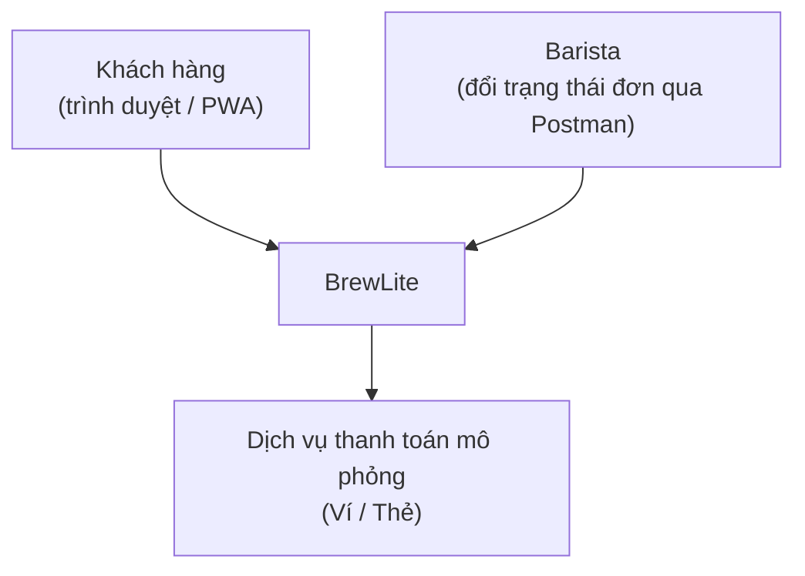
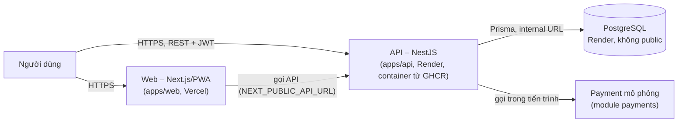

# Task 3.1 – Mô tả kiến trúc BrewLite (A2)

> **Bản nháp do AI soạn để nhóm sửa và chốt qua PR** (nhánh `a2/task-3-architecture`). Soạn từ kế hoạch `docs/planning/2026-10-15-assignment2-plan.md` và đề A2; **chưa đối chiếu với `srs.md` và các sơ đồ Task 2 của nhóm**. Chỗ ghi `[đối chiếu srs.md]` là chỗ nhóm cần kiểm lại mã yêu cầu thật.

## 1. Phương pháp
C4 mức 1–2 (Context, Container) kết hợp **kiến trúc phân lớp** trong backend. Hình thức triển khai: **một backend NestJS (modular monolith)**, một frontend Next.js, một PostgreSQL. Payment mô phỏng là module trong API (xem ADR-002, ADR-005).

## 2. C4 mức 1 – Context

## 3. C4 mức 2 – Container

| Container | Công nghệ | Trách nhiệm | Mã nguồn |
|---|---|---|---|
| Web | Next.js, PWA (web app manifest) | Menu, chi tiết sản phẩm (size, topping), giỏ hàng, đăng nhập, đặt đơn, thanh toán, lịch sử đơn; trạng thái loading/empty/error | `apps/web` |
| API | NestJS | Nghiệp vụ, JWT, validate, transaction, health, log | `apps/api` |
| Database | PostgreSQL + Prisma migration | Dữ liệu bền vững | `apps/api` (migration, seed) |
| Payment mô phỏng | Module NestJS | Ví/Thẻ mô phỏng, thành công/thất bại, chống thu trùng | `apps/api` (module `payments`) |

## 4. Backend theo module/domain (phân lớp)
Gợi ý 5 module (nhóm chốt): `auth`, `catalog`, `orders`, `payments`, `health`. Chưa có module `promotions`/`loyalty` vì FR-17/18 ngoài bản nộp (Won't); `Promotion` và `LoyaltyTransaction` vẫn có ở class diagram.
Mỗi module: **controller → service → truy cập dữ liệu (Prisma)**; controller không gọi DB trực tiếp; DTO được validate ở biên.

| Module | Việc chính |
|---|---|
| `auth` | `POST /auth/register`, `POST /auth/login`, băm mật khẩu (bcrypt cost ≥ 10), JWT (`exp` ≤ 3600 s, khóa từ env ≥ 32 ký tự), guard theo vai trò CUSTOMER/BARISTA (NFR-04, NFR-05) |
| `catalog` | `GET /products`, `GET /products/:id`, size/topping, giá do server tính |
| `orders` | `POST /orders` (transaction đơn + giữ chỗ tồn kho), `GET /orders/me`, `GET/PATCH /orders/:id` theo state machine 8 chuyển hợp lệ (FR-23, FR-24) |
| `payments` | `POST /payments`, Ví/Thẻ mô phỏng, `Idempotency-Key`, simulator chống thu trùng (ADR-005) |
| `health` | `GET /health` kiểm DB, trả 200/503, có `version` (SHA), không cache |

## 5. Cắt ngang
- **Migration:** Prisma migrate; migration chỉ *cộng thêm* để rollback image vẫn chạy được với schema mới (ADR-003); seed chạy lại được trên DB trống.
- **Logging (NFR-20, Should):** mỗi request một dòng JSON có `timestamp`, `method`, `path`, `status`, `durationMs`, `requestId`; mức log chọn bằng `LOG_LEVEL`; không ghi mật khẩu, token, số thẻ (NFR-07).
- **Health check:** `GET /health` kiểm kết nối DB, trả `{status, database, version}` (200 hoặc 503) kèm `Cache-Control: no-store`; `version` = commit SHA nhúng lúc build image qua `APP_VERSION` (`local` khi chạy local), dùng cho smoke test và nhận diện bản đang chạy (NFR-15).
- **Cấu hình:** biến môi trường (`DATABASE_URL`, `JWT_SECRET`, `CORS_ORIGINS`, `LOG_LEVEL`, `APP_VERSION`, `NEXT_PUBLIC_API_URL`; cổng local web 3000, API 4000, Postgres 5432); `.env.example` chỉ có tên biến; secret thật ở GitHub Secrets, Vercel, Render.
- **Bảo mật:** JWT, băm mật khẩu, validate ở frontend và backend, DB không public, CORS giới hạn origin của web.

### Lưu ý nhất quán với class diagram (cần nhóm chốt)
- `class-domain.puml` không có lớp/bảng cho **size và topping**; chỉ có `OrderItem.size` và `OrderItem.toppings`. Vì vậy phụ thu size (S/M/L) và topping (SRS 3.3) nên là **hằng số cấu hình trong module `catalog`**, không phải bảng DB. Nếu nhóm muốn lưu thành bảng thì phải sửa class diagram và SRS 3.6.
- Bảng lưu kết quả thu tiền của simulator (ADR-005) là **hạ tầng nội bộ của Payment Service mô phỏng**, nằm ngoài mô hình domain 7 lớp; ghi rõ như vậy để không mâu thuẫn class diagram.

## 6. Lý do chọn, ưu điểm, hạn chế, trade-off
| Quyết định | Ưu điểm | Hạn chế / trade-off | ADR |
|---|---|---|---|
| Monorepo | PR đổi cả code lẫn tài liệu, truy vết dễ | CI phải chạy theo thư mục | 001 |
| NestJS phân lớp theo module | Đơn giản, đủ cho MVP, transaction đơn/tồn kho trong một tiến trình | Khó scale riêng từng module | 002 |
| Prisma + migration cộng thêm | DB tái tạo được; rollback image an toàn | Phải kỷ luật khi sửa schema | 003 |
| Vercel (web) + Render (API, DB) + GHCR | Khớp chuỗi Docker của đề; DB không public; có free tier | Free tier: ngủ sau 15 phút, DB hết hạn, CORS giữa hai nền tảng | 004 |
| Idempotency + cập nhật tồn kho có điều kiện trong transaction | Gửi lại thanh toán không thu trùng; không bán quá tồn kho (AC-F13.3) | Thêm bảng lưu kết quả của simulator; logic phục hồi E8b phức tạp hơn | 005 |

## 7. Truy vết deployment diagram → kiến trúc → mã nguồn (tiêu chí §5.2)
| Container / dịch vụ trong `deployment.puml` | Thành phần trong tài liệu này | Mã nguồn (điền thật khi có code) |
|---|---|---|
| Trình duyệt/PWA, Vercel (Next.js) | Web (§3) | `apps/web` |
| Render Web Service (NestJS API) | API và module (§3, §4) | `apps/api`, `apps/api/Dockerfile` |
| Render Postgres | Database (§3, §5) | migration, seed trong `apps/api` |
| Payment mô phỏng | module `payments` (§4) | `apps/api` |
| GHCR, GitHub Actions | Triển khai (ADR-004) | `.github/workflows/ci.yml`, `cd.yml` |
| Local docker-compose | — | `docker-compose.yml`, `.env.example` |

## 8. Ánh xạ NFR triển khai → thiết kế (bổ sung cột Thiết kế của ma trận truy vết)
| NFR (SRS §6) | Thiết kế / nơi thể hiện |
|---|---|
| NFR-07 secret, CORS | `deployment.puml` (GitHub Secrets, env Vercel/Render), `CORS_ORIGINS`, ADR-004 |
| NFR-08 HTTPS, DB không public | `deployment.puml` (HTTPS 443, Postgres private, internal URL), ADR-004 |
| NFR-13 transaction, chống vượt tồn | sequence T1/T2, ADR-005 |
| NFR-14 docker-compose | `deployment.puml` (Local), ADR-001 |
| NFR-15 health check | module `health`, `deployment.puml` (poll `/health`) |
| NFR-16 migration/seed | ADR-003 |
| NFR-17 CI, NFR-18 CD/rollback | `deployment.puml` (CI/CD), ADR-004 |
| NFR-19 production truy cập được | ADR-004 (rủi ro free tier) |
| NFR-20 logging | §5 |
