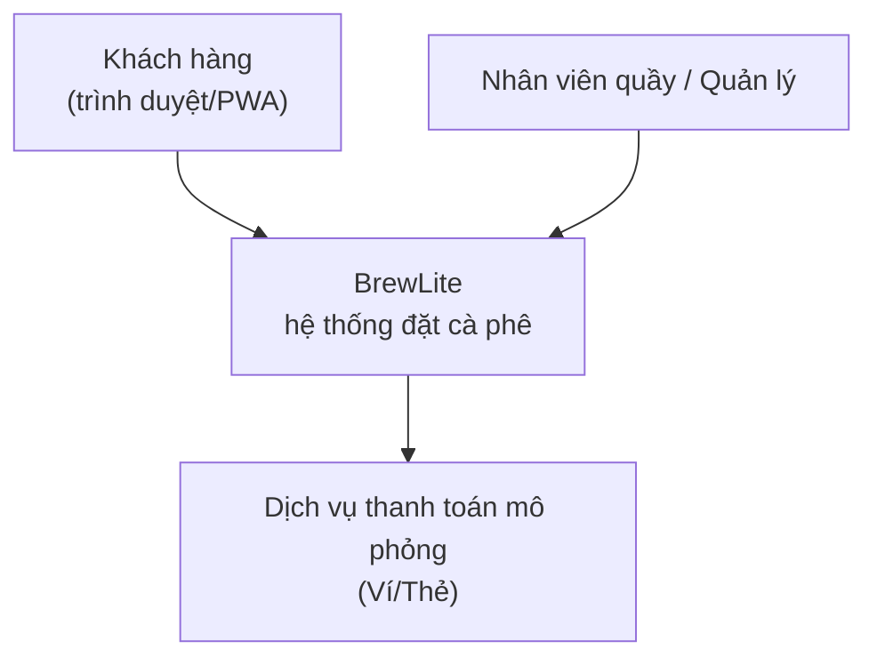
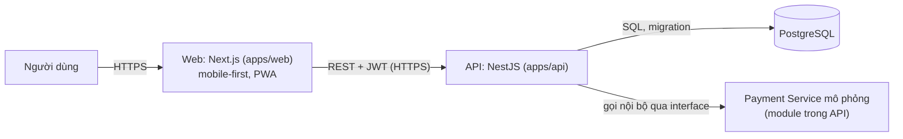

# Task 3.1 – Mô tả kiến trúc BrewLite

> **Bản nháp do AI soạn để nhóm sửa và chốt.** Các lựa chọn công nghệ ngoài Next.js, NestJS, PostgreSQL, Docker (ví dụ ORM, nền tảng triển khai) là **đề xuất**, đánh dấu *(đề xuất)*.

## 1. Phương pháp
Dùng **C4 (mức Context và Container)** kết hợp **kiến trúc phân lớp** bên trong backend. Mô hình triển khai là **modular monolith**: một API NestJS chia module theo domain, một frontend Next.js, một PostgreSQL.

## 2. C4 – Context

## 3. C4 – Container

| Container | Công nghệ | Trách nhiệm | Thư mục mã nguồn |
|---|---|---|---|
| Web | Next.js, PWA | Menu, giỏ hàng, đặt đơn, theo dõi đơn; trạng thái loading/empty/error | `apps/web` |
| API | NestJS | Nghiệp vụ, xác thực JWT, validate, transaction | `apps/api` |
| Database | PostgreSQL | Lưu dữ liệu bền vững | migration trong `apps/api` *(đề xuất: `apps/api/src/migrations`)* |
| Payment mô phỏng | Module NestJS | Giả lập Ví/Thẻ, hỗ trợ idempotency | `apps/api/src/payments` |

## 4. Backend theo module/domain
`auth` · `users` · `products` (menu, size, topping) · `cart` *(hoặc xử lý ở client)* · `orders` · `payments` · `promotions` · `loyalty` · `health` · `common` (filter lỗi, guard, logger, config).
Mỗi module có `controller → service → repository`; controller không truy cập DB trực tiếp. Khớp với các lớp domain của Task 2.3: User, Product, Order, OrderItem, Payment, Promotion, LoyaltyTransaction.

## 5. Cắt ngang
- **Migration:** mọi thay đổi schema đi qua file migration, có seed dữ liệu mẫu; chạy tự động ở local (docker-compose) và có bước riêng trong CD.
- **Logging:** log JSON ra stdout, có request id; không ghi secret/JWT.
- **Health check:** `GET /health` (kiểm tra API và kết nối DB), dùng cho nền tảng và smoke test.
- **Cấu hình:** biến môi trường, validate khi khởi động; `.env.example` trong repo, secret thật nằm ở CI/nền tảng.
- **Bảo mật:** JWT, validate DTO ở backend, DB không public.

## 6. Lý do chọn, ưu điểm, hạn chế, trade-off
| Quyết định | Ưu điểm | Hạn chế / trade-off |
|---|---|---|
| Modular monolith | Đơn giản triển khai, đủ cho phạm vi MVP, dễ test | Mở rộng độc lập từng module khó hơn; cần giữ ranh giới module bằng kỷ luật |
| Monorepo | Một PR đổi cả web/api/docs, truy vết dễ | CI phải lọc theo thư mục để không chạy thừa |
| PostgreSQL + migration | Transaction ACID cho đơn/tồn kho | Cần quản lý migration cẩn thận khi deploy |
| Payment mô phỏng nội bộ | Không phụ thuộc bên ngoài, test được | Không phản ánh độ trễ/lỗi thật; giữ interface để thay sau |

## 7. Truy vết thành phần (dùng cho tiêu chí nghiệm thu Task 3.2)
| Thành phần trong deployment diagram | Thành phần kiến trúc | Mã nguồn |
|---|---|---|
| Container `web` | Web (Next.js) | `apps/web`, `apps/web/Dockerfile` |
| Container `api` | API (NestJS) | `apps/api`, `apps/api/Dockerfile` |
| PostgreSQL | Database | migration/seed trong `apps/api` |
| Pipeline CI/CD | — | `.github/workflows/ci.yml`, `cd.yml` |
| Local compose | — | `docker-compose.yml`, `.env.example` |

ADR liên quan: [001](adr/001-monorepo.md), [002](adr/002-modular-monolith.md), [003](adr/003-postgresql-migration.md), [004](adr/004-mock-payment-idempotency.md), [005](adr/005-config-logging-health.md), [006](adr/006-deployment-platform.md).
