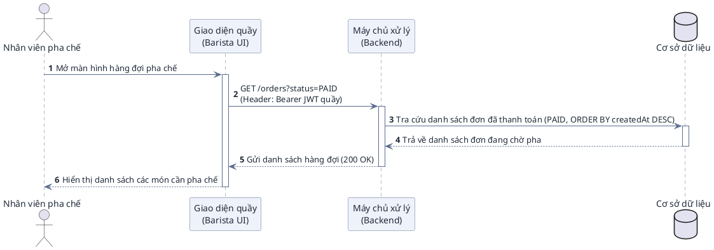
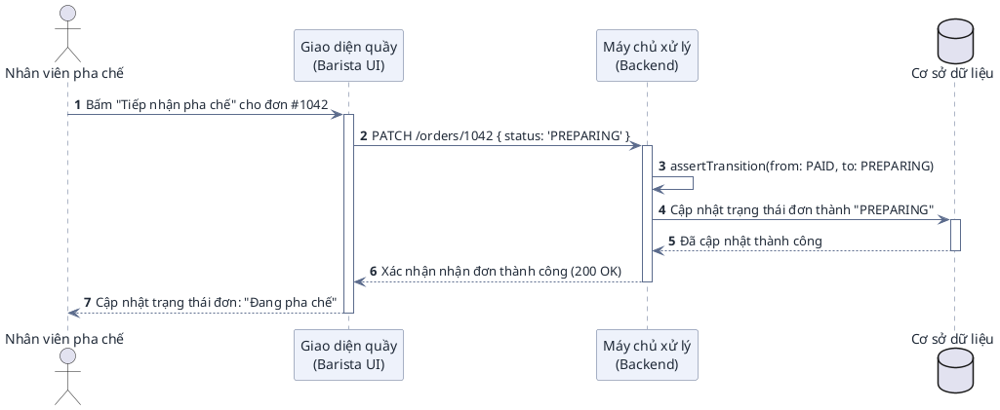
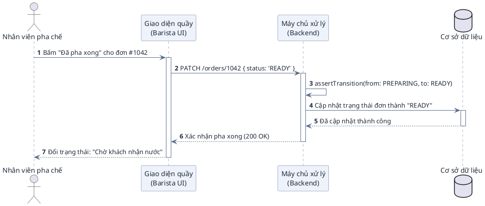
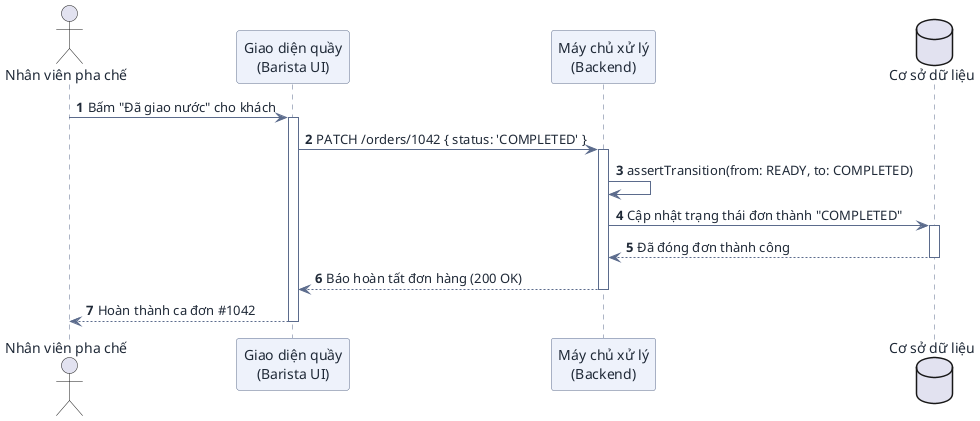

# ĐẶC TẢ BIỂU ĐỒ TUẦN TỰ — PHÂN HỆ PHA CHẾ (BARISTA, EXTENSION NGOÀI MVP)
> Phạm vi: UC08–UC12 theo sơ đồ usecase quầy. Quy ước đọc (`->`, `-->`, `activate`, `alt/opt/group`) xem Phần I của `docs/user-sequence-specifications.md`, áp dụng nguyên vẹn tại đây.

## UC08: Xem hàng đợi đơn chờ pha chế (PAID)

* **Endpoint:** `GET /orders?status=PAID` (JWT quầy).

## UC09: Tiếp nhận pha chế (PAID -> PREPARING)

* **Endpoint:** `PATCH /orders/:id` (JWT quầy). Sai trạng thái (vd đơn chưa trả tiền) trả 400.

## UC10: Báo hoàn tất pha chế (PREPARING -> READY)

* **Endpoint:** `PATCH /orders/:id` (JWT quầy).

## UC11: Xác nhận giao nước cho khách (READY -> COMPLETED)

* **Endpoint:** `PATCH /orders/:id` (JWT quầy). `COMPLETED` là trạng thái kết thúc, mọi chuyển tiếp sau đó đều 400.
