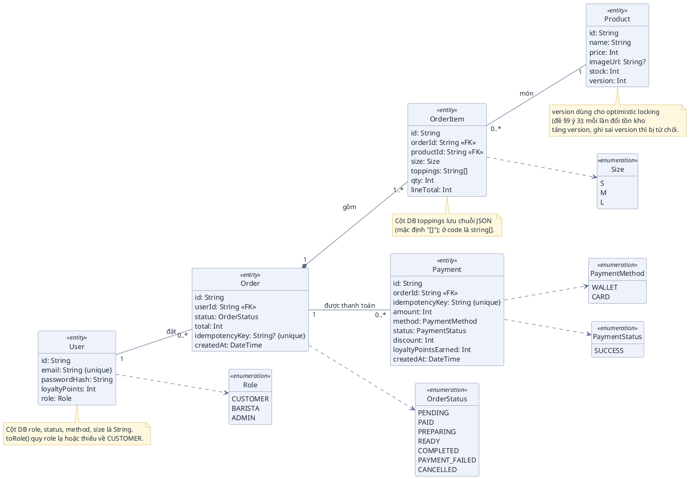
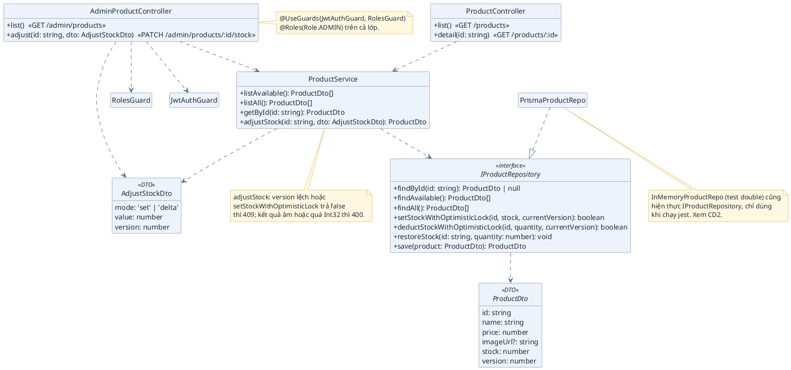
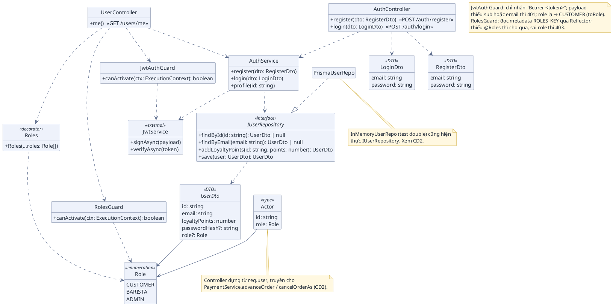

```plantuml
@startuml
skinparam DefaultFontColor #1f2937
skinparam ArrowColor #5b6b8c
skinparam ClassBackgroundColor #eef2fb
skinparam ClassBorderColor #5b6b8c
skinparam PackageBorderColor #9aa5bd
skinparam NoteBackgroundColor #fff8e1
skinparam NoteBorderColor #c9a227
skinparam classAttributeIconSize 0
hide circle
hide empty members

package "Controller" {
  class OrderController {
    +create(dto: CreateOrderDto, key?: string)  «POST /orders»
    +queue(status?: string)  «GET /orders»
    +mine()  «GET /orders/me»
    +byId(id: string)  «GET /orders/:id»
  }
  class PaymentController {
    +pay(dto: CreatePaymentDto, key: string)  «POST /payments»
    +update(id: string, dto: UpdateOrderStatusDto)  «PATCH /orders/:id»
  }
}

package "Service" {
  class OrderService {
    +create(userId: string, dto: CreateOrderDto, idempotencyKey?: string): OrderDto & { isCached: boolean }
    +listMine(userId: string): NamedOrderDto[]
    +getById(userId: string, orderId: string)
    +listQueue(statuses?: OrderStatus[]): NamedOrderDto[]
  }
  class PaymentService {
    +processPayment(userId: string, dto: CreatePaymentDto, idempotencyKey: string)
    +cancelOrder(orderId: string)
    +advanceOrder(actor: Actor, orderId: string, status: OrderStatus)
    +cancelOrderAs(actor: Actor, orderId: string)
  }
  class OrderStateMachine <<module>> {
    +assertTransition(from: OrderStatus, to: OrderStatus): void
  }
  class MockPaymentGatewayService {
    +failNextCharge(): void
    +charge(opts: {amount, method}): void
    +refund(orderId: string, amount: number): void
    +getCallCount(): number
  }
}

package "Contracts" {
  class TxContext <<type>>
  interface IOrderRepository <<interface>> {
    +findById(id: string): OrderDto | null
    +findByIdempotencyKey(key: string): OrderDto | null
    +findByUserId(userId: string): OrderDto[]
    +findByStatuses(statuses: OrderStatus[]): OrderDto[]
    +updateStatus(id: string, status: OrderStatus): OrderDto
    +save(order: OrderDto): OrderDto
    +runInTransaction<T>(fn: (tx: TxContext) => Promise<T>): T
  }
  interface IPaymentRepository <<interface>> {
    +findByIdempotencyKey(key: string): PaymentDto | null
    +findAllByOrderId(orderId: string): PaymentDto[]
    +save(payment: PaymentDto): PaymentDto
  }
  interface IProductRepository <<interface>> {
    +findById(id: string): ProductDto | null
    +findAvailable(): ProductDto[]
    +findAll(): ProductDto[]
    +setStockWithOptimisticLock(id, stock, currentVersion): boolean
    +deductStockWithOptimisticLock(id, quantity, currentVersion): boolean
    +restoreStock(id: string, quantity: number): void
    +save(product: ProductDto): ProductDto
  }
  interface IUserRepository <<interface>> {
    +findById(id: string): UserDto | null
    +findByEmail(email: string): UserDto | null
    +addLoyaltyPoints(id: string, points: number): UserDto
    +save(user: UserDto): UserDto
  }
}

package "Adapters" {
  class PrismaOrderRepo
  class PrismaPaymentRepo
  class PrismaProductRepo
  class PrismaUserRepo
  class InMemoryOrderRepo <<test double>>
  class InMemoryPaymentRepo <<test double>>
  class InMemoryProductRepo <<test double>>
  class InMemoryUserRepo <<test double>>
  class "in-memory-tx" as InMemoryTx <<module, test double>> {
    +registerInMemoryRepo(entry): void
    +runInMemoryTransaction<T>(fn: () => Promise<T>): T
  }
}

PrismaOrderRepo -[hidden]right- InMemoryOrderRepo
PrismaPaymentRepo -[hidden]right- InMemoryPaymentRepo
PrismaProductRepo -[hidden]right- InMemoryProductRepo
PrismaUserRepo -[hidden]right- InMemoryUserRepo

OrderController .down.> OrderService
PaymentController .down.> PaymentService

OrderService .down.> IOrderRepository
OrderService .down.> IProductRepository

PaymentService .down.> IOrderRepository
PaymentService .down.> IPaymentRepository
PaymentService .down.> IProductRepository
PaymentService .down.> IUserRepository
PaymentService .down.> MockPaymentGatewayService
PaymentService .down.> OrderStateMachine

IOrderRepository .left.> TxContext

PrismaOrderRepo .up.|> IOrderRepository
PrismaPaymentRepo .up.|> IPaymentRepository
PrismaProductRepo .up.|> IProductRepository
PrismaUserRepo .up.|> IUserRepository

InMemoryOrderRepo .up.|> IOrderRepository
InMemoryPaymentRepo .up.|> IPaymentRepository
InMemoryProductRepo .up.|> IProductRepository
InMemoryUserRepo .up.|> IUserRepository

InMemoryOrderRepo .down.> InMemoryTx : "cả 4 InMemory*Repo"

note bottom of OrderController
  @UseGuards(JwtAuthGuard, RolesGuard) từng route:
  create, mine, byId: @Roles(CUSTOMER);
  queue: @Roles(BARISTA, ADMIN).
end note

note bottom of PaymentController
  pay: @UseGuards(JwtAuthGuard, RolesGuard), @Roles(CUSTOMER).
  update (PATCH): chỉ JwtAuthGuard; luật vai trò
  nằm ở PaymentService (isStaff, chủ đơn).
end note

note bottom of OrderStateMachine
  Không có class: file
  order-state.machine.ts xuất hàm
  assertTransition (bảng ALLOWED).
  Chuyển sai ném 400.
end note

note bottom of TxContext
  type TxContext = unknown.
  Prisma truyền TransactionClient;
  in-memory bỏ qua, tính nguyên tử
  bằng bản chụp trong in-memory-tx.
end note
@enduml
```

# BIỂU ĐỒ LỚP (CLASS DIAGRAM) – BREWLITE

> **Dự án:** BrewLite – Ứng dụng đặt cà phê không tiền mặt
> **Môn học:** Công nghệ Phần mềm (Bài tập lớn 10 Task Agile Scrum)

## Phạm vi

Tài liệu gồm **4 biểu đồ lớp**, mỗi biểu đồ một khối PlantUML:

| Mã | Biểu đồ | Loại | Nguồn chính trong code |
|---|---|---|---|
| CD1 | Mô hình miền (5 thực thể đề §12.2 + enum) | Domain model | `backend/prisma/schema.prisma`, `backend/src/contracts/*.ts` |
| CD2 | Đơn hàng & Thanh toán | Design class | `backend/src/order`, `payment`, `state-machine`, `contracts`, `prisma`, `stubs` |
| CD3 | Sản phẩm & Kho | Design class | `backend/src/product`, `contracts/product.contract.ts` |
| CD4 | Xác thực & Phân quyền | Design class | `backend/src/auth`, `contracts/user.contract.ts` |

- Chỉ vẽ **backend** (NestJS + Prisma). Không vẽ frontend (Next.js).
- CD1 là mô hình khái niệm của dữ liệu, không có phương thức. CD2–CD4 là lớp thiết kế, chỉ ghi phương thức `public`.
- Đối chiếu đề: `docs/BrewLite-CongNghePhanMem-fixed.md` §12.2 (5 thực thể), §9 (idempotency, optimistic locking, State Machine §9.1). Hành vi từng bước của các phương thức xem `docs/user-sequence-specifications.md` (mục C và ma trận Phần III của từng UC).
- Tên lớp, phương thức, chữ ký lấy trực tiếp từ code; đổi code thì sửa lại tài liệu này (xem `.claude/rules/doc-code-sync.md`).

## Quy ước ký hiệu

| Ký hiệu | Ý nghĩa |
|---|---|
| `A "1" -- "0..*" B` | Association (liên kết) kèm bội số (multiplicity). `1` đúng một, `0..*` không hoặc nhiều, `1..*` ít nhất một |
| `A "1" *-- "1..*" B` | Composition: B là thành phần của A, xoá A thì xoá B |
| `A ..> B` | Dependency: A dùng B (ở CD2–CD4 là constructor injection, hoặc tham số / kiểu trả về của phương thức) |
| `A ..|> I` | Realization: A hiện thực interface I |
| `<<interface>>` | Interface TypeScript (hợp đồng repository) |
| `<<enumeration>>` | Kiểu liệt kê |
| `<<test double>>` | Bản giả trong bộ nhớ (`backend/src/stubs`), chỉ dùng khi chạy jest, không có `DATABASE_URL` |
| `<<entity>>` / `<<DTO>>` / `<<type>>` / `<<decorator>>` / `<<module>>` | Phân loại thành phần (bản ghi CSDL / đối tượng truyền dữ liệu / kiểu TypeScript / decorator của Nest / file chứa hàm rời, không có `class`) |
| `{unique}` | Cột có chỉ số unique |

Quy ước thành viên ở CD2–CD4:

- Chỉ ghi phương thức `public`; không ghi field `private` và token DI.
- Bỏ `Promise<>` chỉ ở kiểu trả về của phương thức (gần như mọi phương thức repository và service là `async`). `Promise<>` trong kiểu của tham số callback thì giữ nguyên, ví dụ `runInTransaction<T>(fn: (tx: TxContext) => Promise<T>): T`. Kiểu trả về không khai báo trong code (suy luận) thì để trống.
- Bỏ tham số `tx?: TxContext` của các phương thức repository (mọi phương thức repository đều nhận); bỏ `req`, `res` của controller. Số tham số còn lại giữ nguyên.
- Controller ghi route ở cuối dòng, dạng `«POST /orders»`.

---

# CD1 – MÔ HÌNH MIỀN (DOMAIN MODEL, ĐỀ §12.2)

### A. Bối cảnh

Đề §12.2 yêu cầu **5 thực thể tối thiểu**: `User`, `Product`, `Order`, `OrderItem`, `Payment`. Sơ đồ lấy thuộc tính và kiểu từ `schema.prisma`; kiểu liệt kê lấy từ `contracts/*.ts` vì cột `status`, `role`, `method`, `size` ở DB đều là `String`. Enum không phải thực thể: vẫn đúng 5 thực thể, không thêm bảng.

### B. Sơ đồ (PlantUML)

### C. Bảng đối chiếu

| Thành phần trên sơ đồ | Nơi trong code | Ghi chú |
|---|---|---|
| `User` | `model User` trong `backend/prisma/schema.prisma` | `email` có `@unique`. `role` là mở rộng ngoài §12.2 (không thêm bảng), mặc định `CUSTOMER` |
| `Product` | `model Product` | `version` mặc định `1`, dùng cho `setStockWithOptimisticLock` / `deductStockWithOptimisticLock` (đề §9 ý 3) |
| `Order` | `model Order` | `idempotencyKey` có `@unique`, cho phép `null` (đơn tạo không kèm header). `payments Payment[]` |
| `OrderItem` | `model OrderItem` | DTO `OrderItemDto` (`contracts/order.contract.ts`) đặt tên khác: `quantity` ứng với `qty`, `unitPrice` suy ra `lineTotal` |
| `Payment` | `model Payment` | `idempotencyKey` có `@unique`; `discount`, `loyaltyPointsEarned` mặc định `0` |
| Bội số `User 1 – 0..* Order` | `Order.userId` bắt buộc; `User.orders Order[]` | Người dùng chưa đặt đơn nào vẫn hợp lệ |
| Bội số `Order 1 – 1..* OrderItem` (composition) | `OrderItem.orderId` bắt buộc; `CreateOrderDto.items` có `@ArrayMinSize(1)` và `@ArrayMaxSize(20)` | Schema cho phép 0 dòng, nghiệp vụ (DTO) bắt buộc 1–20 dòng nên vẽ `1..*` |
| Bội số `OrderItem 0..* – 1 Product` | `OrderItem.productId` bắt buộc; `Product.items OrderItem[]` | Món chưa ai đặt vẫn hợp lệ |
| Bội số `Order 1 – 0..* Payment` | `Payment.orderId` bắt buộc; `Order.payments Payment[]` | Đơn PENDING / PAYMENT_FAILED chưa có biên lai; một đơn có thể có nhiều biên lai (`findAllByOrderId` cộng mọi biên lai `SUCCESS` khi hoàn tiền) |
| `Role` (3 giá trị) | `enum Role` trong `contracts/user.contract.ts` | `toRole(value)` chỉ nhận `BARISTA`, `ADMIN`; còn lại về `CUSTOMER` |
| `OrderStatus` (7 giá trị) | `enum OrderStatus` trong `contracts/order.contract.ts` | Luật chuyển trạng thái: `state-machine/order-state.machine.ts` (đề §9.1) |
| `Size` (`S`, `M`, `L`) | `SIZES` và `type Size` trong `order/pricing.ts` | Kiểu hợp (`'S' \| 'M' \| 'L'`) suy ra từ mảng `SIZES`, vẽ như enum; `DEFAULT_SIZE = 'M'` |
| `PaymentMethod`, `PaymentStatus` | `type PaymentMethod = 'WALLET' \| 'CARD'`, `type PaymentStatus = 'SUCCESS'` trong `contracts/payment.contract.ts` | Là union type chứ không khai báo `enum`; vẽ như enum cho thống nhất |
| Cột `toppings` | `OrderItem.toppings String @default("[]")`; `parseToppings` trong `prisma/prisma-order.repo.ts` | Lưu JSON, đọc lỗi thì coi như `[]` |

---

# CD2 – ĐƠN HÀNG & THANH TOÁN (DESIGN CLASS)

### A. Bối cảnh

Luồng tạo đơn (`POST /orders`), thanh toán (`POST /payments`) và tiến / huỷ đơn (`PATCH /orders/:id`). Service chỉ phụ thuộc interface repository (`I*Repository` trong `contracts/`), không biết Prisma; module Nest chọn bản Prisma khi có `DATABASE_URL`, ngược lại chọn bản in-memory (chỉ để jest). Lưu ý `PATCH /orders/:id` nằm ở `PaymentController`, không phải `OrderController`.

### B. Sơ đồ (PlantUML)

### C. Bảng đối chiếu

| Thành phần trên sơ đồ | File trong code | Ghi chú |
|---|---|---|
| `OrderController` | `backend/src/order/order.controller.ts` | `@Controller('orders')`. `create` trả 201, hoặc 200 khi `isCached`; `queue` chỉ BARISTA / ADMIN; `mine`, `byId` chỉ CUSTOMER. `byId` khai sau `mine` để `/orders/me` không rơi vào `:id` |
| `PaymentController` | `backend/src/payment/payment.controller.ts` | `@Controller()` không tiền tố, giữ cả `POST /payments` và `PATCH /orders/:id`. `update` gọi `cancelOrderAs` khi `status = CANCELLED`, ngược lại gọi `advanceOrder` |
| `OrderService` | `backend/src/order/order.service.ts` | Constructor nhận `IOrderRepository`, `IProductRepository`. Tính lại giá ở server (`order/pricing.ts`). `NamedOrderDto` là `OrderDto` kèm `productName` mỗi dòng |
| `PaymentService` | `backend/src/payment/payment.service.ts` | Constructor nhận `IOrderRepository`, `IProductRepository`, `IPaymentRepository`, `IUserRepository`, `MockPaymentGatewayService`. `processPayment` khoá theo key và theo đơn, gọi `charge` ngoài transaction, rồi ghi kho + trạng thái + điểm + biên lai trong một `runInTransaction` |
| `OrderStateMachine` | `backend/src/state-machine/order-state.machine.ts` | Không phải `class`: hàm `assertTransition` và bảng `ALLOWED` (đề §9.1). Vẽ như lớp tiện ích để thấy `PaymentService` phụ thuộc vào nó |
| `MockPaymentGatewayService` | `backend/src/payment/mock-payment-gateway.service.ts` | Cổng giả; `failNextCharge`, `getCallCount` chủ yếu cho test; biến môi trường `MOCK_GATEWAY_DECLINE_METHOD` ép từ chối một phương thức |
| `IOrderRepository` | `backend/src/contracts/order.contract.ts` | Cùng file: `OrderDto`, `OrderItemDto`, enum `OrderStatus`. `runInTransaction` là seam transaction chung |
| `IPaymentRepository` | `backend/src/contracts/payment.contract.ts` | Cùng file: `PaymentDto`, `PaymentMethod`, `PaymentStatus` |
| `IProductRepository` | `backend/src/contracts/product.contract.ts` | Cùng file: `ProductDto` (có `version`). Chữ ký đầy đủ: `setStockWithOptimisticLock(id: string, stock: number, currentVersion: number): boolean`, `deductStockWithOptimisticLock(id: string, quantity: number, currentVersion: number): boolean` |
| `IUserRepository` | `backend/src/contracts/user.contract.ts` | Cùng file: `UserDto`, `Role`, `Actor`, `isStaff`, `toRole` |
| `TxContext` | `backend/src/contracts/transaction.contract.ts` | `type TxContext = unknown`, tham số `tx?` của mọi phương thức repository |
| `PrismaOrderRepo`, `PrismaPaymentRepo`, `PrismaProductRepo`, `PrismaUserRepo` | `backend/src/prisma/prisma-order.repo.ts`, `prisma-payment.repo.ts`, `prisma-product.repo.ts`, `prisma-user.repo.ts` | Hiện thực đủ phương thức của interface tương ứng; phụ thuộc `PrismaService` (không vẽ). `PrismaOrderRepo.runInTransaction` gọi `db.$transaction` |
| `InMemoryOrderRepo`, `InMemoryPaymentRepo`, `InMemoryProductRepo`, `InMemoryUserRepo` | `backend/src/stubs/in-memory-order.repo.ts`, `in-memory-payment.repo.ts`, `in-memory-product.repo.ts`, `in-memory-user.repo.ts` | `<<test double>>`: Map trong bộ nhớ, trả bản sao `structuredClone`. Mỗi lớp đăng ký bản chụp qua `registerInMemoryRepo` |
| `in-memory-tx` | `backend/src/stubs/in-memory-tx.ts` | Không phải `class`: file hàm rời (vẽ `<<module>>`). Hàm `registerInMemoryRepo`, `runInMemoryTransaction`, `snapshotMap`: transaction giả bằng chụp và khôi phục, có mutex chuỗi promise. `InMemoryOrderRepo.runInTransaction` dùng `runInMemoryTransaction` |
| Chọn bản hiện thực | `backend/src/order/order.module.ts`, `backend/src/payment/payment.module.ts` | `useDb = !!process.env.DATABASE_URL`: có thì cắm `Prisma*Repo`, không thì `InMemory*Repo`; `useFactory` + `inject` truyền repository vào `new OrderService(...)`, `new PaymentService(...)` |

---

# CD3 – SẢN PHẨM & KHO (DESIGN CLASS)

### A. Bối cảnh

Khách xem menu (`GET /products`, `GET /products/:id`); ADMIN xem mọi món và chỉnh tồn kho (`GET /admin/products`, `PATCH /admin/products/:id/stock`, UC14). Chỉnh kho dùng optimistic locking theo `version` (đề §9 ý 3): ai đổi trước thì người sau nhận 409 và phải tải lại.

### B. Sơ đồ (PlantUML)

### C. Bảng đối chiếu

| Thành phần trên sơ đồ | File trong code | Ghi chú |
|---|---|---|
| `ProductController` | `backend/src/product/product.controller.ts` | `@Controller('products')`, công khai (không guard). `list` trả món còn hàng (`findAvailable`) |
| `AdminProductController` | `backend/src/product/admin-product.controller.ts` | `@Controller('admin/products')`, guard cả lớp, chỉ `Role.ADMIN` |
| `ProductService` | `backend/src/product/product.service.ts` | Constructor nhận `IProductRepository`. `getById` ném 404; `adjustStock` kiểm version, âm, quá Int32 rồi gọi `setStockWithOptimisticLock` |
| `AdjustStockDto` | `backend/src/product/dto/adjust-stock.dto.ts` | `mode` thuộc `'set'` hoặc `'delta'`; `value` trong khoảng Int32; `version` là số đang thấy trên màn hình. Thư mục `product/dto` chỉ có DTO này |
| `ProductDto` | `backend/src/contracts/product.contract.ts` | `export interface`, ứng với `model Product` (CD1); `version` là cột optimistic lock |
| `IProductRepository` | `backend/src/contracts/product.contract.ts` | Chữ ký đầy đủ của hai phương thức khoá: `(id: string, stock\|quantity: number, currentVersion: number): boolean` |
| `PrismaProductRepo` | `backend/src/prisma/prisma-product.repo.ts` | Hiện thực bằng Prisma; module chọn bản này khi có `DATABASE_URL` (`backend/src/product/product.module.ts`) |
| `JwtAuthGuard`, `RolesGuard` | `backend/src/auth/jwt-auth.guard.ts`, `roles.guard.ts` | Chi tiết ở CD4. `@Roles` đặt trên lớp `AdminProductController` |
| `InMemoryProductRepo` (note) | `backend/src/stubs/in-memory-product.repo.ts` | `<<test double>>`, vẽ ở CD2 |

---

# CD4 – XÁC THỰC & PHÂN QUYỀN (DESIGN CLASS)

### A. Bối cảnh

Đăng ký, đăng nhập (JWT, đề UC03) và xem hồ sơ (`GET /users/me`, UC16). `JwtAuthGuard` đọc token, đặt `req.user` (`id`, `email`, `role`); `RolesGuard` so `role` với danh sách khai bằng decorator `@Roles(...)`. Cặp guard này dùng chung cho mọi controller cần đăng nhập (CD2, CD3).

### B. Sơ đồ (PlantUML)

### C. Bảng đối chiếu

| Thành phần trên sơ đồ | File trong code | Ghi chú |
|---|---|---|
| `AuthController` | `backend/src/auth/auth.controller.ts` | `@Controller('auth')`; `login` đặt `@HttpCode(200)` |
| `UserController` | `backend/src/auth/user.controller.ts` | `@Controller('users')`, `me` chỉ CUSTOMER; mở rộng ngoài đề §12.1 |
| `AuthService` | `backend/src/auth/auth.service.ts` | Constructor nhận `IUserRepository`, `JwtService`. `register` luôn tạo `Role.CUSTOMER`, băm bcrypt, trùng email thì 409; `login` sai thông tin thì 401; `profile` không trả `passwordHash` |
| `JwtAuthGuard` | `backend/src/auth/jwt-auth.guard.ts` | `implements CanActivate`; chỉ import hàm `toRole` (không import enum `Role`) để chuẩn hoá role |
| `RolesGuard` | `backend/src/auth/roles.guard.ts` | `implements CanActivate`; phụ thuộc `Reflector` (không vẽ) |
| `Roles` | `backend/src/auth/roles.decorator.ts` | Không phải `class`: hàm `Roles = (...roles: Role[]) => SetMetadata(ROLES_KEY, roles)`; vẽ như decorator |
| `RegisterDto`, `LoginDto` | `backend/src/auth/dto.ts` | Chuẩn hoá email (`normalizeEmail`: cắt khoảng trắng, chữ thường); `password` của `RegisterDto` tối thiểu 6 ký tự |
| `IUserRepository`, `UserDto`, `Role`, `Actor` | `backend/src/contracts/user.contract.ts` | `Role` là enum 3 giá trị (CD1); `UserDto` là `interface`; `Actor` là `type`, không phải `class`. Hàm rời `isStaff`, `toRole` cũng ở file này (không vẽ) |
| `PrismaUserRepo` | `backend/src/prisma/prisma-user.repo.ts` | Hiện thực bằng Prisma; `AuthModule` chọn bản này khi có `DATABASE_URL` (`backend/src/auth/auth.module.ts`) |
| `JwtService` | thư viện `@nestjs/jwt` | Lớp ngoài dự án, chỉ ghi hai phương thức dùng tới (`signAsync`, `verifyAsync`); khởi tạo trong `AuthModule` với `JWT_SECRET`, hạn 7 ngày |
| `InMemoryUserRepo` (note) | `backend/src/stubs/in-memory-user.repo.ts` | `<<test double>>`, vẽ ở CD2 |
