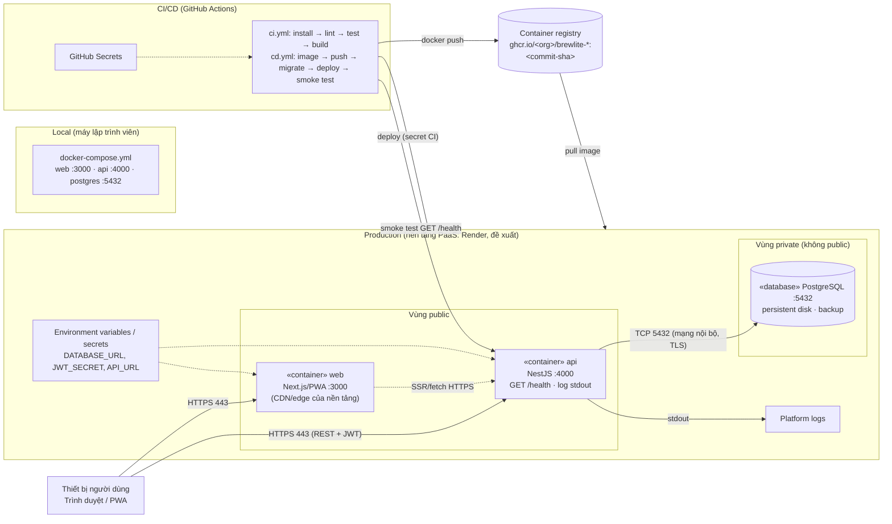

# Task 3.2 – Deployment diagram (production)

> Bản nháp do AI soạn để nhóm sửa. Nền tảng Render + GitHub Container Registry là **đề xuất**; sửa sơ đồ nếu nhóm dùng nền tảng khác (xem [ADR-006](architecture/adr/006-deployment-platform.md)).

Tệp nguồn: `diagrams/deployment.mmd` · ảnh kết xuất: `diagrams/deployment.svg`, `diagrams/deployment.png`.

## Giải thích
| Thành phần | Vai trò | Cổng / giao thức | Truy vết |
|---|---|---|---|
| Thiết bị người dùng | Chạy trình duyệt/PWA | HTTPS 443 | Web (Next.js) |
| `web` | Phục vụ Next.js, qua CDN/edge của nền tảng | 3000 (nội bộ), 443 (ngoài) | `apps/web` |
| `api` | NestJS API, `GET /health`, log ra stdout | 4000 (nội bộ), 443 (ngoài) | `apps/api` |
| PostgreSQL | Dữ liệu bền vững (persistent disk, backup), không public | 5432, chỉ mạng nội bộ | migration trong `apps/api` |
| Container registry | Lưu image tag bằng commit SHA | HTTPS | `.github/workflows/cd.yml` |
| CI/CD | `ci.yml`: install→lint→test→build; `cd.yml`: image→push→migrate→deploy→smoke test→rollback nếu lỗi | — | `.github/workflows/` |
| Secrets/env | `DATABASE_URL`, `JWT_SECRET`, `API_URL`… nằm ở GitHub Secrets và biến môi trường của nền tảng, không có trong repo/log | — | `.env.example` |

## Ranh giới môi trường
- **Local:** `docker-compose.yml` chạy web, api, postgres; dùng `.env` cục bộ.
- **CI:** GitHub Actions chạy kiểm tra và build image; giữ secret của CI.
- **Production:** chỉ `web` và `api` công khai qua HTTPS; database nằm vùng private.
