# Sequence Checkout Minimum — Implementation Plan

> **For agentic workers:** REQUIRED SUB-SKILL: Use superpowers:subagent-driven-development (recommended) or superpowers:executing-plans to implement this plan task-by-task. Steps use checkbox (`- [ ]`) syntax for tracking.

**Goal:** Rút gọn sequence checkout thành một sơ đồ dễ đọc, khớp UC-04/SRS và đủ yêu cầu Assignment 2 §4.2; SVG phải được kết xuất trực tiếp từ nguồn.

**Architecture:** Giữ nguyên năm lifeline Customer, Next.js UI, NestJS API, Database và Payment Service. Dùng luồng chính tạo đơn → thanh toán, các nhánh kết thúc ở cấp ngoài cùng và hai đoạn mô tả ngắn E1b/E8b; không thiết kế lại API hoặc domain. PlantUML chính thức là công cụ nghiệm thu; converter bên thứ ba chưa được xác định nên không cam kết tương thích mọi converter.

**Tech Stack:** PlantUML CLI/JAR, Java, PowerShell, Python standard library, Markdown.

## Global Constraints

- Task: A2 Task 2.2, phương án B được người dùng chọn ngày 2026-10-21.
- Worktree: `E:\CNPM\BrewLite\.worktrees\task2`; branch: `a2/task-2-diagrams`; baseline đã kiểm tra: `619c318`.
- Chỉ một writer cho mỗi file. Trước khi thực thi phải kiểm tra lại branch/status và quyền sở hữu các file tài liệu dùng chung.
- Nguồn yêu cầu: `docs/Assignment2-BrewLite.md` §4.2–4.3; `docs/requirements/srs.md` §3.4–3.6, FR-10–16, FR-20, NFR-05/06/13; `docs/requirements/uc-checkout.md` bước 1–16, A3, E1–E8.
- Yêu cầu đề: “request/response và thứ tự gọi API”; “kiểm tra JWT và validate dữ liệu”; “transaction khi tạo đơn và cập nhật tồn kho”; “nhánh `alt` cho thanh toán thành công/thất bại”; “idempotency khi client gửi lại yêu cầu thanh toán”; “thông báo kết quả cuối cùng cho người dùng”.
- Giữ đủ năm lifeline; một nguồn `sequence-checkout.puml` và một ảnh `sequence-checkout.svg`.
- `hide footbox` hợp lệ trong PlantUML, nhưng bỏ dòng này để giảm phụ thuộc vào tùy chọn trình bày mà converter đã báo không hỗ trợ.
- Giữ nguyên khối `skinparam` của sequence hiện tại (`sequence-checkout.puml:3-11`) để đồng bộ font, màu và nền note với activity/class/state (quy tắc 4 của skill `uml`); chỉ bỏ riêng `hide footbox`, không đổi sang theme mới.
- Tách rõ lỗi xác thực/phân quyền/dữ liệu ở cả `POST /orders` và `POST /payments`: 401 là E1a/E1b (`uc-checkout.md` E1); 403 do role không phải CUSTOMER là AC-F11.4/AC-F14.4; 400 là E6. Ở `POST /payments` còn 403 do không phải chủ đơn (AC-F14.3), nằm trong nhánh E7 sau khi đọc Order; hai loại 403 phải có nhãn phân biệt.
- Không thêm endpoint, migration, dependency, lớp domain, activity tổng quan hoặc tính năng runtime. Không sửa SRS để làm cho sơ đồ đơn giản hơn.
- Không bỏ E1b hoặc E8b khỏi baseline. Phải phân biệt E4a (API cache, không gọi simulator) và E8b (simulator trả kết quả gốc sau restart).
- Chỉ kiểm tra tài liệu và render; không yêu cầu chạy build/test ứng dụng cho thay đổi này.
- Không dùng `docs/render_svg.py` để ghi đè ảnh; script đó dựng preview riêng và không bảo toàn toàn bộ ngữ nghĩa PlantUML.
- Việc render class và bổ sung activity end-to-end là hạng mục riêng, không được tính là đã giải quyết trong kế hoạch sequence này.

---

## File map và phạm vi thực thi

| File | Trách nhiệm / thay đổi |
|---|---|
| `docs/diagrams/sequence-checkout.puml` | Nguồn sequence rút gọn theo nội dung Task 2 bên dưới |
| `docs/diagrams/sequence-checkout.svg` | Ảnh xuất trực tiếp từ nguồn mới bằng PlantUML |
| `docs/validate_task2.py` | Chỉ sửa ROOT sai từ `docs/docs/diagrams` thành `docs/diagrams`; giữ các kiểm tra hiện có |
| `docs/diagrams/README.md` | Bỏ thông tin chưa có sơ đồ, giải thích phạm vi sequence và lệnh render |
| `docs/traceability-matrix.md` | Chỉ cập nhật cột Thiết kế/Sơ đồ của những yêu cầu sequence thực sự phủ |

File kế hoạch này là tạo phẩm của phiên lập kế hoạch; chưa áp dụng các thay đổi ở bảng trên. Không tạo test framework hay script renderer mới.

## Task 1: Chuẩn bị công cụ và sửa đường dẫn kiểm tra

**Files:** Modify `docs/validate_task2.py:8`.

**Interfaces:** Consumes bốn cặp diagram hiện có; produces script kiểm tra chạy được từ root, không thay đổi tiêu chí nghiệp vụ.

- [ ] **Step 1: Xác nhận môi trường và baseline.**

```powershell
Get-Location
git rev-parse --show-toplevel
git branch --show-current
git status --short
git log -1 --oneline
```

Phải ở worktree/branch nêu trên. Nếu đã có chỉnh sửa trong file thuộc phạm vi, kiểm tra chủ sở hữu trước khi ghi. Không restore file để làm sạch diff.

- [ ] **Step 2: Tái hiện lỗi kiểm tra hiện có.**

```powershell
python -X utf8 docs/validate_task2.py
```

Baseline dự kiến: exit 1 với đường dẫn `docs/docs/diagrams/class-domain.puml`. Đây là lỗi đường dẫn, không chứng minh diagram thiếu file.

- [ ] **Step 3: Thay đúng dòng ROOT.**

```python
ROOT = Path(__file__).resolve().parent / 'diagrams'
```

Không đổi các assertion để làm chúng xanh. Chạy lại `python -X utf8 docs/validate_task2.py`; dự kiến tất cả static checks qua. Những kiểm tra này không chứng minh ngữ nghĩa nhánh hoặc ảnh giống nguồn.

- [ ] **Step 4: Xác nhận JAR thực tế và phiên bản.**

JAR đã tìm thấy trong phiên lập kế hoạch:

```powershell
$sequenceJar = Join-Path $env:TEMP 'brewlite-task1-plantuml.jar'
if (-not (Test-Path -LiteralPath $sequenceJar)) { throw 'PlantUML JAR is missing; resolve the tool location before rendering.' }
java -jar "$sequenceJar" -version
if ($LASTEXITCODE -ne 0) { throw 'Cannot run PlantUML.' }
```

Biến `$sequenceJar` được dùng trong các lệnh sau ở cùng phiên PowerShell; nếu mở phiên khác, chạy lại đoạn này. Không commit JAR vào repo. Nếu file tạm đã mất, xác định lại JAR hoặc lấy bản phát hành chính thức theo quyền mạng của môi trường; không thay bằng renderer tự viết. Ghi phiên bản vào báo cáo thực thi.

- [ ] **Step 5: Kiểm tra diff và commit bản sửa công cụ độc lập.**

```powershell
git diff --check
git diff -- docs/validate_task2.py
git add docs/validate_task2.py
git commit -m "fix(docs): correct Task 2 validator diagram path"
```

## Task 2: Viết nguồn sequence và xuất ảnh cùng một thay đổi

**Files:** Modify `docs/diagrams/sequence-checkout.puml`; regenerate `docs/diagrams/sequence-checkout.svg`.

**Interfaces:** Consumes endpoint/status/error contracts trong SRS; produces `Sequence-01`, giữ tên file để liên kết hiện có không hỏng. `charge(...)` là thông điệp mô hình, không phải khai báo public API mới.

- [ ] **Step 1: Dùng bảng nghiệm thu làm checklist trước khi sửa.**

| Kịch bản | Kết quả phải nhìn thấy |
|---|---|
| Happy path | Order PENDING, kho giảm trong T1; Payment SUCCESS và PAID trong T2; 201 và biên lai, xóa giỏ |
| E1a | JWT không hợp lệ: 401, giữ giỏ; đăng nhập xong mới bắt đầu lại tạo đơn |
| Sai role | JWT hợp lệ nhưng không phải CUSTOMER: 403 riêng ở cả hai endpoint (AC-F11.4, AC-F14.4), không gộp vào E1a hoặc 400 |
| E6 | 400 trước thao tác ghi; UI chặn giỏ/thẻ sai trước khi gửi |
| Product thiếu | Truy vấn DB xảy ra trước 404 PRODUCT_NOT_FOUND |
| E2 | 409, ROLLBACK cả đơn và kho; không rơi xuống POST /payments |
| E1b | Giữ orderId/key/owner; cùng tài khoản GET đơn cũ; chỉ tiếp tục nếu payable; không tạo đơn mới |
| E7 | 403 không phải chủ đơn (AC-F14.3)/404/409 không gọi Payment Service |
| E4a | Cache SUCCESS đúng user/order/key/body trả 200 trước kiểm trạng thái; không gọi simulator |
| E3/A3 | FAILED và PAYMENT_FAILED; giỏ/kho giữ nguyên; lần thử sau cùng đơn chuyển PAYMENT_FAILED → PENDING |
| E8b | UI báo mất kết nối, giữ orderId/key; API trở lại và simulator trả SUCCESS gốc; một Payment SUCCESS |

- [ ] **Step 2: Thay toàn bộ nguồn bằng bản dự kiến sau.**

Các `break` kết thúc checkout nằm ngoài mọi `alt`, `opt`, `group`; chỉ dùng tiêu đề `== ... ==` để phân đoạn T1. Không đặt `break` trong transaction group rồi giả định nó thoát toàn sơ đồ.

```plantuml
@startuml
skinparam shadowing false
skinparam defaultFontName "DejaVu Sans"
skinparam ArrowColor #536C83
skinparam SequenceParticipantBackgroundColor #EAF3FA
skinparam SequenceParticipantBorderColor #536C83
skinparam SequenceLifeLineBorderColor #536C83
skinparam NoteBackgroundColor #FFF4D9
skinparam NoteBorderColor #BD9754
skinparam SequenceGroupBackgroundColor #F6F9FB
title BrewLite A2 - Sequence-01: UC-04 Checkout (minimum)
autonumber
actor "Customer" as Customer
participant "Next.js UI" as UI
participant "NestJS API" as API
database "Database\n(PostgreSQL)" as DB
participant "Payment Service\n(simulator)" as Pay

== Checkout and order creation ==
Customer -> UI : Confirm checkout: items, WALLET/CARD
UI -> UI : Validate nonempty cart, quantity and card format
break Invalid UI input
  UI --> Customer : Show field errors; keep cart; no API request
end
break E1a: UI knows Customer is not logged in
  UI --> Customer : Open /login?next=/checkout; retain cart; no POST /orders
  note over Customer,UI : After login return to checkout; without login this attempt ends.
end
UI -> UI : Disable confirm; create Idempotency-Key
UI -> API : POST /orders (JWT, items; no client prices)
API -> API : JWT guard: valid token and CUSTOMER role
break E1a: missing, invalid or expired JWT
  API --> UI : 401 UNAUTHORIZED
  UI --> Customer : Keep cart; login required before a new attempt
end
break Valid JWT but role is not CUSTOMER (AC-F11.4)
  API --> UI : 403 FORBIDDEN (role)
  UI --> Customer : No permission; stop checkout; no Order created
end
API -> API : Validate DTO; reject client prices
break E6: invalid order data
  API --> UI : 400 VALIDATION_ERROR
  UI --> Customer : Correct cart; no Order created
end
API -> DB : Read Product records and catalog prices
DB --> API : Product records or missing product
break E6: product missing
  API --> UI : 404 PRODUCT_NOT_FOUND
  UI --> Customer : Correct cart; no Order created
end
API -> API : Compute unitPrice, lineTotal, total

== Transaction T1: reserve stock and create order ==
API -> DB : BEGIN; lock/check stock for all items
DB --> API : Stock sufficient or insufficient
break E2: insufficient stock
  API -> DB : ROLLBACK
  API --> UI : 409 OUT_OF_STOCK + details
  UI --> Customer : Edit cart; no Order or stock changes
end
API -> DB : Reserve stock; INSERT Order(PENDING) + OrderItems; COMMIT
DB --> API : orderId, total
note over API,DB : Any T1 write failure rolls back Order, items and stock.
API --> UI : 201 {id: orderId, status: PENDING, total}
UI -> UI : Retain SAME orderId, owner and key
note over UI,API : Lost POST /orders response without orderId: check history; do not auto-resubmit.

== Payment and continuation of the same order ==
UI -> API : POST /payments (JWT, orderId, paymentMethod, cardNumber?)\nIdempotency-Key
API -> API : JWT guard and CUSTOMER role
break E1b: JWT expired after Order exists
  API --> UI : 401 UNAUTHORIZED
  UI --> Customer : Session expired; keep cart, orderId, owner and key
  note over Customer,DB
    No login: stop; existing Order and reserved stock remain.
    After login, same account calls GET /orders/:id.
    Wrong owner: 403; require original account or show own history.
    PAID/PREPARING/READY/COMPLETED: show existing order; no payment.
    CANCELLED: show cancelled order; no payment.
    PENDING/PAYMENT_FAILED: resume at POST /payments with SAME orderId/key.
    Never repeat POST /orders for this continuation.
  end note
end
break Valid JWT but role is not CUSTOMER (AC-F14.4)
  API --> UI : 403 FORBIDDEN (role)
  UI --> Customer : No permission; stop payment; no charge
end
API -> API : Validate payment DTO and Idempotency-Key
break E6: invalid payment input
  API --> UI : 400 VALIDATION_ERROR / IDEMPOTENCY_KEY_REQUIRED
  UI --> Customer : Show field errors; keep cart and Order
end
API -> DB : Read Order; verify ownership; find matching SUCCESS
DB --> API : Order and SUCCESS cache result, or missing/wrong owner
break E7: missing Order or wrong owner
  API --> UI : 404 ORDER_NOT_FOUND / 403 FORBIDDEN (not owner, AC-F14.3)
  UI --> Customer : Show error and own history; no charge
end
break E4a: successful replay (same user/order/key/body)
  API --> UI : 200 original SUCCESS and paymentId
  UI --> Customer : Receipt; clear cart; no Payment Service call
end
break E7: new request and Order not PENDING/PAYMENT_FAILED
  API --> UI : 409 ORDER_NOT_PAYABLE
  UI --> Customer : Show current status; no charge
end
opt A3: Order is PAYMENT_FAILED
  API -> DB : Transition PAYMENT_FAILED -> PENDING
  DB --> API : Same Order; stock remains reserved
end
API -> Pay : charge(orderId, Order.total, paymentMethod, cardNumber?)
note right of Pay
  cardNumber only for CARD; never persist or log it.
  SUCCESS is stored durably by orderId, including after restart.
  Repeated charge returns original reference/amount/method.
  FAILED does not lock orderId; it can be retried.
end note
alt Payment declined (E3)
  Pay --> API : DECLINED
  API -> DB : Save Payment FAILED; Order -> PAYMENT_FAILED
  DB --> API : Saved; stock reservation unchanged
  API --> UI : 402 PAYMENT_DECLINED
  UI --> Customer : Keep cart; retry same Order, optionally change method
else Payment successful
  Pay --> API : SUCCESS(transactionRef, original amount, original method)
  opt E8b: API crashes before success commit
    UI -> UI : Detect timeout/disconnection; retain orderId/key
    UI --> Customer : Có lỗi xảy ra, vui lòng thử lại
    note over API : API restarts before the retry below.
    Customer -> UI : Retry
    UI -> API : POST /payments (SAME orderId/key, JWT, payment data)
    API -> API : Revalidate JWT, role, DTO and owner
    API -> DB : Read Order and SUCCESS cache
    DB --> API : PENDING; no committed SUCCESS
    API -> Pay : charge(orderId, Order.total, paymentMethod, cardNumber?)
    Pay --> API : Original durable SUCCESS; no additional debit
  end
  group Transaction T2: normal completion or E8b recovery
    API -> DB : BEGIN; save exactly one Payment SUCCESS\nwith key and original reference/amount/method; Order -> PAID; COMMIT
    DB --> API : One Payment SUCCESS; Order PAID
  end
  API --> UI : 201 {orderId, paymentId, status: SUCCESS, orderStatus: PAID, amount}
  UI -> UI : Clear cart
  UI --> Customer : Receipt with order code, items, paid amount, method and time\nLink to track Order
end
@enduml
```



E1b dùng note để mô tả continuation chính xác mà không vẽ lặp một quy trình đăng nhập đầy đủ. `break` chấm dứt lần tương tác hiện tại; note chỉ rõ điểm tiếp tục của lần sau. E8b mô tả đúng tình huống đã chọn trong UC: API chết trước commit, sau restart đơn vẫn PENDING và chưa có cache. Không tuyên bố đây là thiết kế recovery cho mọi race condition hoặc cổng thanh toán thật.

- [ ] **Step 3: Render đúng một file bằng PlantUML chính thức.**

```powershell
java -jar "$sequenceJar" -charset UTF-8 -failfast2 -tsvg docs/diagrams/sequence-checkout.puml
if ($LASTEXITCODE -ne 0) { throw 'Sequence rendering failed.' }
```

Kết quả: cập nhật SVG cùng tên cạnh nguồn, exit 0; không dùng wildcard để tránh ghi đè diagram ngoài phạm vi. Nếu báo syntax error, sửa nguồn rồi chạy lại; không dùng SVG preview cũ để thay thế. Bỏ `hide footbox` không được dùng làm bằng chứng converter bên thứ ba hỗ trợ các lệnh khác.

- [ ] **Step 4: Kiểm tra tự động và mở SVG đối chiếu.**

```powershell
python -X utf8 docs/validate_task2.py
python -X utf8 -c "from xml.etree import ElementTree as E; r=E.parse('docs/diagrams/sequence-checkout.svg').getroot(); assert r.tag == '{http://www.w3.org/2000/svg}svg'; print('Sequence SVG XML valid')"
git diff --check
```

Mở SVG bằng trình xem/browser có sẵn và lần theo từng dòng trong bảng nghiệm thu Step 1. Kiểm năm lifeline, chữ tiếng Việt, nhánh `alt`, phạm vi `break`, T1/T2, E1b/E8b; không có chữ bị cắt hoặc khối chồng lên nhau. Nếu ảnh quá rộng, chỉ ngắt dòng message bằng `\n`; nếu cần định dạng, dùng PlantUML chính thức và không thêm nghiệp vụ. Không đánh giá ảnh bằng việc tìm/không tìm thấy chữ Graphviz.

- [ ] **Step 5: Commit nguồn và ảnh cùng nhau sau khi đạt.**

```powershell
git diff --stat
git add docs/diagrams/sequence-checkout.puml docs/diagrams/sequence-checkout.svg
git commit -m "docs(diagrams): simplify checkout sequence and render matching SVG"
```

## Task 3: Cập nhật tài liệu liên kết và bàn giao

**Files:** Modify `docs/diagrams/README.md`, `docs/traceability-matrix.md`.

**Interfaces:** Consumes `Sequence-01` từ Task 2; produces liên kết truy vết thật, không nâng trạng thái code/test chưa hiện thực.

- [ ] **Step 1: Thay đoạn đầu README và thêm ghi chú sequence.**

Thay đoạn “Thư mục này chưa có sơ đồ” bằng:

```markdown
Thư mục chứa activity checkout, sequence checkout, class domain và state order; mỗi sơ đồ có nguồn `.puml` và ảnh `.svg`. Sequence-01 được rút gọn theo UC-04 và kết xuất trực tiếp bằng PlantUML. Phạm vi và yêu cầu của từng sơ đồ nằm trong bảng dưới đây.
```

Đổi tiêu đề `Nhóm phải nộp ở đây` thành `Danh mục sơ đồ`. Giữ bảng hiện có; thêm dưới bảng:

```markdown
### Sequence-01: cách đọc và render

[Nguồn](sequence-checkout.puml) · [Ảnh](sequence-checkout.svg).

Đọc theo thứ tự tạo đơn và T1 → kiểm thanh toán/cache → gọi Payment Service → kết quả và T2. E1b ghi bằng note về cách tiếp tục đơn cũ sau đăng nhập; E8b thể hiện phục hồi sau API dừng trước commit. Các nhánh `break` kết thúc lần checkout hiện tại. Đây là sơ đồ checkout; không thay thế activity tổng quan end-to-end hoặc thiết kế triển khai simulator.

Dùng PlantUML CLI chính thức, chọn đường dẫn JAR đã cài trong biến PowerShell `$sequenceJar`:

    java -jar "$sequenceJar" -charset UTF-8 -failfast2 -tsvg docs/diagrams/sequence-checkout.puml
    python -X utf8 docs/validate_task2.py

Chạy từ root repository. Sau render phải mở ảnh kiểm nội dung và bố cục. Không dùng `docs/render_svg.py` để tái tạo ảnh sequence. `hide footbox` là tùy chọn trình bày PlantUML hợp lệ nhưng không cần thiết cho bản này.
```

- [ ] **Step 2: Cập nhật đúng cột Thiết kế/Sơ đồ theo bảng dưới.**

Mỗi ô bắt đầu bằng `[Sequence-01](diagrams/sequence-checkout.svg)`. Giữ nguyên các cột khác và phần phụ thuộc Class/Activity/Task 3 đã có nếu chưa được xác minh trong task này.

| Dòng | Nội dung phần sequence cần ghi |
|---|---|
| FR-10 | JWT guard, E1a; note E1b tiếp tục SAME orderId/key sau đăng nhập cùng tài khoản |
| FR-11 | Transaction T1: Order PENDING, OrderItems và giữ chỗ stock |
| FR-12 | Validate UI/DTO, đọc Product trước 404, tính giá server |
| FR-13 | E2: kiểm stock nguyên tử và ROLLBACK trong T1 |
| FR-14 | POST /payments, kiểm quyền sở hữu, charge và Transaction T2 |
| FR-15 | alt Payment declined, A3 PAYMENT_FAILED → PENDING; thử lại cùng Order |
| FR-16 | E4a trả cache trước kiểm trạng thái; E8b durable SUCCESS và phục hồi T2; Task 3 ADR 005 còn chờ |
| FR-20 | Thông điệp receipt và clear cart; phần reload receipt qua GET đơn vẫn chờ mô hình/hiện thực liên quan |
| NFR-05 | JWT guard/CUSTOMER role/owner trong checkout; phần endpoint khác và Task 3 còn chờ |
| NFR-06 | Validate UI/DTO trong checkout, reject client prices; phần form đăng ký/đăng nhập còn chờ |
| NFR-13 | Transaction T1, stock locking/rollback; T2 và E8b; phần kiến trúc Task 3 còn chờ |

Không đổi FR-01–09, FR-21/22 hoặc FR-24 thành đã phủ chỉ vì sequence có một lời nhắc menu/tracking/login. Không thay toàn bộ “chờ Task 2” trong file bằng một lệnh replace.

- [ ] **Step 3: Chạy kiểm tra bàn giao.**

```powershell
python -X utf8 docs/validate_task2.py
git diff --check
git diff --name-status
git diff -- docs/diagrams/README.md docs/traceability-matrix.md
```

Kiểm thủ công liên kết nguồn/ảnh tồn tại và bảng truy vết trỏ đúng nhãn có trong nguồn. Không cần bổ sung unit test ứng dụng cho chỉnh sửa tài liệu.

- [ ] **Step 4: Commit tài liệu và kiểm phạm vi toàn đợt.**

```powershell
git add docs/diagrams/README.md docs/traceability-matrix.md
git commit -m "docs: trace minimum checkout sequence to requirements"
git diff --check 619c318 HEAD
git diff --name-status 619c318 HEAD
git status --short
```

Phạm vi diff chỉ gồm năm file trong file map, cộng file kế hoạch nếu đã được commit riêng. Nếu baseline đã tiến trước khi thực thi, ghi SHA bắt đầu thật ở Step 1 và dùng SHA đó khi kiểm phạm vi; không reset về `619c318`.

- [ ] **Step 5: Báo cáo kết quả.**

Ghi task A2 Task 2.2, branch/worktree, các file đổi, phiên bản PlantUML, lệnh và exit code thực tế, kết quả mở SVG, commit SHA. Nêu rõ hạn chế còn lại: converter bên thứ ba chưa xác định, activity chưa phủ toàn bộ end-to-end, class SVG chưa được render trong task này. Không tuyên bố toàn bộ Task 2 đã đạt từ việc sequence render thành công.

## Self-review của kế hoạch

- §4.2: năm lifeline, request/response, JWT/validation, T1/stock, alt thành công/thất bại, idempotency, thông báo cuối và nguồn/ảnh đều nằm ở Task 2.
- Trình bày: giữ khối `skinparam` cũ, chỉ bỏ `hide footbox`; 401 (E1a/E1b), 403 role (AC-F11.4/AC-F14.4), 403 không phải chủ đơn (AC-F14.3, E7) và 400 (E6) là các nhánh `break` riêng.
- Khớp SRS: E1b, A3, E4a/E4d và E8b được giữ; cardNumber chỉ truyền khi CARD và không lưu/log; không thêm chức năng Won't.
- Truy vết §8.1: Task 3 cập nhật riêng các phần có bằng chứng, không biến phần chưa làm thành đã xong.
- Không thêm test/framework mới; tái dùng validator và PlantUML, kết hợp kiểm ảnh/ngữ nghĩa thủ công.
- Các lệnh render/kiểm thử trong kế hoạch chưa được chạy để chứng minh nguồn dự kiến hợp lệ; phải thực hiện trong phiên triển khai trước khi báo hoàn thành.
