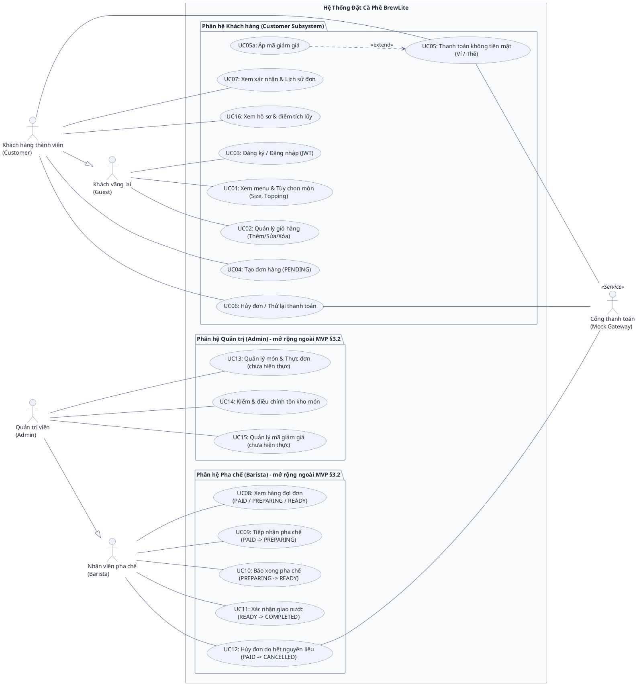
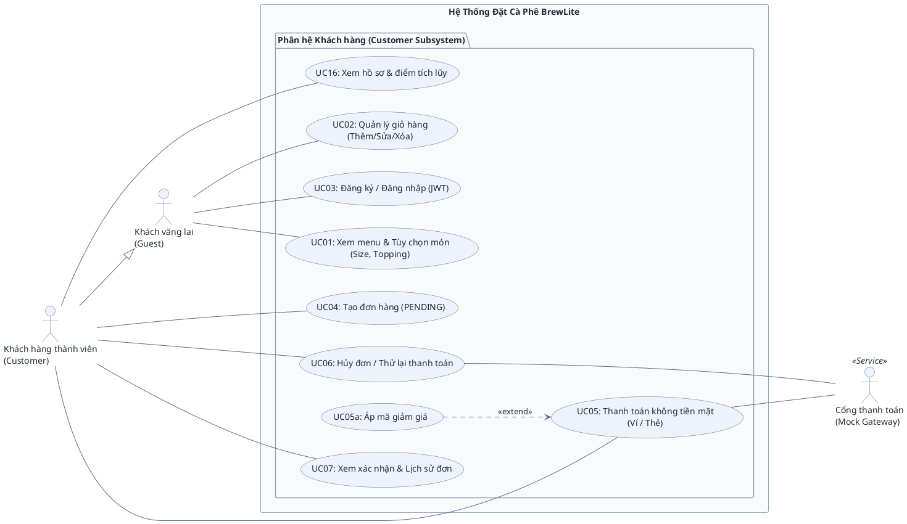

# ĐẶC TẢ BIỂU ĐỒ USE CASE (USE CASE SPECIFICATIONS)
## HỆ THỐNG ĐẶT CÀ PHÊ KHÔNG TIỀN MẶT BREWLITE

> **Dự án:** BrewLite – Ứng dụng đặt cà phê không tiền mặt  
> **Môn học:** Công nghệ Phần mềm (Bài tập lớn Agile Scrum)  
> **Tài liệu tham chiếu:** [BrewLite-CongNghePhanMem-fixed.md](../../BrewLite-CongNghePhanMem-fixed.md)
> **Mục đích:** Đặc tả kiến trúc Ca sử dụng (Use Case), phân định rõ ràng vai trò các tác nhân (Actors) gồm Khách hàng, Pha chế (Barista) và Quản trị (Admin); cung cấp mã nguồn PlantUML chuẩn mực và hướng dẫn phản biện khi bảo vệ đồ án.

---

## 1. TỔNG QUAN TÁC NHÂN (ACTORS)

Hệ thống BrewLite bao gồm 4 nhóm tác nhân người dùng chính (Primary Actors) và 1 tác nhân dịch vụ bên ngoài (Secondary Actor):

| Tác nhân | Phân loại | Phân hệ phụ trách | Vai trò & Hành vi trong hệ thống |
| :--- | :--- | :--- | :--- |
| **Khách vãng lai** *(Guest)* | Tác nhân chính *(Primary)* | Phân hệ Khách hàng | Người dùng chưa đăng nhập: xem thực đơn, xem chi tiết món (size, topping), quản lý giỏ hàng tạm tính, thực hiện đăng ký / đăng nhập tài khoản. |
| **Khách hàng thành viên** *(Customer)* | Tác nhân chính *(Primary)* | Phân hệ Khách hàng | Người dùng đã đăng nhập (có token JWT): kế thừa toàn bộ quyền của Khách vãng lai (`Customer --\|> Guest`), đồng thời có thêm quyền tạo đơn hàng (`PENDING`), thanh toán không tiền mặt, áp mã giảm giá, hủy đơn / thử lại thanh toán, xem lịch sử đơn hàng, và xem hồ sơ cùng điểm tích lũy (`/profile`). |
| **Nhân viên pha chế** *(Barista)* | Tác nhân chính *(Primary)* | Phân hệ Pha chế | Vận hành quầy pha chế theo máy trạng thái đơn hàng (Order State Machine): xem hàng đợi quầy gồm đơn chờ pha (`PAID`), đang pha (`PREPARING`) và sẵn sàng (`READY`), tiếp nhận pha chế (`PREPARING`), báo hoàn tất pha chế (`READY`), giao nước cho khách (`COMPLETED`), hoặc hủy đơn khi hết nguyên liệu (`CANCELLED`). Không dùng Phân hệ Khách hàng (không kế thừa Customer / Guest): giao diện chỉ có "Quầy", mở trang khách (`/`, `/cart`, `/history`, `/profile`) thì tự chuyển về `/barista`, và các API của khách (`POST /orders`, `GET /orders/me`, `GET /orders/:id`, `POST /payments`, `GET /users/me`) trả 403 `Insufficient role`. |
| **Quản trị viên** *(Admin)* | Tác nhân chính *(Primary)* | Phân hệ Quản trị | Kế thừa toàn bộ quyền của Nhân viên pha chế (`Admin --\|> Barista`: API quầy cho phép `BARISTA` và `ADMIN`, màn `/barista` mở cho cả hai). Riêng Admin: kiểm và điều chỉnh tồn kho món (`Product.stock`), chưa có quản lý thực đơn / voucher (UC13, UC15 là backlog). Giao diện gồm "Quầy" và "Kho". Giống Barista, Admin không dùng Phân hệ Khách hàng (không kế thừa Customer / Guest): mở trang khách thì tự chuyển về `/admin`, API của khách trả 403 `Insufficient role`. |
| **Cổng thanh toán** *(Mock Gateway)* | Tác nhân dịch vụ *(Secondary)* | Tích hợp dịch vụ ngoài | Hệ thống bên ngoài hỗ trợ xử lý trừ tiền giao dịch không tiền mặt (Ví điện tử / Thẻ ngân hàng) và hoàn tiền khi đơn hàng bị hủy. |

> **Lưu ý về phạm vi triển khai:**  
> • **Phân hệ Khách hàng (UC01–UC07 + UC05a):** Là phạm vi cốt lõi của bài tập lớn (MVP 10 Task Scrum), đã được hiện thực hoàn chỉnh cả Frontend (Next.js) lẫn Backend (NestJS + PostgreSQL/Prisma). **UC16 (Xem hồ sơ & điểm tích lũy, `GET /users/me`)** cũng thuộc Phân hệ Khách hàng và đã hiện thực, nhưng là mở rộng ngoài đề §12.1.  
> • **Phân hệ Pha chế (UC08–UC12) & Quản trị (UC14):** **Đã hiện thực, là mở rộng ngoài đề §3.2.** Vai trò phân quyền qua `User.role` (`CUSTOMER` / `BARISTA` / `ADMIN`) và `RolesGuard`; màn `/barista` (UC08–UC12) và `/admin` (UC14).
> • **UC13 (Quản lý món & Thực đơn), UC15 (Quản lý mã giảm giá):** **Chưa hiện thực (backlog §11.4).** UC15 còn trái chốt của nhóm là voucher `BREWLITE10` chỉ validate nội bộ trong `PaymentService`, không có bảng hay endpoint riêng. Cột **Trạng thái** ở mục 4 là nguồn sự thật về từng UC; khi trạng thái một UC đổi thì sửa cột đó cùng commit với code.

---

## 2. BẢN 1: BIỂU ĐỒ TỔNG QUAN TOÀN HỆ THỐNG (SYSTEM OVERVIEW USE CASE DIAGRAM)

Biểu đồ này bao quát toàn bộ 3 phân hệ chính của quán cà phê BrewLite, thể hiện đầy đủ mối liên kết giữa tất cả tác nhân và 17 Ca sử dụng (UC01–UC16 + UC05a):

---

## 3. BẢN 2: BIỂU ĐỒ TRỌNG TÂM PHÂN HỆ KHÁCH HÀNG (CUSTOMER SUBSYSTEM)

> **Mô tả:** Biểu đồ này trích xuất riêng biệt phân hệ Khách hàng (9 UC: UC01–UC07 + UC05a + UC16). Đây là bản trích phân hệ Khách hàng từ Bản 1 (gốc), dùng khi thuyết trình MVP và khớp với thiết kế giao diện đặt hàng của nhóm; các sơ đồ tuần tự trong [user-sequence-specifications.md](user-sequence-specifications.md) bám theo Bản 1.

---

## 4. DANH MỤC CHI TIẾT CÁC USE CASE & TRACEABILITY MATRIX

Bảng dưới đây liệt kê đầy đủ 17 Use Case thuộc cả 3 phân hệ (15 đã hiện thực; UC13 và UC15 là backlog), phân định rõ tác nhân thực hiện, quan hệ phụ thuộc và căn cứ kỹ thuật:

| Mã UC | Tên Ca Sử Dụng | Phân hệ | Tác Nhân Thực Hiện | Quan Hệ Phụ Thuộc | Căn Cứ Đề Bài & Hiện Thực Mã Nguồn | Sơ đồ tuần tự | Trạng thái |
| :--- | :--- | :--- | :--- | :--- | :--- | :--- | :--- |
| **UC01** | Xem menu & Tùy chọn món (Size, Topping) | Khách hàng | `Guest` *(và Customer)* | Độc lập | Task 2, 3, 4 (`GET /products`, `GET /products/:id`) | §2.1 | Đã hiện thực |
| **UC02** | Quản lý giỏ hàng (Thêm/Sửa/Xóa) | Khách hàng | `Guest` *(và Customer)* | Độc lập | Task 5 (Zustand / LocalStorage Client-side). Giỏ tối đa 20 dòng, mỗi dòng tối đa 99 ly (`cart-limits.ts`, khớp `CreateOrderDto`) | §2.2 | Đã hiện thực |
| **UC03** | Đăng ký / Đăng nhập (JWT) | Khách hàng | `Guest` *(Customer dùng lại)* | Độc lập | Task 7 (`POST /auth/register`, `POST /auth/login`) | §2.3 | Đã hiện thực |
| **UC04** | Tạo đơn hàng (PENDING) | Khách hàng | `Customer` | Độc lập (gọi trước khi trả tiền) | Task 6 (`POST /orders`, server tính giá dựa trên menu gốc, `@Roles(CUSTOMER)` (Barista / Admin → 403 `Insufficient role`), `Idempotency-Key` chống tạo trùng đơn; DTO chặn quá 20 dòng (`@ArrayMaxSize(20)`) hoặc quá 99 ly một dòng (`@Max(99)`) → 400) | §2.4 (bước 2a) | Đã hiện thực |
| **UC05** | Thanh toán không tiền mặt (Ví / Thẻ) | Khách hàng | `Customer`, `Mock Gateway` | Nối Gateway; mở rộng bởi UC05a | Task 8, 10 (`POST /payments`, `@Roles(CUSTOMER)`) | §2.4 (bước 2b) | Đã hiện thực |
| **UC05a** | Áp mã giảm giá | Khách hàng | `Customer` | `<<extend>> UC05` | Task 10 (Áp mã `BREWLITE10`, chiết khấu hợp lệ trước khi trừ tiền) | §2.4 (bước 1) | Đã hiện thực |
| **UC06** | Hủy đơn / Thử lại thanh toán | Khách hàng | `Customer`, `Mock Gateway` | Nối Gateway (hoàn tiền đơn `PAID`) | Task 10 (`PATCH /orders/:id`, `POST /payments`). Hủy đơn `PENDING` / `PAYMENT_FAILED` / `PAID` (nút Hủy ở `/history`, `PAID` có hoàn tiền + hoàn kho) hoặc thanh toán lại đơn `PAYMENT_FAILED`. Khách **không** tự tiến đơn (403). | §2.5 | Đã hiện thực |
| **UC07** | Xem xác nhận & Lịch sử đơn | Khách hàng | `Customer` | Độc lập | Task 9 (`GET /orders/me`, `GET /orders/:id`, `@Roles(CUSTOMER)`) | §2.6 | Đã hiện thực |
| **UC08** | Xem hàng đợi đơn (PAID / PREPARING / READY) | Pha chế | `Barista` *(Admin kế thừa)* | Độc lập | Order State Machine §9.1 (theo dõi hàng đợi đơn chờ pha chế): `GET /orders?status=PAID,PREPARING,READY` (JWT + BARISTA/ADMIN), màn `/barista` 3 cột | §2.7 | Đã hiện thực (mở rộng ngoài đề §3.2) |
| **UC09** | Tiếp nhận pha chế (PAID -> PREPARING) | Pha chế | `Barista` *(Admin kế thừa)* | Phụ thuộc UC08 | `PAID` $\rightarrow$ `PREPARING`: `PATCH /orders/:id {PREPARING}` chỉ BARISTA/ADMIN (khách 403), nút Nhận pha ở `/barista` | §2.7 | Đã hiện thực (mở rộng ngoài đề §3.2) |
| **UC10** | Báo xong pha chế (PREPARING -> READY) | Pha chế | `Barista` *(Admin kế thừa)* | Phụ thuộc UC09 | `PREPARING` $\rightarrow$ `READY`: `PATCH /orders/:id {READY}` chỉ BARISTA/ADMIN, nút Pha xong ở `/barista` | §2.7 | Đã hiện thực (mở rộng ngoài đề §3.2) |
| **UC11** | Xác nhận giao nước (READY -> COMPLETED) | Pha chế | `Barista` *(Admin kế thừa)* | Phụ thuộc UC10 | `READY` $\rightarrow$ `COMPLETED`: `PATCH /orders/:id {COMPLETED}` chỉ BARISTA/ADMIN, nút Đã giao ở `/barista` | §2.7 | Đã hiện thực (mở rộng ngoài đề §3.2) |
| **UC12** | Hủy đơn do hết nguyên liệu (PAID -> CANCELLED) | Pha chế | `Barista` *(Admin kế thừa)*, `Mock Gateway` | Nối Gateway (hoàn tiền) | `PATCH /orders/:id {CANCELLED}` bởi BARISTA/ADMIN, chỉ từ `PAID` (đơn chưa trả `PENDING` / `PAYMENT_FAILED` → 403, từ `PREPARING` state machine chặn 400); hoàn đúng số thực thu + hoàn kho; nút "Hủy (hết nguyên liệu)" ở cột Chờ pha | §2.7 | Đã hiện thực (mở rộng ngoài đề §3.2) |
| **UC13** | Quản lý món & Thực đơn | Quản trị | `Admin` | Độc lập | Quản trị danh mục đồ uống (CRUD Product, giá, size, topping) | — | Chưa hiện thực (backlog đề §11.4) |
| **UC14** | Kiểm & điều chỉnh tồn kho món | Quản trị | `Admin` | Độc lập | Kiểm & điều chỉnh tồn kho món: `GET /admin/products` (kể cả món hết hàng), `PATCH /admin/products/:id/stock {mode: set\|delta, value, version}` chỉ ADMIN, optimistic lock theo `version` (409 khi kho vừa đổi), không âm (400). Không có bảng nguyên liệu. | §2.8 | Đã hiện thực (mở rộng ngoài đề §3.2) |
| **UC15** | Quản lý mã giảm giá | Quản trị | `Admin` | Độc lập | Thiết lập và quản lý danh sách chương trình khuyến mãi (Voucher); trái chốt voucher nội bộ `BREWLITE10` của nhóm | — | Chưa hiện thực (backlog đề §11.4) |
| **UC16** | Xem hồ sơ & điểm tích lũy | Khách hàng | `Customer` | Độc lập | Mở rộng ngoài đề §12.1: `GET /users/me` (`JwtAuthGuard` + `@Roles(CUSTOMER)`, trả `id`, `email`, `role`, `loyaltyPoints`, không trả `passwordHash`), màn `/profile`. Chỉ Customer dùng: Barista / Admin gọi API nhận 403 `Insufficient role`, mở `/profile` thì bị chuyển về trang nhà; điểm tích lũy chỉ có nghĩa với khách (điểm được cộng khi thanh toán đơn ở UC05) | §2.9 | Đã hiện thực (mở rộng ngoài đề §12.1) |

---

## 5. QUY CHUẨN ĐƯỜNG NỐI & CẨM NANG BẢO VỆ ĐỒ ÁN

### 5.1 Phân biệt các loại đường nối chuẩn UML

1. **Association (Đường nét liền không mũi tên `---`):** Dùng để biểu diễn sự tham gia giữa **Actor** và **Use Case**. Tuyệt đối không vẽ mũi tên chỉa vào Use Case như sơ đồ luồng dữ liệu (DFD).
2. **Generalization (Mũi tên tam giác rỗng `--|>`):** Quan hệ kế thừa giữa Actor với Actor (`Customer --|> Guest`, `Admin --|> Barista`).
3. **`<<include>>` (Mũi tên nét đứt `..>`):** Biểu diễn quan hệ bắt buộc luôn chạy kèm. Trong BrewLite, việc tạo đơn (`UC04`) và thanh toán (`UC05`) là hai ca độc lập (khi thanh toán thất bại, người dùng gọi lại `UC05` mà không tạo lại đơn mới `UC04`), do đó không dùng `<<include>>`.
4. **`<<extend>>` (Mũi tên nét đứt `..>`):** Trỏ từ Use Case mở rộng về Use Case gốc (`UC05a ..> UC05`). Chỉ kích hoạt khi thỏa mãn điều kiện (người dùng có mã voucher và chủ động nhập mã).

---

### 5.2 Bộ câu hỏi & câu trả lời mẫu khi bảo vệ trước Hội đồng

* **Câu 1: Tại sao `Customer` không nối dây tới `UC01: Xem menu` và `UC02: Quản lý giỏ hàng`?**  
  👉 **Trả lời:** *"Dạ thưa thầy/cô, theo chuẩn UML, `Customer` có quan hệ Kế thừa (`Customer --|> Guest`). Vì vậy `Customer` tự động thừa hưởng toàn bộ các ca sử dụng mà `Guest` có quyền thực hiện. Việc không vẽ thêm đường nối giúp biểu đồ tránh được lỗi Dư thừa liên kết (Redundant Association) và không bị rối dây."*

* **Câu 2: Tại sao `Customer` đã đăng nhập rồi mà lại kế thừa cả `UC03: Đăng ký / Đăng nhập` của `Guest`?**  
  👉 **Trả lời:** *"Dạ thưa thầy/cô, hệ thống BrewLite sử dụng xác thực qua JWT Token (Task 7) có thời hạn hiệu lực (`expiresIn`). Khi phiên làm việc của Customer hết hạn, họ cần sử dụng lại chức năng Đăng nhập để cấp lại Token mới mà không làm mất giỏ hàng đang lưu trên Client."*

* **Câu 3: Tại sao không nối dây từ `Customer` vào `UC05a: Áp mã giảm giá`?**  
  👉 **Trả lời:** *"Dạ thưa thầy/cô, `UC05a` là một Ca sử dụng mở rộng (`<<extend>>`) chỉ được kích hoạt tùy chọn bên trong màn hình của ca sử dụng gốc là `UC05: Thanh toán`. Người dùng không thể mở app lên và áp mã giảm giá độc lập nếu không thanh toán, nên Actor chỉ liên kết với Base Use Case (`UC05`) chứ không liên kết với Extension Use Case."*

* **Câu 4: Mối quan hệ giữa phân hệ Khách hàng và các phân hệ Pha chế (Barista), Quản trị (Admin) trong đồ án là gì?**  
  👉 **Trả lời:** *"Dạ thưa thầy/cô, trong kiến trúc tổng thể của chuỗi cà phê BrewLite (Bản 1), hệ thống gồm 3 phân hệ: Khách hàng (đặt món/thanh toán), Pha chế (vận hành máy trạng thái đơn hàng) và Quản trị. MVP của đề bài (§3.2, 10 Task Agile Scrum) là phân hệ Khách hàng (Bản 2), nên nhóm kiểm thử chuyên sâu ở đó. Nhóm mở rộng thêm phân hệ Pha chế (UC08–UC12) và phần kiểm kho của Quản trị (UC14) để máy trạng thái §9.1 có người vận hành thật (Barista nhận pha, pha xong, giao nước, hoặc hủy khi hết nguyên liệu) thay vì để khách tự bấm các bước đó. UC13 (quản lý thực đơn) và UC15 (quản lý mã giảm giá) vẫn nằm trên Bản 1 nhưng là backlog, chưa hiện thực."*

* **Câu 5: Tại sao vẽ `Admin --|> Barista` mà không nối `Admin` vào từng ca UC08–UC12?**  
  👉 **Trả lời:** *"Dạ thưa thầy/cô, mã nguồn cho Admin làm được mọi việc của Barista: API quầy `GET /orders?status=…` gắn `@Roles(BARISTA, ADMIN)`, `PATCH /orders/:id` kiểm `isStaff` (BARISTA hoặc ADMIN), và màn `/barista` mở cho cả hai vai trò. Dùng quan hệ Kế thừa thì Admin tự thừa hưởng UC08–UC12, giống cách `Customer --|> Guest`, tránh vẽ thêm 5 đường nối dư thừa. Chiều ngược lại không đúng: Barista không vào được `/admin` (UC14 chỉ `ADMIN`), nên mũi tên chỉ đi từ Admin sang Barista."*

* **Câu 6: Barista và Admin không nối với `UC03: Đăng ký / Đăng nhập`, vậy nhân viên đăng nhập bằng cách nào?**  
  👉 **Trả lời:** *"Dạ thưa thầy/cô, nhân viên dùng chung form đăng nhập của UC03 (`POST /auth/login`), JWT trả về mang claim `role`. Sau khi đăng nhập, nhân viên vào thẳng trang nhà: `BARISTA` sang `/barista`, `ADMIN` sang `/admin` (`?next=` trỏ tới trang khách bị bỏ qua; `?next=/admin` vẫn giữ, trang đó tự kiểm quyền). Phần đăng ký thì không dành cho nhân viên: `POST /auth/register` luôn tạo `CUSTOMER`, tài khoản nhân viên do seed tạo sẵn. Đăng nhập là bước tiền đề kỹ thuật chứ không phải mục tiêu nghiệp vụ của nhân viên, nên Bản 1 không vẽ thêm dây; luồng này được mô tả ở sơ đồ tuần tự §2.3."*

* **Câu 7: Xem hồ sơ & điểm tích lũy chỉ là một màn nhỏ, tại sao tách thành `UC16` riêng?**  
  👉 **Trả lời:** *"Dạ thưa thầy/cô, `UC16` có mục tiêu riêng của khách (biết mình đang có bao nhiêu điểm) và có endpoint riêng `GET /users/me`, màn riêng `/profile`, không nằm trong luồng đặt món hay lịch sử đơn của UC07. Ghép vào UC07 sẽ làm một ca chứa hai mục tiêu khác nhau. Màn này chỉ dành cho Customer (API trả 403 với nhân viên, trang `/profile` chuyển nhân viên về trang nhà), vì điểm chỉ có nghĩa với khách; trên biểu đồ `UC16` nối với `Customer`."*

* **Câu 8: Barista và Admin có đặt món hay thanh toán được không, và code chặn thế nào?**  
  👉 **Trả lời:** *"Dạ thưa thầy/cô, không. Biểu đồ Bản 1 không có `Barista --|> Customer`, chỉ có `Customer --|> Guest` và `Admin --|> Barista`, nên UC01–UC07 và UC16 không thuộc nhân viên. Nhóm chặn ở cả hai phía: backend gắn `@Roles(CUSTOMER)` cho `POST /orders`, `GET /orders/me`, `GET /orders/:id`, `POST /payments`, `GET /users/me` (nhân viên nhận 403 `Insufficient role`); giao diện bỏ Menu, Lịch sử, giỏ hàng và link hồ sơ khỏi header của nhân viên, đồng thời chuyển họ về trang nhà khi mở trang khách. `PATCH /orders/:id` giữ nguyên vì Customer hủy đơn của mình (UC06) còn nhân viên tiến hoặc hủy đơn (UC08–UC12) dùng chung endpoint. Việc chuyển hướng chạy phía client nên trang khách có thể hiện trong tích tắc, nhưng bảo mật không phụ thuộc vào đó vì backend đã trả 403."*
