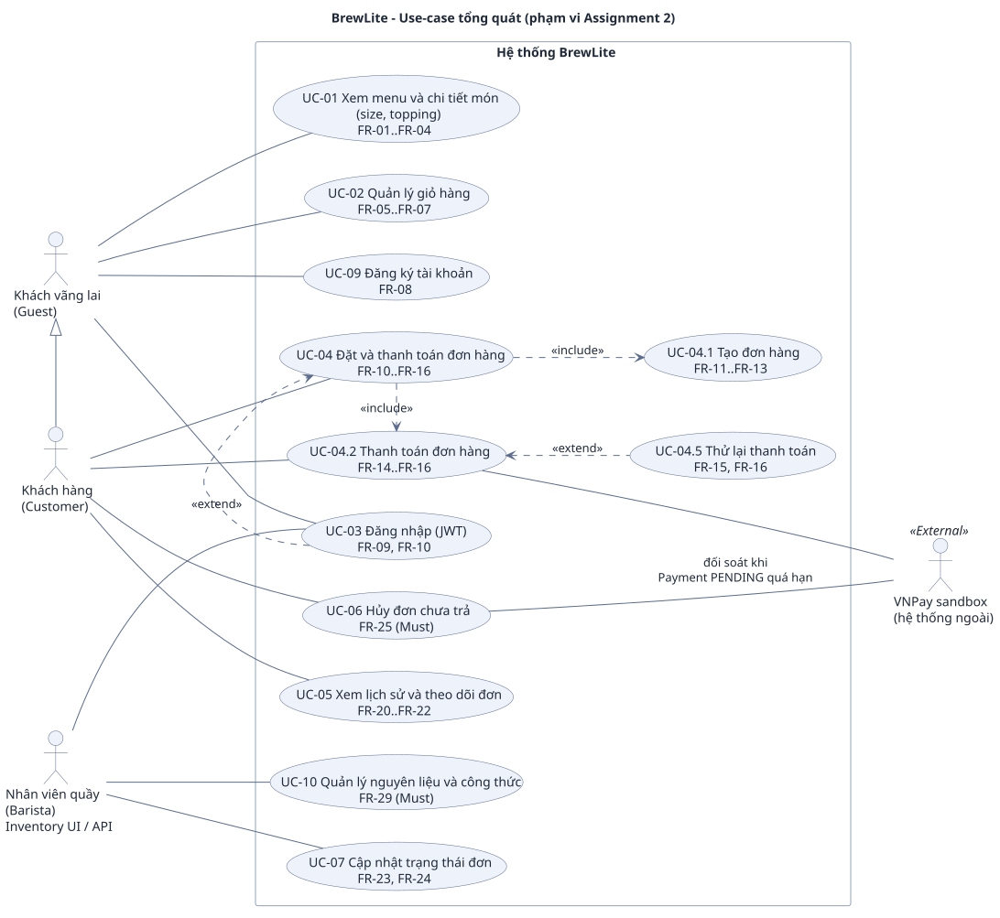

# Đặc tả yêu cầu phần mềm rút gọn (SRS) — BrewLite Assignment 2

> Tài liệu này trả lời đề A2 §3.2. Đề A2: [`../Assignment2-BrewLite.md`](../Assignment2-BrewLite.md). Bối cảnh, stakeholder, phạm vi: [`context-and-scope.md`](context-and-scope.md). Đặc tả use-case trọng tâm: [`uc-checkout.md`](uc-checkout.md). Truy vết: [`../traceability-matrix.md`](../traceability-matrix.md).

## Mục lục

1. Giới thiệu
2. Tổng quan hệ thống: actor, use-case tổng quát, danh mục use-case
3. Quy ước dùng trong tiêu chí chấp nhận (API, mã lỗi, dữ liệu mẫu, quy tắc nghiệp vụ, từ điển miền dữ liệu)
4. Bảng tóm tắt yêu cầu theo nhóm
5. Yêu cầu chức năng (FR)
6. Yêu cầu phi chức năng (NFR)
7. Ánh xạ yêu cầu → stakeholder
8. Quyết định phạm vi
9. Thuật ngữ

---

## 1. Giới thiệu

### 1.1 Mục đích

Tài liệu này mô tả **BrewLite làm gì và không làm gì** trong Assignment 2. Mỗi yêu cầu có mã riêng (`FR-xx`, `NFR-xx`), mức ưu tiên MoSCoW và **tiêu chí chấp nhận kiểm chứng được** (mã HTTP, trạng thái, thông báo trên giao diện, thời gian). Mục tiêu là một người ngoài nhóm đọc xong có thể tự viết test từ các tiêu chí này (đề A2 §3.3).

### 1.2 Phạm vi

BrewLite là ứng dụng đặt đồ uống không dùng tiền mặt: giao diện web ưu tiên điện thoại, cài được như app (PWA, viết bằng Next.js), API viết bằng NestJS, cơ sở dữ liệu PostgreSQL. Luồng chính: **Xem menu → Chọn tùy chọn → Giỏ hàng → Đặt đơn → Thanh toán → Theo dõi đơn** (đề A2 §1.1). Phạm vi chi tiết, phần mở rộng và phần không làm: [`context-and-scope.md`](context-and-scope.md) mục 3.

### 1.3 Mức ưu tiên MoSCoW

| Mức | Ý nghĩa trong dự án này |
|---|---|
| **Must** | Bắt buộc có trong MVP; thiếu thì luồng từ đầu tới cuối không chạy được. Mọi `FR-xx` Must phải điền đủ 5 cột ở ma trận truy vết trước khi kết thúc Task 5 |
| **Should** | Làm sau khi xong Must; thiếu thì MVP vẫn chạy nhưng hụt một phần nghiệp vụ |
| **Could** | Làm nếu còn thời gian; là phần bị cắt đầu tiên khi trễ tiến độ |
| **Won't** | Không làm trong Assignment 2; phạm vi và lý do ghi ở mục 1.4 và 5.9 |

### 1.4 Baseline bản nộp và phụ thuộc

- Bản hiện tại gồm FR-01–FR-16, FR-20–FR-25 và FR-29 (23 yêu cầu Must). FR-25 là bắt buộc để chủ đơn nhả được phần nguyên liệu đã giữ; FR-29 gồm quản lý kho và công thức.
- FR-17, FR-18, FR-19, FR-26, FR-27 là **Won’t trong bản nộp**, đã gom vào bảng ở mục 5.9 (giữ nguyên mã, không đánh lại số). Không cần giao diện, endpoint, seed khuyến mãi hay giao dịch điểm cho các yêu cầu này.
- NFR Must chỉ áp dụng cho các endpoint và luồng thuộc bản nộp. NFR Should và Could không phải điều kiện nghiệm thu bản tối thiểu.
- Task 2 vẫn phải mô hình hóa hai lớp domain bắt buộc `Promotion` và `LoyaltyTransaction` với thuộc tính, quan hệ, multiplicity (đề A2 §4.3); điều này không có nghĩa là phải làm tính năng tương ứng.
- **VNPay sandbox.** Thanh toán đi qua VNPay sandbox thay cho simulator (ADR-007): `POST /payments` chỉ tạo `Payment PENDING` và URL đã ký, khách trả trên trang VNPay, kết quả về qua IPN hoặc QueryDR (BR-10, BR-11). Quy ước ở mục 3.4, hành vi ở FR-14 đến FR-16, rủi ro ở R-13 đến R-15 ([context-and-scope](context-and-scope.md)). FR-31 (cổng production thật) vẫn là Won't.

### 1.5 Cách đọc một yêu cầu

Mỗi yêu cầu gồm: **mô tả** (khi cần), dòng **Ưu tiên / Use-case / Stakeholder**, và danh sách **tiêu chí chấp nhận** đánh mã `AC-Fxx.n` (cho `FR-xx`) hoặc `AC-Nxx.n` (cho `NFR-xx`). Mỗi tiêu chí viết để chuyển thẳng được thành một test (mã test `UNIT-Txx`, `API-Txx`, `INT-Txx`, `E2E-Txx` ghi trong ma trận truy vết). Mã tiêu chí, quy tắc và luồng đã bỏ không dùng lại; các mã còn lại giữ nguyên số hiệu.

---

## 2. Tổng quan hệ thống

### 2.1 Actor

| Actor | Loại | Mô tả |
|---|---|---|
| Khách vãng lai (**Guest**) | Chính | Chưa đăng nhập: xem menu, xem chi tiết món, bỏ món vào giỏ, đăng ký, đăng nhập |
| Khách hàng (**Customer**) | Chính | Đã đăng nhập (JWT hợp lệ, `role = CUSTOMER`); làm được mọi việc của Guest (`Customer --\|> Guest`), cộng thêm: đặt đơn, thanh toán, xem lịch sử và theo dõi đơn, hủy đơn chưa trả (FR-25, Must) |
| Nhân viên quầy (**Barista**) | Chính | Đã đăng nhập, `role = BARISTA`; đổi trạng thái đơn đã thanh toán qua API (Postman); nhập/kiểm kê nguyên liệu trên màn `/inventory`, sửa công thức qua API `PUT /inventory/recipes` (FR-29, UC-10); không đặt đơn, không thanh toán |
| Cổng thanh toán (**VNPay sandbox**) | Phụ (hệ thống ngoài) | Cổng thanh toán bên thứ ba, chạy ở môi trường thử nên không thu tiền thật. Khách trả tiền trên trang VNPay; VNPay báo kết quả cho API qua IPN và trả lời khi API hỏi lại bằng QueryDR |

### 2.2 Use-case diagram tổng quát

Nguồn: [`use-case-overview.puml`](use-case-overview.puml). Use-case trọng tâm UC-04 được đặc tả ở [`uc-checkout.md`](uc-checkout.md).

### 2.3 Danh mục use-case

| Mã | Tên use-case | Actor | Yêu cầu liên quan |
|---|---|---|---|
| UC-01 | Xem menu và chi tiết món (size, topping) | Guest, Customer | FR-01 đến FR-04 |
| UC-02 | Quản lý giỏ hàng | Guest, Customer | FR-05 đến FR-07 |
| UC-03 | Đăng nhập (JWT) | Guest, Barista | FR-09, FR-10 |
| UC-04 | **Đặt và thanh toán đơn hàng** (trọng tâm) | Customer; VNPay sandbox | FR-10 đến FR-16; FR-17/18 ngoài bản nộp |
| UC-04.1 | Tạo đơn hàng (include của UC-04) | Customer | FR-11, FR-12, FR-13 |
| UC-04.2 | Thanh toán đơn hàng (include của UC-04) | Customer; VNPay sandbox | FR-14, FR-15, FR-16 |
| UC-04.3 | Áp mã giảm giá (extend UC-04.2) — ngoài bản nộp, không vẽ trong sơ đồ | Customer | FR-17 (Won’t) |
| UC-04.4 | Ghi nhận điểm thưởng (extend UC-04.2) — ngoài bản nộp, không vẽ trong sơ đồ | hệ thống | FR-18 (Won’t) |
| UC-04.5 | Thử lại thanh toán (extend UC-04.2, khi đơn `PAYMENT_FAILED`) | Customer; VNPay sandbox | FR-15, FR-16 |
| UC-05 | Xem lịch sử và theo dõi đơn | Customer | FR-20, FR-21, FR-22 |
| UC-06 | Hủy đơn chưa trả; hủy đơn đã trả/hoàn tiền vẫn ngoài phạm vi | Customer; Barista chỉ ở phần FR-26 ngoài phạm vi | FR-25 (Must); FR-26 (Won’t) |
| UC-07 | Cập nhật trạng thái đơn (hàng đợi Barista FR-27 không vẽ trong sơ đồ) | Barista | FR-23, FR-24; FR-27 (Won’t) |
| UC-08 | Xem điểm thưởng — ngoài bản nộp, không vẽ trong sơ đồ | Customer | FR-19 (Won’t) |
| UC-09 | Đăng ký tài khoản (Barista không đăng ký, tài khoản do seed tạo: giả định A-04) | Guest | FR-08 |
| UC-10 | Quản lý nguyên liệu và công thức | Barista | FR-29 |

Sơ đồ chỉ vẽ các use-case thuộc bản nộp (Must). Các dòng Won’t vẫn giữ trong bảng để truy vết (xem mục 5.9).

---

## 3. Quy ước dùng trong tiêu chí chấp nhận

Mục này chốt sẵn tên gọi và giá trị, để tiêu chí nào cũng kiểm chứng được và để Task 2 (sơ đồ), Task 4–5 (code, test) dùng chung một bộ từ.

### 3.1 Endpoint

| Endpoint | Ai gọi | Mục đích |
|---|---|---|
| `GET /products`, `GET /products/:id` | công khai | Menu, chi tiết món |
| `GET /catalog/options` | công khai | Danh sách size và topping kèm phụ thu, để giao diện không tự ghi cứng bảng giá (FR-03, FR-04) |
| `POST /auth/register`, `POST /auth/login` | công khai | Đăng ký, đăng nhập |
| `POST /orders` | Customer | Tạo đơn `PENDING` |
| `POST /payments` | Customer | Tạo giao dịch VNPay (header `Idempotency-Key`; body `{ orderId, paymentMethod }`, không có `cardNumber`): lưu `Payment PENDING` và trả `paymentUrl` đã ký, không chờ VNPay. Trả 201 khi tạo mới, 200 khi replay |
| `GET /payments/vnpay/ipn` | VNPay sandbox (công khai, không JWT) | IPN: VNPay báo kết quả server-to-server; luôn HTTP 200 với JSON `RspCode` (mục 3.4) |
| `GET /payments/vnpay/return` | Trình duyệt khách quay về từ VNPay (công khai, không ghi DB) | Kiểm chữ ký và merchant, trả `{ valid, paymentId, orderId, responseCode }` để hiển thị |
| `POST /payments/:id/sync` | Customer (chủ đơn) | Hỏi VNPay bằng QueryDR khi thiếu IPN; áp kết quả như IPN |
| `GET /orders/me`, `GET /orders/:id` | Customer (`:id` còn cho Barista) | Lịch sử, chi tiết đơn |
| `PATCH /orders/:id` | Barista (đổi trạng thái); Customer (hủy theo FR-25 Must) | Body `{ "status": "<TRẠNG_THÁI_ĐÍCH>" }`; hủy bị chặn 409 `PAYMENT_IN_PROGRESS` khi đơn còn `Payment PENDING` chưa kết luận (AC-F25.4) |
| `POST /inventory/availability` | công khai | Tính khả năng đáp ứng theo size/topping và tổng giỏ, không giữ kho |
| `GET /inventory/ingredients`, `GET /inventory/movements`, `GET /inventory/recipes` | Barista | Xem số dư, lịch sử và công thức |
| `POST /inventory/ingredients/:id/movements`, `PUT /inventory/recipes` | Barista | Nhập/kiểm kê có lý do; thay công thức nguyên tử |
| `GET /health` | công khai | Kiểm kết nối DB (NFR-15) |

Cổng chạy local: web 3000, API 4000, PostgreSQL 5432.

**Trường thanh toán trong `GET /orders/:id`.** Mỗi phần tử trong `payments` có thêm `paymentUrl`, `expiresAt`, `gatewayResponseCode`, `gatewayTransactionStatus` (đều có thể `null`), để khách trả tiếp được và giao diện hiện đúng kết quả. API không trả secret, chữ ký, fingerprint hay `Idempotency-Key`. Danh sách `GET /orders/me` giữ nguyên; khách xem payment ở trang chi tiết đơn.

### 3.2 Định dạng lỗi và mã HTTP

Mọi lỗi của API đều trả về JSON: `{ "statusCode": <số>, "error": "<MÃ_LỖI>", "message": "<thông điệp>", "details": [ ... ] }` (`details` có hoặc không tùy lỗi).

| HTTP | `error` | Khi nào |
|---|---|---|
| 400 | `VALIDATION_ERROR`, `IDEMPOTENCY_KEY_REQUIRED` | Dữ liệu sai định dạng/thiếu; thiếu hoặc quá dài header `Idempotency-Key` |
| 401 | `UNAUTHORIZED` | Thiếu, sai hoặc hết hạn JWT; sai email/mật khẩu |
| 403 | `FORBIDDEN` | Đúng đăng nhập nhưng sai vai trò, hoặc không phải chủ đơn |
| 404 | `PRODUCT_NOT_FOUND`, `ORDER_NOT_FOUND`, `INGREDIENT_NOT_FOUND`, `PAYMENT_NOT_FOUND` | Không tồn tại |
| 409 | `EMAIL_ALREADY_EXISTS`, `OUT_OF_STOCK`, `RECIPE_UNAVAILABLE`, `BELOW_RESERVED`, `ORDER_NOT_PAYABLE`, `INVALID_ORDER_TRANSITION`, `PAYMENT_IN_PROGRESS` | Xung đột trạng thái hoặc dữ liệu. `PAYMENT_IN_PROGRESS`: đơn có `Payment PENDING` chưa kết luận (khác phương thức, hủy đơn, hoặc `sync`/QueryDR chưa có kết quả cuối) |
| 502 | `PAYMENT_PROVIDER_ERROR` | Thiếu cấu hình VNPay cho thao tác, lỗi ký, hoặc QueryDR lỗi mạng, hết thời gian chờ, sai chữ ký, báo mã lỗi hay không kết luận được |
| 503 | — | `GET /health` khi database không kết nối được |

Riêng `GET /payments/vnpay/ipn` không dùng định dạng lỗi trên: endpoint này luôn trả HTTP 200 với JSON `{ "RspCode": "<mã>", "Message": "<thông điệp>" }` theo quy ước của VNPay (mục 3.4). Thanh toán thất bại cũng không còn là phản hồi của `POST /payments`: kết quả này đến qua IPN hoặc QueryDR và đưa đơn sang `PAYMENT_FAILED`.

Giao diện ghi số tiền dạng `124.000đ` (dấu chấm ngăn cách hàng nghìn, chữ "đ" ở cuối); mọi thông báo cho người dùng đều bằng tiếng Việt.

### 3.3 Dữ liệu mẫu tham chiếu (seed)

Các tiêu chí dùng chung bộ dữ liệu dưới đây (NFR-16 yêu cầu seed chạy lại được):

- **Sản phẩm** (giá size S, đồng): Cà phê sữa 35.000, Americano 40.000, Cappuccino 45.000, Trà đào 39.000, Trà sữa trân châu 42.000, Matcha latte 48.000, Bạc xỉu 38.000, Cold brew 45.000. Seed tạo nguyên liệu thiếu với số dư 0; số ly không được suy ra từ cột `Product.stock` cũ. Dữ liệu demo được nhập bằng API có xác thực theo [runbook](../inventory-runbook.md).
- **Size:** S phụ thu 0đ, M +5.000đ, L +10.000đ.
- **Topping:** Trân châu +7.000đ, Kem phô mai +10.000đ, Thạch dừa +5.000đ.
- **Tài khoản demo** (chỉ để test, mật khẩu chỉ dùng cho tài khoản **demo**): Customer `customer.demo@brewlite.local` mật khẩu demo `Demo@12345`; Barista `barista.demo@brewlite.local` mật khẩu demo `Demo@12345`.

**Ví dụ tính tiền dùng trong các tiêu chí:** 2 ly Cappuccino size L kèm topping Trân châu: đơn giá `45.000 + 10.000 + 7.000 = 62.000`; tổng `124.000`; số tiền phải trả đúng `124.000`. Khi tạo URL VNPay, số tiền gửi là `Order.total × 100` (VND nhân 100, không dấu phân cách), tức `12400000` cho ví dụ này.

### 3.4 Quy ước VNPay sandbox

VNPay sandbox là hệ thống ngoài, không thu tiền thật (ADR-007). Hành vi chi tiết ở FR-14, FR-15, FR-16.

- **Thẻ:** khách chỉ nhập thẻ test NCB trên trang VNPay. Hệ thống không nhận, không lưu, không ghi log số thẻ, nên body `POST /payments` không có `cardNumber`. Số thẻ và OTP không ghi vào tài liệu, repo, ảnh chụp, log.
- **`paymentMethod`** (`WALLET`/`CARD`): bắt buộc, lưu ở `Payment.method` để nhận replay (BR-05). Chỉ gợi ý phương thức trên trang VNPay, không bảo đảm khách trả đúng loại.
- **Cấu hình:** `VNP_TMN_CODE`, `VNP_HASH_SECRET`, `WEB_URL` nằm trong `apps/api/.env` và biến môi trường Render (AC-N07.1); `VNP_URL`, `VNP_API_URL` mặc định là URL sandbox công khai. Tạo URL mới cần cả ba biến; IPN, kiểm return, QueryDR cần `VNP_TMN_CODE` và `VNP_HASH_SECRET`; replay, đọc DB, `/health` không cần biến nào. Thiếu biến thì API vẫn khởi động (AC-F14.7, AC-F14.8).
- **Ký:** mỗi lần thử có `vnp_TxnRef` mới, bằng `Payment.id`. URL, IPN, return được ký và kiểm bằng HMAC-SHA512 với `VNP_HASH_SECRET`; sai chữ ký, merchant hoặc số tiền thì không đổi trạng thái.
- **Hạn 15 phút:** `vnp_ExpireDate` và `Payment.expiresAt` là cùng một mốc, GMT+7. Quá hạn chỉ có nghĩa là phải đối soát QueryDR; đơn không tự hủy, kho không tự nhả, không có job nền. Khoảng chờ thêm 15 phút (`EXPIRY_GRACE_MS`) theo AC-F16.10 (D6 trong ADR-007).
- **Nguồn kết quả:** IPN là nguồn chính (`GET /payments/vnpay/ipn`, phải HTTPS công khai). QueryDR (`POST /payments/:id/sync`) dùng khi thiếu IPN. Cả hai ghi qua cùng một hàm (BR-11). Return URL (`<WEB_URL>/payment/vnpay-return`) chỉ hiển thị và poll DB.
- **QueryDR có hai mã:** `vnp_ResponseCode` là kết quả lần hỏi, `vnp_TransactionStatus` là trạng thái giao dịch (AC-F14.12, AC-F15.6, AC-F15.8, AC-F16.10, AC-F16.11). Giao diện lấy trạng thái trong DB làm chuẩn.
- **Tiền về sau trạng thái cuối:** nhân viên đối soát và hoàn tiền tay theo AC-F15.7 và [deployment.md](../deployment.md); không có refund API.

| `RspCode` của IPN | Nghĩa |
|---|---|
| `00` | Đã ghi nhận |
| `01` | Không có `Payment` ứng với `vnp_TxnRef` |
| `02` | `Payment` hoặc đơn không còn `PENDING` |
| `04` | Sai số tiền |
| `97` | Sai chữ ký hoặc merchant |
| `99` | Thiếu cấu hình, lỗi bất ngờ hoặc chưa có kết luận (VNPay gọi lại tối đa 10 lần, cách nhau 5 phút) |

| Mã VNPay | Hiển thị cho khách |
|---|---|
| `24` | Khách hủy giao dịch |
| `51` | Tài khoản không đủ số dư |
| `11`, `15`, `EXPIRED` (giá trị nội bộ, AC-F16.10) | "Đã hết thời gian thanh toán" |
| `13` | Sai OTP |
| `09`, `10`, `12`, `79` | Lỗi thẻ hoặc tài khoản |
| Mã còn lại, hoặc QueryDR không trả mã từ chối gốc | "Thanh toán không thành công" |

Mã trên return hoặc IPN chỉ để chọn câu thông báo, không quyết định trạng thái (BR-11).

### 3.5 Quy tắc nghiệp vụ (BR)

| Mã | Quy tắc |
|---|---|
| BR-01 | Giá do **server** tính: `unitPrice = product.price + phụ thu size + Σ phụ thu topping`; `lineTotal = unitPrice × quantity`; `total = Σ lineTotal`. Trường giá hoặc tổng tiền do client gửi bị từ chối theo AC-F12.3 |
| BR-02 | Số lượng mỗi dòng từ 1 đến 99; mỗi đơn tối đa 20 dòng; giá là số nguyên VND |
| BR-03 | Đơn mới `inventoryTracked=true`: tổng hợp nhu cầu nguyên liệu của toàn giỏ từ công thức server; tăng `reserved`, tạo `Order`, `OrderItem`, `OrderIngredient` bất biến trong cùng transaction. Thành công thanh toán giảm cả `onHand` và `reserved` theo snapshot; thất bại giữ nguyên; chủ đơn hủy chưa trả chỉ giảm `reserved`, đúng một lần. Luôn `0 <= reserved <= onHand`. Đơn cũ `inventoryTracked=false` tiếp tục vòng đời `Product.stock` cũ, không suy diễn snapshot |
| BR-04 | Chỉ chủ đơn mới thanh toán/hủy đơn của mình; đơn chỉ thanh toán được khi ở `PENDING` hoặc `PAYMENT_FAILED` |
| BR-05 | `Idempotency-Key` bắt buộc cho `POST /payments`, gắn với người dùng; thanh toán thất bại (`Payment FAILED`) không khóa key. Hai yêu cầu là **cùng một yêu cầu** khi cùng chủ đơn, `orderId`, `Idempotency-Key` và `paymentMethod`. Sau khi kiểm đầu vào, xác thực và quyền sở hữu, API xét theo thứ tự: (1) có `Payment SUCCESS` của cùng yêu cầu thì trả lại kết quả đó (200), trước khi xét trạng thái đơn; (2) đơn không ở `PENDING`/`PAYMENT_FAILED` thì 409 `ORDER_NOT_PAYABLE`; (3) `Payment PENDING` quá hạn thì đối soát QueryDR rồi xét lại từ (1); (4) có `Payment PENDING` còn hạn thì cùng `paymentMethod` trả lại URL và thời hạn cũ (200, kể cả khi key mới), khác `paymentMethod` thì 409 `PAYMENT_IN_PROGRESS`; (5) chỉ khi phải tạo URL mới mới kiểm cấu hình ký. Hai nhánh replay (1) và (4) không cần ký lại hay cấu hình VNPay |
| BR-08 | Vòng đời đơn theo mục 3.6; mọi chuyển trạng thái ngoài bảng đều bị từ chối |
| BR-09 | Thanh toán thất bại không xóa giỏ hàng và không hủy đơn; tồn kho vẫn giữ cho tới khi đơn `CANCELLED` |
| BR-10 | Mỗi đơn có tối đa một `Payment PENDING`. Chưa xác định được kết quả của payment đó (còn hạn, hoặc quá hạn mà QueryDR chưa kết luận) thì không mở lần thử mới và không cho hủy đơn: trả 409 `PAYMENT_IN_PROGRESS`. Payment không kẹt mãi: khi `now >= expiresAt + 15 phút` mà vẫn chưa kết luận, lời gọi `POST /payments`, hủy đơn hoặc `sync` đóng nó thành `FAILED` (`gatewayResponseCode = "EXPIRED"`) rồi mới mở lần thử mới hoặc cho hủy; nhóm trạng thái nghi ngờ (`04`/`05`/`06`/`07`/`09`) và `MISMATCH` không bao giờ tự đóng (AC-F16.10, AC-F16.11) |
| BR-11 | Chỉ IPN hoặc QueryDR đã xác thực (chữ ký, merchant, mã tham chiếu, số tiền khớp) mới được quyết định kết quả cuối của `Payment` và đơn. Return URL chỉ hiển thị, không đổi trạng thái; hai nguồn kết quả áp qua cùng một hàm và không ghi đè trạng thái cuối |

### 3.5a Kho nguyên liệu và thuật ngữ

`onHand`, `reserved`, `available`: xem mục 9. Nguyên liệu tracked là nguyên liệu được theo dõi số lượng (`Ingredient.tracked`).

- **Công thức:** công thức gốc gắn với món + size S/M/L; công thức topping cộng thêm nguyên liệu (kể cả trân châu vốn đã có trong món). Không bán được khi công thức trống, thiếu, hoặc công thức gốc không có nguyên liệu tracked. Nước và đá không giới hạn, không tính vào số ly.
- **Số ly** = `min(floor(available / requiredPerCup))` trên các nguyên liệu tracked. `stock` trên menu là ước tính cho S không topping, không làm trần cho lựa chọn khác và không cộng lại thành cam kết cho cả giỏ. Số ly không hiển thị thành nhãn, khách chỉ thấy qua ô số lượng: nhập lớn hơn N thì tự hạ về N (tối đa 99 ly mỗi dòng); để trống, nhập 0, số âm hoặc số thập phân không vượt N thì báo "từ 1 đến N". Giới hạn đã biết: lựa chọn không bán được chỉ khóa nút "Thêm vào giỏ", chưa hiện lý do.
- **Cả giỏ:** cộng nhu cầu của cùng một nguyên liệu trên mọi dòng trước khi đặt (AC-F05.4, AC-F13.3).
- **Đơn vị:** `g`, `ml`, `piece`; decimal string tối đa 3 chữ số thập phân, DB numeric(18,3). Đổi đơn vị theo AC-F29.3; chi tiết ở [HTTP/schema contract](../inventory-contract.md).

### 3.6 Từ điển miền dữ liệu (ràng buộc cho Task 2)

Sơ đồ dùng đúng tên dưới đây (đề A2 §4.3); luồng khuyến mãi, điểm thưởng ngoài bản nộp không bắt buộc vẽ vào sơ đồ luồng.

- **Lớp domain (7):** `User`, `Product`, `Order`, `OrderItem`, `Payment`, `Promotion`, `LoyaltyTransaction`.
- **Quan hệ:** `User` 1–n `Order`; `Order` 1–n `OrderItem`; `OrderItem` n–1 `Product`; `Order` 1–n `Payment` (tối đa một `PENDING`, BR-10); `Order` n–0..1 `Promotion`; `User` 1–n `LoyaltyTransaction`; `LoyaltyTransaction` n–0..1 `Order`.
- **Enum:** `OrderStatus`: `PENDING`, `PAID`, `PAYMENT_FAILED`, `PREPARING`, `READY`, `COMPLETED`, `CANCELLED`; `Role`: `CUSTOMER`, `BARISTA`; `PaymentMethod`: `WALLET`, `CARD`; `PaymentStatus`: `SUCCESS`, `FAILED`, `PENDING`; `LoyaltyType`: `EARN`, `REVERSAL`. Không có `REFUNDED` (FR-26 Won't). `EXPIRED` không phải enum, chỉ là giá trị của `gatewayResponseCode` (AC-F15.8, AC-F16.10).
- **Thuộc tính tối thiểu:** `Product(id, name, description, price, imageUrl, stock)`; `User(id, email, passwordHash, role)`; `Order(id, userId, status, total, discountAmount, promotionId?, inventoryTracked, createdAt)`; `OrderItem(id, orderId, productId, size, toppings, quantity, unitPrice, lineTotal)`; `Payment(id, orderId, method, status, amount, idempotencyKey, createdAt, provider, paymentUrl?, expiresAt?, gatewayCreateDate?, gatewayTxnNo?, gatewayResponseCode?, gatewayTransactionStatus?, bankCode?, paidAt?)`; `Promotion(id, code, discountPercent, validFrom, validTo, maxUses?, usedCount, active)`; `LoyaltyTransaction(id, userId, orderId?, type, points, createdAt)`. `provider` mặc định `VNPAY`; hàng tạo trước 2026-10-29 là `SIMULATOR`. `Order.discountAmount`, `Order.promotionId`, `Promotion` và `LoyaltyTransaction` chỉ có trong mô hình Task 2, chưa có trong schema.
- `discountAmount` là thuộc tính miền cạnh `Promotion` (đề A2 §4.3), không có cột DB hay trường API.
- **Kho:** `Ingredient(id,name,unit,tracked,onHand,reserved)`, `Recipe(id,productId?,size?,topping?)`, `RecipeLine(recipeId,ingredientId,quantity)`, `StockMovement(id,ingredientId,actorId,kind,quantity,onHandAfter,reason,createdAt)`, `OrderIngredient(orderId,ingredientId,quantity)`. `Product.stock` là cột cũ; `stock` trong response là giá trị tính ra. Xem [Class-01](../diagrams/class-domain.svg) và [contract](../inventory-contract.md).

**Máy trạng thái đơn (BR-08, nguồn đề A1 §9.1).** Có đúng 8 chuyển hợp lệ. `COMPLETED`, `CANCELLED` là trạng thái kết thúc; chuyển khác bị từ chối, gồm `PAID → CANCELLED` (FR-26 Won't).

| Từ | Sang | Ai thực hiện |
|---|---|---|
| `PENDING` | `PAID` | Hệ thống, khi IPN/QueryDR đã xác thực báo thành công (BR-11) |
| `PENDING` | `PAYMENT_FAILED` | Hệ thống, khi IPN/QueryDR đã xác thực báo thất bại (BR-11) |
| `PENDING` | `CANCELLED` | Chủ đơn (FR-25) |
| `PAYMENT_FAILED` | `PENDING` | Hệ thống, khi khách thử lại (`Payment PENDING` mới, không giữ thêm nguyên liệu) |
| `PAYMENT_FAILED` | `CANCELLED` | Chủ đơn (FR-25) |
| `PAID` | `PREPARING` | Barista |
| `PREPARING` | `READY` | Barista |
| `READY` | `COMPLETED` | Barista |

**Vòng đời `Payment` (BR-10, BR-11).** Chỉ đi một chiều từ `PENDING` (đã tạo URL, đang chờ VNPay; đơn vẫn `PENDING`) sang `SUCCESS` (đơn `PAID`) hoặc `FAILED` (đơn `PAYMENT_FAILED`); thử lại luôn tạo `Payment` mới. `FAILED` không nhả nguyên liệu, chỉ chủ đơn hủy hợp lệ mới nhả (FR-25).

**Nhãn tiếng Việt trên giao diện:** `PENDING` "Chờ thanh toán"; `PAID` "Đã thanh toán"; `PAYMENT_FAILED` "Thanh toán thất bại"; `PREPARING` "Đang pha chế"; `READY` "Sẵn sàng nhận"; `COMPLETED` "Hoàn tất"; `CANCELLED` "Đã hủy".

---

## 4. Bảng tóm tắt yêu cầu theo nhóm

| # | Nhóm | Yêu cầu | MoSCoW |
|---|---|---|---|
| 1 | Menu | FR-01, FR-02 | Must |
| 2 | Chi tiết sản phẩm | FR-03, FR-04 | Must |
| 3 | Giỏ hàng | FR-05, FR-06, FR-07 | Must |
| 4 | Xác thực | FR-08, FR-09, FR-10 | Must |
| 5 | Đặt đơn | FR-11, FR-12, FR-13 | Must |
| 6 | Thanh toán | FR-14, FR-15, FR-16 (Must); FR-17, FR-18, FR-19 (Won’t bản nộp) | Must / Won’t |
| 7 | Lịch sử đơn | FR-20, FR-21, FR-22 | Must |
| 8 | Quản lý trạng thái đơn | FR-23, FR-24 (Must); FR-25 (Must); FR-26, FR-27 (Won’t bản nộp) | Must / Won’t |
| 9 | Quản lý nguyên liệu và công thức | FR-29 | Must |
| 10 | Hiệu năng | NFR-01 (Must); NFR-02, NFR-03 (Could) | Must / Could |
| 11 | Bảo mật | NFR-04 đến NFR-08, NFR-13 | Must |
| 12 | Tính khả dụng | NFR-09 đến NFR-12 | Must |
| 13 | Khả năng triển khai | NFR-14 đến NFR-19 (Must); NFR-20 (Should) | Must / Should |

Won’t bản nộp: FR-17, FR-18, FR-19, FR-26, FR-27 và FR-28, FR-30 đến FR-32. Tổng cộng: **32 FR** (23 Must, 0 Could, 9 Won’t) và **20 NFR** (17 Must, 1 Should, 2 Could).

Ba tình huống mà đề A2 §4.1 yêu cầu phải có nhánh riêng đều có yêu cầu tương ứng: **chưa đăng nhập** → FR-10; **hết hàng** → FR-13; **thanh toán thất bại** → FR-15.

---

## 5. Yêu cầu chức năng (FR)

### 5.1 Menu

#### FR-01 — Xem danh sách menu
- **Mô tả:** Hệ thống hiển thị danh sách đồ uống gồm hình, tên, giá, tình trạng còn hàng; không cần đăng nhập.
- **Ưu tiên:** Must · **Use-case:** UC-01 · **Stakeholder:** S1, S3
- **Tiêu chí chấp nhận:**
  - AC-F01.1: Khi gọi `GET /products` với dữ liệu mẫu (mục 3.3) thì trả 200 và mảng đúng 8 sản phẩm, mỗi phần tử có `id`, `name`, `price` (số nguyên), `imageUrl`, `stock`; không cần token.
  - AC-F01.2: Khi mở trang menu thì lưới hiển thị đủ 8 thẻ, mỗi thẻ có hình, tên và giá dạng `45.000đ`.
  - AC-F01.3: Menu hiển thị nhãn theo `stock` tính từ nguyên liệu cho S không topping: 0 là "Hết hàng", lớn hơn 0 là "Còn hàng"; không hiển thị số ly. Thiếu công thức thì `stock` bằng 0. Trang chi tiết kiểm bằng availability, không lấy số S làm trần cho M/L/topping.

#### FR-02 — Trạng thái tải menu (loading, empty, error)
- **Mô tả:** Trang menu xử lý ba trạng thái: đang tải, danh sách rỗng, lỗi tải.
- **Ưu tiên:** Must · **Use-case:** UC-01 · **Stakeholder:** S1, S4
- **Tiêu chí chấp nhận:**
  - AC-F02.1: Khi yêu cầu tải chưa xong thì trang hiển thị skeleton hoặc spinner, và biến mất khi có dữ liệu.
  - AC-F02.2: Khi `GET /products` trả mảng rỗng thì trang hiển thị "Hiện chưa có món nào" và không hiển thị lưới.
  - AC-F02.3: Khi `GET /products` trả 5xx hoặc mất mạng thì hiển thị "Không tải được thực đơn" cùng nút "Thử lại"; bấm "Thử lại" thành công thì hiển thị menu.

### 5.2 Chi tiết sản phẩm

#### FR-03 — Xem chi tiết sản phẩm
- **Mô tả:** Hệ thống hiển thị chi tiết một sản phẩm (hình, tên, mô tả, giá nền, tùy chọn size và topping).
- **Ưu tiên:** Must · **Use-case:** UC-01 · **Stakeholder:** S1
- **Tiêu chí chấp nhận:**
  - AC-F03.1: Khi gọi `GET /products/:id` với `id` tồn tại thì trả 200 với `id`, `name`, `price`, `imageUrl`, `stock`, `description`.
  - AC-F03.2: Khi gọi `GET /products/:id` với `id` không tồn tại thì trả 404 `PRODUCT_NOT_FOUND`.
  - AC-F03.3: Khi mở trang chi tiết của `id` không tồn tại thì giao diện hiển thị "Không tìm thấy sản phẩm" và liên kết quay lại menu; trang có trạng thái loading và error như FR-02.

#### FR-04 — Chọn size và topping
- **Mô tả:** Khách chọn size (S/M/L) và nhiều topping; giá hiển thị cập nhật theo lựa chọn (BR-01).
- **Ưu tiên:** Must · **Use-case:** UC-01 · **Stakeholder:** S1
- **Tiêu chí chấp nhận:**
  - AC-F04.1: Khi mở trang chi tiết thì size mặc định được chọn là `M`; chỉ một size được chọn tại một thời điểm.
  - AC-F04.2: Khi chọn Cappuccino (45.000đ) size `L` thì giá hiển thị là `55.000đ`; thêm topping "Trân châu" thì giá hiển thị là `62.000đ`; bỏ topping thì về `55.000đ` ngay, không tải lại trang.
  - AC-F04.3: Khi chọn đồng thời "Trân châu" và "Kem phô mai" thì phụ thu cộng dồn (`+17.000đ`).
  - AC-F04.4: Khi đổi size/topping thì gọi `POST /inventory/availability`; phản hồi cũ không ghi đè lựa chọn mới. Không đủ nguyên liệu hoặc thiếu công thức thì khóa nút "Thêm vào giỏ". Khi lần kiểm lúc bấm thêm thấy giỏ dự kiến thiếu nguyên liệu thì báo nguyên liệu thiếu và lượng cần/còn, giỏ giữ nguyên.

### 5.3 Giỏ hàng

#### FR-05 — Thêm món vào giỏ
- **Mô tả:** Khách (Guest hoặc Customer) thêm món kèm size, topping, số lượng vào giỏ hàng lưu ở trình duyệt.
- **Ưu tiên:** Must · **Use-case:** UC-02 · **Stakeholder:** S1
- **Tiêu chí chấp nhận:**
  - AC-F05.1: Khi bấm "Thêm vào giỏ" ở chi tiết Cappuccino L + Trân châu số lượng 2 thì giỏ có một dòng đúng các giá trị đó và biểu tượng giỏ hiển thị số lượng tổng là 2.
  - AC-F05.2: Khi thêm hai lần cùng món, cùng size, cùng topping thì giỏ gộp thành một dòng cộng dồn số lượng; khác size hoặc khác topping thì tạo dòng riêng.
  - AC-F05.3: Khi tải lại trang hoặc đăng nhập xong thì giỏ vẫn còn nguyên các dòng (lưu `localStorage`).
  - AC-F05.4: Trước khi thêm món và ở giỏ, kiểm availability cho cả giỏ dự kiến, cộng nhu cầu các dòng dùng chung nguyên liệu. Thiếu hoặc công thức không khả dụng thì không cho tiếp tục checkout, giữ giỏ để sửa; không dùng `Product.stock` làm giới hạn chung cho biến thể.
  - AC-F05.5: Khi giỏ đã có 20 dòng thì thêm dòng thứ 21 bị từ chối với thông báo "Giỏ hàng tối đa 20 món" (BR-02).

#### FR-06 — Sửa số lượng và xóa dòng
- **Mô tả:** Khách tăng, giảm số lượng và xóa dòng trong giỏ.
- **Ưu tiên:** Must · **Use-case:** UC-02 · **Stakeholder:** S1
- **Tiêu chí chấp nhận:**
  - AC-F06.1: Khi bấm "+" thì số lượng tăng 1, tối đa 99; ở 99 nút "+" bị vô hiệu.
  - AC-F06.2: Khi bấm "−" ở số lượng 1 thì dòng bị xóa sau khi khách xác nhận, hoặc có nút "Hoàn tác"; ở số lượng lớn hơn 1 thì giảm 1.
  - AC-F06.3: Khi bấm "Xóa" ở một dòng thì chỉ dòng đó bị xóa; khi giỏ rỗng thì hiển thị "Giỏ hàng trống" cùng nút quay lại menu và nút "Thanh toán" bị vô hiệu.

#### FR-07 — Tính tổng tiền giỏ
- **Mô tả:** Giỏ tự tính thành tiền từng dòng và tổng tiền theo BR-01, cập nhật ngay khi giỏ đổi.
- **Ưu tiên:** Must · **Use-case:** UC-02 · **Stakeholder:** S1, S3
- **Tiêu chí chấp nhận:**
  - AC-F07.1: Khi giỏ có 2 × Cappuccino L + Trân châu thì dòng hiển thị đơn giá `62.000đ`, thành tiền `124.000đ`; tổng giỏ là `124.000đ`.
  - AC-F07.2: Khi giỏ có thêm 1 × Americano M (`45.000đ`) thì tổng giỏ là `169.000đ`; đổi số lượng hoặc xóa dòng thì tổng cập nhật ngay mà không tải lại trang.
  - AC-F07.3: Tổng hiển thị ở giỏ bằng `Order.total` do server tính ở FR-11 cho cùng nội dung giỏ (kiểm bằng một test so sánh).

### 5.4 Xác thực

#### FR-08 — Đăng ký tài khoản
- **Mô tả:** Guest đăng ký bằng email và mật khẩu; tài khoản mới có vai trò `CUSTOMER`.
- **Ưu tiên:** Must · **Use-case:** UC-09 · **Stakeholder:** S1
- **Tiêu chí chấp nhận:**
  - AC-F08.1: Khi `POST /auth/register` với `{ email, password }` hợp lệ (email đúng định dạng, mật khẩu ít nhất 8 ký tự gồm chữ và số) thì trả 201 với `id`, `email`, `role = "CUSTOMER"`; phản hồi không chứa `password` hay `passwordHash`.
  - AC-F08.2: Khi email đã tồn tại (không phân biệt hoa/thường) thì trả 409 `EMAIL_ALREADY_EXISTS`.
  - AC-F08.3: Khi email sai định dạng, mật khẩu ngắn hơn 8 ký tự, hoặc body có trường lạ như `role` thì trả 400 `VALIDATION_ERROR` kèm `details` mô tả lỗi.
  - AC-F08.4: Khi gửi form đăng ký với dữ liệu sai thì giao diện hiển thị thông báo lỗi dưới từng ô, không gọi API nếu lỗi do định dạng.

#### FR-09 — Đăng nhập và cấp JWT
- **Mô tả:** Người dùng đăng nhập bằng email và mật khẩu, nhận JWT dùng cho các chức năng cần xác thực.
- **Ưu tiên:** Must · **Use-case:** UC-03 · **Stakeholder:** S1, S2
- **Tiêu chí chấp nhận:**
  - AC-F09.1: Khi `POST /auth/login` với thông tin đúng thì trả 200 với `accessToken` là JWT có `sub` (id người dùng), `role` và `exp`.
  - AC-F09.2: Khi sai mật khẩu hoặc email không tồn tại thì trả 401 `UNAUTHORIZED` với cùng thông điệp "Email hoặc mật khẩu không đúng".
  - AC-F09.3: Khi đăng nhập thành công trên giao diện thì chuyển về trang trước đó (tham số `next`) hoặc trang menu, và header hiển thị trạng thái đã đăng nhập kèm nút "Đăng xuất"; đăng xuất xóa token và giữ nguyên giỏ hàng.
  - AC-F09.4: Barista dùng cùng form và endpoint đăng nhập; token có `role = "BARISTA"`.

#### FR-10 — Chặn khi chưa đăng nhập
- **Mô tả:** Các chức năng cần đăng nhập (đặt đơn, thanh toán, lịch sử, theo dõi đơn, đổi trạng thái) chỉ dùng được khi có JWT hợp lệ. Guest được dẫn tới trang đăng nhập, đăng nhập xong thì quay lại đúng chỗ cũ và giỏ hàng vẫn còn.
- **Ưu tiên:** Must · **Use-case:** UC-03, UC-04 · **Stakeholder:** S1, S4
- **Tiêu chí chấp nhận:**
  - AC-F10.1: Khi gọi `POST /orders`, `POST /payments`, `POST /payments/:id/sync`, `GET /orders/me`, `GET /orders/:id`, `PATCH /orders/:id` mà không có header `Authorization` thì trả 401 `UNAUTHORIZED`. `GET /payments/vnpay/ipn` và `GET /payments/vnpay/return` công khai, bảo vệ bằng chữ ký VNPay.
  - AC-F10.2: Khi token sai chữ ký hoặc đã hết hạn thì cùng các endpoint trên trả 401 `UNAUTHORIZED`.
  - AC-F10.3: Khi Guest có giỏ hàng bấm "Thanh toán" thì giao diện chuyển tới `/login?next=/checkout` trong vòng 1 giây, không gọi `POST /orders`; sau đăng nhập thành công quay về `/checkout` và giỏ còn nguyên các dòng.
  - AC-F10.4: Khi API trả 401 giữa lúc thanh toán thì giao diện báo "Phiên đăng nhập đã hết hạn, vui lòng đăng nhập lại", chuyển tới đăng nhập, giữ giỏ. 401 ở `POST /orders`: đăng nhập xong tiếp tục tạo đơn. 401 ở `POST /payments`: giữ `orderId`, chủ đơn, `Idempotency-Key`; đăng nhập lại cùng tài khoản thì đọc `GET /orders/:id` và trả tiếp nếu `PENDING`/`PAYMENT_FAILED`, không gọi lại `POST /orders`, không giữ kho thêm; đơn đã trả thì hiện kết quả, `CANCELLED` thì dừng. Tài khoản khác: API trả 403, không tự thanh toán đơn cũ, UI yêu cầu dùng đúng tài khoản hoặc về lịch sử của tài khoản mới.
  - AC-F10.5: Guest vẫn xem menu, chi tiết món và thêm vào giỏ bình thường (không bị chặn bởi đăng nhập).

### 5.5 Đặt đơn

#### FR-11 — Tạo đơn hàng
- **Mô tả:** Customer tạo đơn từ giỏ hàng; đơn mới ở trạng thái `PENDING`. Việc tạo `Order`, các `OrderItem`, bản chụp nguyên liệu `OrderIngredient` (snapshot) và giữ chỗ nguyên liệu nằm trọn trong một transaction: hoặc xong hết, hoặc không có gì thay đổi (BR-03).
- **Ưu tiên:** Must · **Use-case:** UC-04.1 · **Stakeholder:** S1, S3, S5
- **Tiêu chí chấp nhận:**
  - AC-F11.1: Khi `POST /orders` kèm token Customer và `items = [{ productId: <Cappuccino>, quantity: 2, size: "L", toppings: ["Trân châu"] }]` thì trả 201 với `id`, `status = "PENDING"`, `total = 124000`, một `OrderItem` với `unitPrice = 62000`, `lineTotal = 124000`; `userId` của đơn là người trong token.
  - AC-F11.2: Đơn mới có `inventoryTracked=true` và snapshot `OrderIngredient` tổng hợp. Đặt 2 Matcha S với công thức 3g/150ml/20ml tăng reserved đúng 6g matcha, 300ml sữa không đường, 40ml syrup; onHand chưa đổi. Sửa công thức sau đó không đổi snapshot này.
  - AC-F11.3: Gây lỗi sau giữ kho hoặc khi tạo OrderItem thì rollback toàn bộ: không có đơn/snapshot mới, mọi onHand/reserved không đổi.
  - AC-F11.4: Khi gọi bằng token Barista thì trả 403 `FORBIDDEN`.

#### FR-12 — Kiểm dữ liệu và tính giá phía server
- **Mô tả:** Máy chủ kiểm mọi dữ liệu của đơn và tự tính giá; không tin giá hay tổng tiền do client gửi lên (BR-01, BR-02).
- **Ưu tiên:** Must · **Use-case:** UC-04.1 · **Stakeholder:** S1, S3, S5
- **Tiêu chí chấp nhận:**
  - AC-F12.1: Khi `items` rỗng, hoặc có hơn 20 dòng, `quantity` < 1, `quantity` > 99, `quantity` không phải số nguyên, `size` ngoài `S`/`M`/`L`, hoặc topping không có trong danh sách thì trả 400 `VALIDATION_ERROR` và không tạo `Order`.
  - AC-F12.2: Khi `productId` không tồn tại thì trả 404 `PRODUCT_NOT_FOUND` và không tạo `Order`.
  - AC-F12.3: Khi body có thêm trường `total: 1` hoặc `unitPrice: 1` thì trả 400 (trường lạ); `Order.total` không bao giờ lấy từ client.
  - AC-F12.4: Khi giỏ trên giao diện rỗng thì nút "Thanh toán" bị vô hiệu và không gọi API.

#### FR-13 — Xử lý hết hàng khi đặt đơn
- **Mô tả:** Khi khách đặt nhiều hơn số còn bán được, hệ thống từ chối tạo đơn để không bán quá số lượng còn, và báo để khách sửa giỏ (nội dung thông báo theo AC-F13.4).
- **Ưu tiên:** Must · **Use-case:** UC-04.1 · **Stakeholder:** S1, S3
- **Tiêu chí chấp nhận:**
  - AC-F13.1: Khi kho có 20g matcha, 2000ml sữa không đường và 200ml syrup, không có lượng nào đang giữ (`reserved`), và công thức Matcha S dùng 3g matcha, 150ml sữa, 20ml syrup, thì bán được 6 ly và matcha là nguyên liệu giới hạn. Khi đặt 7 ly thì trả 409 `OUT_OF_STOCK` với `details` chứa `ingredientId`, `name`, `unit` cùng `requested` và `available` dạng chuỗi (với matcha là 21 và 20); không tạo đơn mới và mọi số dư giữ nguyên.
  - AC-F13.2: Khi một nguyên liệu `tracked` trong công thức có `available` bằng 0 thì số ly bán được bằng 0. Khi món hoặc topping đã chọn thiếu công thức hoặc có công thức trống, hoặc công thức gốc không có nguyên liệu `tracked` nào thì `POST /inventory/availability` trả `sellable=false` và `cups=0`, còn `POST /orders` trả 409 `RECIPE_UNAVAILABLE`.
  - AC-F13.3: Khi kho có đúng 150ml espresso và một ly Americano S cần 30ml, gửi đồng thời 10 yêu cầu tạo đơn, mỗi yêu cầu 1 ly, thì đúng 5 đơn thành công và 5 yêu cầu trả 409; sau đó `onHand` là 150ml, `reserved` là 150ml, `available` là 0 và không số dư nào âm. Hệ thống cộng nhu cầu nguyên liệu của cả giỏ trước khi kiểm, kể cả các size và topping dùng chung một nguyên liệu.
  - AC-F13.4: Khi availability báo shortage, giao diện hiển thị nguyên liệu thiếu và lượng cần/còn; ở giỏ hàng, lựa chọn thiếu công thức thì báo lý do không bán được thay cho lượng cần/còn. Khi đặt đơn trả 409, giao diện báo nguyên liệu đã thay đổi, có liên kết "Sửa giỏ hàng" và giữ nguyên giỏ; sửa giỏ rồi kiểm lại được. Không tạo đơn từ số ly ước tính đã cũ.
  - AC-F13.5: Đơn bị từ chối vì hết hàng không xuất hiện trong lịch sử đơn của khách.

### 5.6 Thanh toán

#### FR-14 — Thanh toán Ví/Thẻ qua VNPay sandbox
- **Mô tả:** Customer chọn trả bằng ví hoặc thẻ cho một đơn đang chờ thanh toán (`PENDING`). API tạo `Payment PENDING` cùng một đường link thanh toán đã ký, rồi khách được chuyển sang trang VNPay sandbox để trả. Đơn chỉ được tính là đã trả khi VNPay báo kết quả thẳng về máy chủ (IPN), hoặc khi máy chủ tự hỏi lại VNPay (QueryDR, dùng khi thiếu IPN), và kết quả đó đã được xác thực. Khi đó `Payment` sang `SUCCESS` và đơn sang `PAID` trong cùng một transaction (BR-11). Luồng UC-04 liên quan: luồng chính, E9, E10, E13 ([`uc-checkout.md`](uc-checkout.md)).
- **Ưu tiên:** Must · **Use-case:** UC-04.2 · **Stakeholder:** S1, S3, S6
- **Tiêu chí chấp nhận:**
  - AC-F14.1: Khi `POST /payments` với `{ orderId, paymentMethod: "WALLET" }`, `Idempotency-Key` hợp lệ, đơn `PENDING` của người gọi và đủ cấu hình tạo URL (mục 3.4) thì trả 201 với `orderStatus = "PENDING"`, `status = "PENDING"`, `amount` bằng `Order.total`, `paymentUrl` đã ký và `expiresAt` (ISO 8601, sau lúc tạo 15 phút); DB có đúng 1 `Payment PENDING`, `Order.status` vẫn `PENDING`; API không chờ VNPay.
  - AC-F14.2: Khi `paymentMethod` ngoài `WALLET`/`CARD` hoặc thiếu `orderId` thì trả 400 `VALIDATION_ERROR`; thiếu, rỗng hoặc dài hơn 255 ký tự ở header `Idempotency-Key` thì trả 400 `IDEMPOTENCY_KEY_REQUIRED`. Trường lạ, gồm `cardNumber`, bị từ chối theo AC-N06.1. Các trường hợp này không tạo `Payment`, không đổi đơn.
  - AC-F14.3: Khi `orderId` không tồn tại thì trả 404 `ORDER_NOT_FOUND`; đơn của người khác trả 403 `FORBIDDEN`. Sau bước đó, replay thành công (BR-05) trả 200 theo FR-16 trước khi xét trạng thái; yêu cầu mới trên đơn `PAID`, `PREPARING`, `READY`, `COMPLETED`, `CANCELLED` trả 409 `ORDER_NOT_PAYABLE`. Các nhánh này không tạo `Payment` mới.
  - AC-F14.4: Khi gọi bằng token Barista thì trả 403 `FORBIDDEN`.
  - AC-F14.5: Khi bấm "Thanh toán qua VNPay" thì giao diện (không có ô nhập số thẻ) gửi `POST /payments` không kèm `cardNumber`, lưu `orderId`, `Idempotency-Key`, `paymentId`, `paymentMethod` của phiên rồi chuyển tới `paymentUrl`; giỏ chỉ bị xóa khi DB xác nhận đơn đã trả (AC-F20.1).
  - AC-F14.6: Khi thành công lần đầu với đơn `inventoryTracked=true` (IPN hoặc QueryDR) thì giảm onHand và reserved đúng snapshot trong cùng transaction với Payment SUCCESS và Order PAID. Replay trả 200, không đổi số dư/snapshot, không tính lại theo công thức hiện tại. Đơn `inventoryTracked=false` chuyển `PAID` mà không trừ kho theo snapshot.
  - AC-F14.7: Khi `POST /payments` phải tạo URL mới mà thiếu `VNP_TMN_CODE`, `VNP_HASH_SECRET`, `WEB_URL` hoặc ký lỗi thì trả 502 `PAYMENT_PROVIDER_ERROR`, không tạo `Payment`, không đổi đơn. Replay `SUCCESS` và `PENDING` còn hạn vẫn trả 200 (UC-04 E13).
  - AC-F14.8: Khi thiếu `VNP_TMN_CODE` hoặc `VNP_HASH_SECRET` thì `GET /payments/vnpay/ipn` trả `RspCode 99`, không đọc, không ghi DB (không trả `97` vì chưa kiểm được chữ ký); lỗi bất ngờ cũng trả `99`. Thiếu riêng `WEB_URL` không chặn IPN, QueryDR, return. API vẫn khởi động, cảnh báo chỉ ghi tên biến thiếu; `GET /health` trả theo trạng thái DB (AC-N15.1, AC-N15.2) (UC-04 E13).
  - AC-F14.9: Khi IPN có chữ ký hợp lệ, `vnp_TmnCode` đúng, `vnp_TxnRef` khớp `Payment PENDING` của đơn `PENDING`, `vnp_Amount` bằng `Payment.amount × 100`, `vnp_ResponseCode = 00`, `vnp_TransactionStatus = 00` thì trả HTTP 200 `RspCode 00`; `Payment` sang `SUCCESS` (lưu hai mã gateway, `gatewayTxnNo`, `bankCode`, `paidAt` theo GMT+7), đơn sang `PAID`, kho theo AC-F14.6. IPN tới sau `expiresAt` mà cả hai còn `PENDING` vẫn được nhận.
  - AC-F14.10: Khi IPN có chữ ký sai hoặc `vnp_TmnCode` khác cấu hình thì trả `RspCode 97`; không có `Payment` ứng với `vnp_TxnRef` thì trả `01`; `vnp_Amount` khác `Payment.amount × 100` thì trả `04`. Cả ba trường hợp không đổi DB và kho (UC-04 E9).
  - AC-F14.11: Khi `GET /payments/vnpay/return` có chữ ký, merchant hợp lệ và tìm thấy `Payment` thì trả `{ valid: true, paymentId, orderId, responseCode }`; còn lại, gồm thiếu cấu hình xác minh, trả `{ valid: false }`, không trả ID từ query chưa xác thực. Endpoint không ghi DB. Trang `/payment/vnpay-return` đọc `GET /orders/:id` (mỗi 2 giây, tối đa 30 giây), không dựa vào `responseCode` để kết luận (BR-11) (UC-04 E9).
  - AC-F14.12: Khi chưa có IPN (chạy local, Render ngủ) và `Payment` còn `PENDING` thì `POST /payments/:id/sync` gọi QueryDR; phản hồi đã xác thực (chữ ký, merchant, mã tham chiếu; với response `00` thêm số tiền và `vnp_TransactionType = 01`) có `vnp_ResponseCode = 00`, `vnp_TransactionStatus = 00` thì áp như IPN thành công (AC-F14.9, AC-F14.6), trả 200 `{ paymentId, orderId, orderStatus, status }`. Kho chỉ trừ một lần dù IPN tới sau (UC-04 E10).
  - AC-F14.13: Khi gọi `POST /payments/:id/sync` thì kiểm quyền trước khi gọi VNPay: không token 401 `UNAUTHORIZED`; không phải chủ đơn hoặc token Barista 403 `FORBIDDEN`; không có payment 404 `PAYMENT_NOT_FOUND`. `Payment` đã `SUCCESS`/`FAILED` thì trả 200 `{ paymentId, orderId, orderStatus, status }` từ DB, không gọi QueryDR, không đòi cấu hình VNPay.

#### FR-15 — Xử lý thanh toán thất bại
- **Mô tả:** Khi VNPay xác nhận thanh toán không thành công (qua IPN hoặc QueryDR đã xác thực, kể cả khi khách bấm Hủy trên trang VNPay), `Payment` sang `FAILED` và đơn sang `PAYMENT_FAILED`. Giỏ hàng và đơn vẫn được giữ để khách thử lại (hoặc hủy theo FR-25) (BR-09). Luồng UC-04 liên quan: E3, A3, E12.
- **Ưu tiên:** Must · **Use-case:** UC-04.2 · **Stakeholder:** S1, S6
- **Tiêu chí chấp nhận:**
  - AC-F15.1: Khi IPN hợp lệ (chữ ký, merchant, số tiền) của `Payment PENDING` có `vnp_TransactionStatus = 02` và `vnp_ResponseCode` khác `00`/`07`, kể cả khách hủy (`24`), thì trả `RspCode 00`; `Payment` sang `FAILED` (lưu riêng hai mã), `Order.status = "PAYMENT_FAILED"`. `POST /payments` không trả 402 (UC-04 E3).
  - AC-F15.3: Thanh toán thất bại giữ nguyên onHand, reserved và snapshot; đơn giữ OrderItem và xuất hiện trong lịch sử ở PAYMENT_FAILED. `Payment FAILED` (kể cả `EXPIRED`) không nhả nguyên liệu. Retry cùng orderId không giữ thêm nguyên liệu.
  - AC-F15.4: Khi đơn trong DB là `PAYMENT_FAILED` (trang `/payment/vnpay-return` đọc `GET /orders/:id`) thì hiển thị "Thanh toán không thành công. Đơn của bạn vẫn được giữ, bạn có thể thử lại hoặc chọn phương thức khác." (hoặc thông báo theo mã ở mục 3.4), giỏ còn đủ, có "Thử lại" và liên kết "Xem hoặc hủy đơn" dẫn tới trang chi tiết, nơi có nút "Hủy đơn" (FR-25). Khi `Payment` còn `PENDING` hoặc chưa đối soát xong thì chỉ hiển thị "Đang xác minh thanh toán, vui lòng kiểm tra lại", không báo thất bại, không khuyên trả lần hai.
  - AC-F15.5: Khi thử lại sau `PAYMENT_FAILED` cùng `orderId` (key mới, cùng hoặc khác `paymentMethod`) thì `POST /payments` trả 201 với `Payment PENDING` và URL mới; `Order` đi `PAYMENT_FAILED → PENDING`, không tạo `Order` mới, `reserved` không tăng. Khi lần thử mới được xác nhận thành công thì `Order` sang `PAID`, có thêm đúng 1 `Payment SUCCESS` (UC-04 A3).
  - AC-F15.6: Khi QueryDR đã xác thực trả `vnp_ResponseCode = 00` với `vnp_TransactionStatus = 02` cho `Payment` còn `PENDING` thì `Payment` sang `FAILED` và đơn sang `PAYMENT_FAILED`; lưu riêng response `00` và status `02`, không gắn nhãn `EXPIRED`.
  - AC-F15.7: Khi IPN thành công hợp lệ (`00`/`00`) tới sau trạng thái cuối (`Payment` đã `FAILED`, kể cả `EXPIRED`; đơn đã `CANCELLED` hoặc đã trả bằng payment khác) thì trả `RspCode 02`, ghi warning `PAYMENT_RECONCILIATION_REQUIRED` kèm `vnp_TxnRef`; đơn và kho không đổi. QueryDR phát hiện tiền về muộn cũng ghi warning này. IPN lặp của chính `Payment SUCCESS` chỉ trả `02`, không warning (UC-04 E12).
  - AC-F15.8: Khi QueryDR đã xác thực trả `vnp_ResponseCode = 91`: `Payment` còn hạn thì giữ `PENDING`, trả 409 `PAYMENT_IN_PROGRESS`; đã quá hạn thì `Payment` sang `FAILED` với `gatewayResponseCode = "EXPIRED"`, đơn sang `PAYMENT_FAILED`, kho không đổi (UC-04 E11).

#### FR-16 — Thanh toán idempotent
- **Mô tả:** Dù cùng một yêu cầu thanh toán bị gửi nhiều lần (mất phản hồi, bấm hai lần, mạng tự gửi lại) hay VNPay gửi lại IPN, khách cũng không bị thu tiền hai lần và hệ thống không tạo bản ghi trùng. Khi lần trả trước chưa rõ kết quả thì chưa mở lần thử mới (BR-05, BR-10, BR-11). Luồng UC-04 liên quan: E4, A6, A5, E11.
- **Ưu tiên:** Must · **Use-case:** UC-04.2 · **Stakeholder:** S1, S3, S6
- **Tiêu chí chấp nhận:**
  - AC-F16.1: Khi hai `POST /payments` là cùng một yêu cầu (BR-05) và lần đầu đã `Payment SUCCESS` thì lần hai trả 200 `{ paymentId, orderId, orderStatus: "PAID", amount, status: "SUCCESS" }` với `paymentId` cũ; không tạo URL, không gọi VNPay, không cần cấu hình; DB có đúng 1 `Payment SUCCESS`. Cùng key khác `paymentMethod` sau khi đã thành công là yêu cầu mới, trả 409 `ORDER_NOT_PAYABLE` (UC-04 E4).
  - AC-F16.4: Khi đơn đã `PAID` mà khách gửi `Idempotency-Key` **mới** thì trả 409 `ORDER_NOT_PAYABLE`, không tạo `Payment` hay URL mới (không thu tiền lần hai).
  - AC-F16.5: Khi lần trước thất bại (`Payment FAILED`, FR-15) thì gửi lại cùng key được xử lý như lần thử mới (BR-05), không trả lại kết quả thất bại cũ.
  - AC-F16.6: Khi bấm "Thanh toán qua VNPay" thì nút bị vô hiệu tới khi có phản hồi; giao diện dùng một `Idempotency-Key` cho cả phiên màn thanh toán, sinh key mới ở phiên khác; chuyển sang đăng nhập theo E1 phải giữ key cùng `orderId`.
  - AC-F16.8: Khi đơn có `Payment PENDING` còn hạn thì `POST /payments` cùng `paymentMethod` (kể cả key mới) trả 200 với `paymentId`, `paymentUrl`, `expiresAt` cũ, không tạo `Payment` thứ hai; khác `paymentMethod` trả 409 `PAYMENT_IN_PROGRESS`. Hai yêu cầu đồng thời chỉ tạo tối đa một `Payment PENDING` (BR-10). Khi quay lại màn thanh toán, giao diện hiển thị "Tiếp tục thanh toán" dùng URL cũ (UC-04 E4, A6).
  - AC-F16.9: Khi `POST /payments` mới gặp `Payment PENDING` quá hạn (`now ≥ expiresAt`) thì API gọi QueryDR ngoài transaction chính rồi xét replay trước (BR-05). Đã thành công: cùng chủ đơn/key/`paymentMethod` trả 200, key hoặc phương thức khác trả 409 `ORDER_NOT_PAYABLE`. Đã thất bại: tạo lần thử mới. Chưa kết luận: theo bảng cuối mục, không tạo URL mới khi còn `PENDING`; nếu đóng thì tạo lần thử mới ngay (201) (UC-04 E11).
  - AC-F16.10: Khi đối soát `Payment PENDING` mà QueryDR chưa kết luận thì xử lý theo bảng cuối mục. Hết khoảng chờ khi `now >= expiresAt + 15 phút` (`now` là lúc gửi QueryDR); không có `expiresAt` thì không bao giờ hết. **Đóng** là `Payment` sang `FAILED`, `gatewayResponseCode = "EXPIRED"`, `gatewayTransactionStatus = null`, đơn sang `PAYMENT_FAILED`, kho không đổi (AC-F15.3), warning `PAYMENT_EXPIRED_UNCONFIRMED vnp_TxnRef=<id>` kèm lý do truy vấn lỗi hoặc hai mã đã xác thực; khách thanh toán lại hoặc hủy đơn. Chỉ đóng khi có lời gọi `POST /payments`, hủy đơn hoặc `sync`, không có job nền. IPN thành công tới sau khi đóng theo AC-F15.7 (UC-04 E11).
  - AC-F16.11: Khi trong khoảng chờ, các nhánh 502 ở bảng cuối mục giữ `Payment PENDING`, không đổi DB và kho, không mở lần thử mới, không gọi lại liên tục. Phản hồi thiếu dữ liệu xác thực không được dùng để đóng payment trong khoảng chờ, kể cả khi mang mã `91`. Việc đóng là chính sách hết hạn của ứng dụng, không coi `94`/`99` hay lỗi truy vấn là bằng chứng thất bại (UC-04 E11, E13).
  - AC-F16.12: Khi IPN thành công đã xử lý được gọi lại cùng tham số thì trả `RspCode 02`, không trừ kho lần hai, không warning đối soát. Khi IPN và `sync` cùng xác nhận một payment thì chỉ có một `Payment SUCCESS`, kho chỉ trừ một lần; kết quả QueryDR cũ không ghi đè trạng thái IPN vừa áp (BR-11).

**Xử lý khi hỏi VNPay (QueryDR) chưa có kết quả rõ ràng.** Áp dụng cho AC-F16.10 và AC-F16.11; mã `91` đã xác thực xử lý riêng theo AC-F15.8.

| Kết quả QueryDR | Trong khoảng chờ | Hết khoảng chờ |
|---|---|---|
| `00` + status `01` | 409 `PAYMENT_IN_PROGRESS` | Đóng |
| `00` + status thiếu hoặc chưa hỗ trợ | 502 `PAYMENT_PROVIDER_ERROR` | Đóng |
| Mã khác `00`/`91` (`02`, `03`, `94`, `97`, `99`...) | 502 | Đóng |
| Mã khác `00` (kể cả `91`) có chữ ký đúng nhưng sai hoặc thiếu merchant, mã tham chiếu (`BAD_RESPONSE`) | 502 | Đóng |
| Không xác thực được: không chữ ký (log `reason=UNSIGNED`), sai chữ ký, timeout 10 giây, lỗi mạng, không đọc được, thiếu cấu hình truy vấn, thiếu `gatewayCreateDate` | 502 | Đóng |
| `00` + status `04`, `05`, `06`, `07`, `09` (đảo, hoàn tiền, nghi ngờ) | 502, warning đối soát | 502, warning đối soát, không bao giờ đóng |
| `00` sai merchant, mã tham chiếu, số tiền hoặc loại giao dịch (`MISMATCH`) | 502, warning đối soát | 502, warning đối soát, không bao giờ đóng |

### 5.7 Lịch sử đơn

#### FR-20 — Xác nhận đơn (biên lai)
- **Mô tả:** Trả tiền thành công xong, khách thấy màn xác nhận đơn.
- **Ưu tiên:** Must · **Use-case:** UC-04, UC-05 · **Stakeholder:** S1, S4
- **Tiêu chí chấp nhận:**
  - AC-F20.1: Khi DB xác nhận đơn đã `PAID` (trang `/payment/vnpay-return` đọc `GET /orders/:id`, hoặc `POST /payments` replay `SUCCESS` trả 200) thì chuyển tới màn xác nhận gồm: mã đơn, trạng thái "Đã thanh toán", món (tên, size, topping, số lượng), số tiền đã trả, phương thức, thời gian.
  - AC-F20.2: Khi hiển thị màn xác nhận thì giỏ hàng đã được xóa (số lượng trên biểu tượng giỏ là 0); khi thanh toán thất bại hoặc `Payment` còn `PENDING` thì giỏ **không** bị xóa.
  - AC-F20.3: Khi tải lại trang xác nhận thì nội dung vẫn đúng (dữ liệu lấy từ `GET /orders/:id`, không phụ thuộc state tạm); màn xác nhận chính là trang chi tiết `/orders/:id` nên không cần nút chuyển trang.

#### FR-21 — Lịch sử đơn của tôi
- **Mô tả:** Customer xem danh sách đơn của chính mình, mới nhất trước.
- **Ưu tiên:** Must · **Use-case:** UC-05 · **Stakeholder:** S1
- **Tiêu chí chấp nhận:**
  - AC-F21.1: Khi `GET /orders/me` với token Customer thì trả 200 với mảng các đơn của **chính người đó**, sắp theo `createdAt` giảm dần, mỗi phần tử có `id`, `status`, `total`, `createdAt`; tối đa 50 đơn mới nhất.
  - AC-F21.2: Khi có hai khách A và B, mỗi người đặt một đơn thì `GET /orders/me` của A không chứa đơn của B.
  - AC-F21.3: Khi chưa có đơn thì trả 200 `[]` và giao diện hiển thị "Bạn chưa có đơn hàng nào" cùng liên kết tới menu; có loading và error như FR-02.
  - AC-F21.4: Khi gọi không token thì 401; token Barista thì 403.
  - AC-F21.5: Giao diện mỗi dòng hiển thị mã đơn, ngày giờ, tổng tiền và nhãn trạng thái tiếng Việt (mục 3.6).

#### FR-22 — Xem chi tiết và theo dõi trạng thái đơn
- **Mô tả:** Customer xem chi tiết một đơn của mình và thấy trạng thái tự cập nhật, không cần tải lại trang (bước "Theo dõi đơn" của luồng).
- **Ưu tiên:** Must · **Use-case:** UC-05 · **Stakeholder:** S1, S2
- **Tiêu chí chấp nhận:**
  - AC-F22.1: Khi `GET /orders/:id` của chủ đơn thì trả 200 với `status`, `total`, `items`, `payments` (nếu có, gồm các trường ở mục 3.1); đơn không tồn tại trả 404 `ORDER_NOT_FOUND`; đơn của người khác trả 403 `FORBIDDEN`; token Barista xem được mọi đơn (200).
  - AC-F22.2: Khi trang theo dõi đơn đang mở và Barista đổi trạng thái (FR-24) thì nhãn trên trang cập nhật trong vòng 6 giây mà không cần tải lại (tự làm mới mỗi 5 giây).
  - AC-F22.3: Khi đơn đã ở `COMPLETED` hoặc `CANCELLED` thì trang ngừng tự làm mới (không còn yêu cầu định kỳ).
  - AC-F22.4: Trang hiển thị tiến trình `PAID → PREPARING → READY → COMPLETED` với bước hiện tại được đánh dấu; trạng thái `CANCELLED` và `PAYMENT_FAILED` hiển thị nhãn riêng.

### 5.8 Quản lý trạng thái đơn

#### FR-23 — Vòng đời và chặn chuyển trạng thái sai
- **Mô tả:** Mọi thay đổi trạng thái đơn phải theo bảng chuyển hợp lệ ở mục 3.6; chuyển nào không có trong bảng đều bị từ chối.
- **Ưu tiên:** Must · **Use-case:** UC-07 · **Stakeholder:** S2, S3, S5
- **Tiêu chí chấp nhận:**
  - AC-F23.1: Unit test duyệt toàn bộ 49 cặp (trạng thái hiện tại, trạng thái đích) trên 7 trạng thái: chấp nhận đúng 8 cặp ở mục 3.6 và từ chối 41 cặp còn lại (kể cả cặp trùng trạng thái và `PAID → CANCELLED`, FR-26 Won’t); quyền của từng actor kiểm riêng theo FR-24 (và FR-25).
  - AC-F23.2: Khi `PATCH /orders/:id` với chuyển không hợp lệ (ví dụ `PAID → READY`, `PREPARING → CANCELLED`, `COMPLETED → PREPARING`) thì trả 409 `INVALID_ORDER_TRANSITION`, trạng thái trong DB không đổi; bị từ chối do phân quyền thì trả 403 theo FR-24, FR-25.
  - AC-F23.3: Khi `status` đích trong body là `PENDING`, `PAID` hoặc `PAYMENT_FAILED` thì trả 400 `VALIDATION_ERROR` (các chuyển này chỉ do luồng thanh toán thực hiện).
  - AC-F23.4: `COMPLETED` và `CANCELLED` không có chuyển nào đi ra.

#### FR-24 — Barista đổi trạng thái đơn qua API
- **Mô tả:** Barista chuyển đơn đã thanh toán qua `PREPARING`, `READY`, `COMPLETED`.
- **Ưu tiên:** Must · **Use-case:** UC-07 · **Stakeholder:** S2, S1
- **Tiêu chí chấp nhận:**
  - AC-F24.1: Khi token Barista gọi `PATCH /orders/:id` với `{ "status": "PREPARING" }` trên đơn `PAID` thì trả 200 với `status = "PREPARING"`; tiếp tục `READY` rồi `COMPLETED` đều trả 200.
  - AC-F24.2: Customer gọi PREPARING/READY/COMPLETED trả 403 FORBIDDEN; không token trả 401. Customer chỉ hủy đơn của chính mình theo AC-F25.1–2; thao tác từ chối không đổi số dư hoặc trạng thái.
  - AC-F24.3: Khi Barista chuyển đơn `PENDING` hoặc `PAYMENT_FAILED` sang `PREPARING` thì trả 409 `INVALID_ORDER_TRANSITION`; `id` không tồn tại trả 404 `ORDER_NOT_FOUND`. Khi Barista gửi `{ "status": "CANCELLED" }` trên đơn `PENDING` hoặc `PAYMENT_FAILED` thì trả 403 `FORBIDDEN` (hai chuyển này chỉ dành cho chủ đơn, mục 3.6); trên đơn `PAID`, `PREPARING`, `READY`, `COMPLETED` hoặc `CANCELLED` thì trả 409 `INVALID_ORDER_TRANSITION` (chuyển không có trong bảng, `PAID → CANCELLED` là FR-26 Won’t). Mọi trường hợp bị từ chối đều không đổi trạng thái đơn, snapshot và số dư nguyên liệu/Product.stock.
  - AC-F24.4: Có hướng dẫn API thủ công: Barista đăng nhập lấy Bearer token, GET /orders/:id theo mã đơn, PATCH lần lượt PREPARING/READY/COMPLETED trên đơn đã PAID; nhận 200 và các lỗi theo AC-F24.1–3. Không giao Postman collection.

#### FR-25 — Khách hủy đơn chưa thanh toán
- **Mô tả:** Customer hủy được đơn của mình khi đơn đang PENDING/PAYMENT_FAILED; phần nguyên liệu đã giữ được nhả ra đúng một lần. Hủy đơn không đổi tồn thực tế (onHand), và đơn không tự hủy theo thời gian. Đơn còn `Payment PENDING` chưa kết luận thì chưa hủy được (409 `PAYMENT_IN_PROGRESS`, AC-F25.4).
- **Ưu tiên:** Must · **Use-case:** UC-06 · **Stakeholder:** S1, S3
- **Tiêu chí chấp nhận:**
  - AC-F25.1: Chủ đơn PATCH CANCELLED ở PENDING/PAYMENT_FAILED trả 200. Đơn `inventoryTracked=true` giảm reserved theo snapshot, onHand không đổi; gọi lại trả 409 và không giải phóng lần hai. Với đơn `inventoryTracked=false` chỉ hoàn Product.stock theo vòng đời cũ, không đổi nguyên liệu.
  - AC-F25.2: Khi Customer hủy đơn của người khác thì trả 403 `FORBIDDEN`; hủy đơn `PAID` bằng token Customer thì trả 403 `FORBIDDEN` (Barista hủy `PAID`: FR-26 Won’t, trả 409 `INVALID_ORDER_TRANSITION`); hủy đơn `PREPARING`, `READY`, `COMPLETED` hoặc `CANCELLED` thì trả 409 `INVALID_ORDER_TRANSITION`.
  - AC-F25.3: Giao diện hiển thị nút "Hủy đơn" cho đơn `PENDING` và `PAYMENT_FAILED`, hỏi xác nhận "Bạn chắc chắn muốn hủy đơn?"; sau khi hủy nhãn đơn là "Đã hủy" và nút biến mất. Khi còn `Payment PENDING` chưa kết luận thì chưa cho hủy (AC-F25.4).
  - AC-F25.4: Khi chủ đơn gửi `PATCH /orders/:id` với `{ "status": "CANCELLED" }` mà đơn có `Payment PENDING` còn hạn thì trả 409 `PAYMENT_IN_PROGRESS`, đơn và kho không đổi. `Payment PENDING` quá hạn thì đối soát QueryDR trước (AC-F16.9); không còn payment chưa kết luận mới xét hủy theo AC-F25.1 (UC-04 A5, E11).

### 5.9 Yêu cầu không thực hiện (Won't)

Các yêu cầu dưới đây không làm trong bản nộp, giữ nguyên mã (xem mục 1.4). Nếu sau này một PR được duyệt đưa chúng trở lại phạm vi thì viết lại tiêu chí chấp nhận ngay trong PR đó.

| Mã | Yêu cầu | Lý do không làm | Kiểm chứng "không làm" |
|---|---|---|---|
| FR-17 | Xác thực và áp mã giảm giá khi thanh toán | Ngoài bản nộp | Không có endpoint/UI nhập mã giảm giá; body `POST /payments` không có `promotionCode` |
| FR-18 | Ghi nhận điểm thưởng khi đơn `PAID` | Ngoài bản nộp | Không có endpoint/UI ghi điểm; luồng thanh toán không tạo `LoyaltyTransaction` |
| FR-19 | Hiển thị điểm thưởng của khách | Ngoài bản nộp; phụ thuộc FR-18 | Không có endpoint/UI hồ sơ hoặc điểm thưởng |
| FR-26 | Hủy đơn đã thanh toán và hoàn tiền | Ngoài bản nộp; refund API của VNPay cũng ngoài phạm vi (tiền về muộn xử lý tay, mục 3.4) | Không có endpoint/UI hoàn tiền; Barista đổi đơn `PAID` sang `CANCELLED` nhận 409 `INVALID_ORDER_TRANSITION` |
| FR-27 | Barista xem hàng đợi đơn (API danh sách và màn hình) | Ngoài bản nộp; Barista dùng `GET /orders/:id` theo mã đơn | Không có endpoint/UI danh sách đơn cho Barista |
| FR-28 | Quản trị menu (thêm, sửa, xóa món, giá, size, topping) | Ngoài luồng đề A2 §1.1, §7.1; menu nạp bằng seed | Không có route quản trị trong web; `POST /products` trả 404 hoặc 405 |
| FR-30 | Quản trị voucher/khuyến mãi bằng màn hình | Không seed khuyến mãi; `Promotion` vẫn có trong mô hình (đề A2 §4.3) | Không có endpoint tạo/sửa `Promotion` |
| FR-31 | Thanh toán qua cổng production thật (Momo, VNPay production, Stripe...) | Chỉ dùng VNPay sandbox, không thu tiền thật (A-01) | Cấu hình chỉ có thông tin VNPay sandbox; không có khóa hoặc URL của cổng production |
| FR-32 | Đổi hoặc trừ điểm thưởng khi thanh toán | Ghi nhận/hiển thị điểm cũng ngoài bản nộp | Không có trường dùng điểm trong body `POST /payments` |

### 5.10 Nguyên liệu và công thức

#### FR-29 — Quản lý nguyên liệu, công thức và khả năng bán
- **Mô tả:** Barista ghi nhận nguyên liệu nhập vào hoặc kiểm kê, kèm lý do, và thay công thức qua API. Từ số dư và công thức, hệ thống tính số ly còn bán được để hiện nhãn "Còn hàng" hoặc "Hết hàng" cho khách và giới hạn số lượng đặt (UC-10).
- **Ưu tiên:** Must · **Use-case:** UC-10, UC-01, UC-02, UC-04 · **Stakeholder:** S1, S2, S3
- **Tiêu chí chấp nhận:**
  - AC-F29.1: Barista xem được `onHand`, `reserved` và đơn vị của từng nguyên liệu tại `/inventory`; nguyên liệu `tracked` hiện `available`, nguyên liệu không `tracked` hiện "Không giới hạn". Với các endpoint quản trị kho, Guest nhận 401 và Customer nhận 403.
  - AC-F29.2: Khi Barista ghi nhận `RECEIVE` với lượng dương hoặc `ADJUST` với số kiểm kê cuối cùng không âm thì bắt buộc có lý do dài 1–500 ký tự. Mỗi lần như vậy hệ thống ghi một `StockMovement` trong cùng transaction với việc đổi số dư, gồm người thực hiện (actor), chênh lệch có dấu (delta), số dư sau và thời điểm. `ADJUST` xuống dưới `reserved` thì trả 409 `BELOW_RESERVED` và không đổi DB. Lịch sử hiển thị 100 `StockMovement` mới nhất.
  - AC-F29.3: Khi nhập 0.020kg matcha thì hệ thống quy đổi thành 20g; khi nhập 2l sữa thì quy đổi thành 2000ml. Số lượng âm, đơn vị sai, số có quá 3 chữ số thập phân, hoặc số không nguyên với nguyên liệu tính theo `piece` thì trả 400. Không cho đổi khối lượng sang thể tích.
  - AC-F29.4: Barista thay trọn một công thức bằng `PUT /inventory/recipes`, chọn công thức theo món kèm size hoặc theo topping; công thức có từ 1 đến 50 nguyên liệu, mỗi nguyên liệu xuất hiện một lần, lượng dương và đơn vị tương thích với nguyên liệu. Nếu yêu cầu chọn cả món lẫn topping, hoặc không chọn cái nào, thì trả 400. Việc thay công thức là nguyên tử (xong hết hoặc không đổi gì) và không sửa snapshot của đơn đã giữ nguyên liệu.
  - AC-F29.5: Seed tạo các nguyên liệu còn thiếu với số dư 0 và công thức demo; khi chạy lại, seed không ghi đè số dư và công thức đã được sửa, cũng không tạo bản ghi trùng. Dữ liệu demo phải được nhập qua API, kèm lý do. Migration là additive: đơn có từ trước được đánh dấu `inventoryTracked=false`, mọi đơn mới là `inventoryTracked=true`; số ly cũ không được chuyển thành nguyên liệu.
  - AC-F29.6: Kiểm nghiệm thu theo [UC-10](uc-inventory.md), [runbook](../inventory-runbook.md) và INT-T13, INT-T14, gồm ví dụ Matcha 6 ly, giỏ dùng chung nguyên liệu, thanh toán thất bại/thử lại/replay, hủy lặp và sửa công thức sau đặt đơn.

## 6. Yêu cầu phi chức năng (NFR)

### 6.1 Hiệu năng

#### NFR-01 — Thời gian phản hồi API đọc
- **Mô tả:** Các API đọc menu trả lời nhanh với dữ liệu mẫu trên máy local. Đề A2 không đặt ngưỡng bằng con số; production gói miễn phí có thể "ngủ" nên không đo ở production. Nhóm chọn mức Must để phần hiệu năng có ít nhất một cam kết kiểm chứng được; ngưỡng p95 ≤ 500 ms (95% yêu cầu nhanh hơn 500 ms) lấy theo đề A1 §4.2.
- **Ưu tiên:** Must · **Stakeholder:** S1, S4
- **Tiêu chí chấp nhận:**
  - AC-N01.1: Với dữ liệu mẫu (không quá 50 sản phẩm) trên môi trường `docker-compose` local, 100 yêu cầu tuần tự `GET /products` và 100 yêu cầu `GET /products/:id` đều có phân vị 95 (p95) không quá 500 ms.

#### NFR-02 — Tốc độ tải trang menu trên di động
- **Ưu tiên:** Could · **Stakeholder:** S1
- **Tiêu chí chấp nhận:**
  - AC-N02.1: Lighthouse (hồ sơ di động, mạng "Slow 4G") trên bản build production local của trang menu cho Largest Contentful Paint không quá 2,5 giây và điểm Performance từ 80 trở lên.
  - AC-N02.2: Khi API chưa phản hồi (dịch vụ free đang ngủ) thì giao diện hiển thị trạng thái loading (AC-F02.1), không để trang trắng.

#### NFR-03 — Thời gian phản hồi đặt đơn và thanh toán
- **Ưu tiên:** Could · **Stakeholder:** S1, S6
- **Tiêu chí chấp nhận:**
  - AC-N03.1: Với dữ liệu mẫu, p95 của `POST /orders` qua 50 yêu cầu không quá 1 giây; p95 của `POST /payments` qua 50 yêu cầu không quá 2 giây (chỉ tạo `Payment PENDING` và ký URL, không chờ VNPay).

### 6.2 Bảo mật

#### NFR-04 — Băm mật khẩu
- **Ưu tiên:** Must · **Stakeholder:** S1, S3, S4
- **Tiêu chí chấp nhận:**
  - AC-N04.1: Sau khi đăng ký, giá trị cột mật khẩu trong DB khác mật khẩu gốc và khớp mẫu băm bcrypt với cost ít nhất 10 (bắt đầu bằng `$2a$10$`, `$2b$10$` hoặc cost lớn hơn) hoặc argon2.
  - AC-N04.2: Không có phản hồi API và không có dòng log nào chứa mật khẩu gốc hoặc giá trị băm (kiểm bằng test gọi các endpoint và quét log).

#### NFR-05 — JWT và phân quyền
- **Ưu tiên:** Must · **Stakeholder:** S1, S2, S3, S4
- **Tiêu chí chấp nhận:**
  - AC-N05.1: JWT được ký bằng khóa đọc từ biến môi trường (ít nhất 32 ký tự), có `exp` không quá 3600 giây kể từ lúc cấp; token đổi một ký tự bị từ chối với 401.
  - AC-N05.2: Ma trận quyền sau được test từng ô: không token → 401 cho mọi endpoint ở FR-10; `POST /orders`, `POST /payments`, `POST /payments/:id/sync`, `GET /orders/me` chỉ `CUSTOMER` (Barista nhận 403); `GET /payments/vnpay/ipn` và `GET /payments/vnpay/return` công khai, bảo vệ bằng chữ ký VNPay; `GET /orders/:id` cho chủ đơn hoặc Barista; `PATCH /orders/:id` theo quy tắc FR-24 (và FR-25).
  - AC-N05.3: Customer không đọc, thanh toán hoặc hủy được đơn của người khác (403 `FORBIDDEN`).

#### NFR-06 — Kiểm dữ liệu đầu vào hai phía và chống tiêm lệnh
- **Ưu tiên:** Must · **Stakeholder:** S1, S4, S5
- **Tiêu chí chấp nhận:**
  - AC-N06.1: Mọi body được kiểm theo danh sách trường cho phép (trường lạ bị từ chối); kiểm sai trả 400 `VALIDATION_ERROR` với `details` chứa thông điệp của lỗi đầu tiên.
  - AC-N06.2: Khi gửi `email = "' OR 1=1 --"` tới `POST /auth/login` thì trả 400 hoặc 401, không bao giờ 500 và không đăng nhập được (truy vấn tham số hóa qua ORM).
  - AC-N06.3: Giao diện kiểm trước khi gửi: đăng ký/đăng nhập (email, mật khẩu), số lượng 1 đến 99; lỗi hiển thị dưới ô tương ứng.
  - AC-N06.4: Giá hoặc tổng gửi từ client không ảnh hưởng `Order.total` (xem AC-F12.3).

#### NFR-07 — Quản lý secret, cấu hình và CORS
- **Ưu tiên:** Must · **Stakeholder:** S3, S4, S5
- **Tiêu chí chấp nhận:**
  - AC-N07.1: Các file Git theo dõi không chứa secret thật, gồm khóa JWT, mật khẩu DB, `VNP_HASH_SECRET` (đề A2 §7.4); `.env` có trong `.gitignore`; `.env.example` chỉ có giá trị mẫu, `VNP_TMN_CODE` và `VNP_HASH_SECRET` để trống. `VNP_HASH_SECRET` chỉ nằm trong `apps/api/.env` và biến môi trường Render, không có trong log, ảnh chụp, mô tả PR.
  - AC-N07.2: Log của các lần chạy CI/CD không in giá trị secret (rà log trước khi nộp); mật khẩu xuất hiện trong tài liệu chỉ thuộc tài khoản demo và kèm chữ "demo" (đề A2 §7.4).
  - AC-N07.3: API chỉ chấp nhận origin trong biến `CORS_ORIGINS`; yêu cầu từ origin khác không nhận header `Access-Control-Allow-Origin`.
  - AC-N07.4: Token, mật khẩu, `VNP_HASH_SECRET`, payment URL, chữ ký (`vnp_SecureHash`) và payload IPN/QueryDR không được ghi vào log. Hệ thống không nhận số thẻ (khách nhập thẻ trên trang VNPay). Log vận hành về thanh toán chỉ gồm mã sự kiện, `vnp_TxnRef`, `vnp_ResponseCode`, `vnp_TransactionStatus` và `RspCode`.

#### NFR-08 — HTTPS và database không public
- **Ưu tiên:** Must · **Stakeholder:** S3, S4
- **Tiêu chí chấp nhận:**
  - AC-N08.1: URL web và API production đều dùng `https://`; yêu cầu `http://` bị chuyển hướng sang HTTPS hoặc bị từ chối. URL IPN đăng ký với VNPay (`/payments/vnpay/ipn` trên API production) dùng `https://`, truy cập được công khai.
  - AC-N08.2: Từ máy bên ngoài, kết nối trực tiếp tới host và cổng 5432 của PostgreSQL production thất bại (từ chối hoặc hết thời gian chờ); API chỉ nối DB qua địa chỉ nội bộ (đề A2 §7.4).

### 6.3 Tính khả dụng

#### NFR-09 — Mobile-first
- **Ưu tiên:** Must · **Stakeholder:** S1, S4
- **Tiêu chí chấp nhận:**
  - AC-N09.1: Ở khung nhìn 360×640 và 390×844, các màn menu, chi tiết, giỏ hàng, thanh toán, đăng nhập/đăng ký, xác nhận, lịch sử, theo dõi đơn không có cuộn ngang (`scrollWidth` không lớn hơn `innerWidth`).
  - AC-N09.2: Nút hành động chính ("Thêm vào giỏ", "Thanh toán", "Thanh toán qua VNPay") có vùng chạm ít nhất 44×44 px; chữ nội dung ít nhất 16 px.
  - AC-N09.3: Ở khung nhìn 1280×800 các màn trên vẫn dùng được, không vỡ bố cục.

#### NFR-10 — Web app manifest (PWA)
- **Mô tả:** Đề A2 nhắc tới Next.js theo hướng ưu tiên điện thoại (mobile-first) và PWA (§1.1, §5.1, §5.2, §9). Bản nộp chỉ cần web app manifest (tệp khai báo để "cài" web ra màn hình chính); không cần service worker hay chạy offline (A-09).
- **Ưu tiên:** Must · **Stakeholder:** S1, S4
- **Tiêu chí chấp nhận:**
  - AC-N10.1: Có web app manifest với `name`, `short_name`, `start_url`, `display = standalone`, `theme_color` và biểu tượng 192 px, 512 px; manifest được liên kết từ các trang (thẻ `<link rel="manifest">`).

#### NFR-11 — Ba trạng thái giao diện và thông báo lỗi dễ hiểu
- **Ưu tiên:** Must · **Stakeholder:** S1, S4
- **Tiêu chí chấp nhận:**
  - AC-N11.1: Mỗi màn tải dữ liệu từ API (menu, chi tiết món, lịch sử đơn, chi tiết đơn) có đủ trạng thái loading, empty (nếu áp dụng) và error theo FR-02.
  - AC-N11.2: Khi API giả lập trả 500 thì màn hiển thị thông báo tiếng Việt như "Không thể tải dữ liệu, vui lòng thử lại" kèm nút "Thử lại"; không hiển thị stack trace, JSON thô hay chỉ mã HTTP.

#### NFR-12 — Trình duyệt hỗ trợ
- **Ưu tiên:** Must · **Stakeholder:** S1, S4
- **Tiêu chí chấp nhận:**
  - AC-N12.1: Luồng end-to-end (menu → giỏ → đăng nhập → thanh toán → xác nhận đơn) đạt trên Chromium bằng E2E tự động. Test đóng vai VNPay bằng secret giả: chặn điều hướng, kiểm URL đã ký (`vnp_SecureHash`), lấy `vnp_TxnRef`, `vnp_Amount`, gọi `GET /payments/vnpay/ipn` đã ký (kỳ vọng `RspCode 00`), mở trang return đã ký và thấy đơn đã thanh toán. Trả bằng thẻ test chỉ kiểm tay và demo (R-14).

### 6.4 Độ tin cậy dữ liệu

#### NFR-13 — Transaction và chống bán vượt tồn kho
- **Mô tả:** Các thao tác gồm nhiều bước phải trọn vẹn: hoặc xong tất cả, hoặc không có gì thay đổi.
- **Ưu tiên:** Must · **Stakeholder:** S3, S5
- **Tiêu chí chấp nhận:**
  - AC-N13.1: Tạo Order/OrderItem/OrderIngredient và tăng reserved là một transaction; thanh toán thành công/tiêu thụ snapshot và hủy/giải phóng snapshot đều nguyên tử. Lỗi giữa chừng không đổi DB; cạnh tranh không vi phạm 0 <= reserved <= onHand. Kiểm riêng đường `inventoryTracked=false`.

### 6.5 Khả năng triển khai

#### NFR-14 — Chạy local bằng docker-compose
- **Ưu tiên:** Must · **Stakeholder:** S4, S5
- **Tiêu chí chấp nhận:**
  - AC-N14.1: Trên máy sạch chỉ có Docker và bản clone repository, sau khi tạo `.env` có `POSTGRES_PASSWORD` và `JWT_SECRET` theo README, lệnh `docker compose up -d --build --wait` rồi lệnh seed đưa web (cổng 3000), API (cổng 4000) và PostgreSQL (mạng nội bộ compose) vào trạng thái chạy trong vòng 5 phút; `GET /health` trả 200 và menu hiện đủ 8 món.
  - AC-N14.2: Sau `docker compose down` (không dùng `-v`) rồi `up` lại thì dữ liệu đơn và tài khoản vẫn còn (volume lưu trữ bền vững).

#### NFR-15 — Health check
- **Ưu tiên:** Must · **Stakeholder:** S4, S5
- **Tiêu chí chấp nhận:**
  - AC-N15.1: `GET /health` không cần token, trả 200 `{ "status": "ok", "database": "up" }` trong vòng 1 giây khi DB hoạt động.
  - AC-N15.2: Khi DB không kết nối được thì `GET /health` trả 503 `{ "status": "error", "database": "down" }`.

#### NFR-16 — Migration và seed tái tạo được
- **Ưu tiên:** Must · **Stakeholder:** S4, S5
- **Tiêu chí chấp nhận:**
  - AC-N16.1: DB trống sau migration/seed có 8 sản phẩm, size/topping, nguyên liệu ở 0 và công thức demo. Hai tài khoản demo chỉ tạo khi SEED_DEMO_USERS=true; không seed khuyến mãi.
  - AC-N16.2: Seed lần hai không trùng bản ghi và bảo toàn số dư nguyên liệu/công thức đã sửa (seed không ghi đè).
  - AC-N16.3: Migration nằm trong repository, có phiên bản, chạy được bằng một lệnh; migration phát hành chỉ thêm bảng hoặc cột (không xóa, không đổi tên cột) để bảo toàn dữ liệu. Bản rollback kho nguyên liệu phải hiểu `inventoryTracked` và snapshot; không dùng image chỉ biết Product.stock sau khi có đơn `inventoryTracked=true` (ADR-006).

#### NFR-17 — Continuous Integration
- **Ưu tiên:** Must · **Stakeholder:** S4, S5
- **Tiêu chí chấp nhận:**
  - AC-N17.1: Khi mở PR, CI chạy Install, Lint, Unit Test (API, web), Migration/seed, Build, Integration Test, E2E, Compose validation; bước nào lỗi thì dừng. Migration chạy một lần và seed chạy hai lần trên DB test riêng để kiểm seed chạy lặp không lỗi; INT-T15 không dựa vào bước này vì tự chạy seed hai lần trong bước Integration Test.
  - AC-N17.2: Pull request có lỗi lint, test hoặc build không merge được. Nhánh `main` yêu cầu PR, một approval, required check `ci` strict, dismiss stale review và áp dụng cả admin; chặn force-push/xóa. Kiểm chứng bằng một run xanh có đủ tầng test và một PR nháp đỏ do test bị chặn merge (đề A2 §6.4); cấu hình protection không thay thế minh chứng này.

#### NFR-18 — Continuous Delivery/Deployment và rollback
- **Ưu tiên:** Must · **Stakeholder:** S3, S4, S5
- **Tiêu chí chấp nhận:**
  - AC-N18.1: Khi push `main` hoặc đẩy tag `a2-v*`, pipeline chạy Lint và Test qua quality gate gọi lại CI ở AC-N17.1, rồi Build Docker Image (gắn tag commit SHA hoặc semantic version), Push Registry, Deploy bằng secret của CI, chạy migration, Smoke Test. Lint, test hoặc build lỗi phải chặn publish/deploy.
  - AC-N18.2: Sau deploy API và web, Smoke Test gọi `GET /health` (trả 200, `database = "up"`), `GET /products` và trang web; mỗi bước thử lại tới khi nhận 200, tối đa 10 phút để chống ngủ đông/lỗi tạm thời; quá hạn thì pipeline báo đỏ và dừng.
  - AC-N18.3: Có quy trình rollback ghi trong `docs/deployment.md` và README, đã thử một lần: deploy lại image có tag commit SHA của bản trước và deployment web trước, rồi chạy lại smoke test theo AC-N18.2.

#### NFR-19 — Production truy cập được và bàn giao
- **Ưu tiên:** Must · **Stakeholder:** S3, S4
- **Tiêu chí chấp nhận:**
  - AC-N19.1: Vào ngày nghiệm thu, URL web production mở được qua HTTPS và hiển thị menu; URL API `GET /health` trả 200; cả hai URL ghi trong README.
  - AC-N19.2: Một người ngoài nhóm clone repository, làm theo README thì chạy được hệ thống local và truy cập được URL production (đề A2 §7.4); lỗi họ gặp được sửa vào README.

#### NFR-20 — Logging có cấu trúc
- **Ưu tiên:** Should · **Stakeholder:** S5, S4
- **Tiêu chí chấp nhận:**
  - AC-N20.1: Mỗi yêu cầu HTTP ghi một dòng log JSON có `timestamp`, `method`, `path`, `status`, `durationMs`, `requestId`.
  - AC-N20.2: Mức log chọn bằng biến `LOG_LEVEL`; log lỗi có stack nhưng không chứa secret, mật khẩu, token, payment URL hay chữ ký VNPay (xem NFR-07).

---

## 7. Ánh xạ yêu cầu → stakeholder

Stakeholder gọi theo mã trong [`context-and-scope.md`](context-and-scope.md) mục 2: **S1** khách hàng, **S2** nhân viên quầy, **S3** quản lý cửa hàng, **S4** giảng viên/khách hàng nghiệm thu, **S5** nhóm phát triển, **S6** đơn vị thanh toán (VNPay sandbox).

- **S1 Khách hàng:** FR-01 đến FR-16, FR-20 đến FR-22, FR-25 (Must); NFR-01, NFR-02, NFR-03, NFR-04, NFR-05, NFR-06, NFR-09, NFR-10, NFR-11, NFR-12.
- **S2 Nhân viên quầy:** FR-09 (đăng nhập), FR-22 (xem đơn), FR-23, FR-24, FR-29; NFR-05.
- **S3 Quản lý cửa hàng:** FR-01, FR-07, FR-11 đến FR-14, FR-16, FR-23, FR-25, FR-29 (Must); NFR-04, NFR-05, NFR-07, NFR-08, NFR-13, NFR-18, NFR-19.
- **S4 Giảng viên nghiệm thu:** FR-02, FR-10, FR-20; toàn bộ NFR bảo mật, khả dụng, triển khai (NFR-04 đến NFR-12, NFR-14 đến NFR-20) vì liên quan trực tiếp tới đề A2 §6, §7, §8.
- **S5 Nhóm phát triển:** FR-11, FR-12, FR-23; NFR-06, NFR-07, NFR-13 đến NFR-18, NFR-20.
- **S6 Đơn vị thanh toán (VNPay sandbox):** FR-14, FR-15, FR-16; NFR-03 (Could).

---

## 8. Quyết định phạm vi

1. **Tồn kho:** đơn mới giữ chỗ nguyên liệu ngay khi tạo, trừ hẳn theo bản chụp (snapshot) khi trả tiền thành công, và nhả ra khi chủ đơn hủy lúc chưa trả. FR-25 và FR-29 là Must. Đơn bỏ dở thì giữ reserved mãi; không có cơ chế tự hủy hay tự hết hạn đơn (expiry). Đơn cũ `inventoryTracked=false` giữ vòng đời Product.stock cũ; xem ADR-006 và runbook cutover.
2. **Phạm vi:** FR-23, FR-24, FR-25, FR-29 là Must; các yêu cầu Won't ở mục 5.9.
3. **Dữ liệu và giới hạn:** bộ giá size/topping, giới hạn 20 dòng/99 ly và JWT 1 giờ ở mục 3 là mốc chuẩn để kiểm thử.
4. **Thanh toán:** theo quy ước VNPay sandbox mục 3.4 (ADR-007): `POST /payments` chỉ tạo `Payment PENDING` và URL; chỉ IPN hoặc QueryDR đã xác thực quyết định kết quả (BR-11); chống thu trùng bằng `Idempotency-Key`, trạng thái đơn và tối đa một `Payment PENDING` mỗi đơn (BR-05, BR-10, FR-16). VNPay sandbox là hệ thống ngoài, được vẽ thành participant "VNPay sandbox" trong sequence diagram.
5. **API và lỗi:** tên endpoint, cấu trúc lỗi và mã HTTP ở mục 3.1–3.2 là mốc chuẩn; nếu sau này đổi thì phải cập nhật tài liệu và test trong cùng PR.
6. **Tạo đơn:** bản tối thiểu không thêm cơ chế chống gửi lặp (idempotency) cho `POST /orders`. UI khóa nút trong lúc gửi; nếu mất phản hồi khi tạo đơn thì không tự gửi lại, mà nhắc khách kiểm tra lịch sử trước khi tạo đơn mới. Khi đã biết `orderId` thì E1/A3/E4 phải tiếp tục trên đơn cũ. Rủi ro bấm hai lần từ nhiều tab vẫn được chấp nhận.
7. **Nhân viên:** dùng Postman với `GET /orders/:id`, `PATCH /orders/:id`; mã đơn lấy từ biên lai demo. Không cam kết có Swagger UI hay màn hàng đợi.
8. **Sơ đồ:** activity, sequence, class có hai nhánh E1 trước và sau khi tạo đơn, 8 chuyển trạng thái hợp lệ (gồm hai chuyển `→ CANCELLED`); không cần mô tả FR-26.
9. **Rút gọn bản nộp:** mọi mục bắt buộc của đề A2 §3–§7 vẫn có ít nhất một yêu cầu Must đáp ứng: hiệu năng API đọc đo ở local (NFR-01), menu, chi tiết và size/topping, giỏ hàng và tổng tiền, đăng ký/đăng nhập/JWT, tạo đơn, thanh toán Ví/Thẻ, ba nhánh lỗi, idempotency, transaction đơn và tồn kho, xác nhận/lịch sử/trạng thái đơn, validate hai phía, loading/empty/error, mobile-first/PWA, docker-compose, health, migration/seed, CI, CD và rollback, HTTPS và DB không public, secret.

---

## 9. Thuật ngữ

| Thuật ngữ | Nghĩa trong tài liệu này |
|---|---|
| MVP | Phiên bản nhỏ nhất chạy được với tính năng cốt lõi (đề A2 §6.3) |
| MoSCoW | Must / Should / Could / Won't: thang ưu tiên yêu cầu |
| FR / NFR | Functional / Non-functional Requirement: yêu cầu chức năng / phi chức năng |
| Tiêu chí chấp nhận (AC) | Điều kiện đo được để kết luận yêu cầu đã đạt |
| JWT | JSON Web Token: chuỗi ký số chứng minh người dùng đã đăng nhập |
| Idempotency-Key | Mã do client gửi kèm yêu cầu thanh toán để server nhận ra yêu cầu lặp và không xử lý lần hai |
| Idempotent | Gửi nhiều lần cho cùng kết quả như gửi một lần |
| Transaction | Nhóm thao tác CSDL hoặc xong cả, hoặc hoàn tác cả |
| Giữ chỗ tồn kho | Tăng `reserved` ngay khi tạo đơn để không bán cho người khác; `onHand` chưa đổi |
| VNPay sandbox | Cổng thanh toán bên thứ ba ở môi trường thử nghiệm của VNPay; hệ thống ngoài, không thu tiền thật |
| IPN | Instant Payment Notification: VNPay gọi thẳng server-to-server vào `GET /payments/vnpay/ipn` để báo kết quả; nguồn kết quả chính |
| QueryDR | API tra cứu giao dịch của VNPay; API BrewLite tự hỏi (`POST /payments/:id/sync`) khi thiếu IPN |
| Return URL | Địa chỉ web mà VNPay chuyển trình duyệt khách về sau khi trả; chỉ hiển thị, không quyết định kết quả |
| `vnp_TxnRef` | Mã tham chiếu giao dịch gửi cho VNPay, bằng `Payment.id`; mỗi lần thử một mã mới |
| PWA | Progressive Web App: web cài được như ứng dụng |
| Sandbox | Môi trường thử của nhà cung cấp dịch vụ: chạy giống thật nhưng không có tiền hay dữ liệu thật |
| Snapshot (bản chụp nguyên liệu) | Lượng nguyên liệu của từng đơn, lưu lại lúc đặt và không đổi về sau; dùng để trừ hoặc nhả kho cho đúng |
| onHand / reserved / available | Tồn thực tế / phần đang giữ cho đơn chưa trả / phần còn dùng được (`onHand - reserved`) |
| Poll (hỏi lại định kỳ) | Giao diện tự gọi lại API sau mỗi khoảng thời gian để cập nhật trạng thái |
| Seed | Dữ liệu mẫu nạp vào CSDL bằng script |
| Smoke test | Kiểm tra nhanh sau triển khai rằng các điểm chính còn sống |
| p95 | Phân vị 95: 95% yêu cầu nhanh hơn hoặc bằng giá trị này |
| Guest / Customer / Barista | Khách chưa đăng nhập / khách đã đăng nhập / nhân viên quầy |
