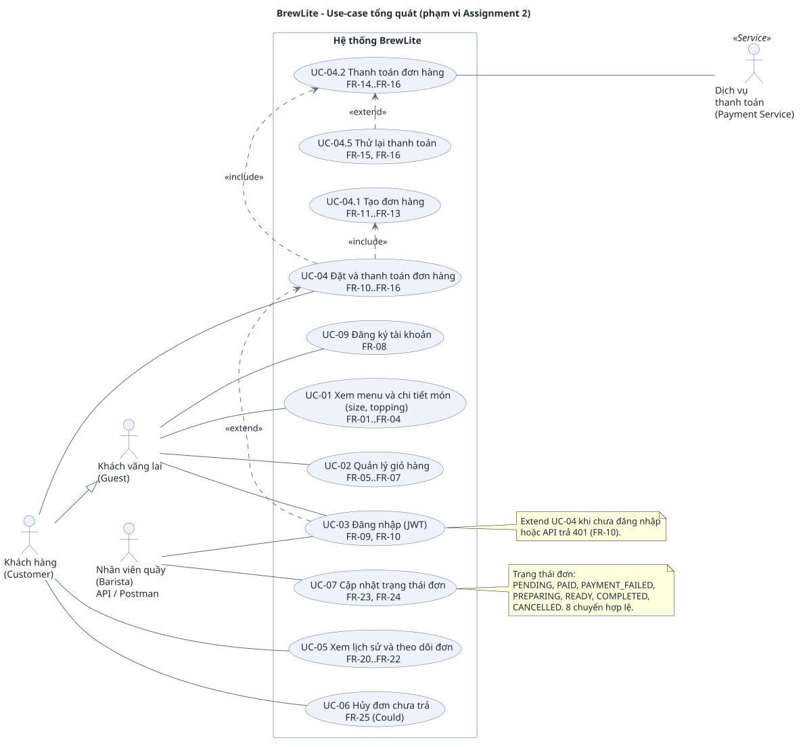

# Đặc tả yêu cầu phần mềm rút gọn (SRS) — BrewLite Assignment 2

> **Baseline Task 1 theo phạm vi minimum đã chốt trong PR #5.** Thành viên phụ trách phải tự giải thích được từng yêu cầu và tiêu chí chấp nhận khi vấn đáp.
>
> Đáp ứng đề A2 §3.2. Đề A2: [`../Assignment2-BrewLite.md`](../Assignment2-BrewLite.md). Bối cảnh, stakeholder, phạm vi: [`context-and-scope.md`](context-and-scope.md). Đặc tả use-case trọng tâm: [`uc-checkout.md`](uc-checkout.md). Truy vết: [`../traceability-matrix.md`](../traceability-matrix.md).
>
> Chỗ ghi **(dự kiến)** là tên endpoint, mã lỗi hoặc giá trị mà Task 2–5 có thể tinh chỉnh; nếu đổi thì sửa SRS, sơ đồ và ma trận truy vết trong cùng PR (xem `.claude/rules/doc-code-sync.md`).

## Mục lục

1. Giới thiệu
2. Tổng quan hệ thống: actor, use-case tổng quát, danh mục use-case
3. Quy ước dùng trong tiêu chí chấp nhận (API, mã lỗi, dữ liệu mẫu, quy tắc nghiệp vụ, từ điển miền dữ liệu)
4. Bảng tóm tắt yêu cầu theo 12 nhóm
5. Yêu cầu chức năng (FR)
6. Yêu cầu phi chức năng (NFR)
7. Ánh xạ yêu cầu → stakeholder
8. Quyết định phạm vi và đầu vào cho task sau
9. Thuật ngữ

---

## 1. Giới thiệu

### 1.1 Mục đích

Tài liệu mô tả **hệ thống BrewLite làm gì và không làm gì** trong Assignment 2, dưới dạng yêu cầu có mã định danh (`FR-xx`, `NFR-xx`), mức ưu tiên MoSCoW và **tiêu chí chấp nhận có thể kiểm chứng** (mã HTTP, trạng thái, thông báo giao diện, thời gian). Mục tiêu: người đọc ngoài nhóm viết được test từ tiêu chí chấp nhận (đề A2 §3.3).

### 1.2 Phạm vi

BrewLite là ứng dụng đặt đồ uống không dùng tiền mặt, mobile-first/PWA (Next.js), API NestJS, CSDL PostgreSQL. Luồng: **Xem menu → Chọn tùy chọn → Giỏ hàng → Đặt đơn → Thanh toán → Theo dõi đơn** (đề A2 §1.1). Phạm vi chi tiết, phần mở rộng, phần không làm: [`context-and-scope.md`](context-and-scope.md) mục 3.

### 1.3 Mức ưu tiên MoSCoW

| Mức | Ý nghĩa trong dự án này |
|---|---|
| **Must** | Bắt buộc có trong MVP; thiếu thì luồng end-to-end không đạt. Mọi `FR-xx` Must phải có đủ 5 cột ở ma trận truy vết trước khi hết Task 5 |
| **Should** | Làm sau khi Must xong; thiếu thì MVP vẫn chạy nhưng yếu một phần nghiệp vụ |
| **Could** | Làm nếu còn thời gian; bị cắt đầu tiên khi trễ tiến độ |
| **Won't** | Không làm trong Assignment 2; ghi phạm vi/lý do ở mục 1.4, 5.6, 5.8 và 5.9 |

### 1.4 Baseline bản nộp và phụ thuộc

- Bản nộp gồm FR-01–FR-16 và FR-20–FR-25 (22 Must). FR-23/24/25 là Must: FR-22 cần API cập nhật trạng thái; FR-15 và BR-03 cần hủy đơn chưa trả để hoàn tồn kho.
- FR-17, FR-18, FR-19, FR-26, FR-27 là **Won’t trong bản nộp**. Giữ đặc tả mở rộng để truy vết; AC của chúng chỉ áp dụng khi một PR sau phê duyệt đưa tính năng vào phạm vi. Không yêu cầu UI, endpoint, seed khuyến mãi hay giao dịch điểm cho minimum.
- FR-19 phụ thuộc FR-18; phần đảo điểm của FR-26 chỉ áp dụng khi FR-18 được triển khai. FR-17 và FR-18 độc lập.
- NFR Must chỉ áp dụng cho endpoint và luồng thuộc baseline. NFR-05 không kéo theo FR-19/27; NFR-16 không kéo theo seed của FR-17. NFR Should không là điều kiện nghiệm thu minimum; ngưỡng timeout đã ghi trực tiếp trong FR-15 vẫn bắt buộc.
- Task 2 vẫn phải mô hình hóa hai lớp domain bắt buộc `Promotion` và `LoyaltyTransaction` với thuộc tính, quan hệ, multiplicity (đề A2 §4.3); không đồng nghĩa phải hiện thực tính năng.

### 1.5 Cách đọc một yêu cầu

Mỗi yêu cầu có: **mô tả**, dòng **Ưu tiên / Use-case / Stakeholder**, và danh sách **tiêu chí chấp nhận** đánh mã `AC-Fxx.n` (cho `FR-xx`) hoặc `AC-Nxx.n` (cho `NFR-xx`). Mỗi tiêu chí viết dạng *khi/thì* để chuyển thẳng thành một test (mã test `UNIT-Txx`, `API-Txx`, `INT-Txx`, `E2E-Txx` ghi trong ma trận truy vết).

---

## 2. Tổng quan hệ thống

### 2.1 Actor

| Actor | Loại | Mô tả |
|---|---|---|
| Khách vãng lai (**Guest**) | Chính | Chưa đăng nhập: xem menu, chi tiết món, quản lý giỏ hàng, đăng ký, đăng nhập |
| Khách hàng (**Customer**) | Chính | Đã đăng nhập (JWT hợp lệ, `role = CUSTOMER`); kế thừa mọi việc của Guest (`Customer --\|> Guest`), thêm: đặt đơn, thanh toán, lịch sử và theo dõi đơn, hủy đơn chưa trả; xem điểm chỉ khi triển khai FR-19 |
| Nhân viên quầy (**Barista**) | Chính (minimum) | Đã đăng nhập, `role = BARISTA`; đổi trạng thái đơn đã thanh toán qua API (Postman); không đặt đơn, không thanh toán |
| Dịch vụ thanh toán (**Payment Service**) | Phụ (dịch vụ) | Dịch vụ **mô phỏng** Ví/Thẻ: nhận yêu cầu trừ tiền, trả thành công/thất bại; nhận yêu cầu hoàn tiền chỉ khi triển khai FR-26 |

### 2.2 Use-case diagram tổng quát

Nguồn: [`use-case-overview.puml`](use-case-overview.puml). Use-case trọng tâm UC-04 được đặc tả ở [`uc-checkout.md`](uc-checkout.md).

### 2.3 Danh mục use-case

| Mã | Tên use-case | Actor | Yêu cầu liên quan |
|---|---|---|---|
| UC-01 | Xem menu và chi tiết món (size, topping) | Guest, Customer | FR-01 đến FR-04 |
| UC-02 | Quản lý giỏ hàng | Guest, Customer | FR-05 đến FR-07 |
| UC-03 | Đăng ký / Đăng nhập (JWT) | Guest, Barista | FR-08, FR-09, FR-10 |
| UC-04 | **Đặt và thanh toán đơn hàng** (trọng tâm) | Customer; Payment Service | FR-10 đến FR-16; FR-17/18 ngoài bản nộp |
| UC-04.1 | Tạo đơn hàng (include của UC-04) | Customer | FR-11, FR-12, FR-13 |
| UC-04.2 | Thanh toán đơn hàng (include của UC-04) | Customer; Payment Service | FR-14, FR-15, FR-16 |
| UC-04.3 | Áp mã giảm giá (extend UC-04.2) | Customer | FR-17 |
| UC-04.4 | Ghi nhận điểm thưởng (extend UC-04.2) | hệ thống | FR-18 |
| UC-04.5 | Thử lại thanh toán (extend UC-04.2, khi đơn `PAYMENT_FAILED`) | Customer; Payment Service | FR-15, FR-16 |
| UC-05 | Xem lịch sử và theo dõi đơn | Customer | FR-20, FR-21, FR-22 |
| UC-06 | Hủy đơn | Customer, Barista; Payment Service (hoàn tiền) | FR-25, FR-26 |
| UC-07 | Cập nhật trạng thái đơn | Barista | FR-23, FR-24, FR-27 |
| UC-08 | Xem điểm thưởng | Customer | FR-19 |

---

## 3. Quy ước dùng trong tiêu chí chấp nhận

Mục này cố định tên và giá trị để các tiêu chí kiểm chứng được và để Task 2 (sơ đồ), Task 4–5 (code, test) dùng cùng một bộ từ ngữ.

### 3.1 Endpoint (dự kiến)

| Endpoint | Ai gọi | Mục đích |
|---|---|---|
| `GET /products`, `GET /products/:id` | công khai | Menu, chi tiết món |
| `POST /auth/register`, `POST /auth/login` | công khai | Đăng ký, đăng nhập |
| `POST /orders` | Customer | Tạo đơn `PENDING` |
| `POST /payments` | Customer | Thanh toán (header `Idempotency-Key`) |
| `GET /orders/me`, `GET /orders/:id` | Customer (`:id` còn cho Barista) | Lịch sử, chi tiết đơn |
| `PATCH /orders/:id` | Customer (hủy), Barista (đổi trạng thái) | Body `{ "status": "<TRẠNG_THÁI_ĐÍCH>" }` |
| `GET /orders?status=` | Barista | Hàng đợi quầy, chỉ khi triển khai FR-27 (ngoài bản nộp) |
| `GET /users/me` | Customer | Hồ sơ và điểm thưởng, chỉ khi triển khai FR-19 (ngoài bản nộp) |
| `GET /health` | công khai | Kiểm tra sống |

Cổng chạy local (dự kiến): web 3000, API 4000, PostgreSQL 5432.

### 3.2 Định dạng lỗi và mã HTTP

Mọi lỗi API trả JSON: `{ "statusCode": <số>, "error": "<MÃ_LỖI>", "message": "<thông điệp>", "details": [ ... ] }` (`details` có hoặc không tùy lỗi).

| HTTP | `error` (dự kiến) | Khi nào |
|---|---|---|
| 400 | `VALIDATION_ERROR`, `IDEMPOTENCY_KEY_REQUIRED` | Dữ liệu sai định dạng/thiếu; thiếu hoặc quá dài header `Idempotency-Key` |
| 401 | `UNAUTHORIZED` | Thiếu, sai hoặc hết hạn JWT; sai email/mật khẩu |
| 402 | `PAYMENT_DECLINED` | Payment Service từ chối |
| 403 | `FORBIDDEN` | Đúng đăng nhập nhưng sai vai trò, hoặc không phải chủ đơn |
| 404 | `PRODUCT_NOT_FOUND`, `ORDER_NOT_FOUND` | Không tồn tại |
| 409 | `EMAIL_ALREADY_EXISTS`, `OUT_OF_STOCK`, `ORDER_NOT_PAYABLE`, `INVALID_ORDER_TRANSITION` | Xung đột trạng thái hoặc dữ liệu |
| 422 | `IDEMPOTENCY_KEY_REUSED`; `PROMOTION_INVALID` chỉ khi triển khai FR-17 | Dữ liệu đúng định dạng nhưng sai nghiệp vụ |
| 502 | `PAYMENT_SERVICE_UNAVAILABLE` | Payment Service lỗi hoặc không phản hồi quá 5 giây |
| 503 | — | `GET /health` khi database không kết nối được |

Giao diện hiển thị số tiền dạng `124.000đ` (dấu chấm ngăn nghìn, hậu tố "đ"); thông báo cho người dùng bằng tiếng Việt.

### 3.3 Dữ liệu mẫu tham chiếu (seed, dự kiến)

Các tiêu chí dùng chung bộ dữ liệu này (NFR-16 yêu cầu seed tái tạo được):

- **Sản phẩm** (giá cho size S, đồng): Cà phê sữa 35.000 (tồn 50), Americano 40.000 (tồn 50), Cappuccino 45.000 (tồn 30), Trà đào 39.000 (tồn 30), Trà sữa trân châu 42.000 (tồn 20), Matcha latte 48.000 (tồn 20), Bạc xỉu 38.000 (**tồn 3**, dùng test sắp hết), Cold brew 45.000 (**tồn 0**, dùng test hết hàng).
- **Size:** S phụ thu 0đ, M +5.000đ, L +10.000đ.
- **Topping:** Trân châu +7.000đ, Kem phô mai +10.000đ, Thạch dừa +5.000đ.
- **Mã khuyến mãi (`Promotion`, chỉ seed khi triển khai FR-17):** `BREWLITE10` (giảm 10%, hợp lệ), `EXPIRED10` (đã hết hạn), `SOLDOUT10` (đã dùng hết lượt).
- **Tài khoản demo** (chỉ để test, mật khẩu chỉ dùng cho tài khoản **demo**): Customer `customer.demo@brewlite.local` mật khẩu demo `Demo@12345`; Barista `barista.demo@brewlite.local` mật khẩu demo `Demo@12345`.

**Ví dụ tính tiền dùng trong các tiêu chí:** 2 ly Cappuccino size L kèm topping Trân châu: đơn giá `45.000 + 10.000 + 7.000 = 62.000`; tổng `124.000`. Minimum trả đủ `124.000`, không ghi điểm. Chỉ khi triển khai FR-17, áp `BREWLITE10`: giảm `floor(124.000 × 10 / 100) = 12.400`; phải trả `111.600`; chỉ khi triển khai FR-18, điểm thưởng `floor(111.600 / 10.000) = 11`.

### 3.4 Quy ước mô phỏng Payment Service (dự kiến)

Để test thanh toán thành công/thất bại lặp lại được:

- Phương thức `WALLET` (Ví): luôn thành công.
- Phương thức `CARD` (Thẻ): body có `cardNumber` (số thẻ **demo**). `4242424242424242` thành công; kết thúc bằng `0002` (ví dụ `4000000000000002`) bị **từ chối**; kết thúc bằng `0119` làm Payment Service **không phản hồi** (quá 5 giây). Hệ thống không lưu và không ghi log số thẻ.
- Có thể ép lỗi cho test bằng biến môi trường (tên do Task 3 chốt).

### 3.5 Quy tắc nghiệp vụ (BR)

| Mã | Quy tắc |
|---|---|
| BR-01 | Giá do **server** tính: `unitPrice = product.price + phụ thu size + Σ phụ thu topping`; `lineTotal = unitPrice × quantity`; `total = Σ lineTotal`. Giá client gửi lên bị bỏ qua |
| BR-02 | Số lượng mỗi dòng từ 1 đến 99; mỗi đơn tối đa 20 dòng; giá là số nguyên VND |
| BR-03 | Tồn kho **giữ chỗ** (trừ) khi tạo đơn, trong cùng transaction với tạo `Order`; hoàn lại khi đơn `CANCELLED`; tồn kho không bao giờ âm |
| BR-04 | Chỉ chủ đơn mới thanh toán/hủy đơn của mình; đơn chỉ thanh toán được khi ở `PENDING` hoặc `PAYMENT_FAILED` |
| BR-05 | `Idempotency-Key` bắt buộc cho `POST /payments`, gắn với người dùng; chỉ **kết quả thành công** được giữ để trả lại; thanh toán thất bại không khóa key |
| BR-06 | Chỉ khi triển khai FR-17 (ngoài bản nộp): mỗi đơn dùng tối đa một mã khuyến mãi; mã hợp lệ khi `active`, trong khoảng `validFrom` đến `validTo`, và `usedCount < maxUses` (nếu có giới hạn); không phân biệt hoa/thường, bỏ khoảng trắng đầu cuối. `BREWLITE10`: `discount = floor(total × 10 / 100)`; `usedCount` tăng khi thanh toán thành công |
| BR-07 | Chỉ khi triển khai FR-18 (ngoài bản nộp): điểm thưởng: `floor(số tiền phải trả / 10.000)`, ghi một `LoyaltyTransaction` loại `EARN` khi đơn sang `PAID`; 0 điểm thì không ghi; mỗi đơn tối đa một giao dịch `EARN` |
| BR-08 | Vòng đời đơn theo mục 3.6; mọi chuyển trạng thái ngoài bảng đều bị từ chối |
| BR-09 | Thanh toán thất bại không xóa giỏ hàng và không hủy đơn; tồn kho vẫn giữ cho tới khi đơn `CANCELLED` |

### 3.6 Từ điển miền dữ liệu (ràng buộc cho Task 2)

Class diagram dùng đúng tên lớp và giá trị dưới đây (đề A2 §4.3). Sequence/activity dùng cùng tên khi tham chiếu; không bắt buộc đưa luồng khuyến mãi/điểm thưởng ngoài bản nộp vào các sơ đồ luồng minimum.

- **Lớp domain (7):** `User`, `Product`, `Order`, `OrderItem`, `Payment`, `Promotion`, `LoyaltyTransaction`.
- **Quan hệ khái niệm:** `User` 1–n `Order`; `Order` 1–n `OrderItem`; `OrderItem` n–1 `Product`; `Order` 1–n `Payment` (nhiều lần thử); `Order` n–0..1 `Promotion` (mã đã áp); `User` 1–n `LoyaltyTransaction`; `LoyaltyTransaction` n–0..1 `Order`. Topping và size mô hình hóa là thuộc tính hay lớp riêng do Task 2 quyết.
- **Trạng thái đơn** (`OrderStatus`): `PENDING`, `PAID`, `PAYMENT_FAILED`, `PREPARING`, `READY`, `COMPLETED`, `CANCELLED`.
- **Vai trò** (`Role`): `CUSTOMER`, `BARISTA`.
- **Phương thức thanh toán** (`PaymentMethod`): `WALLET`, `CARD`.
- **Trạng thái thanh toán** (`PaymentStatus`): `SUCCESS`, `FAILED`, `REFUNDED`.
- **Loại giao dịch điểm** (`LoyaltyType`): `EARN`, `REVERSAL`.
- **Thuộc tính tối thiểu cần có để thỏa tiêu chí:** `Product(id, name, price, imageUrl, stock)`; `User(id, email, passwordHash, role)`; `Order(id, userId, status, total, discountAmount, promotionId?, createdAt)`; `OrderItem(id, orderId, productId, size, toppings, quantity, unitPrice, lineTotal)`; `Payment(id, orderId, method, status, amount, idempotencyKey, createdAt)`; `Promotion(id, code, discountPercent, validFrom, validTo, maxUses?, usedCount, active)`; `LoyaltyTransaction(id, userId, orderId?, type, points, createdAt)`.

**Máy trạng thái đơn (BR-08).** Minimum có 8 chuyển trạng thái hợp lệ; chuyển thứ 9 `PAID → CANCELLED` chỉ hợp lệ khi triển khai FR-26, hiện ngoài bản nộp (nguồn: đề A1 §9.1):

| Từ | Sang | Ai thực hiện |
|---|---|---|
| `PENDING` | `PAID` | hệ thống, khi thanh toán thành công |
| `PENDING` | `PAYMENT_FAILED` | hệ thống, khi thanh toán thất bại |
| `PENDING` | `CANCELLED` | Customer (chủ đơn) |
| `PAYMENT_FAILED` | `PENDING` | hệ thống, khi khách thử thanh toán lại |
| `PAYMENT_FAILED` | `CANCELLED` | Customer (chủ đơn) |
| `PAID` | `PREPARING` | Barista |
| `PAID` | `CANCELLED` | Barista, chỉ khi triển khai FR-26; minimum từ chối với 409 `INVALID_ORDER_TRANSITION` |
| `PREPARING` | `READY` | Barista |
| `READY` | `COMPLETED` | Barista |

`COMPLETED` và `CANCELLED` là trạng thái kết thúc.

**Nhãn tiếng Việt trên giao diện:** `PENDING` "Chờ thanh toán"; `PAID` "Đã thanh toán"; `PAYMENT_FAILED` "Thanh toán thất bại"; `PREPARING` "Đang pha chế"; `READY` "Sẵn sàng nhận"; `COMPLETED` "Hoàn tất"; `CANCELLED` "Đã hủy".

---

## 4. Bảng tóm tắt yêu cầu theo 12 nhóm

| # | Nhóm | Yêu cầu | MoSCoW |
|---|---|---|---|
| 1 | Menu | FR-01, FR-02 | Must |
| 2 | Chi tiết sản phẩm | FR-03, FR-04 | Must |
| 3 | Giỏ hàng | FR-05, FR-06, FR-07 | Must |
| 4 | Xác thực | FR-08, FR-09, FR-10 | Must |
| 5 | Đặt đơn | FR-11, FR-12, FR-13 | Must |
| 6 | Thanh toán | FR-14, FR-15, FR-16 (Must); FR-17, FR-18, FR-19 (Won’t bản nộp) | Must / Won’t |
| 7 | Lịch sử đơn | FR-20, FR-21, FR-22 | Must |
| 8 | Quản lý trạng thái đơn | FR-23, FR-24, FR-25 (Must); FR-26, FR-27 (Won’t bản nộp) | Must / Won’t |
| 9 | Hiệu năng | NFR-01 (Must); NFR-02, NFR-03 (Should) | Must / Should |
| 10 | Bảo mật | NFR-04 đến NFR-08, NFR-13 | Must |
| 11 | Tính khả dụng | NFR-09, NFR-11, NFR-12 (Must); NFR-10 (Should) | Must / Should |
| 12 | Khả năng triển khai | NFR-14 đến NFR-19 (Must); NFR-20 (Should) | Must / Should |

Won’t bản nộp: FR-17, FR-18, FR-19, FR-26, FR-27 và FR-28 đến FR-32. Tổng cộng: **32 FR** (22 Must, 10 Won’t) và **20 NFR** (16 Must, 4 Should).

Ba tình huống đề A2 §4.1 đòi có nhánh riêng đều có yêu cầu riêng: **chưa đăng nhập** → FR-10; **hết hàng** → FR-13; **thanh toán thất bại** → FR-15.

---

## 5. Yêu cầu chức năng (FR)

### 5.1 Menu

#### FR-01 — Xem danh sách menu
- **Mô tả:** Hệ thống hiển thị danh sách đồ uống gồm hình, tên, giá, tình trạng còn hàng; không cần đăng nhập.
- **Ưu tiên:** Must · **Use-case:** UC-01 · **Stakeholder:** S1, S3
- **Tiêu chí chấp nhận:**
  - AC-F01.1: Khi gọi `GET /products` với dữ liệu mẫu (mục 3.3) thì trả 200 và mảng đúng 8 sản phẩm, mỗi phần tử có `id`, `name`, `price` (số nguyên), `imageUrl`, `stock`; không cần token.
  - AC-F01.2: Khi mở trang menu thì lưới hiển thị đủ 8 thẻ, mỗi thẻ có hình, tên và giá dạng `45.000đ`.
  - AC-F01.3: Khi sản phẩm có `stock = 0` (Cold brew) thì thẻ hiển thị nhãn "Hết hàng" và nút "Thêm vào giỏ" bị vô hiệu; sản phẩm có `stock <= 5` (Bạc xỉu) hiển thị nhãn "Sắp hết, còn N".

#### FR-02 — Trạng thái tải menu (loading, empty, error)
- **Mô tả:** Trang menu xử lý ba trạng thái: đang tải, danh sách rỗng, lỗi tải.
- **Ưu tiên:** Must · **Use-case:** UC-01 · **Stakeholder:** S1, S4
- **Tiêu chí chấp nhận:**
  - AC-F02.1: Khi yêu cầu tải chưa xong thì trang hiển thị skeleton hoặc spinner trong vòng 200 ms kể từ lúc gửi yêu cầu, và biến mất khi có dữ liệu.
  - AC-F02.2: Khi `GET /products` trả mảng rỗng thì trang hiển thị "Hiện chưa có món nào" và không hiển thị lưới.
  - AC-F02.3: Khi `GET /products` trả 5xx hoặc mất mạng thì trang hiển thị "Không tải được thực đơn" cùng nút "Thử lại"; bấm "Thử lại" gửi lại yêu cầu và hiển thị menu nếu thành công.

### 5.2 Chi tiết sản phẩm

#### FR-03 — Xem chi tiết sản phẩm
- **Mô tả:** Hệ thống hiển thị chi tiết một sản phẩm (hình, tên, mô tả, giá nền, tùy chọn size và topping).
- **Ưu tiên:** Must · **Use-case:** UC-01 · **Stakeholder:** S1
- **Tiêu chí chấp nhận:**
  - AC-F03.1: Khi gọi `GET /products/:id` với `id` tồn tại thì trả 200 với `id`, `name`, `price`, `imageUrl`, `stock`, `description`.
  - AC-F03.2: Khi gọi `GET /products/:id` với `id` không tồn tại thì trả 404 `PRODUCT_NOT_FOUND`.
  - AC-F03.3: Khi mở trang chi tiết của `id` không tồn tại thì giao diện hiển thị "Không tìm thấy sản phẩm" và liên kết quay lại menu; trang có trạng thái loading và error như FR-02.

#### FR-04 — Chọn size và topping
- **Mô tả:** Khách chọn size (S/M/L) và nhiều topping; giá hiển thị cập nhật theo lựa chọn (BR-01).
- **Ưu tiên:** Must · **Use-case:** UC-01 · **Stakeholder:** S1
- **Tiêu chí chấp nhận:**
  - AC-F04.1: Khi mở trang chi tiết thì size mặc định được chọn là `M`; chỉ một size được chọn tại một thời điểm.
  - AC-F04.2: Khi chọn Cappuccino (45.000đ) size `L` thì giá hiển thị là `55.000đ`; thêm topping "Trân châu" thì giá hiển thị là `62.000đ`; bỏ topping thì về `55.000đ` ngay, không tải lại trang.
  - AC-F04.3: Khi chọn đồng thời "Trân châu" và "Kem phô mai" thì phụ thu cộng dồn (`+17.000đ`).

### 5.3 Giỏ hàng

#### FR-05 — Thêm món vào giỏ
- **Mô tả:** Khách (Guest hoặc Customer) thêm món kèm size, topping, số lượng vào giỏ hàng lưu ở trình duyệt.
- **Ưu tiên:** Must · **Use-case:** UC-02 · **Stakeholder:** S1
- **Tiêu chí chấp nhận:**
  - AC-F05.1: Khi bấm "Thêm vào giỏ" ở chi tiết Cappuccino L + Trân châu số lượng 2 thì giỏ có một dòng đúng các giá trị đó và biểu tượng giỏ hiển thị số lượng tổng là 2.
  - AC-F05.2: Khi thêm hai lần cùng món, cùng size, cùng topping thì giỏ gộp thành một dòng cộng dồn số lượng; khác size hoặc khác topping thì tạo dòng riêng.
  - AC-F05.3: Khi tải lại trang hoặc đăng nhập xong thì giỏ vẫn còn nguyên các dòng (lưu `localStorage`).
  - AC-F05.4: Khi sản phẩm hết hàng (`stock = 0`) thì không thêm được vào giỏ; khi số lượng đã thêm bằng `stock` thì nút thêm bị vô hiệu kèm thông báo "Đã đạt số lượng tối đa còn lại".
  - AC-F05.5: Khi giỏ đã có 20 dòng thì thêm dòng thứ 21 bị từ chối với thông báo "Giỏ hàng tối đa 20 món" (BR-02).

#### FR-06 — Sửa số lượng và xóa dòng
- **Mô tả:** Khách tăng, giảm số lượng và xóa dòng trong giỏ.
- **Ưu tiên:** Must · **Use-case:** UC-02 · **Stakeholder:** S1
- **Tiêu chí chấp nhận:**
  - AC-F06.1: Khi bấm "+" thì số lượng tăng 1, tối đa 99; ở 99 nút "+" bị vô hiệu.
  - AC-F06.2: Khi bấm "−" ở số lượng 1 thì dòng bị xóa sau khi khách xác nhận, hoặc có nút "Hoàn tác"; ở số lượng lớn hơn 1 thì giảm 1.
  - AC-F06.3: Khi bấm "Xóa" ở một dòng thì chỉ dòng đó bị xóa; khi giỏ rỗng thì hiển thị "Giỏ hàng trống" cùng nút quay lại menu và nút "Thanh toán" bị vô hiệu.

#### FR-07 — Tính tổng tiền giỏ
- **Mô tả:** Giỏ tự tính thành tiền từng dòng và tổng tiền theo BR-01, cập nhật ngay khi giỏ đổi.
- **Ưu tiên:** Must · **Use-case:** UC-02 · **Stakeholder:** S1, S3
- **Tiêu chí chấp nhận:**
  - AC-F07.1: Khi giỏ có 2 × Cappuccino L + Trân châu thì dòng hiển thị đơn giá `62.000đ`, thành tiền `124.000đ`; tổng giỏ là `124.000đ`.
  - AC-F07.2: Khi giỏ có thêm 1 × Americano M (`45.000đ`) thì tổng giỏ là `169.000đ`; đổi số lượng hoặc xóa dòng thì tổng cập nhật trong vòng 100 ms mà không tải lại trang.
  - AC-F07.3: Tổng hiển thị ở giỏ bằng `Order.total` do server tính ở FR-11 cho cùng nội dung giỏ (kiểm bằng một test so sánh).

### 5.4 Xác thực

#### FR-08 — Đăng ký tài khoản
- **Mô tả:** Guest đăng ký bằng email và mật khẩu; tài khoản mới có vai trò `CUSTOMER`.
- **Ưu tiên:** Must · **Use-case:** UC-03 · **Stakeholder:** S1
- **Tiêu chí chấp nhận:**
  - AC-F08.1: Khi `POST /auth/register` với `{ email, password }` hợp lệ (email đúng định dạng, mật khẩu ít nhất 8 ký tự gồm chữ và số) thì trả 201 với `id`, `email`, `role = "CUSTOMER"`; phản hồi không chứa `password` hay `passwordHash`.
  - AC-F08.2: Khi email đã tồn tại (không phân biệt hoa/thường) thì trả 409 `EMAIL_ALREADY_EXISTS`.
  - AC-F08.3: Khi email sai định dạng, mật khẩu ngắn hơn 8 ký tự, hoặc body có trường lạ như `role` thì trả 400 `VALIDATION_ERROR` kèm `details` chỉ rõ trường lỗi.
  - AC-F08.4: Khi gửi form đăng ký với dữ liệu sai thì giao diện hiển thị thông báo lỗi dưới từng ô, không gọi API nếu lỗi do định dạng.

#### FR-09 — Đăng nhập và cấp JWT
- **Mô tả:** Người dùng đăng nhập bằng email và mật khẩu, nhận JWT dùng cho các chức năng cần xác thực.
- **Ưu tiên:** Must · **Use-case:** UC-03 · **Stakeholder:** S1, S2
- **Tiêu chí chấp nhận:**
  - AC-F09.1: Khi `POST /auth/login` với thông tin đúng thì trả 200 với `accessToken` là JWT có `sub` (id người dùng), `role` và `exp`.
  - AC-F09.2: Khi sai mật khẩu hoặc email không tồn tại thì trả 401 `UNAUTHORIZED` với cùng một thông điệp "Email hoặc mật khẩu không đúng" (không tiết lộ email nào tồn tại).
  - AC-F09.3: Khi đăng nhập thành công trên giao diện thì chuyển về trang trước đó (tham số `next`) hoặc trang menu, và header hiển thị trạng thái đã đăng nhập kèm nút "Đăng xuất"; đăng xuất xóa token và giữ nguyên giỏ hàng.
  - AC-F09.4: Barista dùng cùng form và endpoint đăng nhập; token có `role = "BARISTA"`.

#### FR-10 — Chặn khi chưa đăng nhập
- **Mô tả:** Chức năng cần xác thực (đặt đơn, thanh toán, lịch sử, theo dõi đơn, đổi trạng thái; hồ sơ chỉ khi triển khai FR-19) chỉ dùng được khi có JWT hợp lệ; Guest được dẫn tới đăng nhập rồi quay lại và không mất giỏ hàng.
- **Ưu tiên:** Must · **Use-case:** UC-03, UC-04 · **Stakeholder:** S1, S4
- **Tiêu chí chấp nhận:**
  - AC-F10.1: Khi gọi `POST /orders`, `POST /payments`, `GET /orders/me`, `GET /orders/:id`, `PATCH /orders/:id` mà không có header `Authorization` thì trả 401 `UNAUTHORIZED`.
  - AC-F10.2: Khi token sai chữ ký hoặc đã hết hạn thì cùng các endpoint trên trả 401 `UNAUTHORIZED`.
  - AC-F10.3: Khi Guest có giỏ hàng bấm "Thanh toán" thì giao diện chuyển tới `/login?next=/checkout` trong vòng 1 giây, không gọi `POST /orders`; sau đăng nhập thành công quay về `/checkout` và giỏ còn nguyên các dòng.
  - AC-F10.4: Khi token hết hạn giữa lúc thanh toán và API trả 401 thì giao diện hiển thị "Phiên đăng nhập đã hết hạn, vui lòng đăng nhập lại", chuyển tới đăng nhập, giữ nguyên giỏ. Nếu chưa tạo đơn (401 ở `POST /orders`) thì sau đăng nhập tiếp tục bước tạo đơn. Nếu đã có `orderId` (401 ở `POST /payments`) thì giữ `orderId`, chủ đơn và `Idempotency-Key`; đăng nhập lại **cùng tài khoản**, đọc lại `GET /orders/:id` và tiếp tục thanh toán đơn cũ nếu `PENDING`/`PAYMENT_FAILED`, không gọi lại `POST /orders`, không giữ kho thêm lần nữa. Nếu đơn đã trả thì hiển thị chi tiết/kết quả; nếu `CANCELLED` thì dừng thanh toán. Đăng nhập tài khoản khác không tự thanh toán đơn cũ; API từ chối truy cập với 403, UI yêu cầu dùng đúng tài khoản hoặc về lịch sử của tài khoản mới.
  - AC-F10.5: Guest vẫn xem menu, chi tiết món và thêm vào giỏ bình thường (không bị chặn bởi đăng nhập).

### 5.5 Đặt đơn

#### FR-11 — Tạo đơn hàng
- **Mô tả:** Customer tạo đơn từ giỏ; đơn ở trạng thái `PENDING`. Tạo `Order`, các `OrderItem` và giữ chỗ tồn kho nằm trong một transaction (BR-03).
- **Ưu tiên:** Must · **Use-case:** UC-04.1 · **Stakeholder:** S1, S3, S5
- **Tiêu chí chấp nhận:**
  - AC-F11.1: Khi `POST /orders` kèm token Customer và `items = [{ productId: <Cappuccino>, quantity: 2, size: "L", toppings: ["Trân châu"] }]` thì trả 201 với `id`, `status = "PENDING"`, `total = 124000`, một `OrderItem` với `unitPrice = 62000`, `lineTotal = 124000`; `userId` của đơn là người trong token.
  - AC-F11.2: Sau khi tạo đơn ở AC-F11.1 thì `stock` của Cappuccino giảm đúng 2 (30 thành 28).
  - AC-F11.3: Khi quá trình tạo một `OrderItem` thất bại (ví dụ dòng thứ hai lỗi) thì không có `Order` nào được tạo và `stock` của mọi sản phẩm không đổi (kiểm bằng integration test gây lỗi giữa chừng).
  - AC-F11.4: Khi gọi bằng token Barista thì trả 403 `FORBIDDEN`.

#### FR-12 — Kiểm dữ liệu và tính giá phía server
- **Mô tả:** Server kiểm mọi dữ liệu đơn và tự tính giá; không tin giá hay tổng từ client (BR-01, BR-02).
- **Ưu tiên:** Must · **Use-case:** UC-04.1 · **Stakeholder:** S1, S3, S5
- **Tiêu chí chấp nhận:**
  - AC-F12.1: Khi `items` rỗng, hoặc có hơn 20 dòng, `quantity` < 1, `quantity` > 99, `quantity` không phải số nguyên, `size` ngoài `S`/`M`/`L`, hoặc topping không có trong danh sách thì trả 400 `VALIDATION_ERROR` và không tạo `Order`.
  - AC-F12.2: Khi `productId` không tồn tại thì trả 404 `PRODUCT_NOT_FOUND` và không tạo `Order`.
  - AC-F12.3: Khi body có thêm trường `total: 1` hoặc `unitPrice: 1` thì trả 400 (trường lạ); `Order.total` không bao giờ lấy từ client.
  - AC-F12.4: Khi giỏ trên giao diện rỗng thì nút "Thanh toán" bị vô hiệu và không gọi API.

#### FR-13 — Xử lý hết hàng khi đặt đơn
- **Mô tả:** Khi số lượng đặt vượt tồn kho, hệ thống từ chối tạo đơn, không bán quá số lượng còn, và báo rõ món nào thiếu.
- **Ưu tiên:** Must · **Use-case:** UC-04.1 · **Stakeholder:** S1, S3
- **Tiêu chí chấp nhận:**
  - AC-F13.1: Khi đặt 5 ly Bạc xỉu (tồn 3) thì trả 409 `OUT_OF_STOCK` với `details = [{ productId, requested: 5, available: 3 }]`; không có `Order` mới; `stock` mọi sản phẩm không đổi, kể cả các dòng hợp lệ khác trong cùng yêu cầu.
  - AC-F13.2: Khi đặt Cold brew (tồn 0) thì trả 409 `OUT_OF_STOCK` với `available = 0`.
  - AC-F13.3: Khi tồn Americano là 5 và 10 yêu cầu `POST /orders` đồng thời, mỗi yêu cầu 1 ly, thì đúng 5 yêu cầu trả 201, 5 yêu cầu trả 409 `OUT_OF_STOCK`, `stock` cuối bằng 0 (không âm) (integration test).
  - AC-F13.4: Khi nhận 409 `OUT_OF_STOCK` thì giao diện hiển thị "{Tên món} chỉ còn N ly" (N > 0) hoặc "{Tên món} đã hết hàng" (N = 0), đưa khách về giỏ, đánh dấu dòng liên quan, giữ nguyên giỏ; sau khi khách chỉnh số lượng thì thanh toán lại được.
  - AC-F13.5: Đơn bị từ chối vì hết hàng không xuất hiện trong lịch sử đơn của khách.

### 5.6 Thanh toán

#### FR-14 — Thanh toán Ví/Thẻ mô phỏng
- **Mô tả:** Customer thanh toán đơn `PENDING` bằng Ví hoặc Thẻ; thành công thì đơn sang `PAID`. Lưu `Payment`, đổi trạng thái đơn trong một transaction.
- **Ưu tiên:** Must · **Use-case:** UC-04.2 · **Stakeholder:** S1, S3, S6
- **Tiêu chí chấp nhận:**
  - AC-F14.1: Khi `POST /payments` với `{ orderId, paymentMethod: "WALLET" }`, header `Idempotency-Key` hợp lệ, đơn `PENDING` của chính người gọi thì trả 201 với `orderStatus = "PAID"`, `amount` bằng `Order.total`, `status = "SUCCESS"`; `Order.status` trong DB là `PAID`; Payment Service được gọi đúng 1 lần; có đúng 1 `Payment` `SUCCESS`.
  - AC-F14.2: Khi `paymentMethod` ngoài `WALLET`/`CARD` hoặc thiếu `orderId` thì trả 400 `VALIDATION_ERROR`; thiếu hoặc rỗng header `Idempotency-Key`, hoặc dài hơn 255 ký tự, thì trả 400 `IDEMPOTENCY_KEY_REQUIRED`; cả hai trường hợp không gọi Payment Service.
  - AC-F14.3: Khi `orderId` không tồn tại thì trả 404 `ORDER_NOT_FOUND`; khi đơn thuộc người khác thì trả 403 `FORBIDDEN`; sau khi kiểm xác thực và quyền sở hữu, nếu có kết quả thành công của cùng người dùng/đơn/key/body thì trả lại 200 theo FR-16 trước khi xét trạng thái. Chỉ với yêu cầu mới, khi đơn đang ở `PAID`, `PREPARING`, `READY`, `COMPLETED` hoặc `CANCELLED` thì trả 409 `ORDER_NOT_PAYABLE`; các nhánh trên đều không gọi Payment Service.
  - AC-F14.4: Khi gọi bằng token Barista thì trả 403 `FORBIDDEN`.
  - AC-F14.5: Khi chọn Thẻ ở giao diện mà số thẻ demo sai định dạng (không đủ 16 chữ số) thì giao diện báo lỗi tại ô và không gọi API.

#### FR-15 — Xử lý thanh toán thất bại
- **Mô tả:** Khi Payment Service từ chối hoặc không phản hồi, đơn chuyển `PAYMENT_FAILED`, giỏ hàng và đơn được giữ để khách thử lại hoặc hủy (BR-09).
- **Ưu tiên:** Must · **Use-case:** UC-04.2 · **Stakeholder:** S1, S6
- **Tiêu chí chấp nhận:**
  - AC-F15.1: Khi `paymentMethod = "CARD"` với `cardNumber = 4000000000000002` thì trả 402 `PAYMENT_DECLINED`; có 1 `Payment` `FAILED`; `Order.status = "PAYMENT_FAILED"`; nếu triển khai FR-18 thì không ghi điểm; nếu triển khai FR-17 thì `usedCount` không đổi; Payment Service không ghi nhận khoản thu nào.
  - AC-F15.2: Khi `cardNumber = 4000000000000119` (Payment Service không phản hồi quá 5 giây) thì trả 502 `PAYMENT_SERVICE_UNAVAILABLE` trong vòng 7 giây; kết quả đối với `Order` và `Payment` giống AC-F15.1.
  - AC-F15.3: Sau thất bại thì `stock` vẫn đang giữ chỗ (không hoàn), `Order` còn nguyên `OrderItem`, và `GET /orders/me` vẫn trả đơn đó ở trạng thái `PAYMENT_FAILED`.
  - AC-F15.4: Khi nhận 402 hoặc 502 thì giao diện hiển thị "Thanh toán không thành công. Đơn của bạn vẫn được giữ, bạn có thể thử lại hoặc chọn phương thức khác.", giỏ hàng còn đủ các dòng, có nút "Thử lại" và "Hủy đơn".
  - AC-F15.5: Khi khách thử lại sau thất bại với thẻ `4242424242424242` cho cùng `orderId` thì trả 201, `Order` đi `PAYMENT_FAILED → PENDING → PAID`, **không** tạo `Order` mới (số đơn của khách không đổi), có thêm 1 `Payment` `SUCCESS`.

#### FR-16 — Thanh toán idempotent
- **Mô tả:** Gửi lại cùng yêu cầu thanh toán (mất phản hồi, bấm đúp, retry mạng) không trừ tiền hai lần và không tạo trùng bản ghi (BR-05).
- **Ưu tiên:** Must · **Use-case:** UC-04.2 · **Stakeholder:** S1, S3, S6
- **Tiêu chí chấp nhận:**
  - AC-F16.1: Khi gửi hai lần `POST /payments` giống hệt nhau (cùng `Idempotency-Key`, cùng `orderId`, cùng body) và lần đầu thành công thì lần hai trả 200 với `paymentId` và nội dung giống lần đầu; Payment Service được gọi đúng 1 lần; DB có đúng 1 `Payment` `SUCCESS` cho đơn; có đúng 1 `LoyaltyTransaction` `EARN` (nếu FR-18 được làm).
  - AC-F16.2: Khi hai yêu cầu cùng người dùng/đơn/key/body gửi song song và thanh toán thành công thì xử lý tuần tự theo key: kết quả cuối đúng 1 `Payment` `SUCCESS`; cả hai nhận 2xx với cùng `paymentId`. Nếu lần đầu thất bại thì yêu cầu thứ hai được xử lý như lần thử mới theo AC-F16.5; với cùng thẻ từ chối/timeout, cả hai trả 402/502 tương ứng, có 2 `Payment` `FAILED`, không ghi nhận khoản thu.
  - AC-F16.3: Khi cùng `Idempotency-Key` nhưng `orderId` khác (cùng chủ) thì trả 422 `IDEMPOTENCY_KEY_REUSED`, không gọi Payment Service, đơn thứ hai giữ nguyên trạng thái.
  - AC-F16.4: Khi đơn đã `PAID` mà khách gửi `Idempotency-Key` **mới** thì trả 409 `ORDER_NOT_PAYABLE`, không gọi Payment Service (không trừ tiền lần hai).
  - AC-F16.5: Khi lần đầu thất bại (FR-15) thì gửi lại cùng key được xử lý như lần thử mới (BR-05), không trả lại kết quả thất bại cũ.
  - AC-F16.6: Khi bấm "Xác nhận trả" thì nút bị vô hiệu cho tới khi có phản hồi (chống bấm đúp); giao diện dùng cùng một `Idempotency-Key` cho cả phiên màn thanh toán, sinh key mới khi bắt đầu phiên thanh toán khác; chuyển sang đăng nhập theo E1 phải giữ key cùng `orderId` để tiếp tục phiên cũ.

#### FR-17 — Xác thực và áp mã giảm giá
- **Mô tả:** Khi thanh toán, khách có thể nhập một mã khuyến mãi; server kiểm hợp lệ và giảm giá theo BR-06.
- **Ưu tiên:** Won’t trong bản nộp · **Use-case:** UC-04.3 · **Stakeholder:** S1, S3
- **Tiêu chí mở rộng (chỉ áp dụng khi được đưa lại vào phạm vi):**
  - AC-F17.1: Khi `POST /payments` kèm `promotionCode = "BREWLITE10"` cho đơn `total = 124000` thì trả 201 với `discountAmount = 12400`, `amount = 111600`; `usedCount` của mã tăng 1; mã `brewlite10 ` (chữ thường, thừa khoảng trắng) cho kết quả y hệt.
  - AC-F17.2: Khi mã không tồn tại, hoặc `EXPIRED10` (hết hạn), hoặc `SOLDOUT10` (hết lượt), hoặc chưa tới `validFrom`, hoặc `active = false` thì trả 422 `PROMOTION_INVALID`; không gọi Payment Service; `Order` vẫn `PENDING`; không có `Payment`.
  - AC-F17.3: Sau lỗi `PROMOTION_INVALID`, khách gửi lại cùng `Idempotency-Key` và không kèm mã thì thanh toán thành công với `amount = total`.
  - AC-F17.4: Giao diện có ô "Mã giảm giá" tùy chọn; mã không hợp lệ hiển thị "Mã giảm giá không hợp lệ hoặc đã hết hạn" và giữ nguyên các lựa chọn khác; thành công hiển thị dòng "Đã giảm: 12.400đ" trên biên lai.
  - AC-F17.5: Mỗi đơn chỉ áp tối đa một mã (body chỉ nhận một `promotionCode`).

#### FR-18 — Ghi nhận điểm thưởng khi đơn PAID
- **Mô tả:** Khi đơn chuyển `PAID`, hệ thống ghi một `LoyaltyTransaction` loại `EARN` theo BR-07.
- **Ưu tiên:** Won’t trong bản nộp · **Use-case:** UC-04.4 · **Stakeholder:** S1, S3
- **Tiêu chí mở rộng (chỉ áp dụng khi được đưa lại vào phạm vi):**
  - AC-F18.1: Khi đơn có `amount = 111600` sang `PAID` thì có đúng 1 `LoyaltyTransaction` với `type = EARN`, `points = 11`, `userId` và `orderId` đúng.
  - AC-F18.2: Khi `amount = 9999` thì không ghi `LoyaltyTransaction` (0 điểm); khi thanh toán thất bại thì không ghi.
  - AC-F18.3: Khi gửi lại thanh toán cùng `Idempotency-Key` thì vẫn chỉ có 1 giao dịch `EARN` cho đơn (không cộng điểm hai lần).
  - AC-F18.4: Lưu `Payment` `SUCCESS`, đổi `Order` sang `PAID` và ghi `LoyaltyTransaction` nằm trong cùng một transaction: nếu bước ghi điểm lỗi thì ba thay đổi đều không được lưu (xem NFR-13).

#### FR-19 — Hiển thị điểm thưởng
- **Mô tả:** Khách xem tổng điểm thưởng của mình và điểm vừa được cộng.
- **Ưu tiên:** Won’t trong bản nộp · **Use-case:** UC-08 · **Stakeholder:** S1
- **Tiêu chí mở rộng (chỉ áp dụng khi được đưa lại vào phạm vi):**
  - AC-F19.1: Khi `GET /users/me` với token Customer thì trả 200 với `id`, `email`, `role`, `loyaltyPoints` bằng tổng `points` các `LoyaltyTransaction` của người đó; phản hồi không chứa `passwordHash`; không có token thì 401; token Barista thì 403.
  - AC-F19.2: Khi mở trang hồ sơ thì giao diện hiển thị "Điểm tích lũy: N" khớp `loyaltyPoints`.
  - AC-F19.3: Khi biên lai có `loyaltyPointsEarned > 0` thì hiển thị "+N điểm tích lũy"; bằng 0 thì không hiển thị dòng này.

### 5.7 Lịch sử đơn

#### FR-20 — Xác nhận đơn (biên lai)
- **Mô tả:** Sau thanh toán thành công, khách thấy màn xác nhận đơn.
- **Ưu tiên:** Must · **Use-case:** UC-04, UC-05 · **Stakeholder:** S1, S4
- **Tiêu chí chấp nhận:**
  - AC-F20.1: Khi thanh toán trả 2xx thì giao diện chuyển tới màn xác nhận hiển thị: mã đơn, trạng thái "Đã thanh toán", danh sách món (tên, size, topping, số lượng), tổng gốc, số tiền giảm (chỉ nếu triển khai FR-17), số tiền đã trả, phương thức, thời gian.
  - AC-F20.2: Khi hiển thị màn xác nhận thì giỏ hàng đã được xóa (số lượng trên biểu tượng giỏ là 0); khi thanh toán thất bại thì giỏ **không** bị xóa.
  - AC-F20.3: Khi tải lại trang xác nhận thì nội dung vẫn đúng (dữ liệu lấy từ `GET /orders/:id`, không phụ thuộc state tạm); có nút "Theo dõi đơn" dẫn tới trang chi tiết đơn.

#### FR-21 — Lịch sử đơn của tôi
- **Mô tả:** Customer xem danh sách đơn của chính mình, mới nhất trước.
- **Ưu tiên:** Must · **Use-case:** UC-05 · **Stakeholder:** S1
- **Tiêu chí chấp nhận:**
  - AC-F21.1: Khi `GET /orders/me` với token Customer thì trả 200 với mảng các đơn của **chính người đó**, sắp theo `createdAt` giảm dần, mỗi phần tử có `id`, `status`, `total`, `createdAt`; tối đa 50 đơn mới nhất.
  - AC-F21.2: Khi có hai khách A và B, mỗi người đặt một đơn thì `GET /orders/me` của A không chứa đơn của B.
  - AC-F21.3: Khi chưa có đơn thì trả 200 `[]` và giao diện hiển thị "Bạn chưa có đơn nào" cùng liên kết tới menu; có loading và error như FR-02.
  - AC-F21.4: Khi gọi không token thì 401; token Barista thì 403.
  - AC-F21.5: Giao diện mỗi dòng hiển thị mã đơn, ngày giờ, tổng tiền và nhãn trạng thái tiếng Việt (mục 3.6).

#### FR-22 — Xem chi tiết và theo dõi trạng thái đơn
- **Mô tả:** Customer xem chi tiết một đơn của mình và thấy trạng thái cập nhật tự động (bước "Theo dõi đơn" của luồng).
- **Ưu tiên:** Must · **Use-case:** UC-05 · **Stakeholder:** S1, S2
- **Tiêu chí chấp nhận:**
  - AC-F22.1: Khi `GET /orders/:id` của chủ đơn thì trả 200 với `status`, `total`, `discountAmount` (0 ở minimum), `items`, thông tin thanh toán (nếu có); đơn không tồn tại trả 404 `ORDER_NOT_FOUND`; đơn của người khác trả 403 `FORBIDDEN`; token Barista xem được mọi đơn (200).
  - AC-F22.2: Khi trang theo dõi đơn đang mở và Barista đổi trạng thái (FR-24) thì nhãn trên trang cập nhật trong vòng 6 giây mà không cần tải lại (tự làm mới mỗi 5 giây).
  - AC-F22.3: Khi đơn đã ở `COMPLETED` hoặc `CANCELLED` thì trang ngừng tự làm mới (không còn yêu cầu định kỳ).
  - AC-F22.4: Trang hiển thị tiến trình `PAID → PREPARING → READY → COMPLETED` với bước hiện tại được đánh dấu; trạng thái `CANCELLED` và `PAYMENT_FAILED` hiển thị nhãn riêng.

### 5.8 Quản lý trạng thái đơn

> **Quyết định minimum:** FR-23, FR-24, FR-25 là Must. Nhân viên đổi trạng thái qua API bằng Postman, dùng mã đơn từ biên lai demo để đọc `GET /orders/:id`; không cần API danh sách/màn hàng đợi (FR-27). Swagger UI không là tiêu chí nghiệm thu.

#### FR-23 — Vòng đời và chặn chuyển trạng thái sai
- **Mô tả:** Mọi thay đổi trạng thái đơn tuân theo bảng chuyển hợp lệ theo phạm vi ở mục 3.6; chuyển ngoài bảng bị từ chối.
- **Ưu tiên:** Must · **Use-case:** UC-07 · **Stakeholder:** S2, S3, S5
- **Tiêu chí chấp nhận:**
  - AC-F23.1: Unit test duyệt toàn bộ 49 cặp (trạng thái hiện tại, trạng thái đích) trên 7 trạng thái: minimum chấp nhận đúng 8 cặp ở mục 3.6 và từ chối 41 cặp còn lại (kể cả cặp trùng trạng thái và `PAID → CANCELLED`). Chỉ khi triển khai FR-26 mới chấp nhận 9 cặp và từ chối 40 cặp; kiểm quyền actor riêng theo FR-24/25/26.
  - AC-F23.2: Khi gọi `PATCH /orders/:id` với chuyển không hợp lệ (ví dụ `PAID → READY`, `PREPARING → CANCELLED`, `COMPLETED → PREPARING`) thì trả 409 `INVALID_ORDER_TRANSITION` và trạng thái đơn trong DB không đổi.
  - AC-F23.3: Khi `status` đích trong body là `PENDING`, `PAID` hoặc `PAYMENT_FAILED` thì trả 400 `VALIDATION_ERROR` (các chuyển này chỉ do luồng thanh toán thực hiện).
  - AC-F23.4: `COMPLETED` và `CANCELLED` không có chuyển nào đi ra.

#### FR-24 — Barista đổi trạng thái đơn qua API
- **Mô tả:** Barista chuyển đơn đã thanh toán qua `PREPARING`, `READY`, `COMPLETED`.
- **Ưu tiên:** Must · **Use-case:** UC-07 · **Stakeholder:** S2, S1
- **Tiêu chí chấp nhận:**
  - AC-F24.1: Khi token Barista gọi `PATCH /orders/:id` với `{ "status": "PREPARING" }` trên đơn `PAID` thì trả 200 với `status = "PREPARING"`; tiếp tục `READY` rồi `COMPLETED` đều trả 200.
  - AC-F24.2: Khi token Customer gọi cùng thao tác với `PREPARING`, `READY` hoặc `COMPLETED` thì trả 403 `FORBIDDEN`; không có token thì 401.
  - AC-F24.3: Khi Barista chuyển đơn `PENDING` hoặc `PAYMENT_FAILED` sang `PREPARING` thì trả 409 `INVALID_ORDER_TRANSITION`; `id` không tồn tại trả 404 `ORDER_NOT_FOUND`.
  - AC-F24.4: Có Postman collection và hướng dẫn dùng tài khoản Barista demo để lấy Bearer token, đọc đơn theo mã đơn, gọi `PATCH /orders/:id` qua đủ `PAID → PREPARING → READY → COMPLETED`; chạy được và nhận các mã HTTP theo AC-F24.1–3. Không yêu cầu Swagger UI.

#### FR-25 — Khách hủy đơn chưa thanh toán
- **Mô tả:** Customer hủy đơn của mình khi đơn còn `PENDING` hoặc `PAYMENT_FAILED`; tồn kho giữ chỗ được hoàn lại.
- **Ưu tiên:** Must · **Use-case:** UC-06 · **Stakeholder:** S1, S3
- **Tiêu chí chấp nhận:**
  - AC-F25.1: Khi chủ đơn gọi `PATCH /orders/:id` với `{ "status": "CANCELLED" }` trên đơn `PENDING` hoặc `PAYMENT_FAILED` thì trả 200 với `status = "CANCELLED"` và `stock` của từng món trong đơn tăng lại đúng số lượng đã giữ (kiểm: tồn Cappuccino 28 về 30 sau khi hủy đơn 2 ly).
  - AC-F25.2: Khi Customer hủy đơn của người khác thì trả 403 `FORBIDDEN`; hủy đơn `PAID` bằng token Customer thì trả 403 `FORBIDDEN` (Barista chỉ được hủy PAID khi triển khai FR-26; minimum trả 409 cho Barista); hủy đơn `PREPARING`, `READY`, `COMPLETED` hoặc `CANCELLED` thì trả 409 `INVALID_ORDER_TRANSITION`.
  - AC-F25.3: Giao diện hiển thị nút "Hủy đơn" cho đơn `PENDING` và `PAYMENT_FAILED`, hỏi xác nhận "Bạn chắc chắn muốn hủy đơn?"; sau khi hủy nhãn đơn là "Đã hủy" và nút biến mất.

#### FR-26 — Hủy đơn đã thanh toán và hoàn tiền mô phỏng
- **Mô tả:** Barista hủy đơn `PAID` (ví dụ hết nguyên liệu): hoàn tiền mô phỏng, hoàn tồn kho, đảo điểm thưởng.
- **Ưu tiên:** Won’t trong bản nộp · **Use-case:** UC-06 · **Stakeholder:** S2, S1, S6
- **Tiêu chí mở rộng (chỉ áp dụng khi được đưa lại vào phạm vi):**
  - AC-F26.1: Khi token Barista gọi `PATCH /orders/:id` với `{ "status": "CANCELLED" }` trên đơn `PAID` thì trả 200 với `status = "CANCELLED"`; `Payment` chuyển `REFUNDED`; Payment Service nhận đúng 1 yêu cầu hoàn tiền bằng số đã thu; `stock` được hoàn lại.
  - AC-F26.2: Chỉ khi triển khai cả FR-18 và FR-26, khi đơn đã có `LoyaltyTransaction` `EARN` thì có thêm 1 giao dịch `REVERSAL` với `points` âm cùng độ lớn; `loyaltyPoints` của khách trở về giá trị trước đơn.
  - AC-F26.3: Khi đơn đã `PREPARING`, `READY` hoặc `COMPLETED` thì trả 409 `INVALID_ORDER_TRANSITION`, không hoàn tiền.

#### FR-27 — Barista xem hàng đợi đơn
- **Mô tả:** Barista xem danh sách đơn qua API và màn hàng đợi; cả hai ngoài bản nộp.
- **Ưu tiên:** Won’t trong bản nộp · **Use-case:** UC-07 · **Stakeholder:** S2
- **Tiêu chí mở rộng (chỉ áp dụng khi được đưa lại vào phạm vi):**
  - AC-F27.1: Khi token Barista gọi `GET /orders?status=PAID,PREPARING,READY` thì trả 200 với các đơn thuộc các trạng thái đó, sắp theo `createdAt` tăng dần (đơn cũ nhất trước); không có tham số `status` thì dùng mặc định `PAID,PREPARING,READY`.
  - AC-F27.2: Khi token Customer gọi thì trả 403 `FORBIDDEN`; không có token thì 401.
  - AC-F27.3: Khi `status` chứa giá trị ngoài 7 trạng thái thì trả 400 `VALIDATION_ERROR`.

### 5.9 Yêu cầu không thực hiện (Won't)

| Mã | Yêu cầu | Lý do không làm | Kiểm chứng "không làm" |
|---|---|---|---|
| FR-28 | Quản trị menu (thêm, sửa, xóa món, giá, size, topping) | Ngoài luồng đề A2 §1.1, §7.1; menu nạp bằng seed | Không có route quản trị trong web; `POST /products` trả 404 hoặc 405 |
| FR-29 | Quản trị và chỉnh tồn kho bằng màn hình | Tồn kho đổi qua seed và qua luồng đặt/hủy đơn | Không có endpoint ghi `stock` trực tiếp |
| FR-30 | Quản trị voucher/khuyến mãi bằng màn hình | Chỉ seed mã nếu triển khai FR-17; `Promotion` vẫn có trong mô hình (đề A2 §4.3) | Không có endpoint tạo/sửa `Promotion` |
| FR-31 | Thanh toán thật qua Momo/VNPay/Stripe | Chỉ mô phỏng (A-01) | Không có khóa/URL cổng thật trong cấu hình |
| FR-32 | Đổi hoặc trừ điểm thưởng khi thanh toán | Ghi nhận/hiển thị điểm cũng ngoài bản nộp | Không có trường dùng điểm trong body `POST /payments` |

---

## 6. Yêu cầu phi chức năng (NFR)

### 6.1 Hiệu năng

#### NFR-01 — Thời gian phản hồi API đọc
- **Mô tả:** Các API đọc menu phản hồi nhanh với dữ liệu mẫu.
- **Ưu tiên:** Must · **Stakeholder:** S1, S4
- **Tiêu chí chấp nhận:**
  - AC-N01.1: Với dữ liệu mẫu (không quá 50 sản phẩm) trên môi trường `docker-compose` local, 100 yêu cầu tuần tự `GET /products` và 100 yêu cầu `GET /products/:id` đều có phân vị 95 (p95) không quá 500 ms.
  - AC-N01.2: Trên production khi dịch vụ đã "thức" (sau yêu cầu `GET /health` thành công), p95 của `GET /products` qua 50 yêu cầu không quá 800 ms.

#### NFR-02 — Tốc độ tải trang menu trên di động
- **Ưu tiên:** Should · **Stakeholder:** S1
- **Tiêu chí chấp nhận:**
  - AC-N02.1: Lighthouse (hồ sơ di động, mạng "Slow 4G") trên bản build production local của trang menu cho Largest Contentful Paint không quá 2,5 giây và điểm Performance từ 80 trở lên.
  - AC-N02.2: Khi API chưa phản hồi (dịch vụ free đang ngủ) thì giao diện hiển thị trạng thái loading (AC-F02.1), không để trang trắng.

#### NFR-03 — Thời gian phản hồi đặt đơn và thanh toán
- **Ưu tiên:** Should · **Stakeholder:** S1, S6
- **Tiêu chí chấp nhận:**
  - AC-N03.1: Với dữ liệu mẫu, p95 của `POST /orders` qua 50 yêu cầu không quá 1 giây; p95 của `POST /payments` thành công qua 50 yêu cầu không quá 2 giây (Payment Service mô phỏng trả trong tối đa 500 ms).

### 6.2 Bảo mật

#### NFR-04 — Băm mật khẩu
- **Ưu tiên:** Must · **Stakeholder:** S1, S3, S4
- **Tiêu chí chấp nhận:**
  - AC-N04.1: Sau khi đăng ký, giá trị cột mật khẩu trong DB khác mật khẩu gốc và khớp mẫu băm bcrypt với cost ít nhất 10 (bắt đầu bằng `$2a$10$`, `$2b$10$` hoặc cost lớn hơn) hoặc argon2.
  - AC-N04.2: Không có phản hồi API và không có dòng log nào chứa mật khẩu gốc hoặc giá trị băm (kiểm bằng test gọi các endpoint và quét log).

#### NFR-05 — JWT và phân quyền
- **Ưu tiên:** Must · **Stakeholder:** S1, S2, S3, S4
- **Tiêu chí chấp nhận:**
  - AC-N05.1: JWT được ký bằng khóa đọc từ biến môi trường (ít nhất 32 ký tự), có `exp` không quá 3600 giây kể từ lúc cấp; token đổi một ký tự bị từ chối với 401.
  - AC-N05.2: Ma trận quyền sau được test từng ô: không token → 401 cho mọi endpoint ở FR-10; `POST /orders`, `POST /payments`, `GET /orders/me` chỉ `CUSTOMER` (Barista nhận 403); `GET /orders/:id` cho chủ đơn hoặc Barista; chỉ khi triển khai FR-19, `GET /users/me` dành cho Customer, và chỉ khi triển khai FR-27, `GET /orders?status=` dành cho Barista (vai trò khác nhận 403); `PATCH /orders/:id` theo quy tắc FR-24, FR-25.
  - AC-N05.3: Customer không đọc, thanh toán hoặc hủy được đơn của người khác (403 `FORBIDDEN`).

#### NFR-06 — Kiểm dữ liệu đầu vào hai phía và chống tiêm lệnh
- **Ưu tiên:** Must · **Stakeholder:** S1, S4, S5
- **Tiêu chí chấp nhận:**
  - AC-N06.1: Mọi body/tham số được kiểm bằng DTO với danh sách trường cho phép (trường lạ bị từ chối); kiểm sai trả 400 `VALIDATION_ERROR` với `details` theo từng trường.
  - AC-N06.2: Khi gửi `email = "' OR 1=1 --"` tới `POST /auth/login` thì trả 400 hoặc 401, không bao giờ 500 và không đăng nhập được (truy vấn tham số hóa qua ORM).
  - AC-N06.3: Giao diện kiểm trước khi gửi: đăng ký/đăng nhập (email, mật khẩu), số thẻ demo, số lượng 1 đến 99; lỗi hiển thị dưới ô tương ứng.
  - AC-N06.4: Giá hoặc tổng gửi từ client không ảnh hưởng `Order.total` (xem AC-F12.3).

#### NFR-07 — Quản lý secret, cấu hình và CORS
- **Ưu tiên:** Must · **Stakeholder:** S3, S4, S5
- **Tiêu chí chấp nhận:**
  - AC-N07.1: Quét repository và lịch sử bằng công cụ quét secret (ví dụ gitleaks) không tìm thấy secret thật; `.env` có trong `.gitignore`; `.env.example` chỉ có tên biến và giá trị giả.
  - AC-N07.2: Log của các lần chạy CI/CD không in giá trị secret (rà log trước khi nộp); mật khẩu xuất hiện trong tài liệu chỉ thuộc tài khoản demo và kèm chữ "demo" (đề A2 §7.4).
  - AC-N07.3: API chỉ chấp nhận origin trong biến `CORS_ORIGINS`; yêu cầu từ origin khác không nhận header `Access-Control-Allow-Origin`.
  - AC-N07.4: Số thẻ, token, mật khẩu không được ghi vào log.

#### NFR-08 — HTTPS và database không public
- **Ưu tiên:** Must · **Stakeholder:** S3, S4
- **Tiêu chí chấp nhận:**
  - AC-N08.1: URL web và URL API production đều dùng `https://`; yêu cầu `http://` bị chuyển hướng sang HTTPS hoặc bị từ chối.
  - AC-N08.2: Từ máy bên ngoài, kết nối trực tiếp tới host và cổng 5432 của PostgreSQL production thất bại (từ chối hoặc hết thời gian chờ); API chỉ nối DB qua địa chỉ nội bộ (đề A2 §7.4).

### 6.3 Tính khả dụng

#### NFR-09 — Mobile-first
- **Ưu tiên:** Must · **Stakeholder:** S1, S4
- **Tiêu chí chấp nhận:**
  - AC-N09.1: Ở khung nhìn 360×640 và 390×844, các màn menu, chi tiết, giỏ hàng, thanh toán, đăng nhập/đăng ký, xác nhận, lịch sử, theo dõi đơn không có cuộn ngang (`scrollWidth` không lớn hơn `innerWidth`).
  - AC-N09.2: Nút hành động chính ("Thêm vào giỏ", "Thanh toán", "Xác nhận trả") có vùng chạm ít nhất 44×44 px; chữ nội dung ít nhất 16 px.
  - AC-N09.3: Ở khung nhìn 1280×800 các màn trên vẫn dùng được, không vỡ bố cục.

#### NFR-10 — PWA cài đặt được
- **Ưu tiên:** Should · **Stakeholder:** S1, S4
- **Tiêu chí chấp nhận:**
  - AC-N10.1: Có web app manifest với `name`, `short_name`, `start_url`, `display = standalone`, `theme_color` và biểu tượng 192 px, 512 px; có service worker đăng ký thành công.
  - AC-N10.2: Lighthouse không báo lỗi tiêu chí "Installable" trên bản production.

#### NFR-11 — Ba trạng thái giao diện và thông báo lỗi dễ hiểu
- **Ưu tiên:** Must · **Stakeholder:** S1, S4
- **Tiêu chí chấp nhận:**
  - AC-N11.1: Mỗi màn tải dữ liệu từ API (menu, chi tiết món, lịch sử đơn, chi tiết đơn) có đủ trạng thái loading, empty (nếu áp dụng) và error theo FR-02.
  - AC-N11.2: Khi API giả lập trả 500 thì màn hiển thị thông báo tiếng Việt như "Không thể tải dữ liệu, vui lòng thử lại" kèm nút "Thử lại"; không hiển thị stack trace, JSON thô hay chỉ mã HTTP.
  - AC-N11.3: Mọi mã lỗi ở mục 3.2 thuộc tính năng đã triển khai mà người dùng có thể gặp đều ánh xạ sang thông báo tiếng Việt riêng (có bảng ánh xạ và test).

#### NFR-12 — Trình duyệt hỗ trợ
- **Ưu tiên:** Must · **Stakeholder:** S1, S4
- **Tiêu chí chấp nhận:**
  - AC-N12.1: Luồng end-to-end (menu → giỏ → đăng nhập → thanh toán → theo dõi đơn) chạy đạt trên Chromium bằng test E2E tự động.
  - AC-N12.2: Trước khi phát hành, nhóm chạy thử tay luồng trên Chrome và Safari (iOS) và Firefox và Edge, bản mới nhất và bản liền trước, ghi kết quả vào biên bản.

### 6.4 Độ tin cậy dữ liệu

#### NFR-13 — Transaction và chống bán vượt tồn kho
- **Mô tả:** Các thao tác nhiều bước phải toàn vẹn: hoặc xong cả, hoặc không đổi gì.
- **Ưu tiên:** Must · **Stakeholder:** S3, S5
- **Tiêu chí chấp nhận:**
  - AC-N13.1: Tạo đơn (tạo `Order`, `OrderItem`, giữ chỗ tồn kho) là một transaction; gây lỗi ở bước bất kỳ thì DB không đổi (xem AC-F11.3).
  - AC-N13.2: Hai mươi yêu cầu đặt đồng thời trên tổng tồn kho 10 không bao giờ làm `stock` âm hoặc tạo tổng số lượng đặt vượt 10 (xem AC-F13.3).
### 6.5 Khả năng triển khai

#### NFR-14 — Chạy local bằng docker-compose
- **Ưu tiên:** Must · **Stakeholder:** S4, S5
- **Tiêu chí chấp nhận:**
  - AC-N14.1: Trên máy sạch chỉ có Docker và bản clone repository, lệnh `docker compose up --build` đưa web (cổng 3000), API (cổng 4000) và PostgreSQL (cổng 5432) vào trạng thái chạy trong vòng 5 phút; `GET /health` trả 200 và trang menu mở được.
  - AC-N14.2: Sau `docker compose down` (không dùng `-v`) rồi `up` lại thì dữ liệu đơn và tài khoản vẫn còn (volume lưu trữ bền vững).

#### NFR-15 — Health check
- **Ưu tiên:** Must · **Stakeholder:** S4, S5
- **Tiêu chí chấp nhận:**
  - AC-N15.1: `GET /health` không cần token, trả 200 `{ "status": "ok", "database": "up" }` trong vòng 1 giây khi DB hoạt động.
  - AC-N15.2: Khi DB không kết nối được thì `GET /health` trả 503 `{ "status": "error", "database": "down" }`.

#### NFR-16 — Migration và seed tái tạo được
- **Ưu tiên:** Must · **Stakeholder:** S4, S5
- **Tiêu chí chấp nhận:**
  - AC-N16.1: Trên DB trống, chạy migration rồi seed tạo đúng dữ liệu mẫu ở mục 3.3 (8 sản phẩm, 2 tài khoản demo; size/topping theo mục 3.3). Không cần seed khuyến mãi trong minimum; chỉ thêm 3 mã nếu triển khai FR-17.
  - AC-N16.2: Chạy seed lần hai không tạo bản ghi trùng (số dòng mỗi bảng không đổi).
  - AC-N16.3: Migration nằm trong repository, có phiên bản, chạy được bằng một lệnh; migration phát hành chỉ thêm bảng hoặc cột (không xóa, không đổi tên cột) để quay lại image cũ vẫn chạy được.

#### NFR-17 — Continuous Integration
- **Ưu tiên:** Must · **Stakeholder:** S4, S5
- **Tiêu chí chấp nhận:**
  - AC-N17.1: Khi mở pull request vào `develop-Assignment2` thì pipeline tự chạy các bước theo thứ tự Install, Lint, Unit Test, Build cho cả `apps/api` và `apps/web`.
  - AC-N17.2: Pull request có lỗi lint, test đỏ hoặc build lỗi không merge được (branch protection yêu cầu check `ci` xanh); có minh chứng một lần chạy xanh và một lần chạy phát hiện lỗi (đề A2 §6.4).

#### NFR-18 — Continuous Delivery/Deployment và rollback
- **Ưu tiên:** Must · **Stakeholder:** S3, S4, S5
- **Tiêu chí chấp nhận:**
  - AC-N18.1: Khi đẩy tag `a2-v*` thì pipeline chạy đủ chuỗi Lint và Test, Build Docker Image (gắn tag commit SHA hoặc semantic version), Push Registry, Deploy bằng secret của CI, chạy migration, Smoke Test.
  - AC-N18.2: Smoke Test gọi `GET /health`, `GET /products` và trang web, cùng trả 200, có thử lại tối đa khoảng 2 phút; bước nào lỗi thì pipeline dừng và báo đỏ.
  - AC-N18.3: Có quy trình rollback ghi trong `docs/deployment.md` và README, đã thử một lần (triển khai lại image bản trước, `GET /health` trả 200).

#### NFR-19 — Production truy cập được và bàn giao
- **Ưu tiên:** Must · **Stakeholder:** S3, S4
- **Tiêu chí chấp nhận:**
  - AC-N19.1: Vào ngày chấm, URL web production mở được qua HTTPS và hiển thị menu; URL API `GET /health` trả 200; cả hai URL ghi trong README.
  - AC-N19.2: Một người ngoài nhóm clone repository, làm theo README thì chạy được hệ thống local và truy cập được URL production (đề A2 §7.4); lỗi họ gặp được sửa vào README.

#### NFR-20 — Logging có cấu trúc
- **Ưu tiên:** Should · **Stakeholder:** S5, S4
- **Tiêu chí chấp nhận:**
  - AC-N20.1: Mỗi yêu cầu HTTP ghi một dòng log JSON có `timestamp`, `method`, `path`, `status`, `durationMs`, `requestId`.
  - AC-N20.2: Mức log chọn bằng biến `LOG_LEVEL`; log lỗi có stack nhưng không chứa secret, mật khẩu, token hay số thẻ (xem NFR-07).

---

## 7. Ánh xạ yêu cầu → stakeholder

Stakeholder gọi theo mã trong [`context-and-scope.md`](context-and-scope.md) mục 2: **S1** khách hàng, **S2** nhân viên quầy, **S3** quản lý cửa hàng, **S4** giảng viên/khách hàng nghiệm thu, **S5** nhóm phát triển, **S6** đơn vị thanh toán.

- **S1 Khách hàng:** FR-01 đến FR-22, FR-25, FR-26 (nhận hoàn tiền); NFR-01, NFR-02, NFR-03, NFR-04, NFR-05, NFR-06, NFR-09, NFR-10, NFR-11, NFR-12.
- **S2 Nhân viên quầy:** FR-09 (đăng nhập), FR-22 (xem đơn), FR-23, FR-24, FR-26, FR-27; NFR-05.
- **S3 Quản lý cửa hàng:** FR-01, FR-07, FR-11 đến FR-14, FR-16 đến FR-18, FR-23, FR-25; NFR-04, NFR-05, NFR-07, NFR-08, NFR-13, NFR-18, NFR-19.
- **S4 Giảng viên nghiệm thu:** FR-02, FR-10, FR-20; toàn bộ NFR bảo mật, khả dụng, triển khai (NFR-04 đến NFR-12, NFR-14 đến NFR-20) vì liên quan trực tiếp tới đề A2 §6, §7, §8.
- **S5 Nhóm phát triển:** FR-11, FR-12, FR-23; NFR-06, NFR-07, NFR-13 đến NFR-18, NFR-20.
- **S6 Đơn vị thanh toán:** FR-14, FR-15, FR-16, FR-26; NFR-03.

---

## 8. Quyết định phạm vi và đầu vào cho task sau

Baseline này chốt Task 1 trước Task 2 theo đề A2 §1. Không đợi code hoặc sơ đồ Task 2 để merge Task 1; các ô truy vết của Task 2–5 được ghi là chờ đúng task.

1. **Tồn kho:** giữ chỗ trong transaction tạo đơn (BR-03), hoàn khi khách hủy đơn chưa trả (FR-25 Must). Chấp nhận rủi ro đơn bỏ dở giữ chỗ vô thời hạn; tự hủy theo thời gian ngoài minimum.
2. **Phạm vi:** FR-23/24/25 Must; FR-17/18/19/26/27 ngoài bản nộp. Giữ `Promotion`/`LoyaltyTransaction` trong mô hình domain Task 2, không yêu cầu seed hoặc luồng runtime tương ứng.
3. **Dữ liệu và giới hạn:** dùng bộ giá size/topping, giới hạn 20 dòng/99 ly, JWT 1 giờ ở mục 3 làm baseline kiểm thử. Tỷ lệ điểm và mã giảm giá chỉ dùng nếu mở rộng được phê duyệt.
4. **Thanh toán:** giữ quy ước mô phỏng mục 3.4. Payment Service là thành phần logic riêng trong sequence; bố trí trong tiến trình API hay dịch vụ riêng do Task 3 chốt bằng ADR, không chặn nghiệm thu Task 1.
5. **API và lỗi:** dùng tên endpoint, schema lỗi và mã HTTP mục 3.1–3.2 làm baseline; thay đổi sau này phải đồng bộ tài liệu và test trong cùng PR.
6. **Tạo đơn:** không thêm idempotency cho `POST /orders` trong minimum. UI khóa nút khi đang gửi; nếu mất phản hồi tạo đơn thì không tự gửi lại, yêu cầu kiểm tra lịch sử trước khi quyết định tạo đơn mới. Khi đã biết `orderId`, E1/A3/E4 phải tiếp tục đơn cũ. Rủi ro bấm đúp từ nhiều tab còn được chấp nhận.
7. **Nhân viên:** dùng Postman với `GET /orders/:id`, `PATCH /orders/:id`; mã đơn lấy từ biên lai demo. Không cam kết Swagger UI hoặc màn hàng đợi.
8. **Task 2:** dùng baseline này để vẽ activity, sequence, class; phải thể hiện hai nhánh E1 trước/sau tạo đơn, 8 chuyển trạng thái minimum và điều kiện mở rộng nếu mô tả FR-26.

---

## 9. Thuật ngữ

| Thuật ngữ | Nghĩa trong tài liệu này |
|---|---|
| MVP | Phiên bản nhỏ nhất chạy được với tính năng cốt lõi (đề A2 §6.3) |
| MoSCoW | Must / Should / Could / Won't: thang ưu tiên yêu cầu |
| FR / NFR | Functional / Non-functional Requirement: yêu cầu chức năng / phi chức năng |
| Tiêu chí chấp nhận (AC) | Điều kiện đo được để kết luận yêu cầu đã đạt |
| JWT | JSON Web Token: chuỗi ký số chứng minh người dùng đã đăng nhập |
| Idempotency-Key | Mã do client gửi kèm yêu cầu thanh toán để server nhận ra yêu cầu lặp và không xử lý lần hai |
| Idempotent | Gửi nhiều lần cho cùng kết quả như gửi một lần |
| Transaction | Nhóm thao tác CSDL hoặc xong cả, hoặc hoàn tác cả |
| Giữ chỗ tồn kho | Trừ số lượng tồn ngay khi tạo đơn để không bán cho người khác |
| Payment Service | Dịch vụ mô phỏng cổng thanh toán Ví/Thẻ |
| PWA | Progressive Web App: web cài được như ứng dụng |
| Seed | Dữ liệu mẫu nạp vào CSDL bằng script |
| Smoke test | Kiểm tra nhanh sau triển khai rằng các điểm chính còn sống |
| p95 | Phân vị 95: 95% yêu cầu nhanh hơn hoặc bằng giá trị này |
| Guest / Customer / Barista | Khách chưa đăng nhập / khách đã đăng nhập / nhân viên quầy |
