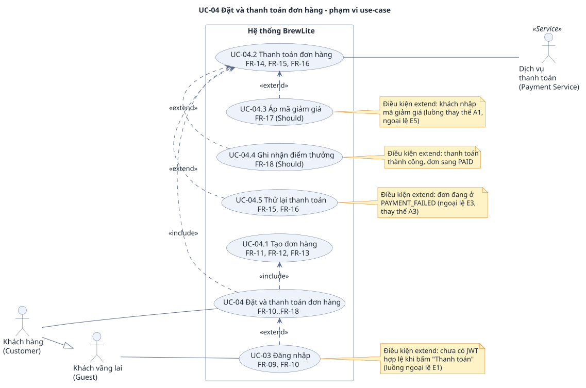

# Đặc tả use-case trọng tâm: UC-04 Đặt và thanh toán đơn hàng (Task 1.3)

> **BREW-INVENTORY-01:** đơn mới dùng snapshot nguyên liệu; cancellation là Must. Bộ test được loại sau kiểm chứng theo yêu cầu bàn giao; các test ID/đề xuất kiểm dưới đây là truy vết lịch sử, kết quả thực tại [inventory-verification.md](../inventory-verification.md).
>
> **Baseline Task 1 theo phạm vi minimum đã chốt trong PR #5, đã rút gọn thêm (SRS mục 1.4).** Thành viên phụ trách phải tự giải thích được từng luồng khi vấn đáp.
>
> Đáp ứng đề A2 §3.3. Yêu cầu: [`srs.md`](srs.md) (mã `FR-xx`, `NFR-xx`, quy tắc `BR-xx`, mã lỗi ở mục 3). Phạm vi: [`context-and-scope.md`](context-and-scope.md). Use-case tổng quát: [`use-case-overview.svg`](use-case-overview.svg). Truy vết: [`../traceability-matrix.md`](../traceability-matrix.md).
>
> **VNPay sandbox (2026-10-29):** giảng viên yêu cầu thanh toán qua sandbox của bên thứ ba thay cho simulator. Thanh toán chạy bất đồng bộ: API tạo `Payment PENDING` và URL ký sẵn, khách trả trên trang VNPay, kết quả về qua IPN (hoặc QueryDR khi IPN không tới), trang return chỉ hiển thị. Kế hoạch: [`../planning/2026-10-29-vnpay-payment-plan.md`](../planning/2026-10-29-vnpay-payment-plan.md). Nhãn **(chờ spike)** đánh dấu câu phụ thuộc hành vi sandbox chưa đo; gỡ hoặc sửa sau spike.
>
> Use-case này là đầu vào cho Task 2: activity diagram (ba nhánh hết hàng, chưa đăng nhập, thanh toán thất bại; thêm các nhánh khách hủy trên VNPay, hết hạn và chưa kết luận) và sequence diagram (Customer, Browser, Next.js UI, NestJS API, Database, VNPay sandbox) phải khớp các luồng dưới đây.

## Mục lục

1. Tóm tắt use-case
2. Use-case diagram
3. Actor
4. Trigger, tiền điều kiện, hậu điều kiện
5. Luồng chính
6. Luồng thay thế
7. Luồng ngoại lệ
8. Quy tắc nghiệp vụ áp dụng
9. Liên kết bước và luồng với yêu cầu
10. Gợi ý test từ đặc tả

---

## 1. Tóm tắt use-case

| Mục | Nội dung |
|---|---|
| Mã và tên | **UC-04 Đặt và thanh toán đơn hàng** |
| Mục tiêu | Customer biến giỏ hàng thành một đơn hàng đã thanh toán không dùng tiền mặt qua VNPay sandbox, nhận mã đơn xác nhận |
| Giá trị nghiệp vụ | Là bước tạo doanh thu của BrewLite: khách trả tiền xong thì đơn mới vào quy trình pha chế |
| Ưu tiên | Must |
| Use-case con | UC-04.1 Tạo đơn hàng (include), UC-04.2 Thanh toán đơn hàng (include), UC-04.5 Thử lại thanh toán (extend UC-04.2); UC-03 Đăng nhập extend UC-04 khi chưa đăng nhập (UC-04.3, UC-04.4 ngoài bản nộp, không vẽ; xem `srs.md` §5.9) |
| Lý do chọn | Đi qua đủ các thành phần (UI, API, DB, VNPay sandbox) và đủ ba nhánh lỗi bắt buộc của đề A2 §4.1 (hết hàng, chưa đăng nhập, thanh toán thất bại); là use-case mà sequence diagram Task 2.2 phải vẽ |

## 2. Use-case diagram

Nguồn: [`uc-checkout.puml`](uc-checkout.puml). Quan hệ:

- UC-04 `<<include>>` UC-04.1 và UC-04.2: chạy khi đặt đơn mới (tạo đơn rồi thanh toán). Khi tiếp tục đơn đã tạo qua E1b/A3/A6, chỉ chạy lại UC-04.2; không tạo đơn lần nữa. VNPay sandbox là actor phụ của UC-04.2.
- UC-04.5 `<<extend>>` UC-04.2: chỉ chạy khi đơn đang `PAYMENT_FAILED`. Áp mã giảm giá và ghi điểm (FR-17/18) ngoài bản nộp nên không vẽ.
- UC-03 Đăng nhập `<<extend>>` UC-04: chỉ chạy khi chưa có phiên đăng nhập; đây là cách vẽ của ngoại lệ "chưa đăng nhập". Tiền điều kiện của use-case vẫn là đã đăng nhập (mục 4).

## 3. Actor

| Actor | Loại | Vai trò trong use-case |
|---|---|---|
| **Customer** (khách hàng đã đăng nhập) | Chính | Bắt đầu use-case, chọn phương thức, bấm "Thanh toán qua VNPay", trả tiền trên trang VNPay, nhận kết quả |
| **Guest** (khách vãng lai) | Chính (kế thừa) | Chỉ xuất hiện ở ngoại lệ E1: chưa đăng nhập thì không bắt đầu được, phải qua UC-03. `Customer` kế thừa `Guest` |
| **VNPay sandbox** (cổng thanh toán bên thứ ba, hệ thống ngoài) | Phụ | Hiển thị trang thanh toán để khách nhập thẻ test; gọi IPN về API khi có kết quả; chuyển trình duyệt về trang return; trả kết quả cho API khi API hỏi QueryDR (quy ước sandbox: `srs.md` mục 3.4) |

Barista không tham gia use-case này (xem UC-07 trong `srs.md` mục 2.3). Các thành phần kỹ thuật dùng trong luồng: Browser (trình duyệt của khách, nơi chạy Next.js UI), Next.js UI, NestJS API, Database (cùng bộ lifeline của sequence diagram, đề A2 §4.2).

## 4. Trigger, tiền điều kiện, hậu điều kiện

**Trigger:** Customer bấm nút "Thanh toán" trên màn Giỏ hàng.

**Tiền điều kiện:**

1. Customer đã đăng nhập: có JWT hợp lệ, chưa hết hạn, `role = CUSTOMER` (FR-09, FR-10).
2. Giỏ hàng có ít nhất 1 dòng và mọi dòng hợp lệ: số lượng 1 đến 99, tối đa 20 dòng (FR-05, FR-06, BR-02).
3. API và database hoạt động.

(Nếu tiền điều kiện 1 không đúng thì chạy ngoại lệ E1, không tính là lỗi hệ thống. Tạo URL thanh toán mới còn cần cấu hình VNPay của API; thiếu cấu hình thì chạy E13.)

**Hậu điều kiện khi thành công (đơn đã `PAID`):**

- Đúng 1 `Order` của Customer ở trạng thái `PAID`, kèm các `OrderItem` khớp giỏ; `Order.total` do server tính (BR-01).
- Đúng 1 `Payment` `SUCCESS` cho đơn do IPN hoặc QueryDR đã xác thực quyết định (BR-11), lưu `Idempotency-Key`, mã giao dịch VNPay (`gatewayTxnNo`), `bankCode` và `paidAt`. Các `Payment` trước đó của đơn (nếu có) đều `FAILED`; không bao giờ có hai `Payment PENDING` cho một đơn (BR-10).
- Đơn mới có snapshot OrderIngredient bất biến. Thành công giảm onHand và reserved đúng snapshot một lần; menu tính lại số ly từ available. Đơn legacy marker false giữ vòng đời Product.stock cũ.
- Giỏ hàng trên trình duyệt đã bị xóa khi DB xác nhận đơn đã trả; Customer thấy màn xác nhận có mã đơn.

**Hậu điều kiện khi thất bại** (mỗi nhánh chi tiết ở mục 7; đây là bảng tổng hợp):

| Tình huống | `Order` | `Payment` | Tồn kho | Giỏ hàng |
|---|---|---|---|---|
| E1a Chưa tạo đơn | không tạo | không | không đổi | giữ |
| E1b Đã tạo đơn, JWT hết hạn | giữ đơn cũ và orderId | không thêm do 401 | vẫn giữ chỗ, không trừ thêm | giữ |
| E2 Hết hàng | không tạo | không | không đổi | giữ (khách chỉnh) |
| E3 Thanh toán thất bại (IPN/QueryDR xác nhận, kể cả khách hủy trên VNPay) | `PAYMENT_FAILED` | `PENDING` → 1 bản ghi `FAILED` | vẫn giữ chỗ | giữ |
| E4 Gửi lại cùng key (đã thành công) | giữ `PAID` | không thêm | không đổi thêm | đã xóa từ lần đầu |
| E4 Gửi lại khi `Payment PENDING` còn hạn, cùng phương thức | giữ `PENDING` | không thêm; trả lại URL cũ | vẫn giữ chỗ | giữ |
| E4 Gửi lại khi `Payment PENDING` còn hạn, khác phương thức (409 `PAYMENT_IN_PROGRESS`) | giữ `PENDING` | không thêm | vẫn giữ chỗ | giữ |
| E5 Ngoài bản nộp (FR-17 Won’t) | — | — | — | — |
| E6 Dữ liệu không hợp lệ | không tạo (hoặc giữ nguyên) | không | không đổi | giữ |
| E7 Đơn không thanh toán được | không đổi | không | không đổi | giữ |
| A5 Hủy bị chặn (409 `PAYMENT_IN_PROGRESS`) | giữ `PENDING` | giữ `PENDING` | vẫn giữ chỗ | giữ |
| A6 Quay lại khi `Payment PENDING` còn hạn | giữ `PENDING` | không thêm; dùng lại URL cũ | vẫn giữ chỗ | giữ |
| E9 Chữ ký, merchant hoặc số tiền sai | không đổi | không đổi | không đổi | giữ |
| E10 Mất hoặc muộn IPN | `PENDING` cho tới khi QueryDR/IPN xác nhận, rồi `PAID` hoặc `PAYMENT_FAILED` | `PENDING` → `SUCCESS` hoặc `FAILED` | trừ một lần khi `SUCCESS`; giữ chỗ khi `FAILED` | giữ tới khi DB xác nhận đã trả |
| E11 `Payment PENDING` quá hạn, chưa kết luận | giữ `PENDING` | giữ `PENDING`; không tạo thêm | vẫn giữ chỗ | giữ |
| E12 Tiền về sau trạng thái cuối | không đổi | không đổi; ghi warning đối soát | không đổi | không đổi |
| E13 Thiếu cấu hình hoặc lỗi provider | không đổi | không tạo (hoặc không đổi) | không đổi | giữ |

## 5. Luồng chính

Luồng thành công nhất: Customer đã đăng nhập, thanh toán Ví qua VNPay sandbox bằng thẻ test, còn đủ hàng, IPN tới kịp.

| Bước | Tác nhân | Hành động |
|---|---|---|
| 1 | Customer | Mở màn Giỏ hàng và bấm "Thanh toán" |
| 2 | Next.js UI | Kiểm giỏ không rỗng và có JWT hợp lệ; hiển thị màn Thanh toán gồm tóm tắt các dòng, tổng tiền, lựa chọn phương thức Ví/Thẻ |
| 3 | Customer | Chọn phương thức (`WALLET` hoặc `CARD`). Thẻ chỉ được nhập trên trang VNPay, BrewLite không có ô số thẻ |
| 4 | Customer | Bấm "Thanh toán qua VNPay" |
| 5 | Next.js UI | Vô hiệu nút, tạo `Idempotency-Key` cho phiên thanh toán; gửi `POST /orders` kèm JWT và danh sách dòng (không gửi giá) |
| 6 | NestJS API | Xác thực JWT và vai trò `CUSTOMER`; kiểm dữ liệu theo DTO (số lượng, size, topping, số dòng) |
| 7 | NestJS API | Tính giá từng dòng và `total` từ giá trong Database (BR-01) |
| 8 | NestJS API, Database | Một transaction: khóa công thức theo ID; tổng hợp nhu cầu base+size+topping của toàn giỏ; khóa nguyên liệu theo ID; kiểm available; tăng reserved; tạo Order PENDING marker true, OrderItems và OrderIngredient snapshot; commit. Thiếu công thức hoặc thiếu lượng thì rollback toàn bộ |
| 9 | Next.js UI | Gửi `POST /payments` với `orderId`, `paymentMethod`; header `Idempotency-Key` |
| 10 | NestJS API | Xác thực JWT; kiểm dữ liệu và quyền sở hữu đơn trước mọi thao tác khác; tra `Idempotency-Key`: nếu cùng chủ đơn/`orderId`/key/`paymentMethod` (BR-05) đã thành công thì trả lại kết quả theo E4a trước khi kiểm trạng thái. Chỉ yêu cầu mới kiểm đơn ở `PENDING` hoặc `PAYMENT_FAILED`; đơn đã có `Payment PENDING` thì theo E4, nếu quá hạn thì theo E11 (luồng chính chưa có payment nào chờ) |
| 11 | NestJS API | Số tiền cần thu `amount = total` (bản nộp không áp khuyến mãi) |
| 12 | NestJS API | Kiểm cấu hình tạo URL (thiếu thì E13); ký URL thanh toán bằng HMAC-SHA512 (tính cục bộ, không gọi mạng) với mã tham chiếu là `Payment.id` (`vnp_TxnRef`), số tiền `amount × 100` và hạn 15 phút |
| 13 | NestJS API, Database | Một transaction giữ khóa đơn: tạo `Payment PENDING` lưu `paymentUrl`, `expiresAt`, `gatewayCreateDate`; commit. Đơn vẫn `PENDING`, không giữ chỗ nguyên liệu lần nữa (BR-10: tối đa một `Payment PENDING` cho mỗi đơn) |
| 14 | NestJS API | Trả 201 với `paymentId`, `orderId`, `orderStatus = PENDING`, `status = PENDING`, `amount`, `paymentUrl`, `expiresAt` |
| 15 | Next.js UI, Browser | Lưu `orderId`, `Idempotency-Key`, `paymentId`, `paymentMethod` trong `sessionStorage` của phiên checkout; chuyển hướng trình duyệt tới `paymentUrl`. Chưa xóa giỏ |
| 16 | Customer, VNPay sandbox | Khách nhập thẻ test (NCB) và xác nhận trên trang VNPay. BrewLite không nhận, không lưu, không log số thẻ |
| 17 | VNPay sandbox, NestJS API | VNPay gọi IPN `GET /payments/vnpay/ipn` (server-to-server, công khai, không JWT). API kiểm chữ ký, merchant, `Payment` tồn tại và số tiền; sai thì chạy E9 |
| 18 | NestJS API, Database | Một transaction giữ khóa đơn: đọc lại `Payment` và `Order`; khi `vnp_ResponseCode = 00` và `vnp_TransactionStatus = 00` thì `Payment` → `SUCCESS` (lưu mã giao dịch, `bankCode`, `paidAt`), giảm onHand và reserved theo snapshot, `Order` → `PAID`; commit; trả VNPay `RspCode = 00`. Lặp IPN chỉ nhận `02`, không trừ kho lần hai |
| 19 | VNPay sandbox, Browser | VNPay chuyển hướng trình duyệt về `/payment/vnpay-return` trên web. Trang này chỉ để hiển thị, không quyết định kết quả (BR-11) |
| 20 | Next.js UI, NestJS API | Gọi `GET /payments/vnpay/return` để kiểm chữ ký, rồi poll `GET /orders/:id` mỗi 2 giây, tối đa 30 giây. Nếu `Payment` vẫn `PENDING` (IPN chưa tới) thì gọi `POST /payments/:id/sync` một lần theo E10 |
| 21 | Next.js UI | Khi DB xác nhận đơn `PAID`: hiển thị màn xác nhận (mã đơn, trạng thái "Đã thanh toán", món, tiền); xóa giỏ hàng; cung cấp nút "Theo dõi đơn". Use-case kết thúc thành công |

## 6. Luồng thay thế

Luồng thay thế vẫn dẫn tới kết quả thành công hoặc một kết thúc có kiểm soát, không phải lỗi.

### A1 — Áp mã giảm giá hợp lệ (ngoài bản nộp)

Ngoài bản nộp (FR-17 Won’t). Giữ mã để không đổi số hiệu các luồng khác.

### A2 — Đổi phương thức trước khi xác nhận (tại bước 3)

Customer đổi giữa Ví và Thẻ bao nhiêu lần tùy ý trước khi bấm "Thanh toán qua VNPay". Chưa có `Order` nào được tạo nên không có tác dụng phụ. Quay lại bước 4.

### A3 — Thử lại thanh toán sau khi thất bại (UC-04.5; sau E3)

1. Đơn đang `PAYMENT_FAILED`, giỏ hàng và `orderId` được giữ (FR-15). Customer chọn phương thức khác hoặc giữ nguyên rồi bấm "Thử lại".
2. UI **không** gọi `POST /orders` lần nữa; gửi `POST /payments` cho cùng `orderId`.
3. Ở bước 10, API chấp nhận đơn `PAYMENT_FAILED`. Ở bước 13, trong cùng transaction tạo `Payment PENDING` mới, API chuyển đơn về `PENDING`; không giữ chỗ nguyên liệu lần nữa.
4. Tiếp tục từ bước 14. Kết quả: không sinh đơn mới (AC-F15.5).

### A4 — Customer rời màn Thanh toán trước khi xác nhận (tại bước 2 đến 4)

Customer bấm quay lại hoặc đóng trang trước bước 4. Chưa có `Order`, giỏ hàng giữ nguyên, tồn kho không đổi. Use-case kết thúc không có tác dụng phụ.

### A5 — Chủ đơn hủy đơn chưa trả (PENDING hoặc PAYMENT_FAILED; FR-25 Must)

Customer xác nhận hủy rồi UI gọi PATCH /orders/:id với status=CANCELLED. API kiểm chủ đơn/trạng thái dưới khóa đơn, chỉ giảm reserved theo snapshot trong cùng transaction; onHand không đổi. Hủy lặp trả 409 và không giải phóng thêm. Với legacy marker false chỉ hoàn Product.stock cũ. Không tự hủy theo thời gian.

Hủy bị chặn khi còn payment chưa kết luận, để tránh khách vừa trả tiền vừa hủy:

- Có `Payment PENDING` còn hạn: API trả 409 `PAYMENT_IN_PROGRESS`, không hủy; đơn và nguyên liệu giữ nguyên.
- `Payment PENDING` đã quá hạn: API đối soát QueryDR trước (E11), rồi mới xét hủy. Hủy chỉ tiếp tục nếu đơn còn hủy được và không còn payment chưa kết luận; nếu kết quả là đã trả thì đơn thành `PAID` và không hủy được.
- Payment đã `FAILED` (kể cả hết hạn): hủy như thường; nguyên liệu chỉ được nhả khi đơn bị hủy, không nhả chỉ vì payment `FAILED`.

### A6 — Quay lại checkout khi đã có Payment PENDING còn hạn

1. Customer đã được chuyển sang trang VNPay (bước 15) nhưng quay lại BrewLite mà chưa trả xong: đóng tab, bấm Back, hoặc mở lại từ lịch sử đơn. Đơn đang `PENDING` với một `Payment PENDING` chưa quá hạn (BR-10).
2. UI đọc `GET /orders/:id`, thấy `paymentUrl` và `expiresAt` của payment còn hạn, hiển thị "Tiếp tục thanh toán" thay vì tạo URL mới.
3. Customer bấm "Tiếp tục thanh toán": trình duyệt chuyển tới **URL cũ** (quay lại bước 15). Nếu UI vẫn gửi `POST /payments` cùng phương thức thì API trả 200 với `paymentUrl` và `expiresAt` cũ (E4), không tạo `Payment` mới.
4. Kết quả: không thêm `Payment`, không đổi đơn hay tồn kho. Khi hết hạn mà chưa có kết quả thì chạy E11 thay vì dùng URL cũ.

## 7. Luồng ngoại lệ

Ba nhánh bắt buộc của đề A2 §4.1 là **E1, E2, E3**; E4 là điều kiện idempotency của đề A2 §4.2. E9 đến E13 là các nhánh riêng của thanh toán bất đồng bộ qua VNPay sandbox.

### E1 — Chưa đăng nhập hoặc JWT hết hạn (UC-03 extend UC-04)

**E1a — Chưa tạo đơn:** ở bước 1/2 không có JWT hợp lệ, hoặc bước 6 trả 401.

1. Nếu UI biết chưa đăng nhập thì không gọi `POST /orders`; API trả 401 trước khi tạo đơn nếu token sai/hết hạn.
2. Giữ giỏ; chuyển tới `/login?next=/checkout`. Khi token hết hạn, hiển thị "Phiên đăng nhập đã hết hạn, vui lòng đăng nhập lại".
3. Sau đăng nhập, quay lại bước 2 rồi tạo đơn theo luồng chính.
4. Kết quả trước khi đăng nhập lại: không tạo `Order`/`Payment`, tồn kho không đổi. Không đăng nhập thì kết thúc không có tác dụng phụ.

**E1b — Đã tạo đơn:** bước 8 đã trả `orderId`, nhưng bước 10 (`POST /payments`) trả 401.

1. Giữ `orderId`, tài khoản chủ đơn, giỏ và `Idempotency-Key` khi chuyển tới đăng nhập. 401 không tạo thêm `Payment` và không đổi đơn/tồn kho đã giữ.
2. Sau đăng nhập lại **cùng tài khoản**, UI đọc `GET /orders/:id` để xác nhận trạng thái và quyền sở hữu.
3. Với `PENDING`, tiếp tục bước 9 trên **đơn cũ** (đã có `Payment PENDING` còn hạn thì theo A6); với `PAYMENT_FAILED`, tiếp tục A3. Không quay lại bước 5, không gọi lại `POST /orders` và không trừ kho thêm.
4. Nếu đơn đã `PAID`/`PREPARING`/`READY`/`COMPLETED`, hiển thị chi tiết/kết quả đã có; nếu `CANCELLED`, dừng thanh toán và hiển thị đơn đã hủy. Không gửi thanh toán mới.
5. Nếu đăng nhập tài khoản khác, không tự tiếp tục đơn cũ; API đọc/trả tiền đơn của người khác trả 403. UI yêu cầu đăng nhập đúng tài khoản hoặc về lịch sử của tài khoản mới, không tự tạo đơn thay thế.
6. Không đăng nhập lại thì đơn cũ và tồn kho giữ chỗ vẫn còn; khách có thể trở lại lịch sử bằng tài khoản chủ đơn để tiếp tục (hoặc hủy theo FR-25).

**Yêu cầu:** FR-10 (AC-F10.3–4), FR-14/16, FR-21/22, NFR-05. Nếu mất phản hồi `POST /orders` và chưa biết `orderId`, không coi là E1a: không tự gửi lại; kiểm tra lịch sử theo SRS mục 8.6.

### E2 — Hết hàng (tại bước 8)

- **Kích hoạt:** tổng nhu cầu cùng nguyên liệu trên mọi dòng vượt available (onHand-reserved), kể cả khi từng dòng riêng lẻ còn đủ; hoặc công thức thiếu/không hợp lệ. Ví dụ đặt 7 Matcha S với 20g matcha cần 21g.
- **Phản ứng:**
  1. API rollback: không có Order/OrderItem/OrderIngredient mới và không đổi bất kỳ onHand/reserved nào.
  2. API trả 409 OUT_OF_STOCK với details nguyên liệu `{ingredientId,name,unit,requested,available}` (lượng là string), hoặc RECIPE_UNAVAILABLE nếu thiếu công thức.
  3. UI hiển thị "{Tên món} chỉ còn N ly" hoặc "{Tên món} đã hết hàng", đưa khách về giỏ, đánh dấu dòng liên quan (AC-F13.4).
  4. Customer sửa số lượng hoặc xóa món rồi quay lại bước 1.
- **Kết quả:** không có đơn mới trong lịch sử (AC-F13.5); không bao giờ bán vượt tồn kho kể cả khi đặt đồng thời (AC-F13.3).
- **Yêu cầu:** FR-13, NFR-13.

### E3 — Thanh toán thất bại do IPN hoặc QueryDR xác nhận (tại bước 16 đến 18)

- **Kích hoạt:** IPN (hoặc QueryDR ở E10/E11) xác nhận giao dịch thất bại cuối cùng. IPN được coi là thất bại khi `vnp_TransactionStatus = 02`, kể cả khi khách bấm "Hủy" trên trang VNPay (`vnp_ResponseCode = 24`) (chờ spike). QueryDR trả `vnp_ResponseCode = 00` kèm `vnp_TransactionStatus = 02` cũng là thất bại cuối cùng.
- **Phản ứng:**
  1. Trong một transaction giữ khóa đơn, API đổi `Payment` từ `PENDING` sang `FAILED`, lưu riêng `gatewayResponseCode` và `gatewayTransactionStatus`, và đổi `Order` từ `PENDING` sang `PAYMENT_FAILED`. Nguyên liệu vẫn được giữ. IPN trả VNPay `RspCode = 00`.
  2. Không có phản hồi 402 từ `POST /payments`: thất bại luôn đến qua IPN hoặc QueryDR, không đến từ việc API tự gọi cổng.
  3. Trang return chỉ hiển thị thất bại và cho thử lại/hủy **sau khi DB đã xác nhận** `PAYMENT_FAILED`. Thông báo theo mã VNPay chỉ để tham khảo: `24` khách hủy giao dịch, `11` hết thời gian thanh toán, `51` không đủ số dư, `13` sai OTP, `09`/`10`/`12`/`79` lỗi thẻ hoặc tài khoản, mã còn lại "Thanh toán không thành công". Khi payment còn `PENDING` thì hiển thị "Đang xác minh thanh toán, vui lòng kiểm tra lại", không khuyên trả lần hai.
  4. UI giữ giỏ và `orderId`, hiển thị nút "Thử lại" (và "Hủy đơn" theo FR-25).
  5. Customer chọn A3 (thử lại) hoặc, nếu có FR-25, A5 (hủy đơn).
- **Kết quả:** giỏ hàng và đơn được giữ; tồn kho vẫn giữ chỗ; khách không bị tính tiền (giao dịch thất bại hoặc bị hủy trên VNPay không ghi nhận khoản thu).
- **Yêu cầu:** FR-15 (AC-F15.1), FR-16, NFR-03.

### E4 — Gửi lại yêu cầu thanh toán với cùng Idempotency-Key (tại bước 9 và 10)

Xảy ra khi khách bấm đúp, mất phản hồi rồi bấm lại, hoặc mạng tự gửi lại. Sau xác thực và kiểm quyền sở hữu, API xét theo thứ tự (BR-05, BR-10):

1. Đã có `Payment` `SUCCESS` cùng chủ đơn/`orderId`/key/`paymentMethod` → 200 trả kết quả cũ (E4a), xét **trước** trạng thái đơn.
2. Đơn không còn thanh toán được → 409 `ORDER_NOT_PAYABLE` (E4d).
3. Đã có `Payment PENDING` còn hạn: cùng `paymentMethod` → 200, trả nguyên `paymentUrl` và `expiresAt` cũ dù key mới (khách dùng tiếp URL cũ, xem A6); khác `paymentMethod` → 409 `PAYMENT_IN_PROGRESS`. Cả hai trường hợp không tạo `Payment` mới và không ký lại URL.
4. `Payment PENDING` đã quá hạn → đối soát QueryDR trước (E11), rồi xét lại từ mục 1.

Các nhánh con:

- **E4a — lần đầu đã thành công:** API thấy `Idempotency-Key` đã gắn với một `Payment` `SUCCESS` của đúng chủ đơn/`orderId`/`paymentMethod` này (BR-05; ưu tiên trước kiểm trạng thái đơn), **không** tạo `Payment`, không ký URL, trả 200 `{ paymentId, orderId, orderStatus: "PAID", amount, status: "SUCCESS" }` với cùng `paymentId` (AC-F16.1). UI hiển thị màn xác nhận như bước 21. Cùng key nhưng khác `paymentMethod` không phải replay: xử lý như yêu cầu mới, đơn đã `PAID` nên theo E4d.
- **E4b:** Đã bỏ khỏi bản nộp (rút gọn, SRS mục 1.4). Giữ mã để không đổi số hiệu các luồng khác.
- **E4c:** Đã bỏ khỏi bản nộp (rút gọn, SRS mục 1.4). Giữ mã để không đổi số hiệu các luồng khác.
- **E4d — đơn đã `PAID`, key mới:** API trả 409 `ORDER_NOT_PAYABLE`, không tạo `Payment`, không ký URL, nên không thu tiền lần hai (AC-F16.4).
- **E4e — lần đầu đã thất bại (E3):** gửi lại là lần thử mới (BR-05, `FAILED` không khóa key), xem A3.
- **Yêu cầu:** FR-16, NFR-13.

### E5 — Mã giảm giá không hợp lệ (ngoài bản nộp)

Ngoài bản nộp (FR-17 Won’t). Giữ mã để không đổi số hiệu các luồng khác.

### E6 — Dữ liệu không hợp lệ (tại bước 5, 6 hoặc 10)

- **Kích hoạt:** giỏ rỗng, số lượng ngoài 1 đến 99, quá 20 dòng, size hoặc topping lạ, thiếu `paymentMethod`, thiếu `Idempotency-Key`.
- **Phản ứng:** UI chặn trước khi gửi nếu lỗi định dạng (AC-N06.3). Nếu vẫn tới API: 400 `VALIDATION_ERROR` hoặc `IDEMPOTENCY_KEY_REQUIRED` (AC-F12.1, AC-F14.2); sản phẩm không tồn tại: 404 `PRODUCT_NOT_FOUND` (AC-F12.2). Không tạo `Order` mới, không tạo `Payment`, không ký URL; UI hiển thị lỗi dưới từng ô.
- **Yêu cầu:** FR-12, FR-14, NFR-06.

### E7 — Đơn không thể thanh toán (tại bước 10)

- **Kích hoạt:** `orderId` không tồn tại (404 `ORDER_NOT_FOUND`), thuộc người khác (403 `FORBIDDEN`), hoặc yêu cầu mới cho đơn đã `PAID`/`PREPARING`/`READY`/`COMPLETED`/`CANCELLED` (409 `ORDER_NOT_PAYABLE`; replay thành công đúng chủ đơn/`orderId`/key/`paymentMethod` được xử lý trước theo E4a) (AC-F14.3).
- **Phản ứng:** không tạo `Payment`, không ký URL; UI hiển thị thông báo tương ứng và dẫn khách về lịch sử đơn.
- **Yêu cầu:** FR-14, NFR-05.

### E8 — Lỗi hệ thống (tại bước 10 đến 14)

- **E8a — server đã commit nhưng client mất phản hồi:** UI hiển thị "Có lỗi xảy ra, vui lòng thử lại". Retry cùng `orderId`/key được trả kết quả đã lưu: `Payment` `SUCCESS` theo E4a, hoặc `Payment PENDING` còn hạn theo E4 (URL cũ). Không tạo thêm `Payment`, không ký lại URL.
- **E8b:** Đã bỏ khỏi bản nộp (rút gọn, SRS mục 1.4). Rủi ro chấp nhận cũ không còn vì IPN và QueryDR (E10, E11) xác định kết quả thay cho simulator. Giữ mã để không đổi số hiệu các luồng khác.
- E8a chỉ áp dụng khi đã biết `orderId`; không gọi lại `POST /orders`. Nếu mất phản hồi tạo đơn và chưa biết mã đơn thì theo SRS mục 8.6.
- **Yêu cầu:** NFR-13, FR-16.

### E9 — Chữ ký, merchant hoặc số tiền không hợp lệ (tại bước 17 và 20)

- **Kích hoạt:** IPN hoặc return có `vnp_SecureHash` sai, thiếu hoặc sai định dạng; `vnp_TmnCode` khác cấu hình; hoặc `vnp_Amount` khác `Payment.amount × 100`. IPN còn có thể mang `vnp_TxnRef` không khớp `Payment` nào.
- **Phản ứng:**
  1. IPN sai chữ ký hoặc sai merchant → `{"RspCode":"97","Message":"Invalid signature"}`; không tìm thấy `Payment` → `01`; sai số tiền → `04`. Luôn HTTP 200.
  2. `GET /payments/vnpay/return` sai chữ ký, sai merchant hoặc không tìm thấy payment → `{ valid: false }`; API không trả ID lấy từ query chưa xác thực. Trang return chỉ phục hồi từ `orderId`/`paymentId` lưu trong `sessionStorage` của chính khách.
  3. Không đổi `Payment`, `Order` hay tồn kho; không ghi chữ ký hoặc query đầy đủ vào log.
- **Kết quả:** `Payment` vẫn `PENDING` cho tới khi có IPN hợp lệ (VNPay gọi lại) hoặc QueryDR đã xác thực (E10).
- **Yêu cầu:** FR-14, FR-16, BR-11, NFR-07, NFR-08.

### E10 — Mất IPN hoặc IPN đến muộn (tại bước 20)

- **Kích hoạt:** khách đã trả xong nhưng IPN chưa tới khi trang return poll: Render free tier đang ngủ, API chạy local (VNPay không gọi được `localhost`), hoặc IPN tới sau 30 giây.
- **Phản ứng:**
  1. Trang return poll `GET /orders/:id`; nếu `Payment` vẫn `PENDING` thì gọi `POST /payments/:id/sync` một lần.
  2. API kiểm quyền trước: chưa đăng nhập 401, sai chủ đơn hoặc sai vai trò 403, không có payment 404 `PAYMENT_NOT_FOUND`. `Payment` đã `SUCCESS`/`FAILED` thì trả 200 từ DB, không gọi QueryDR.
  3. Payment còn `PENDING` (kể cả chưa hết hạn): API gọi QueryDR **bên ngoài** mọi transaction giữ khóa đơn, kiểm chữ ký phản hồi, merchant, mã tham chiếu và số tiền. Sau đó mở transaction, khóa đơn, đọc lại đúng payment đã hỏi rồi áp kết quả qua cùng hàm với IPN: `00/00` → `SUCCESS`, đơn `PAID`, trừ kho đúng một lần (như bước 18); `00/02` → `FAILED`, đơn `PAYMENT_FAILED` (E3); `00/01` hoặc `91` khi còn hạn → giữ `PENDING`, 409 `PAYMENT_IN_PROGRESS`.
  4. Lỗi mạng, timeout, chữ ký sai, thiếu cấu hình hoặc mã truy vấn khác → 502 `PAYMENT_PROVIDER_ERROR`, không đổi DB (E13). Khi nhận 409 hoặc 502, UI hiển thị "Đang xác minh thanh toán, vui lòng kiểm tra lại" kèm nút kiểm tra lại; không tạo vòng lặp QueryDR.
- **Kết quả:** trạng thái cuối do DB quyết định. Nếu IPN thật tới trong lúc API chờ QueryDR thì kết quả đọc lại dưới khóa không bị ghi đè bởi kết quả cũ, và kho chỉ bị trừ một lần.
- **Yêu cầu:** FR-14, FR-16, BR-11, NFR-13.

### E11 — Payment PENDING quá hạn (tại bước 10, khi hủy đơn ở A5 hoặc khi `sync`)

- **Kích hoạt:** `now >= expiresAt` (hạn 15 phút, cùng mốc với `vnp_ExpireDate` đã ký) mà `Payment` vẫn `PENDING`, và khách tạo thanh toán lại, hủy đơn hoặc kiểm tra trạng thái. Hết hạn không có nghĩa là không thu tiền: khách có thể trả sát giờ mà IPN tới muộn, nên API phải hỏi VNPay trước khi kết luận.
- **Phản ứng:** sau kiểm quyền, API gọi QueryDR ngoài transaction, kiểm phản hồi như E10 rồi mở transaction, khóa đơn, đọc lại đúng payment đã hỏi. Kết quả:
  - `00/00` → `SUCCESS`, đơn `PAID`. Với `POST /payments`, API xét replay BR-05 **trước**: cùng chủ đơn/key/`paymentMethod` → 200 `SUCCESS` (E4a); key hoặc phương thức khác → 409 `ORDER_NOT_PAYABLE`. Với hủy đơn thì đơn đã `PAID` nên không hủy được.
  - `00/02` → `FAILED`, đơn `PAYMENT_FAILED`; khách thử lại (A3) hoặc hủy (A5).
  - `00/01` sau hạn → giữ `PENDING`, 409 `PAYMENT_IN_PROGRESS`, không tạo giao dịch mới và không hủy; ca bỏ dở (URL đã mở nhưng chưa trả) không được kẹt vĩnh viễn, lối thoát (tự chuyển `FAILED` sau khoảng chờ đã đo, hoặc nhân viên đóng payment sau khi tra Merchant Admin) chốt sau spike (chờ spike).
  - `91` sau hạn và phản hồi đã xác thực → `FAILED` với `gatewayResponseCode = "EXPIRED"`, đơn `PAYMENT_FAILED` (chờ spike). `EXPIRED` chỉ là giá trị nội bộ của `gatewayResponseCode`, không phải trạng thái của `PaymentStatus`. Nếu còn hạn thì giữ `PENDING`, 409 `PAYMENT_IN_PROGRESS`.
  - Nhóm trạng thái đảo/hoàn tiền/nghi ngờ (`04`/`05`/`06`/`07`/`09`), mã chưa hỗ trợ, hoặc lỗi truy vấn (`94`/`99`, chữ ký sai, timeout) → giữ `PENDING`, 502 `PAYMENT_PROVIDER_ERROR`, không đổi DB; có dấu hiệu trừ hoặc hoàn tiền thì ghi warning để đối soát.
- **Kết quả:** chưa kết luận thì `Payment` giữ `PENDING`, khách không tạo được giao dịch mới và không hủy được (BR-10). Không nhả nguyên liệu chỉ vì payment `FAILED`/`EXPIRED`; chưa có job tự hủy đơn.
- **Yêu cầu:** FR-14, FR-15, FR-16, FR-25, BR-10, NFR-13.

### E12 — Tiền về sau trạng thái cuối (tại bước 17)

- **Kích hoạt:** IPN (hoặc QueryDR) báo thành công (`vnp_ResponseCode = 00` và `vnp_TransactionStatus = 00`) trong khi `Payment` đã `FAILED` (kể cả `EXPIRED`), đơn đã `CANCELLED`, hoặc đơn đã được trả bằng payment khác.
- **Phản ứng:** IPN trả `RspCode = 02`; API ghi warning `PAYMENT_RECONCILIATION_REQUIRED` kèm `vnp_TxnRef` và **không** đổi đơn, payment hay kho. Nhân viên tra Merchant Admin theo `vnp_TxnRef` và hoàn tiền tay nếu cần (xem [`../deployment.md`](../deployment.md)).
- **Không phải E12:** IPN lặp của chính `Payment SUCCESS` trên đơn `PAID` (hoặc đã vào pha chế/hoàn tất) chỉ trả `02`, không cảnh báo; IPN thành công tới sau `expiresAt` nhưng `Payment` và đơn vẫn `PENDING` thì nhận bình thường như bước 18.
- **Kết quả:** trạng thái cuối trong DB không bị mở lại; khoản tiền thu thừa được xử lý ngoài hệ thống.
- **Yêu cầu:** FR-14, FR-15 (AC-F15.7), BR-11, NFR-20.

### E13 — Thiếu cấu hình VNPay hoặc lỗi provider (tại bước 12, 17 và 20)

- **Kích hoạt:** thiếu `VNP_TMN_CODE`, `VNP_HASH_SECRET` hoặc `WEB_URL` cho thao tác đang chạy (tạo URL mới cần cả ba; IPN, kiểm return và QueryDR chỉ cần hai biến đầu), hoặc QueryDR gặp lỗi mạng, timeout, chữ ký sai, mã truy vấn lạ.
- **Phản ứng:**
  1. Tạo URL mới hoặc `sync` → 502 `PAYMENT_PROVIDER_ERROR`; không tạo `Payment`, không đổi trạng thái đơn hay kho. UI hiển thị "Có lỗi xảy ra, vui lòng thử lại"; giỏ và đơn được giữ.
  2. IPN thiếu secret hoặc merchant → `RspCode = 99`, không đọc hay ghi DB, để VNPay gọi lại khi biến được bổ sung (không trả `97`, vì chữ ký chưa kiểm được chứ không phải sai).
  3. Return thiếu cấu hình xác minh → `{ valid: false }`.
  4. Replay (`SUCCESS`, `PENDING` còn hạn) và đọc trạng thái từ DB vẫn chạy, không cần biến VNPay. API vẫn khởi động khi thiếu biến; log khởi động chỉ ghi tên biến thiếu.
- **Kết quả:** không có tác dụng phụ lên đơn, payment, kho; khách thử lại sau khi cấu hình đủ.
- **Yêu cầu:** FR-14, NFR-07, NFR-15.

## 8. Quy tắc nghiệp vụ áp dụng

Định nghĩa đầy đủ ở [`srs.md`](srs.md) mục 3.5.

| Mã | Quy tắc | Dùng ở |
|---|---|---|
| BR-01 | Giá do server tính từ catalog; trường giá/tổng tiền client gửi bị từ chối (AC-F12.3) | bước 7; E6 |
| BR-02 | Số lượng 1 đến 99; tối đa 20 dòng | điều kiện đầu; bước 6; E6 |
| BR-03 | Giữ chỗ tồn kho khi tạo đơn, hoàn khi đơn `CANCELLED` (A5) | bước 8; E2; A5 |
| BR-04 | Chỉ chủ đơn thanh toán; chỉ `PENDING` hoặc `PAYMENT_FAILED` thanh toán được | bước 10; E7 |
| BR-05 | `Idempotency-Key` bắt buộc; replay theo thứ tự `SUCCESS` rồi `Payment PENDING` còn hạn; `FAILED` không khóa key | bước 10; E4; E11; A3; A6 |
| BR-08 | Máy trạng thái đơn (`PENDING → PAID`, `PENDING → PAYMENT_FAILED`, `PAYMENT_FAILED → PENDING`, `PENDING`/`PAYMENT_FAILED → CANCELLED`); đơn vẫn `PENDING` trong lúc chờ VNPay | bước 8, 13, 18; E3; E10; A3; A5 |
| BR-09 | Thanh toán thất bại không xóa giỏ, không hủy đơn | E3 |
| BR-10 | Tối đa một `Payment PENDING` cho mỗi đơn; chưa xác định kết quả thì không mở lần thử mới | bước 13; E4; E11; A5; A6 |
| BR-11 | Chỉ IPN hoặc QueryDR đã xác thực được quyết định kết quả cuối; return URL chỉ hiển thị | bước 17 đến 20; E9; E10; E12 |

## 9. Liên kết bước và luồng với yêu cầu

| Bước / luồng | Mô tả ngắn | Yêu cầu chức năng | Yêu cầu phi chức năng |
|---|---|---|---|
| Tiền điều kiện 1 | Đã đăng nhập, JWT hợp lệ | FR-09, FR-10 | NFR-05 |
| Tiền điều kiện 2 | Giỏ hợp lệ | FR-05, FR-06, FR-07 | — |
| 1 | Bấm "Thanh toán" tại giỏ | FR-07, FR-10 | NFR-09 |
| 2 | Màn Thanh toán | FR-07, FR-12 (AC-F12.4) | NFR-09, NFR-11 |
| 3 | Chọn phương thức (không nhập thẻ ở BrewLite) | FR-14 | NFR-09 |
| 4, 5 | Bấm "Thanh toán qua VNPay", khóa nút, tạo `Idempotency-Key`, gọi `POST /orders` | FR-11, FR-16 (AC-F16.6) | NFR-06 |
| 6 | Xác thực JWT, validate | FR-10, FR-12 | NFR-05, NFR-06 |
| 7 | Tính giá phía server | FR-12 | NFR-06 |
| 8 | Transaction tạo đơn, giữ chỗ tồn kho | FR-11, FR-13 | NFR-03, NFR-13 |
| 9, 10 | `POST /payments`, kiểm đơn, key và replay | FR-14, FR-16 | NFR-05, NFR-06 |
| 11 | Số tiền cần thu bằng `total` | FR-14 | — |
| 12, 13 | Ký URL, transaction tạo `Payment PENDING` | FR-14 | NFR-03, NFR-07, NFR-13 |
| 14, 15 | Trả `paymentUrl`, lưu phiên và chuyển hướng sang VNPay | FR-14 | NFR-03 |
| 16 | Khách trả trên trang VNPay | FR-14 | NFR-08 |
| 17, 18 | IPN, transaction: `Payment SUCCESS`, trừ kho, `PAID` | FR-14, FR-16 | NFR-08, NFR-13 |
| 19, 20 | Return, poll chi tiết đơn, `sync` khi còn `PENDING` | FR-14, FR-22 | NFR-11 |
| 21 | Màn xác nhận, xóa giỏ | FR-20, FR-22 | NFR-11 |
| A1 | Ngoài bản nộp (FR-17 Won’t) | — | — |
| A2 | Đổi phương thức | FR-14 | — |
| A3 | Thử lại thanh toán | FR-15, FR-16 | — |
| A4 | Rời màn thanh toán | FR-07 | — |
| A5 | Hủy đơn chưa trả (FR-25 Must); bị chặn khi còn payment chưa kết luận | FR-25 | — |
| A6 | Quay lại checkout, "Tiếp tục thanh toán" bằng URL cũ | FR-14, FR-16 | — |
| E1a/E1b | Chưa tạo đơn / tiếp tục đơn cũ sau đăng nhập lại cùng tài khoản | FR-10 | NFR-05 |
| E2 | Hết hàng | FR-13 | NFR-13 |
| E3 | Thanh toán thất bại do IPN/QueryDR xác nhận (kể cả khách hủy trên VNPay) | FR-15 | NFR-03 |
| E4 | Gửi lại cùng Idempotency-Key; `Payment PENDING` còn hạn | FR-16 | NFR-13 |
| E5 | Ngoài bản nộp (FR-17 Won’t) | — | — |
| E6 | Dữ liệu không hợp lệ | FR-12, FR-14 | NFR-06 |
| E7 | Đơn không thể thanh toán | FR-14 | NFR-05 |
| E8 | Mất phản hồi sau commit (E8a); E8b đã bỏ | FR-16 (AC-F16.1) | NFR-13 |
| E9 | Chữ ký, merchant hoặc số tiền sai | FR-14, FR-16 | NFR-07, NFR-08 |
| E10 | Mất hoặc muộn IPN, `sync` bằng QueryDR | FR-14, FR-16 | NFR-13 |
| E11 | `Payment PENDING` quá hạn, đối soát QueryDR | FR-14, FR-15, FR-16, FR-25 | NFR-13 |
| E12 | Tiền về sau trạng thái cuối, warning đối soát | FR-14, FR-15 | NFR-20 |
| E13 | Thiếu cấu hình VNPay hoặc lỗi provider | FR-14 | NFR-07, NFR-15 |
| Trạng thái đơn | Chuyển trạng thái trong use-case | FR-23 | — |

## 10. Gợi ý test từ đặc tả

A1 và E5 ngoài bản nộp nên không có test; A5 bắt buộc kiểm chứng trong BREW-INVENTORY-01 (FR-25 Must).

Mỗi luồng chuyển thành test bằng chính tiêu chí chấp nhận trong `srs.md` (mã test cụ thể ghi ở ma trận truy vết khi Task 4–5 viết):

- **Luồng chính:** một test E2E menu → giỏ → đăng nhập → thanh toán Ví → màn xác nhận (FR-14, FR-20); một kiểm chứng integration trước khi loại bộ test khỏi bản phân phối; kết quả ghi tại inventory-verification.md: `POST /orders` rồi `POST /payments` kiểm `PAID`, snapshot, onHand/reserved, `Payment`.
- **E1a:** Guest bấm "Thanh toán" được chuyển tới đăng nhập, quay lại còn giỏ; 401 ở tạo đơn không tạo Order (AC-F10.1).
- **E1b:** tạo đơn thành công rồi làm token hết hạn trước thanh toán; đăng nhập lại cùng tài khoản, thanh toán đúng orderId cũ, số Order và tồn kho không đổi thêm. Kiểm cả đơn đã trả/đã hủy và đăng nhập nhầm tài khoản (AC-F10.4).
- **E2:** integration test đặt quá tồn (AC-F13.1) và đặt đồng thời (AC-F13.3).
- **E3 và A3:** thao tác trên sandbox: bấm "Hủy" trên trang VNPay (đơn thành `PAYMENT_FAILED`, `reserved` vẫn giữ), rồi thử lại thành công cùng `orderId` (AC-F15.1, AC-F15.5).
- **E4 và A6:** gửi hai lần cùng key, đếm số `Payment`: sau `SUCCESS` còn đúng 1 bản ghi (AC-F16.1); khi còn `Payment PENDING` thì cùng phương thức nhận lại URL cũ, khác phương thức nhận 409 `PAYMENT_IN_PROGRESS`.
- **E9, E12 và hàm thuần:** unit test tối thiểu cho chữ ký URL/return/IPN/QueryDR và bảng ánh xạ mã QueryDR; gọi lại IPN cùng tham số phải nhận `02`, không trừ kho lần hai.
- **E10, E11, E13:** local không có IPN, trang return gọi `sync` và đơn thành `PAID`; QueryDR do kịch bản kiểm soát trả `00/01`, `00/02`, `91`, `94`; chạy API không có `VNP_HASH_SECRET`. Ca "đã mở URL nhưng chưa trả" kiểm theo mã thực tế ghi ở spike, không mặc định là `91`.
- **A5 (FR-25 Must):** API test hủy đơn `PENDING`/`PAYMENT_FAILED` và kiểm `reserved` được giải phóng, `onHand` không đổi (AC-F25.1).
- **Máy trạng thái:** unit test 49 cặp: 8 hợp lệ, 41 bị từ chối, bao gồm từ chối PAID → CANCELLED (AC-F23.1).
