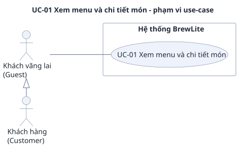

# UC-01 — Xem menu và chi tiết món (size, topping)

> Đặc tả use-case phụ, bổ sung cho use-case trọng tâm [UC-04](../uc-checkout.md) (đề A2 §3.3). Yêu cầu: [`../srs.md`](../srs.md). Use-case tổng quát: [`../use-case-overview.svg`](../use-case-overview.svg).

## 1. Tóm tắt

| Mục | Nội dung |
|---|---|
| Mã và tên | **UC-01 Xem menu và chi tiết món (size, topping)** |
| Mục tiêu | Khách xem được danh sách đồ uống, mở chi tiết một món, chọn size và topping và thấy giá cập nhật ngay, để sẵn sàng thêm món vào giỏ |
| Giá trị nghiệp vụ | Đây là cửa vào của mọi đơn hàng: khách không đăng nhập vẫn xem và chọn món được, nên không bị chặn trước khi thấy sản phẩm |
| Ưu tiên | Must (FR-01 đến FR-04) |
| FR liên quan | FR-01, FR-02, FR-03, FR-04; NFR-02, NFR-09, NFR-11 |
| Quan hệ với UC khác | Không include/extend UC nào (khớp [`use-case-overview.puml`](../use-case-overview.puml)). Bấm "Thêm vào giỏ" là trigger của [UC-02](uc-02-cart.md). Số liệu "Còn hàng" / "Hết hàng" và giới hạn số lượng lấy từ kho nguyên liệu do [UC-10](../uc-inventory.md) nuôi |

## 2. Use-case diagram

Nguồn: [`uc-01-menu.puml`](uc-01-menu.puml). Sơ đồ chỉ ghi mã và tên use-case; mã yêu cầu ở mục 8. Các quan hệ:

- Guest nối với UC-01. Customer kế thừa Guest (`Guest <|- Customer`) nên làm được mọi việc của Guest; use-case không đòi đăng nhập.
- UC-01 không có `<<include>>` hay `<<extend>>` với UC-02 hay UC-04 (SRS mục 2.3 không khai quan hệ này). Thứ tự "xem món rồi mới thêm vào giỏ" chỉ được ghi bằng ghi chú trên sơ đồ.

## 3. Actor

| Actor | Loại | Vai trò trong use-case |
|---|---|---|
| **Guest** (khách vãng lai) | Chính | Mở menu, mở chi tiết món, chọn size và topping. Không cần đăng nhập |
| **Customer** (khách hàng đã đăng nhập) | Chính (kế thừa Guest) | Làm đúng như Guest; đăng nhập hay chưa không đổi luồng nào ở đây |

Barista và VNPay sandbox không tham gia. Các thành phần kỹ thuật trong luồng: Next.js UI, NestJS API, Database.

## 4. Trigger, tiền điều kiện, hậu điều kiện

**Trigger (điều kiện kích hoạt):** khách mở trang menu. Luồng chi tiết bắt đầu khi khách chọn một món trên thẻ để mở trang chi tiết của món đó.

**Tiền điều kiện:**

1. API và database đang hoạt động.
2. Có dữ liệu sản phẩm (dữ liệu mẫu có 8 món, SRS mục 3.3). Không cần JWT.

**Hậu điều kiện khi thành công:**

- Khách thấy menu hoặc chi tiết món với giá đúng theo lựa chọn hiện tại (BR-01) và biết món nào còn hàng.
- Use-case chỉ đọc dữ liệu: `GET /products`, `GET /products/:id`, `GET /catalog/options` và `POST /inventory/availability` (tính khả năng đáp ứng, không giữ kho, SRS mục 3.1). Giỏ hàng và tồn kho không đổi.
- Nếu khách đã chọn được một lựa chọn bán được, nút "Thêm vào giỏ" bật và khách có thể sang UC-02.

**Hậu điều kiện khi thất bại:** không có dữ liệu nào bị đổi. Khách thấy thông báo tiếng Việt cùng đường đi tiếp (nút "Thử lại" hoặc liên kết về menu), không thấy stack trace hay JSON thô (AC-N11.2).

## 5. Luồng chính

Khách mở menu, vào chi tiết một món, đổi size và topping rồi sẵn sàng thêm vào giỏ. API trả dữ liệu bình thường.

| Bước | Tác nhân | Hành động |
|---|---|---|
| 1 | Guest / Customer | Mở trang menu |
| 2 | Next.js UI | Hiện skeleton hoặc spinner trong lúc chờ (AC-F02.1); gọi `GET /products` |
| 3 | NestJS API, Database | Trả 200 và mảng sản phẩm, mỗi phần tử có `id`, `name`, `price` (số nguyên), `imageUrl`, `stock`; không cần token (AC-F01.1). `stock` là số ly ước tính cho size S không topping, tính từ nguyên liệu (SRS mục 3.5a) |
| 4 | Next.js UI | Bỏ skeleton, hiện lưới thẻ món: hình, tên, giá dạng `45.000đ` (AC-F01.2). Nhãn theo `stock`: 0 là "Hết hàng", lớn hơn 0 là "Còn hàng"; không hiển thị số ly (AC-F01.3) |
| 5 | Guest / Customer | Chọn một món để mở trang chi tiết |
| 6 | Next.js UI | Hiện trạng thái loading; gọi `GET /products/:id` và `GET /catalog/options` (bảng size, topping kèm phụ thu, SRS mục 3.1) |
| 7 | NestJS API, Database | Trả 200 với `id`, `name`, `price`, `imageUrl`, `stock`, `description` (AC-F03.1) và danh sách size, topping |
| 8 | Next.js UI | Hiện chi tiết món (hình, tên, mô tả, giá nền, tùy chọn size và topping). Size mặc định là `M`, chỉ một size được chọn tại một thời điểm (AC-F04.1) |
| 9 | Next.js UI, NestJS API | Gọi `POST /inventory/availability` cho lựa chọn hiện tại để biết có bán được không (không giữ kho) |
| 10 | Guest / Customer | Đổi size (S/M/L) và chọn hoặc bỏ topping |
| 11 | Next.js UI | Cập nhật giá ngay, không tải lại trang (AC-F04.2). Ví dụ Cappuccino `45.000đ`, size L thành `55.000đ`, thêm "Trân châu" thành `62.000đ`; chọn cùng lúc "Trân châu" và "Kem phô mai" thì phụ thu cộng dồn `+17.000đ` (AC-F04.3). Quay lại bước 9 để kiểm lại với lựa chọn mới |
| 12 | Next.js UI | Lựa chọn đủ nguyên liệu thì bật nút "Thêm vào giỏ" và ô số lượng giới hạn theo số ly còn đặt được. Khách bấm "Thêm vào giỏ": use-case kết thúc thành công và UC-02 bắt đầu |

## 6. Luồng thay thế

Luồng thay thế vẫn kết thúc tốt đẹp hoặc dừng có kiểm soát; đây không phải lỗi.

### A1 — Menu rỗng (rẽ từ bước 3, kết thúc ở bước 4)

`GET /products` trả mảng rỗng. UI hiện "Hiện chưa có món nào" và không hiện lưới (AC-F02.2). Use-case dừng ở đây, không có tác dụng phụ.

### A2 — Món có nhãn "Hết hàng" (tại bước 4)

`stock` bằng 0 (kể cả khi món thiếu công thức) thì thẻ hiện nhãn "Hết hàng" (AC-F01.3). Nhãn chỉ phản ánh size S không topping; `stock` không làm trần cho size M, L hay topping (SRS mục 3.5a), nên việc cho thêm món vào giỏ luôn do kiểm availability ở trang chi tiết quyết định (A3). Các thẻ còn lại vẫn xem và chọn bình thường.

### A3 — Đổi size hoặc topping làm lựa chọn không đủ nguyên liệu (rẽ từ bước 11, quay lại bước 10)

1. Kết quả availability cho thấy lựa chọn hiện tại không bán được: thiếu công thức hoặc không đủ nguyên liệu.
2. UI khóa nút "Thêm vào giỏ" (AC-F04.4). Giới hạn đã biết: UI chỉ khóa nút, chưa hiện lý do (SRS mục 3.5a).
3. Khách đổi sang lựa chọn khác; nếu lựa chọn mới bán được thì nút bật lại. Quay lại bước 10.

### A4 — Số lượng vượt giới hạn (tại bước 12)

Ô số lượng chỉ cho từ 1 đến N, N là số ly còn đặt được cho lựa chọn hiện tại (tối đa 99 ly mỗi dòng). Nhập lớn hơn N thì tự hạ về N; để trống, nhập 0, số âm hoặc số thập phân không vượt N thì báo "từ 1 đến N" (SRS mục 3.5a). Quay lại bước 12.

### A5 — Lúc bấm "Thêm vào giỏ", giỏ dự kiến thiếu nguyên liệu (tại bước 12)

Khi bấm thêm, UI kiểm lại availability cho cả giỏ dự kiến (giỏ hiện có cộng dòng mới). Nếu thiếu thì báo nguyên liệu thiếu cùng lượng cần/còn và giữ nguyên giỏ (AC-F04.4). Phần xử lý giỏ ở [UC-02 E3](uc-02-cart.md#e3--cả-giỏ-thiếu-nguyên-liệu-hoặc-công-thức-không-khả-dụng).

## 7. Luồng ngoại lệ

### E1 — Lỗi tải menu (tại bước 3)

- **Kích hoạt:** `GET /products` trả 5xx hoặc mất mạng.
- **Phản ứng:** UI hiện "Không tải được thực đơn" cùng nút "Thử lại" (AC-F02.3); không hiện stack trace, JSON thô hay chỉ mã HTTP (AC-N11.2). Bấm "Thử lại" thành công thì hiện menu như bước 4.
- **Kết quả:** không đổi dữ liệu. Khách có thể thử lại bao nhiêu lần cũng được.

### E2 — Món không tồn tại (tại bước 7)

- **Kích hoạt:** `id` trên trang chi tiết không có trong database (ví dụ đường dẫn cũ hoặc gõ sai).
- **Phản ứng:** API trả 404 `PRODUCT_NOT_FOUND` (AC-F03.2). UI hiện "Không tìm thấy sản phẩm" cùng liên kết quay lại menu (AC-F03.3).
- **Kết quả:** không đổi dữ liệu; khách về menu và chọn món khác từ bước 5.

### E3 — Lỗi tải chi tiết món (tại bước 6 và 7)

- **Kích hoạt:** `GET /products/:id` hoặc `GET /catalog/options` trả 5xx hoặc mất mạng.
- **Phản ứng:** trang chi tiết có trạng thái loading và error như menu (AC-F03.3, AC-N11.1): thông báo tiếng Việt như "Không thể tải dữ liệu, vui lòng thử lại" kèm nút "Thử lại" (AC-N11.2).
- **Kết quả:** không đổi dữ liệu.

### E4 — Phản hồi availability cũ về muộn (tại bước 9 đến 11)

- **Kích hoạt:** khách đổi size hoặc topping liên tục; phản hồi của lựa chọn trước về sau phản hồi của lựa chọn sau.
- **Phản ứng:** phản hồi cũ bị bỏ, không ghi đè lựa chọn mới (AC-F04.4). Trạng thái nút "Thêm vào giỏ" luôn khớp lựa chọn đang hiện.
- **Kết quả:** không đổi dữ liệu.

## 8. Liên kết với yêu cầu

| Bước / luồng | Mô tả ngắn | Yêu cầu chức năng | Tiêu chí chấp nhận | NFR |
|---|---|---|---|---|
| 1 đến 3 | Tải danh sách món, không cần đăng nhập | FR-01 | AC-F01.1 | NFR-02 (AC-N02.1, AC-N02.2) |
| 2 | Trạng thái loading | FR-02 | AC-F02.1 | NFR-11 (AC-N11.1) |
| 4 | Lưới thẻ món, giá `45.000đ` | FR-01 | AC-F01.2 | NFR-09 |
| 4, A2 | Nhãn "Còn hàng" / "Hết hàng", không hiện số ly | FR-01 | AC-F01.3 | — |
| 6 đến 8 | Chi tiết món, size mặc định `M` | FR-03, FR-04 | AC-F03.1, AC-F04.1 | NFR-09 |
| 9 đến 12 | Đổi size, topping, giá cập nhật ngay (BR-01) | FR-04 | AC-F04.2, AC-F04.3 | — |
| A3, A4, A5, E4 | Kiểm availability, khóa nút, phản hồi cũ không ghi đè | FR-04 | AC-F04.4 | — |
| A1 | Menu rỗng | FR-02 | AC-F02.2 | NFR-11 (AC-N11.1) |
| E1 | Lỗi tải menu, "Thử lại" | FR-02 | AC-F02.3 | NFR-11 (AC-N11.2) |
| E2 | Món không tồn tại | FR-03 | AC-F03.2, AC-F03.3 | — |
| E3 | Lỗi tải chi tiết | FR-03 | AC-F03.3 | NFR-11 (AC-N11.1, AC-N11.2) |
