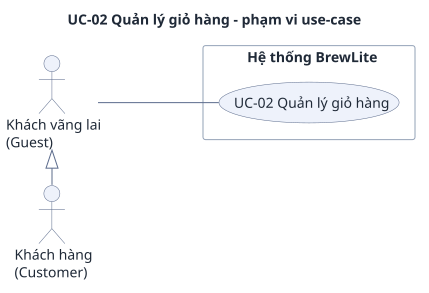

# UC-02 — Quản lý giỏ hàng

> Đặc tả use-case phụ, bổ sung cho use-case trọng tâm [UC-04](../uc-checkout.md) (đề A2 §3.3). Yêu cầu: [`../srs.md`](../srs.md). Use-case tổng quát: [`../use-case-overview.svg`](../use-case-overview.svg).

## 1. Tóm tắt

| Mục | Nội dung |
|---|---|
| Mã và tên | **UC-02 Quản lý giỏ hàng** |
| Mục tiêu | Khách gom các món đã chọn (size, topping, số lượng) vào giỏ, chỉnh số lượng, xóa dòng và thấy thành tiền từng dòng cùng tổng giỏ trước khi thanh toán |
| Giá trị nghiệp vụ | Giỏ cho phép khách đặt nhiều món trong một đơn và kiểm trước được món nào không đủ nguyên liệu, để lỗi hết hàng hiếm khi rơi vào bước thanh toán |
| Ưu tiên | Must (FR-05, FR-06, FR-07) |
| FR liên quan | FR-05, FR-06, FR-07; BR-01, BR-02; NFR-09 |
| Quan hệ với UC khác | Không include/extend UC nào (khớp [`use-case-overview.puml`](../use-case-overview.puml)). Đi tiếp từ [UC-01](uc-01-menu.md); bấm "Thanh toán" là trigger của [UC-04](../uc-checkout.md) |

## 2. Use-case diagram

Nguồn: [`uc-02-cart.puml`](uc-02-cart.puml). Sơ đồ chỉ ghi mã và tên use-case; mã yêu cầu ở mục 8. Các quan hệ:

- Guest nối với UC-02: giỏ dùng được khi chưa đăng nhập (AC-F05.3). Customer kế thừa Guest (`Guest <|- Customer`).
- UC-02 không có `<<include>>` hay `<<extend>>` với UC-01 hay UC-04 (SRS mục 2.3 không khai quan hệ này). Thứ tự UC-01, UC-02, rồi UC-04 chỉ được ghi bằng ghi chú trên sơ đồ.

## 3. Actor

| Actor | Loại | Vai trò trong use-case |
|---|---|---|
| **Guest** (khách vãng lai) | Chính | Thêm món vào giỏ, xem giỏ, đổi số lượng, xóa dòng. Không cần đăng nhập |
| **Customer** (khách hàng đã đăng nhập) | Chính (kế thừa Guest) | Làm đúng như Guest; giỏ không mất khi đăng nhập (AC-F05.3) |

Barista và VNPay sandbox không tham gia. Các thành phần kỹ thuật trong luồng: Next.js UI, NestJS API, Database (chỉ phục vụ kiểm availability).

## 4. Trigger, tiền điều kiện, hậu điều kiện

**Trigger (điều kiện kích hoạt):** khách bấm "Thêm vào giỏ" ở trang chi tiết món (kết thúc [UC-01](uc-01-menu.md)), hoặc mở màn Giỏ hàng.

**Tiền điều kiện:**

1. API và database đang hoạt động (để kiểm availability).
2. Khi thêm món: khách đã chọn size, topping và số lượng cho một lựa chọn bán được (UC-01 bước 12). Không cần JWT.

**Hậu điều kiện khi thành công:**

- Giỏ nằm trong `localStorage` của trình duyệt, còn nguyên sau khi tải lại trang hoặc đăng nhập (AC-F05.3).
- Mọi dòng thỏa BR-02: số lượng từ 1 đến 99, tối đa 20 dòng.
- Tổng giỏ bằng tổng thành tiền các dòng, cập nhật ngay khi giỏ đổi (AC-F07.2).
- Giỏ chỉ là dữ liệu ở trình duyệt: chưa có `Order`, chưa có `Payment`, tồn kho chưa bị giữ. Kiểm availability không giữ kho (SRS mục 3.1); việc giữ chỗ chỉ xảy ra khi tạo đơn ở [UC-04 bước 8](../uc-checkout.md).
- Khi giỏ hợp lệ (có dòng, đủ nguyên liệu), nút "Thanh toán" bật. Khách bấm nút này thì UC-04 bắt đầu; Guest bấm thì đi theo [UC-04 E1a](../uc-checkout.md) (đăng nhập, giỏ được giữ).

**Hậu điều kiện khi thất bại:** thao tác bị từ chối thì giỏ giữ nguyên như trước thao tác, và khách thấy thông báo tiếng Việt nêu lý do.

## 5. Luồng chính

Khách thêm món vừa chọn, xem giỏ, chỉnh số lượng và đi tiếp sang thanh toán. Mọi dòng đều hợp lệ và đủ nguyên liệu.

| Bước | Tác nhân | Hành động |
|---|---|---|
| 1 | Guest / Customer | Ở trang chi tiết món, bấm "Thêm vào giỏ" với số lượng đã nhập |
| 2 | Next.js UI, NestJS API | Gọi `POST /inventory/availability` cho cả giỏ dự kiến (giỏ hiện có cộng dòng mới), cộng nhu cầu của các dòng dùng chung nguyên liệu (AC-F05.4). Không dùng `Product.stock` làm giới hạn chung cho các biến thể |
| 3 | NestJS API, Database | Trả kết quả: cả giỏ dự kiến đủ nguyên liệu (xem `canOrder` trong [`uc-inventory.md`](../uc-inventory.md), luồng chính bước 5) |
| 4 | Next.js UI | Thêm dòng vào giỏ và lưu `localStorage`. Với Cappuccino size L, topping "Trân châu", số lượng 2: giỏ có một dòng đúng các giá trị đó, biểu tượng giỏ hiện tổng số lượng là 2 (AC-F05.1) |
| 5 | Guest / Customer | Mở màn Giỏ hàng |
| 6 | Next.js UI | Hiện từng dòng (món, size, topping, số lượng), đơn giá, thành tiền và tổng giỏ. Ví dụ 2 × Cappuccino L + Trân châu: đơn giá `62.000đ`, thành tiền `124.000đ`, tổng `124.000đ` (AC-F07.1). Kiểm availability cho cả giỏ (AC-F05.4) |
| 7 | Guest / Customer | Bấm "+" để tăng số lượng một dòng thêm 1, tối đa 99 (AC-F06.1) |
| 8 | Next.js UI | Cập nhật số lượng, thành tiền và tổng ngay, không tải lại trang. Thêm 1 × Americano size M (`45.000đ`) vào giỏ ví dụ thì tổng là `169.000đ` (AC-F07.2) |
| 9 | Guest / Customer | Bấm "−" khi số lượng lớn hơn 1 để giảm 1, hoặc bấm "Xóa" để xóa đúng dòng đó (AC-F06.2, AC-F06.3). Có thể lặp lại các bước 7 đến 9 |
| 10 | Next.js UI | Giỏ hợp lệ và đủ nguyên liệu thì bật nút "Thanh toán". Khách bấm "Thanh toán": use-case kết thúc thành công và UC-04 bắt đầu |

Tổng ở giỏ chỉ để hiển thị. Giá chính thức do máy chủ tính ở [UC-04 bước 7](../uc-checkout.md) theo BR-01; tổng ở giỏ phải bằng `Order.total` do server tính cho cùng nội dung giỏ (AC-F07.3). Giỏ không gửi giá lên server khi đặt đơn.

## 6. Luồng thay thế

Luồng thay thế vẫn kết thúc tốt đẹp hoặc dừng có kiểm soát; đây không phải lỗi.

### A1 — Thêm trùng món, size và topping (tại bước 4)

Giỏ đã có dòng cùng món, cùng size, cùng topping thì gộp vào dòng đó và cộng dồn số lượng, không tạo dòng mới. Khác size hoặc khác topping thì tạo dòng riêng (AC-F05.2). Việc gộp không làm tăng số dòng nên không bị giới hạn 20 dòng (E1). Quay lại bước 5.

### A2 — Giảm ở số lượng 1 (tại bước 9)

Khách bấm "−" khi dòng đang có số lượng 1: dòng bị xóa sau khi khách xác nhận (SRS cho phép thay bằng nút "Hoàn tác"). Khách không xác nhận thì dòng giữ nguyên. Ở số lượng lớn hơn 1 thì chỉ giảm 1 (AC-F06.2). Quay lại bước 6, hoặc sang A3 nếu đó là dòng cuối.

### A3 — Giỏ rỗng (tại bước 5 hoặc sau bước 9)

Khách mở giỏ khi chưa có món, hoặc vừa xóa dòng cuối. UI hiện "Giỏ hàng trống" cùng nút quay lại menu, nút "Thanh toán" bị vô hiệu (AC-F06.3). Use-case dừng ở đây cho tới khi khách thêm món (về [UC-01](uc-01-menu.md)).

### A4 — Tải lại trang hoặc đăng nhập (sau bước 4)

Khách tải lại trang hoặc đăng nhập xong: giỏ vẫn còn nguyên các dòng nhờ `localStorage` (AC-F05.3). Quay lại bước 5.

## 7. Luồng ngoại lệ

### E1 — Dòng thứ 21 bị từ chối (tại bước 1 đến 4)

- **Kích hoạt:** giỏ đã có 20 dòng và khách thêm một món, size hoặc topping chưa có trong giỏ (BR-02).
- **Phản ứng:** thao tác bị từ chối với thông báo "Giỏ hàng tối đa 20 món" (AC-F05.5). Dòng mới không được thêm.
- **Kết quả:** giỏ giữ nguyên 20 dòng. Khách xóa bớt một dòng rồi thêm lại, hoặc thêm vào dòng sẵn có (A1).

### E2 — Số lượng chạm 99 (tại bước 7)

- **Kích hoạt:** dòng đã có số lượng 99 (BR-02).
- **Phản ứng:** nút "+" của dòng bị vô hiệu, số lượng không tăng thêm (AC-F06.1). Từ trang chi tiết, mỗi dòng cũng tối đa 99 ly (SRS mục 3.5a).
- **Kết quả:** giỏ không đổi; khách vẫn giảm hoặc xóa dòng được.

### E3 — Cả giỏ thiếu nguyên liệu hoặc công thức không khả dụng

- **Kích hoạt:** ở bước 2 hoặc bước 6, availability cho cả giỏ cho thấy thiếu nguyên liệu, hoặc có món có công thức không khả dụng (AC-F05.4). Từng dòng đủ chưa chắc cả giỏ đủ vì các dòng dùng chung nguyên liệu ([`uc-inventory.md`](../uc-inventory.md)).
- **Phản ứng:**
  1. Nếu đang thêm món (bước 2): món mới không được thêm, giỏ giữ nguyên; UI báo nguyên liệu thiếu cùng lượng cần/còn (AC-F04.4).
  2. Nếu đang ở màn Giỏ hàng (bước 6): UI không cho tiếp tục checkout (nút "Thanh toán" vô hiệu), giữ giỏ để khách sửa (AC-F05.4). Lượng cần/còn hiện theo từng nguyên liệu, ví dụ "Matcha: cần 21 g, còn 20 g"; nếu do thiếu công thức thì giỏ báo lý do không bán được thay cho lượng cần/còn (cùng cách [UC-04 E2](../uc-checkout.md), AC-F13.4).
  3. Khách giảm số lượng hoặc xóa món, rồi nút "Thanh toán" bật lại khi cả giỏ đủ.
- **Kết quả:** không có `Order` nào được tạo, tồn kho không đổi, giỏ còn nguyên.

### E4 — Giỏ hợp lệ lúc xem nhưng hết hàng lúc đặt đơn

- **Kích hoạt:** giỏ qua được kiểm availability, nhưng trước khi khách bấm đặt đơn, nguyên liệu đã bị đơn khác giữ.
- **Phản ứng:** availability chỉ là kiểm tra, không giữ kho, nên có thể lệch. Việc chốt thuộc UC-04: API trả 409 `OUT_OF_STOCK` ở [UC-04 E2](../uc-checkout.md), UI đưa khách về giỏ để sửa (E3).
- **Kết quả:** không bán quá tồn kho (NFR-13, ở UC-04). Giỏ còn nguyên.

## 8. Liên kết với yêu cầu

| Bước / luồng | Mô tả ngắn | Yêu cầu chức năng | Tiêu chí chấp nhận | NFR |
|---|---|---|---|---|
| 1, 4 | Thêm món kèm size, topping, số lượng; biểu tượng giỏ hiện tổng số lượng | FR-05 | AC-F05.1 | NFR-09 (AC-N09.2) |
| A1 | Gộp dòng trùng, tách dòng khác | FR-05 | AC-F05.2 | — |
| A4 | Giỏ còn nguyên sau khi tải lại hoặc đăng nhập | FR-05 | AC-F05.3 | — |
| 2, 3, 6, E3 | Kiểm availability cho cả giỏ, không cho checkout khi thiếu | FR-05 | AC-F05.4 | — |
| E1 | Dòng thứ 21 bị từ chối (BR-02) | FR-05 | AC-F05.5 | — |
| 7, E2 | Nút "+" tối đa 99 | FR-06 | AC-F06.1 | — |
| 9, A2 | Nút "−", xóa dòng khi ở số lượng 1 sau xác nhận | FR-06 | AC-F06.2 | — |
| 9, A3 | Nút "Xóa", giỏ rỗng, "Thanh toán" bị vô hiệu | FR-06 | AC-F06.3 | NFR-09 (AC-N09.1) |
| 6 | Đơn giá, thành tiền, tổng giỏ (BR-01) | FR-07 | AC-F07.1 | — |
| 8 | Tổng cập nhật ngay khi đổi số lượng hoặc xóa dòng | FR-07 | AC-F07.2 | — |
| Ghi chú sau mục 5 | Tổng ở giỏ bằng `Order.total` do server tính | FR-07 | AC-F07.3 | — |
| 10 | Bấm "Thanh toán" sang UC-04 | FR-07 | — | NFR-09 (AC-N09.2) |
