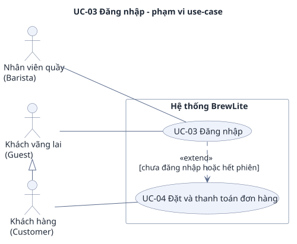

# UC-03 — Đăng nhập (JWT)

> Đặc tả use-case phụ, bổ sung cho use-case trọng tâm [UC-04](../uc-checkout.md) (đề A2 §3.3). Yêu cầu: [`../srs.md`](../srs.md). Use-case tổng quát: [`../use-case-overview.svg`](../use-case-overview.svg).

## 1. Tóm tắt

| Mục | Nội dung |
|---|---|
| Mã và tên | **UC-03 Đăng nhập (JWT)** |
| Mục tiêu | Người dùng có tài khoản nhận được JWT để dùng các chức năng cần xác thực, rồi quay về đúng chỗ đang làm dở |
| Giá trị nghiệp vụ | Là cửa vào của mọi chức năng gắn với danh tính: đặt đơn, thanh toán, xem đơn của mình (Customer) và đổi trạng thái đơn, quản lý kho (Barista) |
| Ưu tiên | Must |
| Yêu cầu liên quan | FR-09, FR-10; NFR-04, NFR-05, NFR-06 |
| Quan hệ với UC khác | `<<extend>>` [UC-04](../uc-checkout.md) khi chưa đăng nhập hoặc hết phiên (E1 của UC-04); [UC-09](uc-09-register.md) tạo tài khoản Customer; [UC-05](uc-05-order-history.md), [UC-06](uc-06-cancel-order.md), [UC-07](uc-07-order-status.md) cũng cần JWT |

Phạm vi: Guest không bị chặn khi xem menu, xem chi tiết món và thêm món vào giỏ (AC-F10.5), nên đăng nhập chỉ là bước bắt buộc khi khách đi tới một chức năng cần danh tính.

## 2. Use-case diagram

Nguồn: [`uc-03-login.puml`](uc-03-login.puml). Sơ đồ chỉ ghi mã, tên use-case và điều kiện bằng lời thường; mã yêu cầu ở mục 8. Các quan hệ:

- Guest và Barista cùng nối với UC-03, như `use-case-overview.puml`. `Customer` kế thừa `Guest` (`Guest <|- Customer`) nên cũng đăng nhập được.
- UC-03 `<<extend>>` UC-04: chỉ chạy khi JWT thiếu hoặc hết hạn (nhãn "chưa đăng nhập hoặc hết phiên"), giống cách `uc-checkout.puml` vẽ ngoại lệ E1. UC-04 là use-case liên quan, được đặc tả ở [`../uc-checkout.md`](../uc-checkout.md).

## 3. Actor

| Actor | Loại | Vai trò trong use-case |
|---|---|---|
| **Guest** (khách vãng lai) | Chính | Nhập email, mật khẩu để đăng nhập. Đăng nhập bằng tài khoản `CUSTOMER` thì từ đó là Customer |
| **Barista** (nhân viên quầy) | Chính | Dùng cùng form và cùng endpoint; token có `role = "BARISTA"` (AC-F09.4). Tài khoản do seed tạo (giả định A-04), không đăng ký được |

Customer đã đăng nhập chỉ xuất hiện lại ở đây khi JWT hết hạn (E2). Thành phần kỹ thuật: Next.js UI, NestJS API, Database.

## 4. Trigger, tiền điều kiện, hậu điều kiện

**Trigger:** người dùng mở trang đăng nhập (`/login`), hoặc bị dẫn tới đó từ một chức năng cần đăng nhập (kèm tham số `next`, xem A1, A2).

**Tiền điều kiện:**

1. Người dùng đã có tài khoản: Customer tạo qua [UC-09](uc-09-register.md), Barista do seed tạo. Tài khoản demo (`srs.md` mục 3.3): `customer.demo@brewlite.local` và `barista.demo@brewlite.local`, mật khẩu demo `Demo@12345`.
2. API và database đang hoạt động.

**Hậu điều kiện khi thành công:**

- Trình duyệt giữ một JWT có `sub`, `role`, `exp`; thời hạn không quá 3600 giây kể từ lúc cấp (AC-F09.1, AC-N05.1).
- Header hiển thị trạng thái đã đăng nhập kèm nút "Đăng xuất". Giỏ hàng không đổi (AC-F09.3).

**Hậu điều kiện khi thất bại:** không cấp token, người dùng ở lại trang đăng nhập, giỏ hàng và dữ liệu trong Database không đổi.

## 5. Luồng chính

Luồng suôn sẻ nhất: Guest có tài khoản Customer nhập đúng thông tin.

| Bước | Tác nhân | Hành động |
|---|---|---|
| 1 | Guest | Mở trang đăng nhập |
| 2 | Next.js UI | Hiện form email và mật khẩu |
| 3 | Guest | Nhập email, mật khẩu và bấm gửi |
| 4 | Next.js UI | Kiểm định dạng email và mật khẩu trước khi gửi (AC-N06.3); hợp lệ thì gửi `POST /auth/login` |
| 5 | NestJS API | Kiểm body theo danh sách trường cho phép (AC-N06.1) |
| 6 | NestJS API, Database | Tìm người dùng theo email, so mật khẩu nhập với bản băm đã lưu (NFR-04) |
| 7 | NestJS API | Trả 200 với `accessToken` là JWT có `sub` (id người dùng), `role`, `exp` (AC-F09.1) |
| 8 | Next.js UI | Lưu phiên đăng nhập; header hiện trạng thái đã đăng nhập và nút "Đăng xuất" |
| 9 | Next.js UI | Chuyển về trang trước đó theo tham số `next`, nếu không có thì về trang menu (AC-F09.3). Use-case kết thúc thành công |

## 6. Luồng thay thế

### A1 — Guest có giỏ bấm "Thanh toán" (rẽ từ UC-04 bước 1, quay lại bước 9)

1. Guest có giỏ hàng bấm "Thanh toán". UI chuyển tới `/login?next=/checkout` trong vòng 1 giây và **không** gọi `POST /orders` (AC-F10.3).
2. Guest đăng nhập theo bước 2 đến 8.
3. Bước 9: UI quay về `/checkout`, giỏ còn nguyên các dòng. Phần còn lại của đặt đơn thuộc UC-04 (E1a).

### A2 — Chức năng khác cần đăng nhập (rẽ từ lúc mở trang, quay lại bước 9)

Đặt đơn, thanh toán, lịch sử, theo dõi đơn và đổi trạng thái chỉ dùng được khi có JWT hợp lệ. Guest được dẫn tới trang đăng nhập, đăng nhập xong thì quay lại đúng chỗ cũ (mô tả FR-10). Với đơn hàng, đích quay lại là trang xem đơn, xem [UC-05](uc-05-order-history.md).

### A3 — Barista đăng nhập (tại bước 3, quay lại bước 4)

Barista nhập email, mật khẩu của tài khoản Barista vào cùng form. Luồng giống luồng chính; token có `role = "BARISTA"` (AC-F09.4). Sau đó Barista dùng token cho các chức năng của mình (đổi trạng thái đơn: [UC-07](uc-07-order-status.md); kho nguyên liệu: [UC-10](../uc-inventory.md)).

### A4 — Đăng xuất (không đi qua bước 1 đến 9)

Người dùng đã đăng nhập bấm "Đăng xuất". UI xóa token; **giữ nguyên giỏ hàng** (AC-F09.3). Header trở về trạng thái chưa đăng nhập. `srs.md` mục 3.1 không có endpoint đăng xuất.

## 7. Luồng ngoại lệ

### E1 — Sai email hoặc mật khẩu (tại bước 6)

- **Kích hoạt:** sai mật khẩu, hoặc email không tồn tại.
- **Phản ứng:** API trả 401 `UNAUTHORIZED` với **cùng một thông điệp** "Email hoặc mật khẩu không đúng" cho cả hai trường hợp, để không lộ email nào đã đăng ký (AC-F09.2). UI hiện thông điệp, giữ người dùng ở form.
- **Kết quả:** không cấp token, dữ liệu không đổi.

### E2 — Thiếu token, token sai chữ ký hoặc hết hạn (tại các endpoint cần đăng nhập)

- **Kích hoạt:** gọi `POST /orders`, `POST /payments`, `POST /payments/:id/sync`, `GET /orders/me`, `GET /orders/:id` hoặc `PATCH /orders/:id` mà không có header `Authorization`, hoặc token đổi một ký tự, hoặc quá `exp`.
- **Phản ứng:** 401 `UNAUTHORIZED` (AC-F10.1, AC-F10.2, AC-N05.1). `GET /payments/vnpay/ipn` và `GET /payments/vnpay/return` công khai, bảo vệ bằng chữ ký VNPay nên không thuộc ngoại lệ này. UI dẫn tới đăng nhập theo A2, giữ giỏ.

### E3 — 401 giữa lúc thanh toán (UC-04)

API trả 401 giữa lúc thanh toán thì UI báo "Phiên đăng nhập đã hết hạn, vui lòng đăng nhập lại", chuyển tới đăng nhập và giữ giỏ (AC-F10.4). Việc tiếp tục đúng đơn cũ, không tạo đơn lần hai, không giữ kho thêm được đặc tả ở UC-04 E1a, E1b trong [`../uc-checkout.md`](../uc-checkout.md), không chép lại ở đây.

### E4 — Dữ liệu đăng nhập sai định dạng (tại bước 4 hoặc 5)

- **Kích hoạt:** email sai định dạng hoặc mật khẩu trống.
- **Phản ứng:** UI chặn trước khi gửi và báo lỗi dưới ô tương ứng (AC-N06.3). Nếu vẫn tới API: 400 `VALIDATION_ERROR` kèm `details` (AC-N06.1). Chuỗi kiểu `' OR 1=1 --` ở ô email trả 400 hoặc 401, không bao giờ 500 và không đăng nhập được (AC-N06.2).

### E5 — Đăng nhập đúng nhưng sai vai trò (sau bước 9)

Token hợp lệ nhưng vai trò không được phép ở endpoint đó thì API trả 403 `FORBIDDEN`; ví dụ Barista gọi `POST /orders` hoặc `GET /orders/me` (AC-N05.2). Customer không đọc, thanh toán hay hủy được đơn của người khác (AC-N05.3).

## 8. Liên kết với yêu cầu

| Bước / luồng | Mô tả ngắn | Yêu cầu chức năng | Tiêu chí chấp nhận |
|---|---|---|---|
| 4 đến 7 | Kiểm dữ liệu, so mật khẩu với bản băm, cấp JWT | FR-09 | AC-F09.1; AC-N04.1; AC-N06.1, AC-N06.3 |
| 8, 9 | Header đã đăng nhập, chuyển theo `next` hoặc menu | FR-09 | AC-F09.3 |
| A1 | Guest có giỏ bấm "Thanh toán" | FR-10 | AC-F10.3 |
| A2 | Chức năng khác cần đăng nhập | FR-10 | AC-F10.1 |
| A3 | Barista dùng cùng form và endpoint | FR-09 | AC-F09.4 |
| A4 | Đăng xuất xóa token, giữ giỏ | FR-09 | AC-F09.3 |
| E1 | Sai email hoặc mật khẩu | FR-09 | AC-F09.2 |
| E2 | Thiếu, sai hoặc hết hạn token | FR-10 | AC-F10.1, AC-F10.2; AC-N05.1 |
| E3 | 401 giữa lúc thanh toán (dẫn UC-04 E1) | FR-10 | AC-F10.4 |
| E4 | Dữ liệu sai định dạng, thử tiêm lệnh | FR-09 | AC-N06.1, AC-N06.2, AC-N06.3 |
| E5 | Sai vai trò, sai chủ đơn | NFR-05 | AC-N05.2, AC-N05.3 |
| Phạm vi | Guest không bị chặn ở menu, chi tiết món, giỏ | FR-10 | AC-F10.5 |
