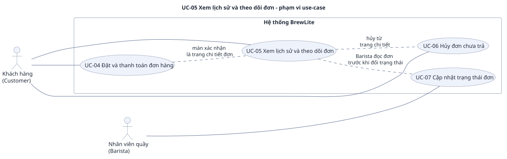

# UC-05 — Xem lịch sử và theo dõi đơn

> Đặc tả use-case phụ, bổ sung cho use-case trọng tâm [UC-04](../uc-checkout.md) (đề A2 §3.3). Yêu cầu: [`../srs.md`](../srs.md). Use-case tổng quát: [`../use-case-overview.svg`](../use-case-overview.svg).

## 1. Tóm tắt

| Mục | Nội dung |
|---|---|
| Mã và tên | **UC-05 Xem lịch sử và theo dõi đơn** |
| Mục tiêu | Customer xem danh sách đơn của mình, mở chi tiết một đơn và thấy trạng thái tự cập nhật cho tới khi đơn kết thúc |
| Giá trị nghiệp vụ | Là bước "Theo dõi đơn" cuối cùng của luồng đặt đồ uống (đề A2 §1.1): khách biết khi nào đồ uống sẵn sàng nhận mà không phải hỏi quầy |
| Ưu tiên | Must |
| Yêu cầu liên quan | FR-20, FR-21, FR-22 |
| Quan hệ với UC khác | Màn xác nhận sau [UC-04](../uc-checkout.md) (bước 21) chính là trang chi tiết đơn của use-case này; hủy đơn là [UC-06](uc-06-cancel-order.md), đổi trạng thái là [UC-07](uc-07-order-status.md), chỉ nhắc ở đây và không đặc tả lại |

## 2. Use-case diagram

Nguồn: [`uc-05-order-history.puml`](uc-05-order-history.puml). Sơ đồ chỉ ghi mã, tên use-case; mã yêu cầu ở mục 8. Các quan hệ:

- Customer nối với UC-05, đúng như `use-case-overview.puml`. Không có actor nào khác.
- UC-05 không có include hay extend. UC-05 liên quan tới ba use-case khác như sau:
  - màn xác nhận đơn sau [UC-04](../uc-checkout.md) là trang chi tiết đơn (A2);
  - nút "Hủy đơn" nằm ở trang chi tiết đơn chưa trả (AC-F25.3), luồng hủy ở [UC-06](uc-06-cancel-order.md);
  - trạng thái đơn do Barista đổi ở [UC-07](uc-07-order-status.md).

## 3. Actor

| Actor | Loại | Vai trò trong use-case |
|---|---|---|
| **Customer** (khách hàng đã đăng nhập) | Chính | Xem danh sách và chi tiết đơn của chính mình, theo dõi trạng thái |

Barista không phải actor của use-case này (`srs.md` mục 2.3). Barista chỉ dùng chung endpoint `GET /orders/:id` khi làm [UC-07](uc-07-order-status.md), xem ghi chú ở A3. Thành phần kỹ thuật: Next.js UI, NestJS API, Database.

## 4. Trigger, tiền điều kiện, hậu điều kiện

**Trigger:** Customer mở màn lịch sử đơn; hoặc trình duyệt được chuyển tới `/orders/:id` sau khi trả tiền (A2); hoặc mở một đơn từ danh sách.

**Tiền điều kiện:**

1. JWT hợp lệ, chưa hết hạn, `role = CUSTOMER` (FR-09, FR-10); thiếu thì chạy E1.
2. API và database đang hoạt động.

**Hậu điều kiện khi thành công:** Customer thấy đúng dữ liệu hiện có trong Database. Use-case chỉ đọc, không tạo hay đổi `Order`, `Payment` hay tồn kho.

**Hậu điều kiện khi thất bại:** dữ liệu không đổi; UI hiện thông báo lỗi tương ứng (mục 7).

## 5. Luồng chính

Customer đã đăng nhập, có đơn, đơn đang trong quá trình pha chế.

| Bước | Tác nhân | Hành động |
|---|---|---|
| 1 | Customer | Mở màn lịch sử đơn |
| 2 | Next.js UI | Hiện trạng thái đang tải, gửi `GET /orders/me` kèm JWT |
| 3 | NestJS API | Xác thực JWT và vai trò `CUSTOMER` |
| 4 | NestJS API, Database | Lấy các đơn của **chính người đó**, sắp theo `createdAt` giảm dần, tối đa 50 đơn (AC-F21.1, AC-F21.2) |
| 5 | NestJS API | Trả 200 với mảng đơn, mỗi phần tử có `id`, `status`, `total`, `createdAt` |
| 6 | Next.js UI | Mỗi dòng hiện mã đơn, ngày giờ, tổng tiền và nhãn trạng thái tiếng Việt: "Chờ thanh toán", "Đã thanh toán", "Thanh toán thất bại", "Đang pha chế", "Sẵn sàng nhận", "Hoàn tất", "Đã hủy" (AC-F21.5, `srs.md` mục 3.6) |
| 7 | Customer | Chọn một đơn để mở chi tiết `/orders/:id` |
| 8 | Next.js UI | Gửi `GET /orders/:id` kèm JWT |
| 9 | NestJS API, Database | Xác thực JWT, kiểm đơn có tồn tại và Customer là chủ đơn; trả 200 với `status`, `total`, `items` và `payments` nếu có (AC-F22.1) |
| 10 | Next.js UI | Hiện món (tên, size, topping, số lượng), tổng tiền, các payment và tiến trình `PAID → PREPARING → READY → COMPLETED` với bước hiện tại được đánh dấu (AC-F22.4) |
| 11 | Next.js UI | Trong lúc trang mở, cứ 5 giây lại gọi `GET /orders/:id` để làm mới. Khi Barista đổi trạng thái ([UC-07](uc-07-order-status.md)), nhãn cập nhật trong vòng 6 giây mà không cần tải lại (AC-F22.2) |
| 12 | Next.js UI | Khi đơn đã `COMPLETED` hoặc `CANCELLED` thì ngừng làm mới, không còn yêu cầu định kỳ (AC-F22.3). Use-case kết thúc |

## 6. Luồng thay thế

### A1 — Chưa có đơn nào (tại bước 5)

API trả 200 `[]`. UI hiện "Bạn chưa có đơn hàng nào" cùng liên kết tới menu (AC-F21.3). Use-case dừng ở đây.

### A2 — Vào thẳng trang chi tiết như màn xác nhận sau UC-04 (vào ở bước 8)

1. Ở [UC-04](../uc-checkout.md) bước 20, trang `/payment/vnpay-return` đọc `GET /orders/:id`. Khi Database xác nhận đơn `PAID`, UI chuyển tới `/orders/:id` (AC-F20.1). Replay `SUCCESS` của `POST /payments` trả 200 cũng đưa tới màn này (UC-04 E4a).
2. Màn xác nhận chính là trang chi tiết đơn, nên có mã đơn, trạng thái "Đã thanh toán", món (tên, size, topping, số lượng), số tiền đã trả, phương thức và thời gian; không có nút chuyển trang riêng (AC-F20.1, AC-F20.3).
3. Giỏ hàng đã được xóa khi màn này hiện ra. Khi thanh toán thất bại hoặc `Payment` còn `PENDING` thì giỏ **không** bị xóa (AC-F20.2).
4. Tải lại trang thì nội dung vẫn đúng vì lấy từ `GET /orders/:id`, không phụ thuộc state tạm (AC-F20.3). Tiếp tục từ bước 9.

### A3 — Ghi chú: Barista dùng chung endpoint đọc đơn (tại bước 9)

Đây không phải luồng của Customer mà là ghi chú về quyền trên cùng endpoint. Token Barista gọi `GET /orders/:id` được 200 với **mọi** đơn (AC-F22.1). Việc này thuộc [UC-07](uc-07-order-status.md): Barista lấy Bearer token, đọc đơn theo mã, rồi `PATCH` lần lượt `PREPARING`, `READY`, `COMPLETED` (AC-F24.4). Barista không có danh sách đơn (E5). Vì vậy sơ đồ và bảng actor của UC-05 không có Barista, khớp overview và `srs.md` mục 2.3.

### A4 — Đơn chưa thanh toán, thanh toán thất bại hoặc đã hủy (tại bước 10)

Đơn `PAYMENT_FAILED` và `CANCELLED` hiện nhãn riêng thay cho tiến trình pha chế (AC-F22.4); đơn `PENDING` hiện nhãn "Chờ thanh toán" (`srs.md` mục 3.6). Hành động tiếp theo thuộc use-case khác: trả tiếp hoặc thử lại ở [UC-04](../uc-checkout.md) (A3, A6), hủy ở [UC-06](uc-06-cancel-order.md). Không đặc tả lại ở đây.

## 7. Luồng ngoại lệ

### E1 — Chưa đăng nhập hoặc JWT hết hạn (tại bước 2, 8 và 11)

- **Kích hoạt:** không có header `Authorization`, token sai chữ ký hoặc hết hạn.
- **Phản ứng:** API trả 401 `UNAUTHORIZED` cho `GET /orders/me` và `GET /orders/:id` (AC-F10.1, AC-F10.2, AC-F21.4). UI dẫn tới đăng nhập ([UC-03](uc-03-login.md)); đăng nhập xong thì quay lại đúng trang đơn (mô tả FR-10).

### E2 — Đơn của người khác (tại bước 9)

API trả 403 `FORBIDDEN`, không trả dữ liệu đơn (AC-F22.1, AC-N05.3). Hai khách A và B không thấy đơn của nhau, kể cả trong danh sách (AC-F21.2).

### E3 — ID đơn không tồn tại (tại bước 9)

API trả 404 `ORDER_NOT_FOUND` (AC-F22.1). UI báo không tìm thấy đơn.

### E4 — Lỗi tải (tại bước 2, 8 và 11)

Trang có trạng thái loading và error như FR-02 (AC-F21.3): khi chưa xong thì hiện skeleton hoặc spinner; khi gặp lỗi 5xx hoặc mất mạng thì hiện thông báo lỗi kèm nút "Thử lại", bấm thành công thì hiện dữ liệu (AC-F02.1, AC-F02.3). `srs.md` không quy định câu chữ riêng cho màn đơn. Dữ liệu không đổi.

### E5 — Barista gọi danh sách đơn của tôi (tại bước 3)

Token Barista gọi `GET /orders/me` nhận 403 (AC-F21.4); danh sách này chỉ dành cho Customer (AC-N05.2).

## 8. Liên kết với yêu cầu

| Bước / luồng | Mô tả ngắn | Yêu cầu chức năng | Tiêu chí chấp nhận |
|---|---|---|---|
| 1 đến 5 | Lấy danh sách đơn của chính mình, mới nhất trước, tối đa 50 | FR-21 | AC-F21.1, AC-F21.2 |
| 6 | Mã đơn, ngày giờ, tổng tiền, nhãn tiếng Việt | FR-21 | AC-F21.5 |
| 7 đến 10 | Chi tiết đơn, món, payment, tiến trình | FR-22 | AC-F22.1, AC-F22.4 |
| 11 | Tự làm mới mỗi 5 giây, cập nhật trong 6 giây | FR-22 | AC-F22.2 |
| 12 | Ngừng làm mới khi `COMPLETED` hoặc `CANCELLED` | FR-22 | AC-F22.3 |
| A1 | Danh sách rỗng | FR-21 | AC-F21.3 |
| A2 | Màn xác nhận là trang chi tiết đơn sau UC-04 | FR-20 | AC-F20.1, AC-F20.2, AC-F20.3 |
| A3 (ghi chú) | Barista dùng chung `GET /orders/:id`, thuộc UC-07 | FR-22; FR-24 | AC-F22.1; AC-F24.4 |
| A4 | Nhãn riêng cho `PAYMENT_FAILED`, `CANCELLED`; nhãn "Chờ thanh toán" cho `PENDING` (mục 3.6); hủy ở UC-06 | FR-22; FR-25 | AC-F22.4; AC-F25.3 |
| E1 | Chưa đăng nhập hoặc hết hạn | FR-10 | AC-F10.1, AC-F10.2, AC-F21.4 |
| E2 | Đơn của người khác | FR-22 | AC-F22.1; AC-N05.3 |
| E3 | ID không tồn tại | FR-22 | AC-F22.1 |
| E4 | Loading và error | FR-21 | AC-F21.3; AC-F02.1, AC-F02.3 |
| E5 | Barista gọi `GET /orders/me` | FR-21 | AC-F21.4; AC-N05.2 |
