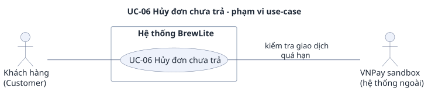

# UC-06 — Hủy đơn chưa trả

> Đặc tả use-case phụ, bổ sung cho use-case trọng tâm [UC-04](../uc-checkout.md) (đề A2 §3.3). Yêu cầu: [`../srs.md`](../srs.md). Use-case tổng quát: [`../use-case-overview.svg`](../use-case-overview.svg).

## 1. Tóm tắt

| Mục | Nội dung |
|---|---|
| Mã và tên | **UC-06 Hủy đơn chưa trả** |
| Mục tiêu | Customer hủy đơn của mình khi chưa trả tiền, và phần nguyên liệu đã giữ cho đơn đó được nhả ra |
| Giá trị nghiệp vụ | Không có use-case này thì nguyên liệu giữ cho đơn bỏ dở sẽ bị khóa mãi (đơn không tự hủy theo thời gian), làm menu báo hết hàng sai |
| Ưu tiên | Must |
| FR liên quan | FR-25 (Must). FR-26 (hủy đơn đã trả và hoàn tiền) là Won't, xem mục 9 |
| Quan hệ với UC khác | Không include hay extend UC-04. Xử lý đơn do UC-04 tạo ra; luồng ngắn gọn bên đó là [UC-04 A5](../uc-checkout.md). Khi đơn còn `Payment PENDING` quá hạn thì dùng chung cách đối soát QueryDR với [UC-04 E11](../uc-checkout.md). Cùng endpoint `PATCH /orders/:id` với UC-07 nhưng khác actor và khác trạng thái đích |

## 2. Use-case diagram

Nguồn: [`uc-06-cancel-order.puml`](uc-06-cancel-order.puml). Sơ đồ chỉ ghi mã và tên use-case; mã yêu cầu ở mục 8. Các quan hệ:

- Customer nối với UC-06: chỉ chủ đơn mới hủy được đơn của mình (BR-04).
- UC-06 nối với VNPay sandbox, nhãn "kiểm tra giao dịch quá hạn": VNPay là actor phụ, chỉ xuất hiện khi đơn có `Payment PENDING` đã quá hạn, lúc đó API hỏi QueryDR trước khi xét hủy (A2). Cách vẽ này khớp `use-case-overview.puml` (`UC06 --- Pay`) và [`uc-checkout.puml`](../uc-checkout.puml).
- UC-06 không có include hay extend: đây là use-case độc lập, nên sơ đồ không vẽ UC-04.

## 3. Actor

| Actor | Loại | Vai trò trong use-case |
|---|---|---|
| **Customer** (chủ đơn) | Chính | Mở đơn, bấm "Hủy đơn", xác nhận. Chỉ hủy được đơn của chính mình |
| **VNPay sandbox** (hệ thống ngoài) | Phụ | Chỉ khi đối soát `Payment PENDING` quá hạn: trả lời API khi API hỏi bằng QueryDR (quy ước: `srs.md` mục 3.4) |

Barista không tham gia use-case này. Barista gửi `CANCELLED` thì luôn bị từ chối, xem [UC-07](uc-07-order-status.md) mục 7 (E7) và `srs.md` AC-F24.3. Các thành phần kỹ thuật trong luồng: Next.js UI, NestJS API, Database.

## 4. Trigger, tiền điều kiện, hậu điều kiện

**Trigger:** Customer bấm "Hủy đơn" trên trang chi tiết đơn.

**Tiền điều kiện:**

1. Customer đã đăng nhập (JWT hợp lệ, `role = CUSTOMER`; FR-09, FR-10). JWT thiếu hoặc hết hạn thì chạy E1.
2. Đơn thuộc Customer và đang `PENDING` hoặc `PAYMENT_FAILED` (BR-04).
3. Đơn không có `Payment PENDING` chưa kết luận (BR-10). Nếu có thì giao diện không cho hủy (AC-F25.3), còn API trả E5 hoặc đối soát theo A2.

**Hậu điều kiện khi thành công (đơn `CANCELLED`):**

| Đối tượng | Đơn `inventoryTracked=true` | Đơn `inventoryTracked=false` (đơn cũ) |
|---|---|---|
| `Order` | `CANCELLED` (trạng thái kết thúc, không còn chuyển nào đi ra: AC-F23.4) | `CANCELLED` |
| `Payment` | Không đổi. Các `Payment` cũ đều đã `FAILED` hoặc không có; không có `Payment PENDING` | Như cột trái |
| `reserved` | Giảm đúng phần trong snapshot (`OrderIngredient`), đúng một lần | Không đổi, không dùng snapshot |
| `onHand` | Không đổi | Không đổi |
| `Product.stock` | Không đổi | Cộng lại số lượng từng dòng (vòng đời cũ) |
| Giao diện | Nhãn đơn "Đã hủy", nút "Hủy đơn" biến mất | Như cột trái |

**Hậu điều kiện khi thất bại:** mọi trường hợp bị từ chối (mục 7) đều không đổi `Order`, `Payment`, snapshot, `reserved`, `onHand` và `Product.stock`. Riêng A2 có thể làm `Payment` và đơn đổi trạng thái do kết quả đối soát, xem bảng ở A2.

## 5. Luồng chính

Chủ đơn hủy đơn `PENDING` hoặc `PAYMENT_FAILED` thuộc loại `inventoryTracked=true`, không có payment chưa kết luận.

| Bước | Tác nhân | Hành động |
|---|---|---|
| 1 | Customer | Mở trang chi tiết đơn (xem ở [UC-05](uc-05-order-history.md)) |
| 2 | Next.js UI | Đọc `GET /orders/:id`. Đơn `PENDING` hoặc `PAYMENT_FAILED` và không có `Payment PENDING` chưa kết luận thì hiện nút "Hủy đơn" (AC-F25.3) |
| 3 | Customer | Bấm "Hủy đơn" |
| 4 | Next.js UI | Hỏi xác nhận "Bạn chắc chắn muốn hủy đơn?". Customer xác nhận; chọn không thì use-case dừng, không có tác dụng phụ |
| 5 | Next.js UI | Gửi `PATCH /orders/:id` kèm JWT, body `{ "status": "CANCELLED" }` |
| 6 | NestJS API | Xác thực JWT và kiểm body (E1, E7); kiểm đơn tồn tại và thuộc Customer (E6, E2) |
| 7 | NestJS API, Database | Mở transaction, khóa đơn rồi đọc lại đơn. Kiểm trạng thái: `PENDING` hoặc `PAYMENT_FAILED` thì đi tiếp (E3, E4 nếu không phải) |
| 8 | NestJS API, Database | Kiểm đơn không còn `Payment PENDING`. Nếu còn: E5. Nếu payment đã quá hạn thì đã được đối soát ở A2 trước khi tới bước này |
| 9 | NestJS API, Database | Giảm `reserved` của từng nguyên liệu theo snapshot `OrderIngredient`; `onHand` không đổi (BR-03, AC-F25.1) |
| 10 | NestJS API, Database | Đổi `Order` sang `CANCELLED`, commit; trả 200 với `status = "CANCELLED"` |
| 11 | Next.js UI | Tải lại đơn: nhãn "Đã hủy", nút "Hủy đơn" biến mất (AC-F25.3). Use-case kết thúc thành công |

Bước 7 đến 10 là một transaction: lỗi giữa chừng thì không đổi gì (AC-N13.1).

## 6. Luồng thay thế

Luồng thay thế vẫn kết thúc tốt đẹp hoặc dừng lại có kiểm soát; đây không phải lỗi.

### A1 — Đơn cũ `inventoryTracked=false` (rẽ từ bước 9)

Đơn không có snapshot nguyên liệu, nên bước 9 thay bằng: cộng lại `Product.stock` theo số lượng từng dòng (vòng đời cũ), không đổi nguyên liệu (AC-F25.1, BR-03). Các bước còn lại như luồng chính. Quay lại bước 10.

### A2 — Đơn có `Payment PENDING` đã quá hạn (rẽ từ bước 6, trước khi vào transaction)

`now >= expiresAt` mà `Payment` vẫn `PENDING`: chưa chắc khách chưa trả (khách có thể trả sát giờ, IPN tới muộn), nên API không hủy ngay mà đối soát trước (AC-F25.4, AC-F16.9). Cách đối soát giống [UC-04 E11](../uc-checkout.md), không chép lại ở đây; VNPay sandbox tham gia ở bước này.

1. Sau khi kiểm quyền sở hữu, API gọi QueryDR ngoài transaction đang khóa đơn, kiểm phản hồi rồi mới ghi kết quả dưới khóa đơn.
2. Tùy kết quả, hướng đi của UC-06 như sau:

| Kết quả đối soát | Payment / đơn sau đối soát | UC-06 |
|---|---|---|
| `00/00` (khách đã trả) | `SUCCESS`, đơn `PAID` | Không hủy được. AC-F25.4 không nêu mã trả về; suy từ AC-F25.2 (Customer hủy đơn `PAID`) thì là 403 `FORBIDDEN`. Kết thúc, đơn không đổi thêm |
| `00/02`, hoặc `91` sau hạn | `FAILED`, đơn `PAYMENT_FAILED` | Không còn payment chưa kết luận, quay lại bước 7 và hủy bình thường |
| Chưa kết luận, đã quá `expiresAt + 15 phút` (trừ nhóm đáng ngờ và `MISMATCH`) | Đóng `FAILED` với `gatewayResponseCode = "EXPIRED"`, đơn `PAYMENT_FAILED`, kho không đổi (AC-F16.10) | Quay lại bước 7 và hủy bình thường. Nguyên liệu chỉ được nhả ở bước 9, không phải lúc payment bị đóng |
| Chưa kết luận, còn trong khoảng chờ | `Payment` giữ `PENDING` | E5 (409 `PAYMENT_IN_PROGRESS`) hoặc E8 (502 `PAYMENT_PROVIDER_ERROR`), không hủy |
| Nhóm đáng ngờ (`04`/`05`/`06`/`07`/`09`) hoặc `MISMATCH` | Giữ `PENDING`, không bao giờ tự đóng | E8, không hủy |

Chi tiết từng mã QueryDR: bảng cuối `srs.md` mục 5.6 (sau AC-F16.12) và [UC-04 E11](../uc-checkout.md).

### A3 — Customer đổi ý ở bước 4

Customer không xác nhận hộp thoại: UI không gọi API, đơn và kho không đổi.

### Ghi chú: những điều không tự xảy ra

- Đơn **không tự hủy theo thời gian** và không có job nền (`srs.md` mục 3.4, FR-25). Đơn bỏ dở nằm nguyên cho tới khi chủ đơn hủy.
- `Payment` chuyển `FAILED` (kể cả `EXPIRED`) **không nhả nguyên liệu**. Chỉ khi đơn bị hủy hợp lệ qua UC-06 thì mới nhả (`srs.md` mục 3.6, BR-09).
- Tiền khách trả sau khi đơn đã `CANCELLED` không mở lại đơn; xử lý theo [UC-04 E12](../uc-checkout.md) (AC-F15.7).

## 7. Luồng ngoại lệ

Mọi lỗi theo định dạng `srs.md` mục 3.2. Mọi nhánh dưới đây đều không đổi `Order`, `Payment`, snapshot, `reserved`, `onHand`, `Product.stock`. SRS không quy định thứ tự kiểm giữa các mã này. Theo code hiện tại, thứ tự là: 401, 400 (body), 404 rồi 403 sở hữu, sau đó 403 hoặc 409 theo trạng thái đơn.

| Mã | Tình huống | Phản hồi | Yêu cầu |
|---|---|---|---|
| E1 | Chưa đăng nhập, JWT sai hoặc hết hạn | 401 `UNAUTHORIZED`. UI dẫn tới trang đăng nhập ([UC-03](uc-03-login.md)) | AC-F10.1, AC-F10.2 |
| E2 | Hủy đơn của người khác | 403 `FORBIDDEN` | AC-F25.2, AC-N05.3 |
| E3 | Customer hủy đơn `PAID` | 403 `FORBIDDEN`. Đơn `PAID` trở đi không hủy được ở bản nộp (FR-26 Won't) | AC-F25.2 |
| E4 | Đơn `PREPARING`, `READY`, `COMPLETED` hoặc `CANCELLED`, kể cả bấm hủy lần hai | 409 `INVALID_ORDER_TRANSITION`. Hủy lần hai không nhả nguyên liệu lần nữa | AC-F25.1, AC-F25.2, AC-F23.2 |
| E5 | Đơn có `Payment PENDING` còn hạn (hoặc quá hạn mà đối soát chưa kết luận trong khoảng chờ) | 409 `PAYMENT_IN_PROGRESS`; đơn và kho giữ nguyên. Tránh trường hợp khách vừa trả tiền vừa hủy | AC-F25.4, BR-10, [UC-04 A5](../uc-checkout.md) |
| E6 | `id` không tồn tại | 404 `ORDER_NOT_FOUND` | AC-F24.3 |
| E7 | Body sai: thiếu `status`, `status` không hợp lệ, có trường lạ | 400 `VALIDATION_ERROR` | AC-N06.1 |
| E8 | Đối soát ở A2 gặp lỗi mạng, hết thời gian chờ, sai chữ ký, nhóm đáng ngờ hoặc `MISMATCH` | 502 `PAYMENT_PROVIDER_ERROR`; `Payment` giữ `PENDING`, không hủy. Quá `expiresAt + 15 phút` (trừ nhóm đáng ngờ và `MISMATCH`) thì đóng payment rồi hủy tiếp theo A2 | AC-F16.10, AC-F16.11 |

Khi nhận E5 hoặc E8, giao diện cho thấy đơn đang chờ xác minh thanh toán và không cho hủy, thay vì tự gọi lại liên tục (AC-F16.11). Customer chờ đối soát xong (nút kiểm tra lại gọi `POST /payments/:id/sync`, [UC-04 E10](../uc-checkout.md)) rồi mới hủy được.

## 8. Liên kết với yêu cầu

| Bước hoặc luồng | Yêu cầu chức năng | Tiêu chí chấp nhận | Quy tắc, ghi chú |
|---|---|---|---|
| Bước 2, 11 (nút, xác nhận, nhãn "Đã hủy") | FR-25 | AC-F25.3 | FR-22 cho việc hiển thị chi tiết đơn |
| Bước 5 đến 10 (hủy hợp lệ, nhả snapshot) | FR-25 | AC-F25.1 | BR-03, BR-04, BR-08; AC-N13.1 (nguyên tử) |
| A1 (đơn cũ) | FR-25 | AC-F25.1 | BR-03 |
| A2 (đối soát quá hạn) | FR-25, FR-16 | AC-F25.4, AC-F16.9, AC-F16.10, AC-F16.11 | BR-10, BR-11; [UC-04 E11](../uc-checkout.md) |
| E1 | FR-10 | AC-F10.1, AC-F10.2 | NFR-05 |
| E2, E3 | FR-25 | AC-F25.2 | AC-N05.3, NFR-05 (AC-N05.2) |
| E4 | FR-25, FR-23 | AC-F25.1, AC-F25.2, AC-F23.2 | BR-08 |
| E5 | FR-25 | AC-F25.4 | BR-10 |
| E6, E7 | FR-24, NFR-06 | AC-F24.3, AC-N06.1 | — |
| E8 | FR-16 | AC-F16.10, AC-F16.11 | BR-11 |
| Trạng thái đơn `PENDING`/`PAYMENT_FAILED` → `CANCELLED` | FR-23 | AC-F23.1, AC-F23.4 | `srs.md` mục 3.6, [state-order.svg](../../diagrams/state-order.svg) |
| Payment `FAILED` không nhả kho | FR-15 | AC-F15.3 | BR-09 |

## 9. Không làm trong bản nộp

- **FR-26** (hủy đơn đã thanh toán và hoàn tiền) là Won't. `PAID → CANCELLED` không có trong máy trạng thái; Customer nhận E3, Barista nhận 409 `INVALID_ORDER_TRANSITION` (AC-F24.3). Không có endpoint hay giao diện hoàn tiền; tiền về sau trạng thái cuối được nhân viên hoàn tay theo AC-F15.7.
- Không có job nền tự hủy đơn hoặc tự nhả nguyên liệu theo thời gian.
