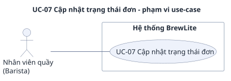

# UC-07 — Cập nhật trạng thái đơn

> Đặc tả use-case phụ, bổ sung cho use-case trọng tâm [UC-04](../uc-checkout.md) (đề A2 §3.3). Yêu cầu: [`../srs.md`](../srs.md). Use-case tổng quát: [`../use-case-overview.svg`](../use-case-overview.svg).

## 1. Tóm tắt

| Mục | Nội dung |
|---|---|
| Mã và tên | **UC-07 Cập nhật trạng thái đơn** |
| Mục tiêu | Barista đưa đơn đã thanh toán đi hết vòng pha chế: `PREPARING`, `READY`, `COMPLETED`, và Customer thấy trạng thái mới |
| Giá trị nghiệp vụ | Đây là bước nối "đã trả tiền" với "khách nhận được đồ uống"; trạng thái đơn trên màn của khách chỉ đúng khi Barista cập nhật đúng |
| Ưu tiên | Must |
| FR liên quan | FR-23, FR-24 (Must). FR-27 (hàng đợi Barista) là Won't, không vẽ trong sơ đồ |
| Quan hệ với UC khác | Đăng nhập lấy token ở [UC-03](uc-03-login.md). Đơn `PAID` do [UC-04](../uc-checkout.md) tạo ra; Customer theo dõi kết quả ở [UC-05](uc-05-order-history.md). Cùng endpoint `PATCH /orders/:id` với [UC-06](uc-06-cancel-order.md) nhưng khác actor và khác trạng thái đích |

## 2. Use-case diagram

Nguồn: [`uc-07-order-status.puml`](uc-07-order-status.puml). Sơ đồ chỉ ghi mã và tên use-case; mã yêu cầu ở mục 8. Các quan hệ:

- Barista nối với UC-07, khớp `use-case-overview.puml` (`UC07 -- Barista`). Không có actor nào khác: Customer chỉ theo dõi kết quả qua [UC-05](uc-05-order-history.md) và hủy đơn qua [UC-06](uc-06-cancel-order.md).
- UC-07 không include hay extend use-case nào. Việc đăng nhập (UC-03) là tiền điều kiện, không phải bước con. Overview nối UC-03 với Barista riêng, nên sơ đồ này không vẽ lại.
- Hàng đợi đơn cho Barista (FR-27) là Won't nên không có use-case hay đường nối nào cho nó.

## 3. Actor

| Actor | Loại | Vai trò trong use-case |
|---|---|---|
| **Barista** (nhân viên quầy) | Chính | Đăng nhập lấy Bearer token, tra đơn theo mã, rồi gọi `PATCH /orders/:id` qua API theo hướng dẫn thủ công (Postman hoặc công cụ HTTP tương đương). Không có màn hình riêng và không giao Postman collection (AC-F24.4) |

Customer và VNPay sandbox không tham gia. Customer chỉ là người nhìn thấy nhãn mới ở UC-05. Các thành phần kỹ thuật: NestJS API, Database, và Next.js UI ở phía khách.

## 4. Trigger, tiền điều kiện, hậu điều kiện

**Trigger:** Barista có mã của một đơn đã thanh toán (đơn `PAID`) và bắt đầu pha chế. Hệ thống không có danh sách đơn cho Barista (FR-27 Won't), nên Barista biết mã đơn từ khách hoặc từ nguồn ngoài hệ thống.

**Tiền điều kiện:**

1. Barista có tài khoản do seed tạo (giả định A-04, Barista không đăng ký). Tài khoản demo: `barista.demo@brewlite.local`, mật khẩu demo `Demo@12345` (`srs.md` mục 3.3).
2. Barista đã đăng nhập, token có `role = "BARISTA"` (AC-F09.4). Thiếu hoặc sai token thì chạy E1.
3. Đơn đang ở trạng thái thích hợp cho bước kế tiếp: `PAID` để sang `PREPARING`, `PREPARING` để sang `READY`, `READY` để sang `COMPLETED`.

**Hậu điều kiện khi thành công:**

| Đối tượng | Sau mỗi lần `PATCH` thành công |
|---|---|
| `Order.status` | Đúng trạng thái đích: `PREPARING`, `READY` rồi `COMPLETED` |
| `Payment` | Không đổi (vẫn `SUCCESS`) |
| Kho (`reserved`, `onHand`) | Không đổi: nguyên liệu đã được trừ theo snapshot khi thanh toán thành công (BR-03) |
| Giao diện của khách | Nhãn đơn đổi trong vòng 6 giây (AC-F22.2); tới `COMPLETED` thì trang ngừng tự làm mới (AC-F22.3) |

**Hậu điều kiện khi thất bại:** mọi trường hợp bị từ chối (mục 7) đều không đổi trạng thái đơn, snapshot và số dư nguyên liệu hay `Product.stock` (AC-F24.3, AC-F24.2).

## 5. Luồng chính

Barista cập nhật một đơn `PAID` đi hết ba bước. Đây là chính hướng dẫn thủ công ở AC-F24.4.

| Bước | Tác nhân | Hành động |
|---|---|---|
| 1 | Barista | Đăng nhập bằng `POST /auth/login` (UC-03) và lấy `accessToken` để dùng làm Bearer token |
| 2 | Barista, NestJS API | `GET /orders/:id` theo mã đơn với header `Authorization: Bearer <token>`. Barista xem được mọi đơn; API trả 200 và `status = "PAID"` (AC-F22.1) |
| 3 | Barista | `PATCH /orders/:id` với body `{ "status": "PREPARING" }` |
| 4 | NestJS API | Xác thực JWT, kiểm body và vai trò `BARISTA`; kiểm đơn tồn tại |
| 5 | NestJS API, Database | Trong transaction, khóa đơn và đọc lại đơn. Chuyển `PAID → PREPARING` có trong bảng ở mục 5.1 và do Barista thực hiện, nên cập nhật `Order.status`, commit và trả 200 với `status = "PREPARING"` (AC-F24.1) |
| 6 | Next.js UI (phía khách) | Trang theo dõi đơn đang mở tự làm mới mỗi 5 giây nên nhãn "Đang pha chế" xuất hiện trong vòng 6 giây (AC-F22.2) |
| 7 | Barista, NestJS API | `PATCH` với `{ "status": "READY" }`; API kiểm như bước 4, 5 cho chuyển `PREPARING → READY`, trả 200. Khách thấy "Sẵn sàng nhận" |
| 8 | Barista, NestJS API | `PATCH` với `{ "status": "COMPLETED" }`; chuyển `READY → COMPLETED`, trả 200. Khách thấy "Hoàn tất", trang ngừng tự làm mới (AC-F22.3). Use-case kết thúc thành công |

Cả ba lần `PATCH` đều trả 200 (AC-F24.1). Nhãn tiếng Việt: `srs.md` mục 3.6.

### 5.1 Tám chuyển trạng thái hợp lệ

Chép từ `srs.md` mục 3.6 (BR-08), khớp [`state-order.puml`](../../diagrams/state-order.puml). Đúng 8 chuyển; `COMPLETED` và `CANCELLED` là trạng thái kết thúc, chuyển nào khác đều bị từ chối, gồm `PAID → CANCELLED` (FR-26 Won't).

| Từ | Sang | Ai thực hiện | Thuộc use-case |
|---|---|---|---|
| `PENDING` | `PAID` | Hệ thống, khi IPN/QueryDR đã xác thực báo thành công (BR-11) | UC-04 |
| `PENDING` | `PAYMENT_FAILED` | Hệ thống, khi IPN/QueryDR đã xác thực báo thất bại (BR-11) | UC-04 |
| `PENDING` | `CANCELLED` | Chủ đơn (FR-25) | UC-06 |
| `PAYMENT_FAILED` | `PENDING` | Hệ thống, khi khách thử lại (`Payment PENDING` mới, không giữ thêm nguyên liệu) | UC-04 |
| `PAYMENT_FAILED` | `CANCELLED` | Chủ đơn (FR-25) | UC-06 |
| `PAID` | `PREPARING` | Barista | **UC-07** |
| `PREPARING` | `READY` | Barista | **UC-07** |
| `READY` | `COMPLETED` | Barista | **UC-07** |

UC-07 chỉ phủ ba chuyển của Barista (ba dòng cuối). Năm chuyển còn lại thuộc hệ thống (UC-04) và chủ đơn (UC-06), không đi qua use-case này.

## 6. Luồng thay thế

Luồng thay thế vẫn kết thúc tốt đẹp hoặc dừng lại có kiểm soát; đây không phải lỗi.

### A1 — Barista dừng giữa chừng (sau bước 5 hoặc 7)

Barista không gọi tiếp. Đơn giữ nguyên ở `PREPARING` hoặc `READY`, không có job nền tự đẩy tiếp hay tự đóng đơn. Lần sau Barista `GET /orders/:id` để biết đơn đang ở đâu rồi gọi tiếp bước kế (quay lại bước 2).

### A2 — Barista tra đơn trước khi cập nhật (bước 2)

`GET /orders/:id` cho thấy đơn chưa `PAID` (còn `PENDING` hoặc `PAYMENT_FAILED`, hoặc đã `CANCELLED`). Barista chưa nên pha chế, và nếu vẫn gửi `PATCH` thì sẽ gặp E6 hoặc E5. Use-case dừng, không có tác dụng phụ.

### Ranh giới với UC-06

Cùng endpoint `PATCH /orders/:id`, hai use-case tách nhau theo actor và trạng thái đích:

| Gửi `status` | Customer (chủ đơn) | Barista |
|---|---|---|
| `CANCELLED` | UC-06 | Luôn bị từ chối (E7) |
| `PREPARING`, `READY`, `COMPLETED` | 403 `FORBIDDEN` (E2) | UC-07 |
| `PENDING`, `PAID`, `PAYMENT_FAILED` | 400 `VALIDATION_ERROR` (E4) | 400 `VALIDATION_ERROR` (E4) |

## 7. Luồng ngoại lệ

Mọi lỗi theo định dạng `srs.md` mục 3.2. Mọi nhánh dưới đây đều không đổi trạng thái đơn, snapshot và số dư. SRS không quy định thứ tự kiểm giữa các mã lỗi này.

| Mã | Tình huống | Phản hồi | Yêu cầu |
|---|---|---|---|
| E1 | Không có token, token sai chữ ký hoặc đã hết hạn | 401 `UNAUTHORIZED` | AC-F24.2, AC-F10.1, AC-F10.2 |
| E2 | Customer gọi `PREPARING`, `READY` hoặc `COMPLETED` | 403 `FORBIDDEN` | AC-F24.2, AC-N05.2 |
| E3 | `id` không tồn tại | 404 `ORDER_NOT_FOUND` | AC-F24.3 |
| E4 | `status` đích là `PENDING`, `PAID` hoặc `PAYMENT_FAILED` (các chuyển này chỉ do luồng thanh toán thực hiện); hoặc body sai định dạng | 400 `VALIDATION_ERROR` | AC-F23.3, AC-N06.1 |
| E5 | Chuyển không có trong bảng 5.1, ví dụ `PAID → READY`, `PREPARING → CANCELLED`, `COMPLETED → PREPARING`, hoặc đích trùng trạng thái hiện tại | 409 `INVALID_ORDER_TRANSITION` | AC-F23.2, AC-F23.1, AC-F23.4 |
| E6 | Barista chuyển đơn `PENDING` hoặc `PAYMENT_FAILED` sang `PREPARING` (đơn chưa trả tiền) | 409 `INVALID_ORDER_TRANSITION` | AC-F24.3 |
| E7 | Barista gửi `{ "status": "CANCELLED" }`. Trên đơn `PENDING` hoặc `PAYMENT_FAILED`: hai chuyển này chỉ dành cho chủ đơn (UC-06). Trên đơn `PAID`, `PREPARING`, `READY`, `COMPLETED` hoặc `CANCELLED`: chuyển không có trong bảng (`PAID → CANCELLED` là FR-26 Won't) | 403 `FORBIDDEN` với đơn `PENDING`/`PAYMENT_FAILED`; 409 `INVALID_ORDER_TRANSITION` với các trạng thái còn lại | AC-F24.3, AC-F25.2 |

Với E1 đến E7, trạng thái đơn trong DB không đổi và Customer không thấy nhãn nào đổi. Khi Customer gửi `PREPARING` lên một `id` không tồn tại, SRS chưa nói trả E2 (403) hay E3 (404); nhóm cần chốt.

## 8. Liên kết với yêu cầu

| Bước hoặc luồng | Yêu cầu chức năng | Tiêu chí chấp nhận | Quy tắc, ghi chú |
|---|---|---|---|
| Bước 1 (đăng nhập Barista) | FR-09 | AC-F09.4 | UC-03 |
| Bước 2 (tra đơn) | FR-22 | AC-F22.1 | NFR-05 (AC-N05.2: `GET /orders/:id` cho chủ đơn hoặc Barista) |
| Bước 3, 5, 7, 8 (đổi trạng thái đúng bảng) | FR-24 | AC-F24.1, AC-F24.4 | BR-08 |
| Bước 6 (khách thấy nhãn mới) | FR-22 | AC-F22.2, AC-F22.3 | — |
| Bảng 5.1 (8 chuyển hợp lệ) | FR-23 | AC-F23.1, AC-F23.4 | BR-08, `srs.md` mục 3.6 |
| Hướng dẫn thủ công, không Postman collection | FR-24 | AC-F24.4 | — |
| E1 | FR-24, FR-10 | AC-F24.2, AC-F10.1, AC-F10.2 | NFR-05 |
| E2 | FR-24 | AC-F24.2 | NFR-05 (AC-N05.2) |
| E3 | FR-24 | AC-F24.3 | — |
| E4 | FR-23, NFR-06 | AC-F23.3, AC-N06.1 | — |
| E5 | FR-23 | AC-F23.2, AC-F23.1, AC-F23.4 | BR-08 |
| E6, E7 | FR-24, FR-25 | AC-F24.3, AC-F25.2 | BR-04, BR-08 |
| Đơn không đổi khi bị từ chối | FR-24 | AC-F24.3 | AC-N13.1 (nguyên tử) |

## 9. Không làm trong bản nộp

- **FR-27** (Barista xem hàng đợi đơn: API danh sách và màn hình) là Won't; Barista dùng `GET /orders/:id` theo mã đơn. Không có endpoint hay giao diện danh sách đơn cho Barista, nên sơ đồ không vẽ.
- **FR-26** (hủy đơn đã thanh toán và hoàn tiền) là Won't: Barista đổi đơn `PAID` sang `CANCELLED` nhận 409 `INVALID_ORDER_TRANSITION` (E7).
- Không có màn hình riêng cho Barista để đổi trạng thái đơn; thao tác qua API theo hướng dẫn thủ công (AC-F24.4).
