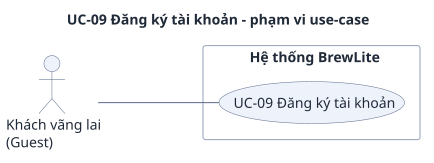

# UC-09 — Đăng ký tài khoản

> Đặc tả use-case phụ, bổ sung cho use-case trọng tâm [UC-04](../uc-checkout.md) (đề A2 §3.3). Yêu cầu: [`../srs.md`](../srs.md). Use-case tổng quát: [`../use-case-overview.svg`](../use-case-overview.svg).

## 1. Tóm tắt

| Mục | Nội dung |
|---|---|
| Mã và tên | **UC-09 Đăng ký tài khoản** |
| Mục tiêu | Guest tạo tài khoản bằng email và mật khẩu để trở thành Customer |
| Giá trị nghiệp vụ | Customer mới có danh tính để đặt đơn, thanh toán và xem lịch sử đơn; chưa có tài khoản thì luồng đặt đơn của [UC-04](../uc-checkout.md) không đi tiếp được |
| Ưu tiên | Must |
| Yêu cầu liên quan | FR-08; NFR-04, NFR-06 |
| Quan hệ với UC khác | Đứng trước [UC-03](uc-03-login.md): có tài khoản rồi mới đăng nhập được. Không include hay extend use-case nào, giống `use-case-overview.puml` |

## 2. Use-case diagram

Nguồn: [`uc-09-register.puml`](uc-09-register.puml). Sơ đồ chỉ có Guest nối với UC-09 và không có quan hệ include hay extend. Barista không nối với use-case này vì tài khoản Barista do seed tạo (giả định A-04 ở [`../context-and-scope.md`](../context-and-scope.md), `srs.md` mục 2.3).

## 3. Actor

| Actor | Loại | Vai trò trong use-case |
|---|---|---|
| **Guest** (khách vãng lai) | Chính | Nhập email, mật khẩu và gửi form đăng ký |

Barista không tham gia: nhân viên không có màn tự đăng ký, và tài khoản đăng ký luôn có `role = "CUSTOMER"` (AC-F08.1). Thành phần kỹ thuật: Next.js UI, NestJS API, Database.

## 4. Trigger, tiền điều kiện, hậu điều kiện

**Trigger:** Guest mở màn đăng ký và gửi form.

**Tiền điều kiện:**

1. Email chưa có tài khoản nào dùng, không phân biệt hoa thường (kiểm ở bước 6).
2. API và database đang hoạt động.

**Hậu điều kiện khi thành công:**

- Có thêm đúng 1 tài khoản với `role = CUSTOMER`. Cột mật khẩu trong Database là bản băm bcrypt (cost ít nhất 10) hoặc argon2, khác mật khẩu gốc (AC-N04.1).
- Phản hồi 201 chỉ có `id`, `email`, `role`; không có `password` hay `passwordHash` (AC-F08.1). Mật khẩu gốc và bản băm không xuất hiện trong phản hồi hay log (AC-N04.2).
- Đặc tả dừng ở đây: tài khoản đã được tạo. `srs.md` không quy định bước nào xảy ra tiếp theo (tự đăng nhập hay chuyển tới trang đăng nhập); xem A2.

**Hậu điều kiện khi thất bại:** không tạo tài khoản, dữ liệu trong Database không đổi.

## 5. Luồng chính

| Bước | Tác nhân | Hành động |
|---|---|---|
| 1 | Guest | Mở màn đăng ký |
| 2 | Guest | Nhập email và mật khẩu (ít nhất 8 ký tự gồm chữ và số), bấm gửi |
| 3 | Next.js UI | Kiểm định dạng email và mật khẩu; hợp lệ thì gửi `POST /auth/register` với `{ email, password }` (AC-F08.4, AC-N06.3) |
| 4 | NestJS API | Kiểm body theo danh sách trường cho phép: chỉ `email` và `password`, trường lạ bị từ chối (AC-N06.1) |
| 5 | NestJS API | Kiểm email đúng định dạng và mật khẩu đủ điều kiện (AC-F08.1) |
| 6 | NestJS API, Database | Kiểm email chưa tồn tại, không phân biệt hoa thường (AC-F08.2) |
| 7 | NestJS API | Băm mật khẩu bằng bcrypt (cost ít nhất 10) hoặc argon2 (NFR-04) |
| 8 | NestJS API, Database | Ghi tài khoản mới với `role = CUSTOMER` |
| 9 | NestJS API | Trả 201 với `id`, `email`, `role = "CUSTOMER"`, không có `password` hay `passwordHash` (AC-F08.1). Use-case kết thúc thành công |

## 6. Luồng thay thế

### A1 — Guest rời màn đăng ký trước khi gửi (tại bước 2 hoặc 3)

Guest đóng trang hoặc quay lại trước khi gửi form. Không gọi API, không tạo tài khoản; use-case kết thúc mà không để lại tác dụng phụ.

### A2 — Dùng tài khoản vừa tạo (sau bước 9)

Để có JWT, người dùng chạy [UC-03](uc-03-login.md) với email và mật khẩu vừa đăng ký. SRS chỉ quy định `POST /auth/register` trả 201 (AC-F08.1) và không quy định có tự đăng nhập sau đó hay không; đây là điểm nhóm cần chốt trong SRS.

## 7. Luồng ngoại lệ

### E1 — Email đã tồn tại (tại bước 6)

- **Kích hoạt:** email đã có tài khoản, không phân biệt hoa thường (ví dụ `Customer.Demo@brewlite.local` trùng `customer.demo@brewlite.local`).
- **Phản ứng:** API trả 409 `EMAIL_ALREADY_EXISTS` (AC-F08.2). Không tạo tài khoản mới, tài khoản cũ không đổi.

### E2 — Dữ liệu không hợp lệ (tại bước 4 hoặc 5)

- **Kích hoạt:** email sai định dạng, mật khẩu ngắn hơn 8 ký tự, hoặc body có trường lạ như `role`.
- **Phản ứng:** API trả 400 `VALIDATION_ERROR` kèm `details` mô tả lỗi (AC-F08.3, AC-N06.1). Gửi `role` không cấp được quyền Barista: tài khoản đăng ký luôn là `CUSTOMER`.

### E3 — Lỗi định dạng bị chặn ngay ở form (tại bước 3)

- **Kích hoạt:** dữ liệu sai định dạng khi Guest bấm gửi.
- **Phản ứng:** UI hiện thông báo lỗi dưới từng ô và **không gọi API** (AC-F08.4, AC-N06.3). Chỉ khi vượt qua bước này mà dữ liệu vẫn sai thì mới tới E2.

## 8. Liên kết với yêu cầu

| Bước / luồng | Mô tả ngắn | Yêu cầu chức năng | Tiêu chí chấp nhận |
|---|---|---|---|
| 2, 3 | Nhập và kiểm dữ liệu ở form | FR-08 | AC-F08.4; AC-N06.3 |
| 4, 5 | Kiểm body theo danh sách trường cho phép | FR-08 | AC-F08.3; AC-N06.1 |
| 6 | Kiểm email trùng | FR-08 | AC-F08.2 |
| 7 | Băm mật khẩu | NFR-04 | AC-N04.1, AC-N04.2 |
| 8, 9 | Tạo tài khoản `CUSTOMER`, trả 201 | FR-08 | AC-F08.1 |
| A1 | Rời màn đăng ký, không có tác dụng phụ | FR-08 | — |
| A2 | Dùng tài khoản vừa tạo, chạy UC-03 | FR-09 | AC-F09.1 |
| E1 | Email trùng | FR-08 | AC-F08.2 |
| E2 | Email sai, mật khẩu yếu, trường lạ | FR-08 | AC-F08.3 |
| E3 | Chặn ở form, không gọi API | FR-08 | AC-F08.4 |
