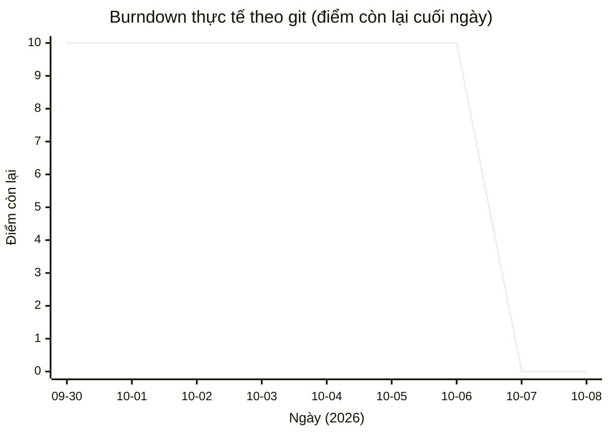

# Hồ sơ quy trình Agile Scrum — BrewLite (BẢN NHÁP)

> **BẢN NHÁP do công cụ soạn từ lịch sử git, để nhóm sửa. Không phải ý kiến thật của thành viên.**
> Mọi con số trong file này lấy từ `git log` của repo (HEAD `5ab0550`, 71 commit trên mọi nhánh, 2026-09-30 → 2026-10-08) hoặc từ bảng task trong đề (`docs/BrewLite-CongNghePhanMem-fixed.md` §2.3, §8). Chỗ git không có dữ liệu thì để **[nhóm điền]**, không ước lượng.
> Phần Retrospective (mục 5) chỉ là khung kèm gợi ý rút từ sự kiện có thật trong repo; nhóm phải họp, sửa và chốt.
> Nhánh `develop-agile`: backlog là user story US-01…US-10 trong `docs/product-backlog.md` (US-*n* ứng 1–1 với Task *n* của đề §8); không còn tài liệu use case / sequence.

## 0. Cách đọc & giới hạn của dữ liệu git

- Git **không** ghi: ranh giới Sprint, Sprint Planning/Daily Scrum/Review, story point, vai trò PO/SM, ai review. Các mục đó để **[nhóm điền]**.
- Điểm của mỗi task lấy từ đề §8: **1 điểm/task, tổng 10**. Không dùng story point nào khác.
- "**Vào develop**" = thời điểm commit chính của task nằm trong lịch sử `develop` lần đầu (commit trực tiếp lên `develop` hoặc merge/PR của nhánh chứa nó). Tính bằng `git log develop --first-parent`, xem mục 6.
- "Vào develop" **không bằng** "đạt Definition of Done" (đề §10 còn đòi review trong nhóm, README, validate, loading/lỗi). DoD đã kiểm đến đâu xem `docs/develop-status-report.md`; ngày đạt DoD của từng task **[nhóm điền]**.
- Có nhiều danh tính tác giả trong git (xem mục 1); chưa biết danh tính nào là ai.

## 1. Vai trò, sự kiện, tạo phẩm (đề §2.1)

| Thành phần | Nội dung |
|---|---|
| Product Owner | **[nhóm điền]** |
| Scrum Master | **[nhóm điền]** |
| Development Team | **[nhóm điền]** |
| Danh tính tác giả trong git (commit không phải merge, tính đến `5ab0550`) | `Thuan-Test` 37, `Thuan-Lap` 17, `DuVinhLoi` 4, `baothien-s` 2; thêm `Thuan-AFK666` và `Trần Vĩnh Thuận` chỉ xuất hiện ở commit merge. Nhóm ghi lại mỗi danh tính ứng với thành viên nào: **[nhóm điền]** |
| Sprint Planning (3 lần) | ngày, người dự: **[nhóm điền]** |
| Daily Scrum | tần suất, ghi chép: **[nhóm điền]** |
| Sprint Review / Demo | ngày, người nhận phản hồi, phản hồi: **[nhóm điền]** |
| Product Backlog | 10 user story US-01…US-10 (`docs/product-backlog.md`), ứng 1–1 với 10 task ở đề §8, thứ tự dễ → khó |

## 2. Sprint Backlog (3 Sprint theo đề §2.3)

Mục tiêu và danh sách task của từng Sprint lấy nguyên từ đề §2.3. Ngày bắt đầu / kết thúc Sprint **không có trong git** nên để **[nhóm điền]**.

**Quy ước cột:** *Commit chính* = commit đầu tiên đưa chức năng của task vào `develop`; *Hoàn thiện sau đó* = commit/merge về sau cùng task (sửa lỗi, test, nâng cấp), kèm ngày. Giờ lấy theo `git log`, múi giờ của người commit.

### Sprint 1 — Nền tảng & hiển thị menu (US-01…04 = Task 1, 2, 3, 4) — 4 điểm

Ngày Sprint: **[nhóm điền]** → **[nhóm điền]**

| Story | Tiêu chí chính (đề §8) | Commit chính (tác giả, ngày commit) | Vào develop | Hoàn thiện sau đó |
|---|---|---|---|---|
| US-01 Khởi tạo dự án | monorepo `frontend` + `backend`, README, `.env.example`, Git | `7142bee` (Thuan-Test, 10-07 20:11): README hướng dẫn chạy, env example, compose 3 service, Dockerfile. Trước đó `2910b17` (DuVinhLoi, 09-30 15:49) chỉ tạo các file **rỗng** (`README.md`, `.env.example`, `docker-compose.yml`, 2 `package.json`: 0 dòng) | 10-07 20:11 | — |
| US-02 `GET /products` | JSON menu từ dữ liệu mẫu/CSDL | `eb865e0` (Thuan-Test, 10-07 23:43, chung commit với Task 6) | 10-07 23:43 | — |
| US-03 Trang Menu | gọi `/products`, lưới sản phẩm, loading/empty | `4b8d81d` (baothien-s, 10-07 16:27, chung commit với Task 5) | 10-07 20:05 (PR #3, merge `6c13b17`) | `b195026` (baothien-s, 10-07 16:43, refactor comment) |
| US-04 Chi tiết & tùy chọn | chọn size S/M/L và topping, tính giá | `e14ccb6` (Thuan-Test, 10-07 21:10) | 10-07 21:10 | `13129b3` (10-07 21:19, sửa comment) |

### Sprint 2 — Giỏ hàng, đặt đơn, đăng nhập (US-05…07 = Task 5, 6, 7) — 3 điểm

Ngày Sprint: **[nhóm điền]** → **[nhóm điền]**

| Story | Tiêu chí chính (đề §8) | Commit chính (tác giả, ngày commit) | Vào develop | Hoàn thiện sau đó |
|---|---|---|---|---|
| US-05 Giỏ hàng | thêm/sửa/xóa, lưu state, tổng tiền, badge | `4b8d81d` (baothien-s, 10-07 16:27, chung commit với Task 3) | 10-07 20:05 (PR #3, merge `6c13b17`) | `6d7056b` (10-08 14:31): thêm test vitest cho cart, merge `c26455e` |
| US-06 `POST /orders` | validate, lưu `PENDING`, trả mã đơn | `eb865e0` (Thuan-Test, 10-07 23:43) | 10-07 23:43 | `b6a2f76` (10-08 22:54): server tự tính giá, bỏ giá client; vào develop qua merge `b290706` (10-08 22:55) |
| US-07 JWT register/login | bcrypt, phát JWT, guard | `bee596a` (Thuan-Test, 10-07 23:41) | 10-07 23:41 | — |

### Sprint 3 — Thanh toán, bàn giao, nghiệp vụ nâng cao (US-08…10 = Task 8, 9, 10) — 3 điểm

Ngày Sprint: **[nhóm điền]** → **[nhóm điền]**

| Story | Tiêu chí chính (đề §8) | Commit chính (tác giả, ngày commit) | Vào develop | Hoàn thiện sau đó |
|---|---|---|---|---|
| US-08 Thanh toán mock | `POST /payments`, `PAID` / `PAYMENT_FAILED` | `d1be546` (Thuan-Test, 10-07 10:54, chung commit với Task 10; bản đầu dùng kho dữ liệu trong bộ nhớ) | 10-07 16:55 (PR #2, merge `7e2cb86`) | `c04947d` (10-07 21:12): FE nhập voucher + checkout 2 bước; `5fa3272` + `2db9ac8` (10-07 23:13–23:32): lưu Postgres, merge `685f1be` 23:38; `b6a2f76` (10-08 22:54): khóa chống thanh toán song song, bắt buộc đăng nhập + kiểm tra chủ đơn |
| US-09 Xác nhận, lịch sử, bàn giao | `GET /orders/me`, màn xác nhận, `docker-compose`, README | `abdd915` (Thuan-Test, 10-07 23:45): trang lịch sử, seed tài khoản demo, compose boot | 10-07 23:45 | `0a02517` (10-07 23:58): healthcheck DB, export `JwtModule` |
| US-10 Nghiệp vụ backend | State Machine, idempotent, tồn kho đồng thời, khuyến mãi/điểm | `d1be546` (Thuan-Test, 10-07 10:54, chung commit với Task 8) | 10-07 16:55 (PR #2, merge `7e2cb86`) | `c9454dc` (10-07 21:08): test voucher/điểm; `d3ce731` (10-08 11:40): test guard; `a209b88` (10-08 14:25): ghi sau charge trong 1 transaction, merge `a92dc00` 14:31; `7f2346b` (10-08 14:31): tiến đơn `PAID → … → COMPLETED`, merge `61602da` 14:37; `b6a2f76` (10-08 22:54) |

### Thứ tự giao thực tế so với kế hoạch Sprint

Theo git, thứ tự vào `develop` **không đi theo Sprint**: Task 8 và 10 (Sprint 3) vào lúc 10-07 16:55, trước Task 3 và 5 (Sprint 1 và 2) lúc 20:05; FE checkout 2 bước (`c04947d`, 21:12) có trước `POST /orders` (`eb865e0`, 23:43). Nhóm ghi lại lý do (làm theo thứ tự khác, hay Sprint thực tế chia khác đề): **[nhóm điền]**.

## 3. Sprint Burndown (dựng từ git)

**Quy tắc (cố định, kiểm lại được):** còn lại = 10 − số task đã "vào develop" (cột *Vào develop* ở mục 2); mỗi task trừ đúng 1 điểm vào thời điểm *Vào develop* đó. Task 1 tính ở 10-07 20:11 chứ không phải 09-30 vì commit 09-30 chỉ có file rỗng. Đây là đường **thực tế theo lúc đưa vào `develop`**, chưa phải theo DoD.

**Đường lý tưởng (Ideal) không dựng được** vì cần ngày bắt đầu/kết thúc Sprint mà git không có: **[nhóm điền]**.

### 3.1 Toàn bộ backlog (10 điểm), theo ngày

| Ngày | Commit (không tính merge, mọi nhánh, đến `5ab0550`) | Task vào develop trong ngày | Còn lại cuối ngày |
|---|---:|---|---:|
| 09-30 | 5 | — (chỉ có file rỗng) | 10 |
| 10-01 | 0 | — | 10 |
| 10-02 | 0 | — | 10 |
| 10-03 | 1 | — | 10 |
| 10-04 | 6 | — (toàn commit tài liệu và cấu hình agent) | 10 |
| 10-05 | 1 | — | 10 |
| 10-06 | 0 | — | 10 |
| 10-07 | 34 | Task 1, 2, 3, 4, 5, 6, 7, 8, 9, 10 | **0** |
| 10-08 | 13 | — (sửa lỗi, test, tài liệu, nâng cấp Task 6, 8, 10) | 0 |



### 3.2 Ngày 10-07 theo thời điểm (toàn bộ điểm giảm trong ngày này)

| Giờ (10-07) | Sự kiện vào develop | Task | Còn lại |
|---|---|---|---:|
| (đầu ngày) | — | — | 10 |
| 16:55 | PR #2 (`7e2cb86`) mang theo `d1be546` | 8, 10 | 8 |
| 20:05 | PR #3 (`6c13b17`) mang theo `4b8d81d` | 3, 5 | 6 |
| 20:11 | `7142bee` (README, env, compose, Dockerfile) | 1 | 5 |
| 21:10 | `e14ccb6` (modal chi tiết + size/topping) | 4 | 4 |
| 23:41 | `bee596a` (JWT) | 7 | 3 |
| 23:43 | `eb865e0` (products + orders) | 2, 6 | 1 |
| 23:45 | `abdd915` (lịch sử, seed, compose boot) | 9 | 0 |

### 3.3 Theo từng Sprint (cùng quy tắc, cùng sự kiện)

Ngày bắt đầu/kết thúc từng Sprint: **[nhóm điền]**. Cột *Còn lại* cho thấy thứ tự thực tế:

| Sprint | Tổng | Diễn biến còn lại (thời điểm vào develop, đều ngày 10-07) |
|---|---:|---|
| 1 (Task 1–4) | 4 | 4 → 3 (20:05, Task 3) → 2 (20:11, Task 1) → 1 (21:10, Task 4) → 0 (23:43, Task 2) |
| 2 (Task 5–7) | 3 | 3 → 2 (20:05, Task 5) → 1 (23:41, Task 7) → 0 (23:43, Task 6) |
| 3 (Task 8–10) | 3 | 3 → 1 (16:55, Task 8 và 10) → 0 (23:45, Task 9) |

### 3.4 Điều biểu đồ cho thấy

Burndown thực tế **phẳng ở 10 từ 09-30 đến 10-06 rồi rơi về 0 trong một ngày (10-07)**: đường 0 điểm rồi dốc đứng, khác hẳn đường giảm đều trong biểu đồ mẫu ở đề §2.4. Nguyên nhân (làm dồn, hay có công việc ngoài git như viết tài liệu, học công nghệ): **[nhóm điền]**. Từ 10-08 điểm không đổi; 13 commit trong ngày chủ yếu là sửa lỗi, test, tài liệu và nâng cấp Task 6, 8, 10 đã vào develop (kèm cấu hình skill và `.gitignore`).

## 4. Definition of Done, Definition of Ready, Review / Demo

### 4.1 Definition of Done (đề §10)

Một story (task) được tính điểm khi thỏa:

- Code chạy được, không lỗi build; tuân theo tiêu chí chấp nhận của story trong `docs/product-backlog.md`.
- Có commit trên Git với mô tả rõ ràng; được review trong nhóm.
- API có validate đầu vào; UI xử lý trạng thái loading / lỗi cơ bản.
- Có hướng dẫn chạy trong README.

### 4.2 Definition of Ready (nhóm bổ sung)

Một story được đưa vào Sprint Backlog khi: có câu "Là một… tôi muốn… để…", có tiêu chí chấp nhận kiểm chứng được, có điểm (đề §8: 1 điểm/task) và thuộc một Sprint theo đề §2.3.

### 4.3 Sprint Review / Demo (đề §11)

Đề §11 yêu cầu: (1) demo end-to-end chọn món → giỏ → thanh toán → xác nhận; (2) bàn giao mã nguồn, `docker-compose`, README; (3) Retrospective; (4) nhận phản hồi và ghi backlog cho phiên bản sau.

- Demo end-to-end ngày, người xem, phản hồi: **[nhóm điền]**.
- **Demo State Machine (US-10 a) qua Postman** (`docs/postman/BrewLite.postman_collection.json`, thư mục `Task 10 / (a)`): khách đặt và trả một đơn (đơn `PAID`); `POST /auth/login` bằng tài khoản barista demo, gửi token dạng Bearer; `PATCH /orders/{id}` lần lượt `PREPARING`, `READY`, `COMPLETED` (200); `PATCH` sang `CANCELLED` phải trả 400 `Invalid transition`; thanh 5 bước ở `/history` của khách tự chuyển trong khoảng 3 giây. Các bước đầy đủ: `README.md` mục "Demo State Machine"; dự phòng `scripts/demo-state-machine.sh`.
- Tình trạng kiểm thử hiện có (nhánh `develop-agile`, chạy ngày 2026-10-21): backend `npx jest` 170 pass / 3 skip (suite Postgres chỉ chạy khi có DATABASE_URL), frontend `npx vitest run` 733 pass, Postman collection 74 request / 137 assertion, 0 lỗi (`docs/postman/results/2026-10-21-run.txt`). Kiểm thử API dùng Postman, không dùng Swagger. Minh chứng từng task: `docs/minh-chung-10-task.md`.
- Backlog cho phiên bản sau (đề §11.4): quản lý món & thực đơn, quản lý mã giảm giá của Barista/Admin, vẫn ngoài MVP theo đề §3.2; mục chốt thêm: **[nhóm điền]**.

## 5. Sprint Retrospective (đề §11.3) — KHUNG NHÁP

> **Đây là gợi ý rút từ sự kiện thật trong repo, KHÔNG phải ý kiến của thành viên.** Nhóm họp, xóa/sửa/thêm, rồi chốt. Mỗi gợi ý có kèm bằng chứng (commit/tài liệu) để kiểm tra.

### 5.1 Điều làm tốt

| Gợi ý (nháp) | Bằng chứng trong repo | Nhóm xác nhận / sửa |
|---|---|---|
| Có test cho nghiệp vụ khó: idempotent, state machine, tồn kho đồng thời, voucher/điểm, thanh toán song song, quyền chủ đơn, quyền theo vai trò | `backend/test/*` (170 pass / 3 skip (suite Postgres chỉ chạy khi có DATABASE_URL)), `frontend/src/**/*.test.ts` (733 pass); `c9454dc`, `a209b88`, `b6a2f76` | **[nhóm điền]** |
| Đợt rà soát tài liệu ↔ mã tìm ra lỗi thật trước khi nộp và sửa cùng đợt | `b6a2f76` / `b290706` (CORS, giá server, khóa song song, auth `POST /payments`) | **[nhóm điền]** |
| Tách việc theo nhánh rồi merge vào `develop` | merge `a92dc00`, `c26455e`, `61602da`, `685f1be`; PR #1–#3 | **[nhóm điền]** |

### 5.2 Điều cần cải thiện

| Gợi ý (nháp) | Bằng chứng trong repo | Nhóm xác nhận / sửa |
|---|---|---|
| Lỗi CORS phát hiện muộn: trước bản sửa, trình duyệt ở `:3001` bị chặn gọi `:3000` nên menu rơi về menu mẫu; bản sửa đến sau khi Task 9 (compose + demo) đã vào develop | sửa ở `b6a2f76` (10-08 22:54); Task 9 vào develop 10-07 23:45; dòng Task 9 trong `docs/develop-status-report.md` | **[nhóm điền]** |
| Tin giá do client gửi: `POST /orders` từng nhận `unitPrice` của client, tổng đơn có thể bị sửa | sửa ở `b6a2f76` (server tự tính từ `product.price` + size/topping, `backend/src/order/pricing.ts`) | **[nhóm điền]** |
| Race thanh toán: 2 request song song cùng key hoặc cùng đơn có thể trừ tiền hai lần | sửa ở `b6a2f76` (khóa trong tiến trình theo key + `orderId`, có test) | **[nhóm điền]** |
| `POST /payments` chưa yêu cầu đăng nhập, không kiểm tra chủ đơn | sửa ở `b6a2f76` (JwtAuthGuard + 404/403 trước nhánh cache) | **[nhóm điền]** |
| Làm dồn: 34 commit trong ngày 10-07, cả 10 task vào develop trong 1 ngày sau 6 ngày gần như chỉ có tài liệu; burndown phẳng rồi dốc đứng | mục 3 file này | **[nhóm điền]** |
| Thứ tự làm không theo Sprint và phụ thuộc làm ngược: Task 8/10 trước Task 3/5; FE checkout 2 bước trước `POST /orders` | mục 2 file này (10-07 16:55 → 20:05; `c04947d` 21:12 → `eb865e0` 23:43) | **[nhóm điền]** |
| Tài liệu và mã lệch nhau, phải đồng bộ lại nhiều lần: spec barista viết rồi xóa, sau đó bỏ hẳn hàng đợi quầy | `74419a8`…`c35b740` (thêm, 10-07 16:02–16:27), `9966119` (xóa, 16:47), `fc8ce19` (bỏ barista queue, 10-08), `a60a304`, `652b5f6` (đồng bộ); sau đó nhóm làm lại phần Barista/Admin ở merge `4974abd` (10-09), và nhánh `develop-agile` gỡ phần giao diện của nó | **[nhóm điền]** |
| Test Postgres không chạy lại được từ lần thứ 2 (đơn/biên lai lần trước còn trong DB làm vướng khóa ngoại); suite này còn mặc định bị bỏ qua khi không có `DATABASE_URL` | sửa ở `8f2c514` (nhánh `chore/pg-test-plantuml-scrum`) | **[nhóm điền]** |
| Nhiều danh tính tác giả trong git (6 tên) nên khó truy vết ai làm việc nào; bằng chứng review (đề §10: "được review trong nhóm") chỉ rõ ở PR #1–#3, các commit còn lại vào `develop` trực tiếp | mục 1 file này | **[nhóm điền]** |

### 5.3 Hành động (đề xuất, nhóm chốt người phụ trách và hạn)

| Hành động (nháp) | Người | Hạn |
|---|---|---|
| Cuối mỗi Sprint chạy demo end-to-end **trên trình duyệt qua compose**, không chỉ gọi API | **[nhóm điền]** | **[nhóm điền]** |
| Mọi route ghi dữ liệu: kiểm tra đăng nhập và chủ sở hữu từ đầu; giá và tiền luôn do server tính; thêm vào checklist DoD | **[nhóm điền]** | **[nhóm điền]** |
| Task đụng tiền hoặc tồn kho phải có test đồng thời (song song cùng key/cùng đơn) trước khi coi là Done | **[nhóm điền]** | **[nhóm điền]** |
| Ghi ngày Sprint, task, điểm còn lại cuối ngày vào repo (file này) mỗi lần Planning/Daily để burndown không phải dựng ngược từ git | **[nhóm điền]** | **[nhóm điền]** |
| Thống nhất `git config user.name/user.email` mỗi thành viên; PR có reviewer ghi tên trước khi vào `develop` | **[nhóm điền]** | **[nhóm điền]** |

## 6. Cách tái tạo số liệu

```bash
git log --all --reverse --date=format:'%Y-%m-%d %H:%M' --pretty='%h|%ad|%an|%p|%s'   # toàn bộ commit (cột %p có 2 hash = merge)
git log develop --first-parent --reverse --date=format:'%Y-%m-%d %H:%M' --pretty='%h|%ad|%s'   # chuỗi vào develop
git merge-base --is-ancestor <commit-của-task> <commit-first-parent>   # commit đã vào develop lúc commit first-parent đó chưa
git log --all --no-merges --date=format:'%Y-%m-%d' --pretty='%ad' | sort | uniq -c   # commit mỗi ngày
```

"Vào develop" của một task = commit first-parent **đầu tiên** của `develop` chứa commit chính của task (lệnh thứ 3 duyệt lần lượt lệnh thứ 2). Hash, ngày trong file này lấy từ các lệnh trên ở HEAD `5ab0550`.
