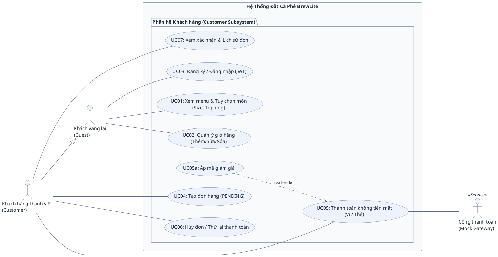

# ĐẶC TẢ BIỂU ĐỒ USE CASE (USE CASE SPECIFICATIONS)
## HỆ THỐNG ĐẶT CÀ PHÊ KHÔNG TIỀN MẶT BREWLITE

> **Dự án:** BrewLite – Ứng dụng đặt cà phê không tiền mặt  
> **Môn học:** Công nghệ Phần mềm (Bài tập lớn 10 Task Agile Scrum)  
> **Tài liệu tham chiếu:** [BrewLite-CongNghePhanMem-fixed.md](BrewLite-CongNghePhanMem-fixed.md)  
> **Phạm vi:** Tập trung trọn vẹn vào phân hệ Khách hàng theo đúng phạm vi MVP (10 Task Scrum) của đề bài; không bao gồm các chức năng mở rộng ngoài phạm vi (Barista / Admin).  
> **Mục đích:** Đặc tả kiến trúc Ca sử dụng (Use Case), phân định vai trò các tác nhân (Actors), cung cấp mã nguồn PlantUML chuẩn mực và hướng dẫn phản biện khi bảo vệ đồ án.

---

## 1. TỔNG QUAN TÁC NHÂN (ACTORS)

Theo mục 3.2 và mục 4.1 trong tài liệu yêu cầu [BrewLite-CongNghePhanMem-fixed.md](BrewLite-CongNghePhanMem-fixed.md), phạm vi sản phẩm cốt lõi (MVP) của BrewLite gồm 2 tác nhân người dùng chính và 1 tác nhân dịch vụ bên ngoài:

| Tác nhân | Phân loại | Vai trò & Hành vi trong hệ thống |
| :--- | :--- | :--- |
| **Khách vãng lai** *(Guest)* | Tác nhân chính *(Primary)* | Người dùng chưa đăng nhập: xem thực đơn, xem chi tiết món (size, topping), quản lý giỏ hàng tạm tính, thực hiện đăng ký / đăng nhập tài khoản. |
| **Khách hàng thành viên** *(Customer)* | Tác nhân chính *(Primary)* | Người dùng đã đăng nhập (có token JWT): kế thừa toàn bộ quyền của Khách vãng lai (`Customer --|> Guest`), đồng thời có thêm quyền tạo đơn hàng (`PENDING`), thanh toán không tiền mặt, áp mã giảm giá, hủy đơn / thử lại thanh toán, và xem lịch sử đơn hàng. |
| **Cổng thanh toán** *(Mock Gateway)* | Tác nhân dịch vụ *(Secondary)* | Hệ thống bên ngoài hỗ trợ xử lý trừ tiền giao dịch không tiền mặt (Ví điện tử / Thẻ ngân hàng) khi thực hiện thanh toán. |

> **Ghi chú về Barista và Admin:** Theo mục 3.2 của đề bài, vai trò Barista/Nhân viên quầy thuộc phần mở rộng ngoài phạm vi MVP, và hệ thống 10 Task không có giao diện/endpoint CRUD cho Admin. Do đó, biểu đồ Use Case của nhóm bám sát 100% phạm vi thực tế được giao.

---

## 2. BIỂU ĐỒ USE CASE HỆ THỐNG BREWLITE (USE CASE DIAGRAM)

Biểu đồ bao quát toàn bộ 8 Ca sử dụng (UC01–UC07 + UC05a) thuộc phân hệ Khách hàng, phân định tường minh ranh giới hệ thống, quan hệ kế thừa giữa các tác nhân và quan hệ mở rộng (`<<extend>>`):

---

## 3. DANH MỤC CHI TIẾT CÁC USE CASE & TRACEABILITY (KHỚP 10 TASK SCRUM)

Biểu đồ ở mục 2 là **gốc (root)**: mỗi UC có đúng một sơ đồ tuần tự trong [user-sequence-specifications.md](user-sequence-specifications.md) Phần II, dùng **cùng mã, cùng tên, cùng tác nhân** (UC01–UC03: `Guest`; UC04–UC07: `Customer`; UC05: thêm `Mock Gateway`). Đổi tên hay tác nhân ở đây thì phải đổi cả sơ đồ tuần tự tương ứng.

| Mã UC | Tên Ca Sử Dụng | Tác Nhân Thực Hiện | Quan Hệ Phụ Thuộc | Căn Cứ Đề Bài & Hiện Thực Code | Sơ đồ tuần tự |
| :--- | :--- | :--- | :--- | :--- | :--- |
| **UC01** | Xem menu & Tùy chọn món (Size, Topping) | `Guest` *(và Customer thừa hưởng)* | Độc lập | Task 2, 3, 4 (`GET /products`, `GET /products/:id`) | §2.1 |
| **UC02** | Quản lý giỏ hàng (Thêm/Sửa/Xóa) | `Guest` *(và Customer thừa hưởng)* | Độc lập | Task 5 (Quản lý trạng thái Client-side qua Zustand / LocalStorage) | §2.2 |
| **UC03** | Đăng ký / Đăng nhập (JWT) | `Guest` *(Customer dùng lại khi hết hạn token)* | Độc lập | Task 7 (`POST /auth/register`, `POST /auth/login`) | §2.3 |
| **UC04** | Tạo đơn hàng (PENDING) | `Customer` | Độc lập (gọi trước khi thanh toán) | Task 6 (`POST /orders`, server tính giá dựa trên menu gốc) | §2.4 (bước 2a) |
| **UC05** | Thanh toán không tiền mặt (Ví / Thẻ) | `Customer`, `Mock Gateway` | Customer nối trực tiếp; liên kết cổng thanh toán; được UC05a mở rộng | Task 8, 10 (`POST /payments`) | §2.4 (bước 2b) |
| **UC05a** | Áp mã giảm giá | `Customer` *(thao tác tại bước thanh toán)* | `<<extend>> UC05` | Task 10 (Áp mã `BREWLITE10`, chiết khấu hợp lệ trước khi trừ tiền) | §2.4 (bước 1) |
| **UC06** | Hủy đơn / Thử lại thanh toán | `Customer` *(chỉ chủ đơn)* | Độc lập | Task 10 (`PATCH /orders/:id`, `POST /payments`). Hủy đơn `PENDING` / `PAYMENT_FAILED` / `PAID` (nút "Hủy đơn" ở `/history`, `PAID` có hoàn tiền + hoàn kho) hoặc thanh toán lại đơn `PAYMENT_FAILED`. *(Mở rộng: `PATCH` còn cho chủ đơn tiến `PAID → PREPARING → READY → COMPLETED` qua API để minh họa State Machine §9.1, thay cho vai trò Barista ngoài MVP)* | §2.5 |
| **UC07** | Xem xác nhận & Lịch sử đơn | `Customer` | Độc lập | Task 9 (`GET /orders/me`) | §2.6 |

---

## 4. QUY CHUẨN ĐƯỜNG NỐI & CẨM NANG BẢO VỆ ĐỒ ÁN

### 4.1 Phân biệt các loại đường nối chuẩn UML

1. **Association (Đường nét liền không mũi tên `---`):** Dùng để biểu diễn sự tham gia giữa **Actor** và **Use Case**. Tuyệt đối không vẽ mũi tên chỉa vào Use Case như sơ đồ luồng dữ liệu (DFD).
2. **Generalization (Mũi tên tam giác rỗng `--|>`):** Quan hệ kế thừa giữa Actor với Actor (`Customer --|> Guest`).
3. **`<<include>>` (Mũi tên nét đứt `..>`):** Biểu diễn quan hệ bắt buộc luôn chạy kèm. Trong BrewLite, việc tạo đơn (`UC04`) và thanh toán (`UC05`) là hai ca độc lập (khi thanh toán thất bại, người dùng gọi lại `UC05` mà không tạo lại đơn mới `UC04`), do đó không dùng `<<include>>`.
4. **`<<extend>>` (Mũi tên nét đứt `..>`):** Trỏ từ Use Case mở rộng về Use Case gốc (`UC05a ..> UC05`). Chỉ kích hoạt khi thỏa mãn điều kiện (người dùng có mã voucher và chủ động nhập mã).

---

### 4.2 Bộ câu hỏi & câu trả lời mẫu khi bảo vệ trước Hội đồng

* **Câu 1: Tại sao `Customer` không nối dây tới `UC01: Xem menu` và `UC02: Quản lý giỏ hàng`?**  
  👉 **Trả lời:** *"Dạ thưa thầy/cô, theo chuẩn UML, `Customer` có quan hệ Kế thừa (`Customer --|> Guest`). Vì vậy `Customer` tự động thừa hưởng toàn bộ các ca sử dụng mà `Guest` có quyền thực hiện. Việc không vẽ thêm đường nối giúp biểu đồ tránh được lỗi Dư thừa liên kết (Redundant Association) và không bị rối dây."*

* **Câu 2: Tại sao `Customer` đã đăng nhập rồi mà lại kế thừa cả `UC03: Đăng ký / Đăng nhập` của `Guest`?**  
  👉 **Trả lời:** *"Dạ thưa thầy/cô, hệ thống BrewLite sử dụng xác thực qua JWT Token (Task 7) có thời hạn hiệu lực (`expiresIn`). Khi phiên làm việc của Customer hết hạn, họ cần sử dụng lại chức năng Đăng nhập để cấp lại Token mới mà không làm mất giỏ hàng đang lưu trên Client."*

* **Câu 3: Tại sao không nối dây từ `Customer` vào `UC05a: Áp mã giảm giá`?**  
  👉 **Trả lời:** *"Dạ thưa thầy/cô, `UC05a` là một Ca sử dụng mở rộng (`<<extend>>`) chỉ được kích hoạt tùy chọn bên trong màn hình của ca sử dụng gốc là `UC05: Thanh toán`. Người dùng không thể mở app lên và áp mã giảm giá độc lập nếu không thanh toán, nên Actor chỉ liên kết với Base Use Case (`UC05`) chứ không liên kết với Extension Use Case."*

* **Câu 4: Tại sao trong biểu đồ Use Case này không có tác nhân Nhân viên pha chế (Barista) hay Quản trị viên (Admin)?**  
  👉 **Trả lời:** *"Dạ thưa thầy/cô, nhóm bám sát nghiêm ngặt yêu cầu đề tài môn học tại Mục 1 và Mục 3.2 của tài liệu [BrewLite-CongNghePhanMem-fixed.md](BrewLite-CongNghePhanMem-fixed.md): Phạm vi MVP cốt lõi của bài tập lớn 10 Task Agile Scrum là quy trình 'Đặt cà phê không tiền mặt' từ lúc chọn món đến khi hoàn tất thanh toán. Đề bài đã quy định rõ vai trò Barista/Nhân viên quầy là phần mở rộng nằm ngoài MVP, và hệ thống 10 Task không yêu cầu quản trị Admin. Do đó, biểu đồ Use Case của nhóm tập trung 100% vào phân hệ Khách hàng để đảm bảo tính khả thi, chuẩn xác và khớp tuyệt đối với mã nguồn đã hiện thực."*
