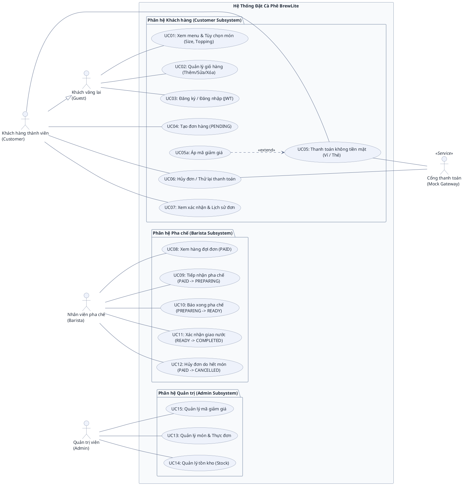
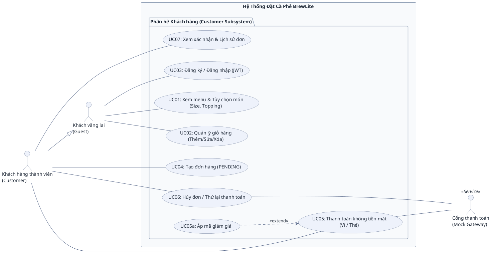

# ĐẶC TẢ BIỂU ĐỒ USE CASE (USE CASE SPECIFICATIONS)
## HỆ THỐNG ĐẶT CÀ PHÊ KHÔNG TIỀN MẶT BREWLITE

> **Dự án:** BrewLite – Ứng dụng đặt cà phê không tiền mặt  
> **Môn học:** Công nghệ Phần mềm (Bài tập lớn Agile Scrum)  
> **Tài liệu tham chiếu:** [BrewLite-CongNghePhanMem-fixed.md](BrewLite-CongNghePhanMem-fixed.md)  
> **Mục đích:** Đặc tả kiến trúc Ca sử dụng (Use Case), phân định rõ ràng vai trò các tác nhân (Actors) gồm Khách hàng, Pha chế (Barista) và Quản trị (Admin); cung cấp mã nguồn PlantUML chuẩn mực và hướng dẫn phản biện khi bảo vệ đồ án.

---

## 1. TỔNG QUAN TÁC NHÂN (ACTORS)

Hệ thống BrewLite bao gồm 4 nhóm tác nhân người dùng chính (Primary Actors) và 1 tác nhân dịch vụ bên ngoài (Secondary Actor):

| Tác nhân | Phân loại | Phân hệ phụ trách | Vai trò & Hành vi trong hệ thống |
| :--- | :--- | :--- | :--- |
| **Khách vãng lai** *(Guest)* | Tác nhân chính *(Primary)* | Phân hệ Khách hàng | Người dùng chưa đăng nhập: xem thực đơn, xem chi tiết món (size, topping), quản lý giỏ hàng tạm tính, thực hiện đăng ký / đăng nhập tài khoản. |
| **Khách hàng thành viên** *(Customer)* | Tác nhân chính *(Primary)* | Phân hệ Khách hàng | Người dùng đã đăng nhập (có token JWT): kế thừa toàn bộ quyền của Khách vãng lai (`Customer --|> Guest`), đồng thời có thêm quyền tạo đơn hàng (`PENDING`), thanh toán không tiền mặt, áp mã giảm giá, hủy đơn / thử lại thanh toán, và xem lịch sử đơn hàng. |
| **Nhân viên pha chế** *(Barista)* | Tác nhân chính *(Primary)* | Phân hệ Pha chế | Vận hành quầy pha chế theo máy trạng thái đơn hàng (Order State Machine): xem hàng đợi đơn đã thanh toán (`PAID`), tiếp nhận pha chế (`PREPARING`), báo hoàn tất pha chế (`READY`), giao nước cho khách (`COMPLETED`), hoặc hủy đơn khi hết nguyên liệu (`CANCELLED`). |
| **Quản trị viên** *(Admin)* | Tác nhân chính *(Primary)* | Phân hệ Quản trị | Quản lý dữ liệu hệ thống: quản lý thực đơn (món, giá, size, topping), quản lý số lượng tồn kho nguyên liệu (Stock), và thiết lập chính sách mã giảm giá (Voucher). |
| **Cổng thanh toán** *(Mock Gateway)* | Tác nhân dịch vụ *(Secondary)* | Tích hợp dịch vụ ngoài | Hệ thống bên ngoài hỗ trợ xử lý trừ tiền giao dịch không tiền mặt (Ví điện tử / Thẻ ngân hàng) và hoàn tiền khi đơn hàng bị hủy. |

> **Lưu ý về phạm vi triển khai:**  
> • **Phân hệ Khách hàng (UC01–UC07 + UC05a):** Là phạm vi cốt lõi của bài tập lớn (MVP 10 Task Scrum), đã được hiện thực hoàn chỉnh cả Frontend (Next.js) lẫn Backend (NestJS + PostgreSQL/Prisma).  
> • **Phân hệ Pha chế (UC08–UC12) & Quản trị (UC13–UC15):** Đại diện cho các tác nhân vận hành mở rộng trong mô hình nghiệp vụ thực tế của quán cà phê.

---

## 2. BẢN 1: BIỂU ĐỒ TỔNG QUAN TOÀN HỆ THỐNG (SYSTEM OVERVIEW USE CASE DIAGRAM)

Biểu đồ này bao quát toàn bộ 3 phân hệ chính của quán cà phê BrewLite, thể hiện đầy đủ mối liên kết giữa tất cả tác nhân và 16 Ca sử dụng (UC01–UC15 + UC05a):

---

## 3. BẢN 2: BIỂU ĐỒ TRỌNG TÂM PHÂN HỆ KHÁCH HÀNG (CUSTOMER SUBSYSTEM)

> **Mô tả:** Biểu đồ này trích xuất riêng biệt phân hệ Khách hàng (8 UC: UC01–UC07 + UC05a). Đây là biểu đồ cốt lõi khớp 100% với các sơ đồ tuần tự trong [user-sequence-specifications.md](user-sequence-specifications.md) và thiết kế giao diện đặt hàng của nhóm.

---

## 4. DANH MỤC CHI TIẾT CÁC USE CASE & TRACEABILITY MATRIX

Bảng dưới đây liệt kê đầy đủ 16 Use Case thuộc cả 3 phân hệ, phân định rõ tác nhân thực hiện, quan hệ phụ thuộc và căn cứ kỹ thuật:

| Mã UC | Tên Ca Sử Dụng | Phân hệ | Tác Nhân Thực Hiện | Quan Hệ Phụ Thuộc | Căn Cứ Đề Bài & Hiện Thực Mã Nguồn | Sơ đồ tuần tự |
| :--- | :--- | :--- | :--- | :--- | :--- | :--- |
| **UC01** | Xem menu & Tùy chọn món | Khách hàng | `Guest` *(và Customer)* | Độc lập | Task 2, 3, 4 (`GET /products`, `GET /products/:id`) | §2.1 |
| **UC02** | Quản lý giỏ hàng | Khách hàng | `Guest` *(và Customer)* | Độc lập | Task 5 (Zustand / LocalStorage Client-side) | §2.2 |
| **UC03** | Đăng ký / Đăng nhập (JWT) | Khách hàng | `Guest` *(Customer dùng lại)* | Độc lập | Task 7 (`POST /auth/register`, `POST /auth/login`) | §2.3 |
| **UC04** | Tạo đơn hàng (PENDING) | Khách hàng | `Customer` | Độc lập (gọi trước khi trả tiền) | Task 6 (`POST /orders`, server tính giá dựa trên menu gốc) | §2.4 (bước 2a) |
| **UC05** | Thanh toán không tiền mặt | Khách hàng | `Customer`, `Mock Gateway` | Nối Gateway; mở rộng bởi UC05a | Task 8, 10 (`POST /payments`) | §2.4 (bước 2b) |
| **UC05a** | Áp mã giảm giá | Khách hàng | `Customer` | `<<extend>> UC05` | Task 10 (Áp mã `BREWLITE10`, chiết khấu hợp lệ trước khi trừ tiền) | §2.4 (bước 1) |
| **UC06** | Hủy đơn / Thử lại thanh toán | Khách hàng | `Customer`, `Mock Gateway` | Nối Gateway (hoàn tiền đơn `PAID`) | Task 10 (`PATCH /orders/:id`, `POST /payments`). Hủy đơn `PENDING`/`PAID` hoặc thanh toán lại đơn lỗi | §2.5 |
| **UC07** | Xem xác nhận & Lịch sử đơn | Khách hàng | `Customer` | Độc lập | Task 9 (`GET /orders/me`) | §2.6 |
| **UC08** | Xem hàng đợi đơn (PAID) | Pha chế | `Barista` | Độc lập | Order State Machine §9.1 (Theo dõi hàng đợi đơn chờ pha chế) | §2.5 (State Machine) |
| **UC09** | Tiếp nhận pha chế | Pha chế | `Barista` | Phụ thuộc UC08 | `PAID` $\rightarrow$ `PREPARING` (Cập nhật tiến trình qua `PATCH /orders/:id`) | §2.5 (Kịch bản 4) |
| **UC10** | Báo hoàn tất pha chế | Pha chế | `Barista` | Phụ thuộc UC09 | `PREPARING` $\rightarrow$ `READY` (Thông báo nước đã sẵn sàng lấy) | §2.5 (State Machine) |
| **UC11** | Xác nhận giao nước | Pha chế | `Barista` | Phụ thuộc UC10 | `READY` $\rightarrow$ `COMPLETED` (Đơn hàng hoàn tất chu trình) | §2.5 (State Machine) |
| **UC12** | Hủy đơn do hết nguyên liệu | Pha chế | `Barista`, `Mock Gateway` | Nối Gateway (hoàn tiền) | `PAID` $\rightarrow$ `CANCELLED` (Hoàn tiền cho khách & hoàn kho các món khả dụng) | §2.5 (State Machine) |
| **UC13** | Quản lý món & Thực đơn | Quản trị | `Admin` | Độc lập | Quản trị danh mục đồ uống (CRUD Product, giá, size, topping) | Seed / Admin DB |
| **UC14** | Quản lý tồn kho (Stock) | Quản trị | `Admin` | Độc lập | Quản lý số lượng tồn kho nguyên liệu (Cập nhật ngưỡng an toàn) | Task 10 Concurrency |
| **UC15** | Quản lý mã giảm giá | Quản trị | `Admin` | Độc lập | Thiết lập và quản lý danh sách chương trình khuyến mãi (Voucher) | Task 10 Voucher Rule |

---

## 5. QUY CHUẨN ĐƯỜNG NỐI & CẨM NANG BẢO VỆ ĐỒ ÁN

### 5.1 Phân biệt các loại đường nối chuẩn UML

1. **Association (Đường nét liền không mũi tên `---`):** Dùng để biểu diễn sự tham gia giữa **Actor** và **Use Case**. Tuyệt đối không vẽ mũi tên chỉa vào Use Case như sơ đồ luồng dữ liệu (DFD).
2. **Generalization (Mũi tên tam giác rỗng `--|>`):** Quan hệ kế thừa giữa Actor với Actor (`Customer --|> Guest`).
3. **`<<include>>` (Mũi tên nét đứt `..>`):** Biểu diễn quan hệ bắt buộc luôn chạy kèm. Trong BrewLite, việc tạo đơn (`UC04`) và thanh toán (`UC05`) là hai ca độc lập (khi thanh toán thất bại, người dùng gọi lại `UC05` mà không tạo lại đơn mới `UC04`), do đó không dùng `<<include>>`.
4. **`<<extend>>` (Mũi tên nét đứt `..>`):** Trỏ từ Use Case mở rộng về Use Case gốc (`UC05a ..> UC05`). Chỉ kích hoạt khi thỏa mãn điều kiện (người dùng có mã voucher và chủ động nhập mã).

---

### 5.2 Bộ câu hỏi & câu trả lời mẫu khi bảo vệ trước Hội đồng

* **Câu 1: Tại sao `Customer` không nối dây tới `UC01: Xem menu` và `UC02: Quản lý giỏ hàng`?**  
  👉 **Trả lời:** *"Dạ thưa thầy/cô, theo chuẩn UML, `Customer` có quan hệ Kế thừa (`Customer --|> Guest`). Vì vậy `Customer` tự động thừa hưởng toàn bộ các ca sử dụng mà `Guest` có quyền thực hiện. Việc không vẽ thêm đường nối giúp biểu đồ tránh được lỗi Dư thừa liên kết (Redundant Association) và không bị rối dây."*

* **Câu 2: Tại sao `Customer` đã đăng nhập rồi mà lại kế thừa cả `UC03: Đăng ký / Đăng nhập` của `Guest`?**  
  👉 **Trả lời:** *"Dạ thưa thầy/cô, hệ thống BrewLite sử dụng xác thực qua JWT Token (Task 7) có thời hạn hiệu lực (`expiresIn`). Khi phiên làm việc của Customer hết hạn, họ cần sử dụng lại chức năng Đăng nhập để cấp lại Token mới mà không làm mất giỏ hàng đang lưu trên Client."*

* **Câu 3: Tại sao không nối dây từ `Customer` vào `UC05a: Áp mã giảm giá`?**  
  👉 **Trả lời:** *"Dạ thưa thầy/cô, `UC05a` là một Ca sử dụng mở rộng (`<<extend>>`) chỉ được kích hoạt tùy chọn bên trong màn hình của ca sử dụng gốc là `UC05: Thanh toán`. Người dùng không thể mở app lên và áp mã giảm giá độc lập nếu không thanh toán, nên Actor chỉ liên kết với Base Use Case (`UC05`) chứ không liên kết với Extension Use Case."*

* **Câu 4: Mối quan hệ giữa phân hệ Khách hàng và các phân hệ Pha chế (Barista), Quản trị (Admin) trong đồ án là gì?**  
  👉 **Trả lời:** *"Dạ thưa thầy/cô, trong kiến trúc tổng thể của chuỗi cà phê BrewLite (Bản 1), hệ thống gồm 3 phân hệ hoàn chỉnh: Khách hàng (đặt món/thanh toán), Pha chế (vận hành máy trạng thái đơn hàng) và Quản trị (quản lý thực đơn, kho bãi, voucher). Tuy nhiên, bám sát phương pháp Agile Scrum và phạm vi MVP 10 Task của đề bài môn học, nhóm tập trung triển khai và kiểm thử chuyên sâu cho Phân hệ Khách hàng (Bản 2), kết hợp mở rộng API và giao diện tiến trình đơn hàng minh họa trực tiếp State Machine của Barista."*
