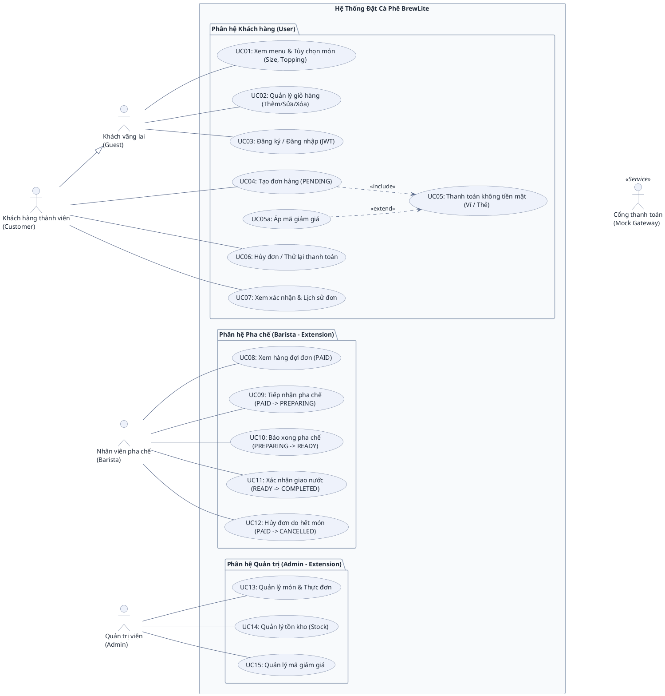
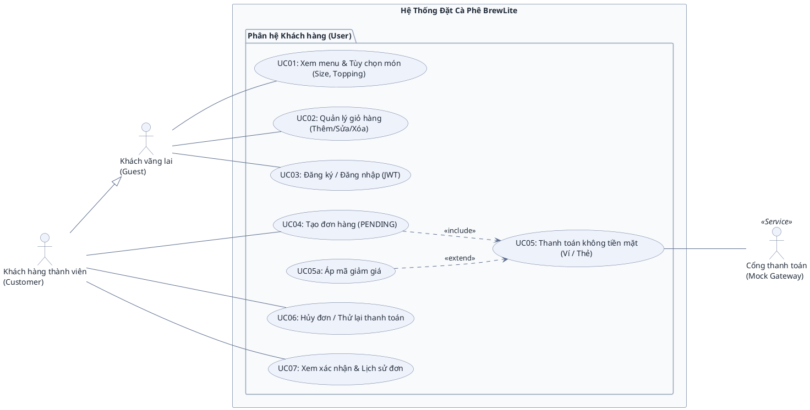

# ĐẶC TẢ BIỂU ĐỒ USE CASE (USE CASE SPECIFICATIONS)
## HỆ THỐNG ĐẶT CÀ PHÊ KHÔNG TIỀN MẶT BREWLITE

> **Dự án:** BrewLite – Ứng dụng đặt cà phê không tiền mặt  
> **Môn học:** Công nghệ Phần mềm (Bài tập lớn 10 Task Agile Scrum)  
> **Tài liệu tham chiếu:** [BrewLite-CongNghePhanMem-fixed.md](BrewLite-CongNghePhanMem-fixed.md)  
> **Mục đích:** Đặc tả kiến trúc Ca sử dụng (Use Case), phân định vai trò các tác nhân (Actors), cung cấp mã nguồn PlantUML chuẩn mực và hướng dẫn phản biện khi bảo vệ đồ án.

---

## 1. TỔNG QUAN TÁC NHÂN (ACTORS)

Hệ thống BrewLite có 4 nhóm tác nhân chính và 1 tác nhân hỗ trợ dịch vụ ngoài:

| Tác nhân | Phân loại | Vai trò & Hành vi trong hệ thống |
| :--- | :--- | :--- |
| **Khách vãng lai** *(Guest)* | Tác nhân chính *(Primary)* | Người dùng chưa đăng nhập: xem thực đơn, xem chi tiết món (size, topping), quản lý giỏ hàng tạm tính, thực hiện đăng ký / đăng nhập. |
| **Khách hàng thành viên** *(Customer)* | Tác nhân chính *(Primary)* | Người dùng đã đăng nhập (có token JWT): kế thừa toàn bộ quyền của Khách vãng lai, đồng thời có thêm quyền tạo đơn hàng (`PENDING`), thanh toán không tiền mặt, áp voucher, hủy đơn và xem lịch sử đơn. |
| **Nhân viên pha chế** *(Barista)* | Tác nhân chính *(Phần mở rộng)* | Vận hành quầy pha chế theo máy trạng thái đơn hàng (Order State Machine): xem hàng đợi đơn `PAID`, tiếp nhận pha chế (`PREPARING`), báo pha xong (`READY`), giao nước cho khách (`COMPLETED`), hoặc hủy đơn khi hết nguyên liệu (`CANCELLED`). |
| **Quản trị viên** *(Admin)* | Tác nhân chính *(Phần mở rộng)* | Quản lý dữ liệu thực đơn (món, giá, ảnh, size, topping), quản lý tồn kho nguyên liệu (Stock), quản lý mã khuyến mãi (Voucher). |
| **Cổng thanh toán** *(Mock Gateway)* | Tác nhân dịch vụ *(Secondary)* | Hệ thống bên ngoài hỗ trợ xử lý trừ tiền giao dịch không tiền mặt (Ví điện tử / Thẻ ngân hàng). |

---

## 2. BẢN 1: BIỂU ĐỒ TỔNG QUAN TOÀN HỆ THỐNG (SYSTEM OVERVIEW)

> **Mô tả:** Biểu đồ này bao quát toàn bộ 3 phân hệ (Khách hàng MVP, Pha chế Barista và Quản trị Admin), thể hiện đầy đủ mối liên kết giữa tất cả tác nhân và hệ thống.

---

## 3. BẢN 2: TẬP TRUNG RIÊNG PHÂN HỆ KHÁCH HÀNG (USER SUBSYSTEM - KHỚP DRAW.IO)

> **Mô tả:** Biểu đồ này trích xuất riêng biệt phân hệ Khách hàng (User Subsystem) theo đúng cấu trúc và cách bố trí đã thiết kế trên `docs/uc0.drawio`. Rất phù hợp cho việc thuyết trình trọng tâm MVP (10 Task chính).

---

## 4. DANH MỤC CHI TIẾT CÁC USE CASE & TRACEABILITY

| Mã UC | Tên Ca Sử Dụng | Tác Nhân Thực Hiện | Quan Hệ Phụ Thuộc | Căn Cứ Đề Bài & API |
| :--- | :--- | :--- | :--- | :--- |
| **UC01** | Xem menu & Tùy chọn món | `Guest` *(và Customer thừa hưởng)* | Độc lập | Task 2, 3, 4 (`GET /products`, `GET /products/:id`) |
| **UC02** | Quản lý giỏ hàng | `Guest` *(và Customer thừa hưởng)* | Độc lập | Task 5 (Zustand / LocalStorage Client-side) |
| **UC03** | Đăng ký / Đăng nhập (JWT) | `Guest` *(Customer dùng khi hết hạn token)* | Độc lập | Task 7 (`POST /auth/register`, `POST /auth/login`) |
| **UC04** | Tạo đơn hàng (PENDING) | `Customer` | `<<include>> UC05` | Task 6 (`POST /orders`) |
| **UC05** | Thanh toán không tiền mặt | `Customer`, `Gateway` | Được gọi bởi UC04 | Task 8, 10 (`POST /payments`) |
| **UC05a** | Áp mã giảm giá | `Customer` *(qua màn thanh toán)* | `<<extend>> UC05` | Task 10 (Mã `BREWLITE10`, validate nội bộ) |
| **UC06** | Hủy đơn / Thử lại | `Customer` | Độc lập | Task 10 (`PATCH /orders/:id`, `POST /payments`) |
| **UC07** | Xem xác nhận & Lịch sử | `Customer` | Độc lập | Task 9 (`GET /orders/me`) |
| **UC08** | Xem hàng đợi đơn (PAID) | `Barista` | Độc lập | State Machine §9.1 |
| **UC09** | Tiếp nhận pha chế | `Barista` | Độc lập | `PAID` $\rightarrow$ `PREPARING` |
| **UC10** | Báo xong pha chế | `Barista` | Độc lập | `PREPARING` $\rightarrow$ `READY` |
| **UC11** | Xác nhận giao nước | `Barista` | Độc lập | `READY` $\rightarrow$ `COMPLETED` |
| **UC12** | Hủy đơn hết món | `Barista` | Độc lập | `PAID` $\rightarrow$ `CANCELLED` (kèm hoàn tiền) |
| **UC13** | Quản lý món & Thực đơn | `Admin` | Độc lập | CRUD Product / Menu |
| **UC14** | Quản lý tồn kho (Stock) | `Admin` | Độc lập | Quản trị tồn kho nguyên liệu Task 10 |
| **UC15** | Quản lý mã giảm giá | `Admin` | Độc lập | Quản trị chính sách chiết khấu Task 10 |

---

## 5. QUY CHUẨN ĐƯỜNG NỐI & CẨM NANG BẢO VỆ ĐỒ ÁN

### 5.1 Phân biệt 4 loại đường nối
1. **Association (Đường nét liền không mũi tên `---`):** Dùng để nối giữa **Actor** và **Use Case**. Tuyệt đối không vẽ mũi tên chỉa vào Use Case như sơ đồ luồng dữ liệu.
2. **Generalization (Mũi tên tam giác rỗng `--|>`):** Quan hệ kế thừa giữa Actor với Actor (`Customer --|> Guest`).
3. **`<<include>>` (Mũi tên nét đứt `..>`):** Trỏ từ Use Case gốc sang Use Case bắt buộc (`UC04 ..> UC05`).
4. **`<<extend>>` (Mũi tên nét đứt `..>`):** Trỏ từ Use Case mở rộng về Use Case gốc (`UC05a ..> UC05`).

### 5.2 Trả lời phản biện các câu hỏi "bẫy" của hội đồng

* **Hỏi 1: Tại sao `Customer` không nối dây tới `UC01: Xem menu` và `UC02: Quản lý giỏ hàng`?**  
  👉 **Trả lời:** *"Dạ thưa thầy/cô, theo chuẩn UML, `Customer` có quan hệ Kế thừa (`Customer --|> Guest`). Vì vậy `Customer` tự động thừa hưởng toàn bộ các ca sử dụng mà `Guest` có quyền thực hiện. Việc không vẽ thêm đường nối giúp biểu đồ tránh được lỗi Dư thừa liên kết (Redundant Association) và không bị rối dây."*

* **Hỏi 2: Tại sao `Customer` đã đăng nhập rồi mà lại kế thừa cả `UC03: Đăng ký / Đăng nhập` của `Guest`?**  
  👉 **Trả lời:** *"Dạ thưa thầy/cô, hệ thống BrewLite sử dụng xác thực qua JWT Token (Task 7) có thời hạn hết hạn (`expiresIn`). Khi phiên làm việc của Customer hết hạn, họ cần sử dụng lại chức năng Đăng nhập để cấp lại Token mới mà không làm mất giỏ hàng đang lưu trên Client."*

* **Hỏi 3: Tại sao không nối dây từ `Customer` vào `UC05a: Áp mã giảm giá`?**  
  👉 **Trả lời:** *"Dạ thưa thầy/cô, `UC05a` là một Ca sử dụng mở rộng (`<<extend>>`) chỉ được kích hoạt tùy chọn bên trong màn hình của ca sử dụng gốc là `UC05: Thanh toán`. Người dùng không thể mở app lên và áp mã giảm giá độc lập nếu không thanh toán, nên Actor chỉ liên kết với Base Use Case (`UC05`) chứ không liên kết với Extension Use Case."*
