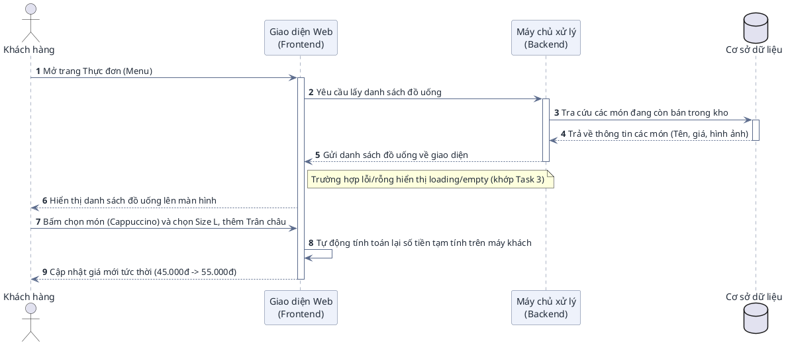
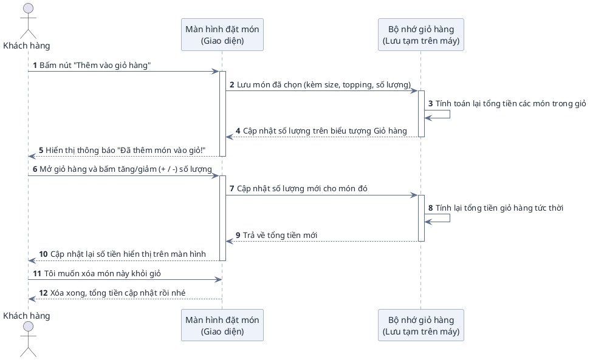
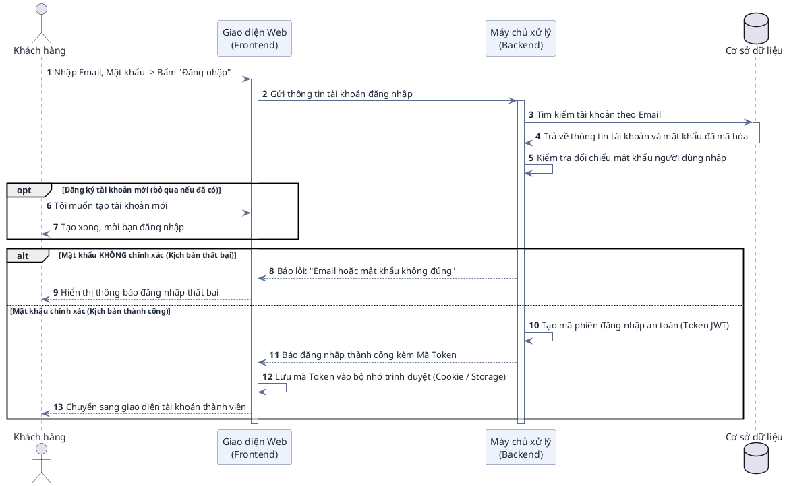
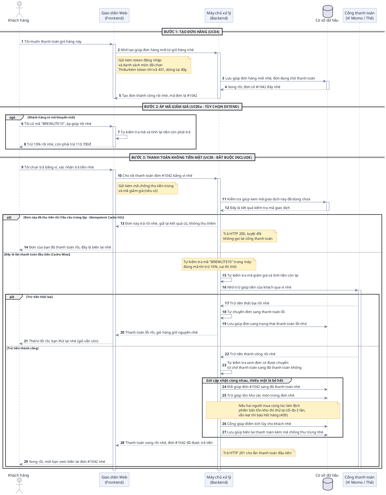
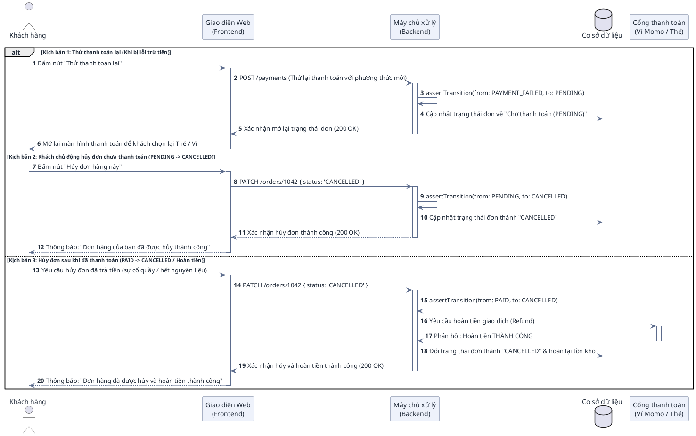
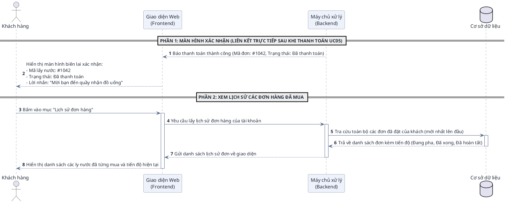

# HƯỚNG DẪN ĐỌC HIỂU & ĐẶC TẢ CHI TIẾT BIỂU ĐỒ TUẦN TỰ (SEQUENCE DIAGRAM)
## PHÂN HỆ KHÁCH HÀNG – DỰ ÁN BREWLITE

> **Dự án:** BrewLite – Ứng dụng đặt cà phê không tiền mặt  
> **Môn học:** Công nghệ Phần mềm (Bài tập lớn 10 Task Agile Scrum)  
> **Phạm vi & Định vị tài liệu:**  
> • **Tài liệu này là Phụ lục chi tiết (Architecture Appendix) cho Developers & AI Agents** dùng để hiểu sâu bối cảnh, đối chiếu mã nguồn và viết test case.  
> • **Bản nộp chính cho giảng viên** tập trung vào 3 biểu đồ cốt lõi tinh gọn đã chốt (Use Case tổng 10 bubble, Activity luồng nghiệp vụ tổng, và Sequence thanh toán rút gọn).  
> **Đối tượng độc giả:**  
> 1. **Sinh viên & Giảng viên:** Tra cứu chi tiết từng bước, đối chiếu ma trận truy vết (Traceability) với 8 API endpoint và 10 Task Backlog.  
> 2. **AI Agents / Developers:** Đọc hiểu bối cảnh kiến trúc (Context Navigation), ánh xạ các bước của biểu đồ vào mã nguồn NestJS (Backend) và Next.js (Frontend) để lập trình và viết kiểm thử tự động.

---

# MỤC LỤC

1. [PHẦN I: CẨM NANG ĐỌC HIỂU BIỂU ĐỒ TUẦN TỰ (DÀNH CHO NGƯỜI DÙNG)](#phần-i-cẩm-nang-đọc-hiểu-biểu-đồ-tuần-tự)
   - 1.1 Khái niệm & Mục đích của Sequence Diagram
   - 1.2 Bốn thành phần cốt lõi
   - 1.3 Quy ước các loại đường nối & Mũi tên
   - 1.4 Giải mã các khối điều khiển đặc biệt (`alt`, `opt`, `group`)
2. [PHẦN II: ĐẶC TẢ CHI TIẾT 6 KỊCH BẢN TUẦN TỰ (PLANTUML TỰ NHIÊN)](#phần-ii-đặc-tả-chi-tiết-6-kịch-bản-tuần-tự)
   - 2.1 UC01: Xem menu & Tùy chọn món (Size, Topping)
   - 2.2 UC02: Quản lý giỏ hàng trên trình duyệt
   - 2.3 UC03: Đăng ký & Đăng nhập tài khoản (JWT)
   - 2.4 UC04 + UC05 + UC05a: Đặt hàng & Thanh toán không tiền mặt (Trọng tâm MVP)
   - 2.5 UC06: Hủy đơn / Thử lại thanh toán (Order State Machine)
   - 2.6 UC07: Xem xác nhận & Lịch sử đơn hàng
3. [PHẦN III: MA TRẬN NGỮ CẢNH KỸ THUẬT DÀNH CHO AI AGENTS & DEVELOPERS](#phần-iii-ma-trận-ngữ-cảnh-kỹ-thuật)
   - 3.1 Bảng ánh xạ Use Case sang Mã nguồn & CSDL
   - 3.2 Quy tắc điều hướng cho AI Agent khi sinh mã / kiểm thử

---

# PHẦN I: CẨM NANG ĐỌC HIỂU BIỂU ĐỒ TUẦN TỰ

### 1.1 Khái niệm & Mục đích
Biểu đồ Tuần tự (**Sequence Diagram**) là biểu đồ thể hiện **sự tương tác qua lại giữa các đối tượng theo trục thời gian**. Nếu Use Case Diagram trả lời câu hỏi *"Ai làm chức năng gì?"*, thì Sequence Diagram trả lời câu hỏi: *"Để hoàn thành chức năng đó, các bộ phận trong hệ thống phải trao đổi thông điệp với nhau theo thứ tự nào?"*.

### 1.2 Bốn thành phần cốt lõi trên biểu đồ
1. **Tác nhân (Actor):** Con người tương tác trực tiếp với giao diện (Khách hàng).
2. **Đối tượng tham gia (Participants / Lifelines):** Đại diện cho các tầng kiến trúc của BrewLite:
   - `Giao diện Web (Frontend Next.js)`: Nơi người dùng bấm nút, xem dữ liệu.
   - `Máy chủ xử lý (Backend NestJS)`: Nơi tiếp nhận yêu cầu, kiểm tra nghiệp vụ và xử lý logic.
   - `Cơ sở dữ liệu (PostgreSQL)`: Nơi lưu trữ vĩnh viễn đơn hàng, sản phẩm, tài khoản.
   - `Cổng thanh toán (Mock Gateway)`: Đơn vị trung gian xử lý trừ tiền Ví/Thẻ.
3. **Đường gióng thời gian (Lifeline):** Đường thẳng đứng nét đứt chạy dọc từ trên xuống dưới, thể hiện sự tồn tại của đối tượng theo thời gian. **Càng ở phía dưới thì sự kiện diễn ra càng muộn**.
4. **Vạch kích hoạt (Activation Bar):** Hình chữ nhật mỏng nằm đè lên đường nét đứt, thể hiện khoảng thời gian mà đối tượng đó **đang tích cực xử lý công việc** (chưa xong).

### 1.3 Quy ước các loại đường nối & Mũi tên (Cực kỳ quan trọng)

| Loại thông điệp | Hình dáng trên biểu đồ | Cú pháp PlantUML | Ý nghĩa nghiệp vụ |
| :--- | :--- | :--- | :--- |
| **Thông điệp gửi đi (Request / Call)** | **Đường nét liền, mũi tên nhọn (`->`)** | `A -> B : Gửi yêu cầu` | Đối tượng A gửi một yêu cầu sang B và chờ B xử lý. |
| **Thông điệp phản hồi (Response / Return)** | **Đường nét đứt, mũi tên hở (`-->`)** | `B --> A : Trả kết quả` | Đối tượng B đã xử lý xong và gửi kết quả về cho A. |
| **Xử lý nội bộ (Self-Call)** | **Mũi tên uốn vòng lại chính nó** | `A -> A : Tự tính toán` | Đối tượng tự thực hiện một logic của chính mình (ví dụ: tự so sánh mật khẩu, tự cộng tiền). |

### 1.4 Giải mã các khối điều khiển đặc biệt (Combined Fragments)

* **Khối `alt` (Alternatives – Tương đương `IF - ELSE`):**
  - **Ý nghĩa:** Dùng khi gặp một ngã rẽ có **hai kịch bản loại trừ lẫn nhau (chỉ xảy ra 1 trong 2)**.
  - **Cách đọc:** Nửa trên là trường hợp xảy ra khi điều kiện đúng (ví dụ: Mật khẩu đúng), nửa dưới sau vạch chia `else` là trường hợp xảy ra khi điều kiện sai (ví dụ: Mật khẩu sai).
* **Khối `opt` (Option – Tương đương `IF` đơn lẻ, không có `ELSE`):**
  - **Ý nghĩa:** Dùng cho hành động **tùy chọn (làm cũng được, không làm cũng không sao)**.
  - **Cách đọc:** Nếu người dùng thỏa mãn điều kiện thì thực hiện các bước trong hộp `opt`, nếu không có thì hệ thống bỏ qua và chạy thẳng xuống dưới (ví dụ: Áp mã giảm giá).
* **Khối `group` (Giao dịch an toàn / Transaction):**
  - **Ý nghĩa:** Đánh dấu một chuỗi nhiều thao tác ghi vào CSDL bắt buộc phải **cùng thành công 100% hoặc cùng hủy bỏ (All or Nothing)** để tránh lỗi hệ thống (ví dụ: Đổi trạng thái đơn VÀ trừ kho VÀ cộng điểm).

---

# PHẦN II: ĐẶC TẢ CHI TIẾT 6 KỊCH BẢN TUẦN TỰ

---

### 2.1 UC01: Xem menu & Tùy chọn món (Size, Topping)

#### A. Bối cảnh nghiệp vụ
Khách hàng truy cập trang chủ của ứng dụng BrewLite. Hệ thống cần lấy danh mục các món đồ uống đang có sẵn để hiển thị kèm giá và hình ảnh. Khi khách chọn một món, khách có thể chọn kích cỡ (S/M/L) hoặc Topping; giao diện sẽ tự động tính lại tổng tiền tạm tính mà không cần phải gọi lại máy chủ.

#### B. Sơ đồ tuần tự (PlantUML)

#### C. Bảng đối chiếu kỹ thuật cho AI Agent
* **Backend Endpoint:** `GET /products` (`GET /products/:id` cho màn chi tiết)
* **Controller / Service:** `ProductController.findAll()` $\rightarrow$ `ProductService.findAll()`
* **Thực thể CSDL:** Bảng `Product` (lọc điều kiện `stock > 0`)
* **Xử lý Frontend:** Quản lý state hiển thị bằng React State / React Query.

---

### 2.2 UC02: Quản lý giỏ hàng trên trình duyệt

#### A. Bối cảnh nghiệp vụ
Theo yêu cầu Task 5 trong tài liệu đồ án, giỏ hàng được quản lý hoàn toàn ở phía máy khách (Client-side State) để mang lại trải nghiệm mượt mà tức thì cho khách hàng. Các thao tác thêm món, tăng/giảm số lượng hoặc xóa món được tính toán tự động và lưu tạm vào bộ nhớ trình duyệt (LocalStorage).

#### B. Sơ đồ tuần tự (PlantUML)

#### C. Bảng đối chiếu kỹ thuật cho AI Agent
* **Công nghệ Frontend:** Quản lý bằng `Zustand` store hoặc `React Context`.
* **Cơ chế lưu trữ:** Đồng bộ vào `window.localStorage` để F5 không bị mất giỏ hàng.
* **Cấu trúc dữ liệu:** `CartItem { productId, name, size, toppings: [], quantity, unitPrice, lineTotal }`.

---

### 2.3 UC03: Đăng ký & Đăng nhập tài khoản (JWT)

#### A. Bối cảnh nghiệp vụ
Khi khách hàng bấm đăng nhập, máy chủ sẽ tra cứu tài khoản trong cơ sở dữ liệu và kiểm tra mật khẩu đã được mã hóa an toàn (bằng bcrypt). 
* **Khối `alt` được sử dụng tại đây:**
  - **Nhánh 1 (Thất bại):** Nếu mật khẩu sai $\rightarrow$ Báo lỗi và dừng lại.
  - **Nhánh 2 (Thành công):** Nếu mật khẩu đúng $\rightarrow$ Máy chủ phát một mã khóa phiên làm việc dạng Token (JWT) để trình duyệt lưu lại. Khách hàng chính thức trở thành Thành viên.

#### B. Sơ đồ tuần tự (PlantUML)

#### C. Bảng đối chiếu kỹ thuật cho AI Agent
* **Backend Endpoint:** `POST /auth/login` (và `POST /auth/register`)
* **Controller / Service:** `AuthController.login()` $\rightarrow$ `AuthService.validateUser()`
* **Bảo mật:** `bcrypt.compare(plainPassword, user.passwordHash)`
* **Mã phiên JWT:** Cấp chuỗi Bearer Token chứa `{ sub: user.id, email: user.email }` có thời hạn hết hạn (`expiresIn`).

---

### 2.4 UC04 + UC05 + UC05a: Đặt hàng & Thanh toán không tiền mặt

#### A. Bối cảnh nghiệp vụ
Đây là **trọng tâm nghiệp vụ lớn nhất của dự án BrewLite** (Bao gồm Task 6, 8 và 10):
1. **Bước 1 (UC04 - Tạo đơn):** Gửi giỏ hàng lên máy chủ (kèm token JWT) để tạo bản ghi đơn hàng ở trạng thái chờ thanh toán (`PENDING`).
2. **Bước 2 (UC05a - Khối `opt`):** Khách có mã giảm giá (`BREWLITE10`) thì nhập mã để được tính giảm trừ trực tiếp trên giao diện (hành động tùy chọn). Mã này sẽ được gửi kèm trong yêu cầu thanh toán để máy chủ xác thực nội bộ (không tạo thêm endpoint hay bảng ngoài đề bài).
3. **Bước 3 (UC05 - Thanh toán):** Khách chọn Ví/Thẻ để trả tiền. Hệ thống dùng **Khóa an toàn chống trừ tiền 2 lần (Idempotency-Key)**:
   - **Nhánh Trùng lặp (Cache Hit):** Nếu khóa đã tồn tại trong CSDL $\rightarrow$ trả về kết quả cũ đã lưu (HTTP 200), **tuyệt đối không gọi lại Cổng thanh toán để tránh trừ tiền 2 lần**.
   - **Nhánh Mới (Cache Miss):** Gọi Cổng thanh toán trừ tiền $\rightarrow$ Thực thi `assertTransition('PENDING' -> 'PAID')` $\rightarrow$ Mở Database Transaction cập nhật trạng thái đơn, trừ kho (kèm Optimistic Locking kiểm soát mua đồng thời) và cộng điểm tích lũy.

#### B. Sơ đồ tuần tự (PlantUML)

#### C. Bảng đối chiếu kỹ thuật cho AI Agent
* **Backend Endpoints:**
  - Tạo đơn: `POST /orders` (Body: `items[]`, Header: `Bearer JWT`)
  - Thanh toán: `POST /payments` (Body: `{ orderId, paymentMethod, voucherCode? }`, Header: `Idempotency-Key: <UUID>`)
* Tạo đơn yêu cầu Bearer JWT, thiếu token trả 401 (khớp Task 7).
* **Xác thực Voucher:** Validate nội bộ trong `PaymentService` theo cấu hình chiết khấu (Task 10), không tạo thêm endpoint riêng ngoài 8 endpoint chính.
* **Chống trừ tiền trùng (Idempotent Test Criteria b):** Kiểm tra `Payment WHERE idempotencyKey = ?`. Nhánh Hit trả 200 OK kết quả cũ, nhánh Miss mới gọi Gateway.
* **Kiểm soát tồn kho đồng thời (Concurrency Test Criteria c):** Sử dụng Transaction Prisma/TypeORM kèm Optimistic Locking (cột `version` trong bảng `Product`), retry 3 lần nếu version xung đột trước khi ném lỗi 409.
* **State Machine (Test Criteria a):** Thực thi `assertTransition('PENDING' -> 'PAID')` trước khi lưu vào CSDL.

---

### 2.5 UC06: Hủy đơn / Thử lại thanh toán

#### A. Bối cảnh nghiệp vụ
Phục vụ máy trạng thái **Order State Machine** tại Mục 9.1 tài liệu môn học (`docs:301-322`). 
* Khối `alt` mô tả 3 ngã rẽ xử lý trạng thái theo chuẩn REST (`PATCH /orders/:id`):
  - **Kịch bản 1 (Thử lại):** Khi cổng thanh toán báo trừ tiền lỗi, đơn hàng ở trạng thái `PAYMENT_FAILED`. Khách bấm "Thử lại", hệ thống gọi lại thanh toán hoặc chuyển trạng thái đơn quay về `PENDING` (`PAYMENT_FAILED` $\rightarrow$ `PENDING`).
  - **Kịch bản 2 (Khách hủy đơn chưa trả):** Khi đơn hàng chưa thanh toán, khách có quyền bấm "Hủy đơn" (`PENDING` $\rightarrow$ `CANCELLED`).
  - **Kịch bản 3 (Hủy đơn đã thanh toán - Hoàn tiền):** Khi đơn đã trả tiền (`PAID`) nhưng quầy pha chế báo hết nguyên liệu đột xuất hoặc khách yêu cầu hủy kịp thời, hệ thống kích hoạt hủy đơn kèm hoàn tiền (`PAID` $\rightarrow$ `CANCELLED` theo đúng `docs:313`).

#### B. Sơ đồ tuần tự (PlantUML)

#### C. Bảng đối chiếu kỹ thuật cho AI Agent
* **Backend Endpoints:**
  - `POST /payments` (gửi lại yêu cầu thanh toán khi thử lại)
  - `PATCH /orders/:id` (cập nhật trạng thái đơn thành `CANCELLED` theo chuẩn REST)
* **Quy tắc State Machine (Task 10):**
  - `assertTransition('PAYMENT_FAILED' -> 'PENDING')`: Hợp lệ.
  - `assertTransition('PENDING' -> 'CANCELLED')`: Hợp lệ.
  - `assertTransition('PAID' -> 'CANCELLED')`: Hợp lệ (kèm nghiệp vụ hoàn tiền `refund()`).
  - `assertTransition('PREPARING' -> 'CANCELLED')`: **Không hợp lệ** (Bị chặn ném lỗi 400 Bad Request vì barista đang pha chế).

---

### 2.6 UC07: Xem xác nhận & Lịch sử đơn hàng

#### A. Bối cảnh nghiệp vụ
Tương ứng Task 9 trong đề tài:
1. **Phần 1 (Biên lai ngay sau khi đặt):** Được kích hoạt **ngay lập tức khi `POST /payments` ở UC05 trả về thành công (HTTP 201)**. Màn hình xác nhận hiển thị mã đơn số to `#1042`, trạng thái `PAID` và lời nhắn nhắc khách tới quầy nhận nước (khớp Wireframe 5).
2. **Phần 2 (Xem lại lịch sử):** Khi khách bấm vào trang cá nhân "Lịch sử đơn", hệ thống gọi `GET /orders/me` để hiển thị danh sách toàn bộ các đơn đã từng mua, ngày đặt và trạng thái hiện tại (`PAID`, `PREPARING`, `READY`, `COMPLETED`).

#### B. Sơ đồ tuần tự (PlantUML)

#### C. Bảng đối chiếu kỹ thuật cho AI Agent
* **Backend Endpoint:** `GET /orders/me` (Được bảo vệ bởi `@UseGuards(JwtAuthGuard)`)
* **Controller / Service:** `OrderController.getMyOrders()` $\rightarrow$ `OrderService.findByUser(userId)`
* **Truy vấn CSDL:** `SELECT * FROM "Order" WHERE "userId" = :userId ORDER BY "createdAt" DESC`
* **Giao diện Wireframe:** Khớp với Wireframe (5) Xác nhận tại Mục 7 tài liệu môn học.

---

# PHẦN III: MA TRẬN NGỮ CẢNH KỸ THUẬT DÀNH CHO AI AGENTS & DEVELOPERS

Bảng ma trận dưới đây đảm bảo **Tính truy vết tuyệt đối 100% (Full Traceability)** với đúng **8 API Endpoints chính** (Mục 12.1) và **5 Thực thể CSDL tối thiểu** (Mục 12.2) trong tài liệu gốc `BrewLite-CongNghePhanMem-fixed.md`:

| Mã UC | Tên Ca Sử Dụng | Endpoint REST Chuẩn | Controller / Service (NestJS) | Bảng CSDL (5 Thực thể tối thiểu) | Cơ Chế Bảo Vệ / Logic Cốt Lõi (Task 10) |
| :--- | :--- | :--- | :--- | :--- | :--- |
| **UC01** | Xem menu & Tùy chọn món | `GET /products` `GET /products/:id` | `ProductController` `ProductService` | `Product` | Lọc `stock > 0`, trả về DTO kèm danh sách Size/Topping |
| **UC02** | Quản lý giỏ hàng | *(Client-side)* | *(Không gọi API)* | *(LocalStorage)* | Zustand Store, tự tính toán `lineTotal` và `cartTotal` |
| **UC03** | Đăng ký & Đăng nhập | `POST /auth/register` `POST /auth/login` | `AuthController` `AuthService` | `User` | `bcrypt.compare`, cấp JWT Access Token |
| **UC04** | Tạo đơn hàng mới | `POST /orders` | `OrderController` `OrderService` | `Order`, `OrderItem` | Khởi tạo đơn `PENDING`, validate dữ liệu giỏ qua `class-validator`, Bearer JWT (401 nếu thiếu) |
| **UC05 / UC05a** | Thanh toán & Voucher | `POST /payments` | `PaymentController` `PaymentService` | `Payment`, `Order`, `Product`, `User` | Header `Idempotency-Key` (alt hit/miss), validate voucher `BREWLITE10` nội bộ (Task 10), DB Transaction, Optimistic Locking trừ kho |
| **UC06** | Hủy đơn / Thử lại | `PATCH /orders/:id` *(hoặc `POST /payments`)* | `OrderController` `OrderService` | `Order`, `Payment` | Hàm `assertTransition()` cưỡng chế State Machine: `PENDING->CANCELLED`, `PAYMENT_FAILED->PENDING`, `PAID->CANCELLED` |
| **UC07** | Xác nhận & Lịch sử đơn | `GET /orders/me` | `OrderController` `OrderService` | `Order`, `OrderItem` | `JwtAuthGuard` trích xuất `userId` từ token, sắp xếp giảm dần theo ngày |

### Hướng Dẫn Điều Hướng Cho AI Agent (Agent Rules):
1. **Tuyệt đối không tạo thêm bảng CSDL ngoài:** Hệ thống chỉ có 5 thực thể tối thiểu (`Product`, `User`, `Order`, `OrderItem`, `Payment`). Khuyến mãi và mã giảm giá `BREWLITE10` được cấu hình và validate nội bộ trong `PaymentService`.
2. **Tiêu chí chấm điểm Task 10:**
   - **(a) State Machine:** Mọi cập nhật trạng thái đơn phải đi qua `assertTransition()`.
   - **(b) Idempotency:** Gửi 2 lần cùng `Idempotency-Key` chỉ trừ tiền 1 lần (nhánh Cache Hit trả kết quả cũ đã lưu).
   - **(c) Concurrency:** Đặt hàng đồng thời sử dụng Optimistic Locking (`version` trên bảng `Product`), retry 3 lần trước khi trả lỗi xung đột 409.
3. **Phạm vi nộp bài:** Tài liệu này đóng vai trò **Phụ lục kiến trúc chuyên sâu (Appendix)** cho đội ngũ phát triển và AI Agent. Khi nộp bài chính, nhóm sử dụng bộ 3 biểu đồ tổng quan tinh gọn đã chốt.

