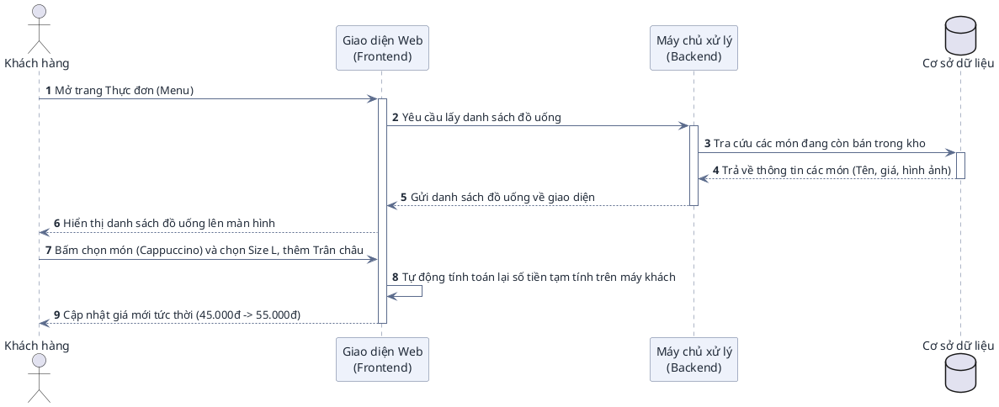
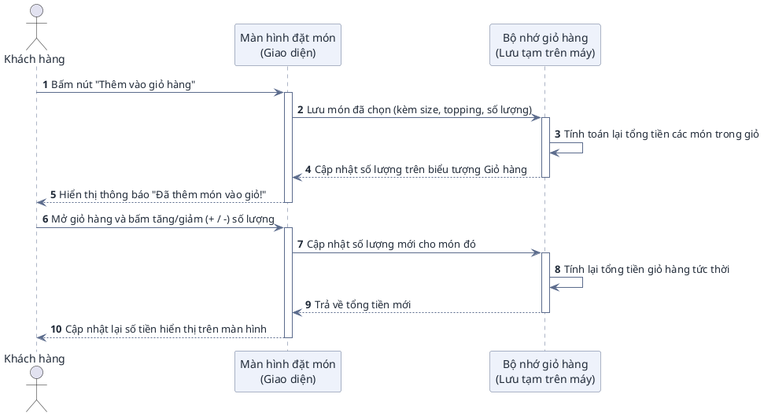
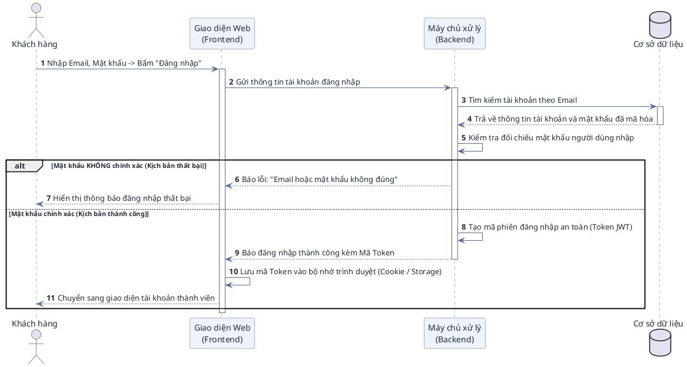
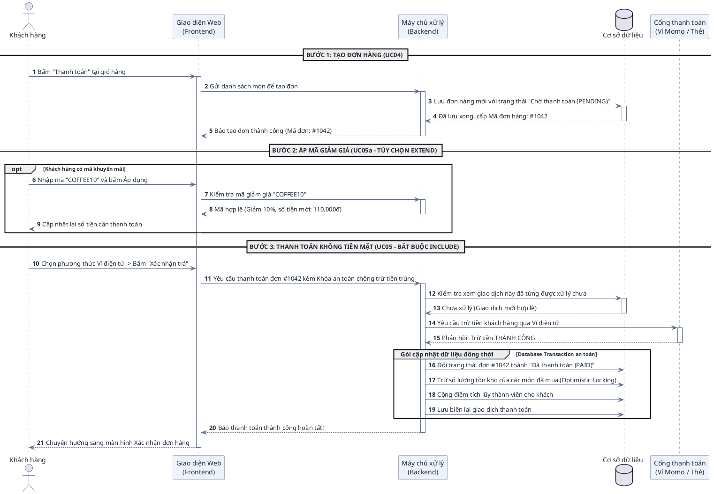
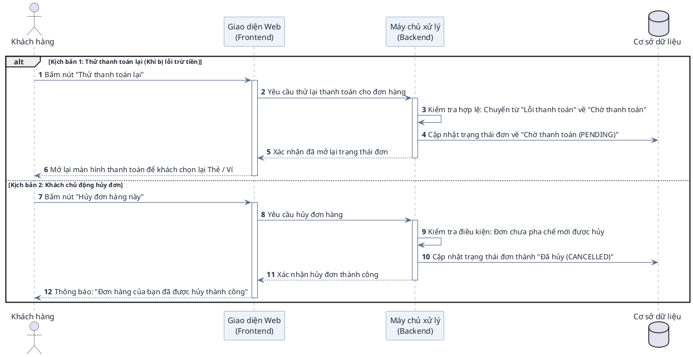
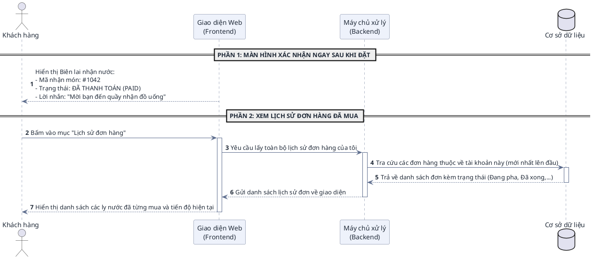

# HƯỚNG DẪN ĐỌC HIỂU & ĐẶC TẢ CHI TIẾT BIỂU ĐỒ TUẦN TỰ (SEQUENCE DIAGRAM)
## PHÂN HỆ KHÁCH HÀNG – DỰ ÁN BREWLITE

> **Dự án:** BrewLite – Ứng dụng đặt cà phê không tiền mặt  
> **Môn học:** Công nghệ Phần mềm (Bài tập lớn 10 Task Agile Scrum)  
> **Phạm vi tài liệu:** Phân hệ Khách hàng (User Subsystem - MVP Cốt lõi)  
> **Đối tượng độc giả:**  
> 1. **Người dùng (Sinh viên, Giảng viên đánh giá):** Đọc hiểu luồng nghiệp vụ, nắm rõ ký hiệu kỹ thuật để thuyết trình bảo vệ đồ án.  
> 2. **AI Agents / Developers:** Đọc hiểu bối cảnh kiến trúc (Context Navigation), ánh xạ các bước của biểu đồ vào mã nguồn NestJS (Backend) và Next.js (Frontend) để lập trình và viết kiểm thử tự động.

---

# MỤC LỤC

1. [PHẦN I: CẨM NANG ĐỌC HIỂU BIỂU ĐỒ TUẦN TỰ (DÀNH CHO NGƯỜI DÙNG)](#phần-i-cẩm-nang-đọc-hiểu-biểu-đồ-tuần-tự)
   - 1.1 Khái niệm & Mục đích của Sequence Diagram
   - 1.2 Bốn thành phần cốt lõi
   - 1.3 Quy ước các loại đường nối & Mũi tên
   - 1.4 Giải mã các khối điều khiển đặc biệt (`alt`, `opt`, `group`)
2. [PHẦN II: ĐẶC TẢ CHI TIẾT 6 KỊCH BẢN TUẦN TỰ (PLANTUML TỰ NHIÊN)](#phần-ii-đặc-tả-chi-tiết-6-kịch-bản-tuần-tự)
   - 2.1 UC01: Xem menu & Tùy chọn món (Size, Topping)
   - 2.2 UC02: Quản lý giỏ hàng trên trình duyệt
   - 2.3 UC03: Đăng ký & Đăng nhập tài khoản (JWT)
   - 2.4 UC04 + UC05 + UC05a: Đặt hàng & Thanh toán không tiền mặt (Trọng tâm MVP)
   - 2.5 UC06: Hủy đơn / Thử lại thanh toán (Order State Machine)
   - 2.6 UC07: Xem xác nhận & Lịch sử đơn hàng
3. [PHẦN III: MA TRẬN NGỮ CẢNH KỸ THUẬT DÀNH CHO AI AGENTS & DEVELOPERS](#phần-iii-ma-trận-ngữ-cảnh-kỹ-thuật)
   - 3.1 Bảng ánh xạ Use Case sang Mã nguồn & CSDL
   - 3.2 Quy tắc điều hướng cho AI Agent khi sinh mã / kiểm thử

---

# PHẦN I: CẨM NANG ĐỌC HIỂU BIỂU ĐỒ TUẦN TỰ

### 1.1 Khái niệm & Mục đích
Biểu đồ Tuần tự (**Sequence Diagram**) là biểu đồ thể hiện **sự tương tác qua lại giữa các đối tượng theo trục thời gian**. Nếu Use Case Diagram trả lời câu hỏi *"Ai làm chức năng gì?"*, thì Sequence Diagram trả lời câu hỏi: *"Để hoàn thành chức năng đó, các bộ phận trong hệ thống phải trao đổi thông điệp với nhau theo thứ tự nào?"*.

### 1.2 Bốn thành phần cốt lõi trên biểu đồ
1. **Tác nhân (Actor):** Con người tương tác trực tiếp với giao diện (Khách hàng).
2. **Đối tượng tham gia (Participants / Lifelines):** Đại diện cho các tầng kiến trúc của BrewLite:
   - `Giao diện Web (Frontend Next.js)`: Nơi người dùng bấm nút, xem dữ liệu.
   - `Máy chủ xử lý (Backend NestJS)`: Nơi tiếp nhận yêu cầu, kiểm tra nghiệp vụ và xử lý logic.
   - `Cơ sở dữ liệu (PostgreSQL)`: Nơi lưu trữ vĩnh viễn đơn hàng, sản phẩm, tài khoản.
   - `Cổng thanh toán (Mock Gateway)`: Đơn vị trung gian xử lý trừ tiền Ví/Thẻ.
3. **Đường gióng thời gian (Lifeline):** Đường thẳng đứng nét đứt chạy dọc từ trên xuống dưới, thể hiện sự tồn tại của đối tượng theo thời gian. **Càng ở phía dưới thì sự kiện diễn ra càng muộn**.
4. **Vạch kích hoạt (Activation Bar):** Hình chữ nhật mỏng nằm đè lên đường nét đứt, thể hiện khoảng thời gian mà đối tượng đó **đang tích cực xử lý công việc** (chưa xong).

### 1.3 Quy ước các loại đường nối & Mũi tên (Cực kỳ quan trọng)

| Loại thông điệp | Hình dáng trên biểu đồ | Cú pháp PlantUML | Ý nghĩa nghiệp vụ |
| :--- | :--- | :--- | :--- |
| **Thông điệp gửi đi (Request / Call)** | **Đường nét liền, mũi tên nhọn (`->`)** | `A -> B : Gửi yêu cầu` | Đối tượng A gửi một yêu cầu sang B và chờ B xử lý. |
| **Thông điệp phản hồi (Response / Return)** | **Đường nét đứt, mũi tên hở (`-->`)** | `B --> A : Trả kết quả` | Đối tượng B đã xử lý xong và gửi kết quả về cho A. |
| **Xử lý nội bộ (Self-Call)** | **Mũi tên uốn vòng lại chính nó** | `A -> A : Tự tính toán` | Đối tượng tự thực hiện một logic của chính mình (ví dụ: tự so sánh mật khẩu, tự cộng tiền). |

### 1.4 Giải mã các khối điều khiển đặc biệt (Combined Fragments)

* **Khối `alt` (Alternatives – Tương đương `IF - ELSE`):**
  - **Ý nghĩa:** Dùng khi gặp một ngã rẽ có **hai kịch bản loại trừ lẫn nhau (chỉ xảy ra 1 trong 2)**.
  - **Cách đọc:** Nửa trên là trường hợp xảy ra khi điều kiện đúng (ví dụ: Mật khẩu đúng), nửa dưới sau vạch chia `else` là trường hợp xảy ra khi điều kiện sai (ví dụ: Mật khẩu sai).
* **Khối `opt` (Option – Tương đương `IF` đơn lẻ, không có `ELSE`):**
  - **Ý nghĩa:** Dùng cho hành động **tùy chọn (làm cũng được, không làm cũng không sao)**.
  - **Cách đọc:** Nếu người dùng thỏa mãn điều kiện thì thực hiện các bước trong hộp `opt`, nếu không có thì hệ thống bỏ qua và chạy thẳng xuống dưới (ví dụ: Áp mã giảm giá).
* **Khối `group` (Giao dịch an toàn / Transaction):**
  - **Ý nghĩa:** Đánh dấu một chuỗi nhiều thao tác ghi vào CSDL bắt buộc phải **cùng thành công 100% hoặc cùng hủy bỏ (All or Nothing)** để tránh lỗi hệ thống (ví dụ: Đổi trạng thái đơn VÀ trừ kho VÀ cộng điểm).

---

# PHẦN II: ĐẶC TẢ CHI TIẾT 6 KỊCH BẢN TUẦN TỰ

---

### 2.1 UC01: Xem menu & Tùy chọn món (Size, Topping)

#### A. Bối cảnh nghiệp vụ
Khách hàng truy cập trang chủ của ứng dụng BrewLite. Hệ thống cần lấy danh mục các món đồ uống đang có sẵn để hiển thị kèm giá và hình ảnh. Khi khách chọn một món, khách có thể chọn kích cỡ (S/M/L) hoặc Topping; giao diện sẽ tự động tính lại tổng tiền tạm tính mà không cần phải gọi lại máy chủ.

#### B. Sơ đồ tuần tự (PlantUML)

#### C. Bảng đối chiếu kỹ thuật cho AI Agent
* **Backend Endpoint:** `GET /products`
* **Controller / Service:** `ProductController.findAll()` $\rightarrow$ `ProductService.findAll()`
* **Thực thể CSDL:** Bảng `Product` (lọc điều kiện `stock > 0`)
* **Xử lý Frontend:** Quản lý state hiển thị bằng React State / React Query.

---

### 2.2 UC02: Quản lý giỏ hàng trên trình duyệt

#### A. Bối cảnh nghiệp vụ
Theo yêu cầu Task 5 trong tài liệu đồ án, giỏ hàng được quản lý hoàn toàn ở phía máy khách (Client-side State) để mang lại trải nghiệm mượt mà tức thì cho khách hàng. Các thao tác thêm món, tăng/giảm số lượng hoặc xóa món được tính toán tự động và lưu tạm vào bộ nhớ trình duyệt (LocalStorage).

#### B. Sơ đồ tuần tự (PlantUML)

#### C. Bảng đối chiếu kỹ thuật cho AI Agent
* **Công nghệ Frontend:** Quản lý bằng `Zustand` store hoặc `React Context`.
* **Cơ chế lưu trữ:** Đồng bộ vào `window.localStorage` để F5 không bị mất giỏ hàng.
* **Cấu trúc dữ liệu:** `CartItem { productId, name, size, toppings: [], quantity, unitPrice, lineTotal }`.

---

### 2.3 UC03: Đăng ký & Đăng nhập tài khoản (JWT)

#### A. Bối cảnh nghiệp vụ
Khi khách hàng bấm đăng nhập, máy chủ sẽ tra cứu tài khoản trong cơ sở dữ liệu và kiểm tra mật khẩu đã được mã hóa an toàn (bằng bcrypt). 
* **Khối `alt` được sử dụng tại đây:**
  - **Nhánh 1 (Thất bại):** Nếu mật khẩu sai $\rightarrow$ Báo lỗi và dừng lại.
  - **Nhánh 2 (Thành công):** Nếu mật khẩu đúng $\rightarrow$ Máy chủ phát một mã khóa phiên làm việc dạng Token (JWT) để trình duyệt lưu lại. Khách hàng chính thức trở thành Thành viên.

#### B. Sơ đồ tuần tự (PlantUML)

#### C. Bảng đối chiếu kỹ thuật cho AI Agent
* **Backend Endpoint:** `POST /auth/login` (và `POST /auth/register`)
* **Controller / Service:** `AuthController.login()` $\rightarrow$ `AuthService.validateUser()`
* **Bảo mật:** `bcrypt.compare(plainPassword, user.passwordHash)`
* **Mã phiên JWT:** Cấp chuỗi Bearer Token chứa `{ sub: user.id, email: user.email }` có thời hạn hết hạn (`expiresIn`).

---

### 2.4 UC04 + UC05 + UC05a: Đặt hàng & Thanh toán không tiền mặt

#### A. Bối cảnh nghiệp vụ
Đây là **trọng tâm nghiệp vụ lớn nhất của dự án BrewLite** (Bao gồm Task 6, 8 và 10):
1. **Bước 1 (UC04 - Tạo đơn):** Gửi giỏ hàng lên máy chủ để tạo bản ghi đơn hàng ở trạng thái chờ thanh toán (`PENDING`).
2. **Bước 2 (UC05a - Khối `opt`):** Khách có mã giảm giá thì nhập mã để được trừ bớt tiền (hành động tùy chọn).
3. **Bước 3 (UC05 - Thanh toán):** Khách chọn Ví/Thẻ để trả tiền. Hệ thống dùng **Khóa an toàn chống trừ tiền 2 lần (Idempotency-Key)** để đảm bảo bấm nhiều lần không bị trừ tiền lặp lại.
4. **Khối `group Database Transaction`:** Đảm bảo khi cổng thanh toán báo thành công, 3 thao tác: Đổi trạng thái đơn sang `PAID`, trừ số lượng kho và cộng điểm thành viên bắt buộc phải diễn ra đồng thời.

#### B. Sơ đồ tuần tự (PlantUML)

#### C. Bảng đối chiếu kỹ thuật cho AI Agent
* **Backend Endpoints:**
  - Tạo đơn: `POST /orders` (Body: `items[]`, Header: `Bearer JWT`)
  - Thanh toán: `POST /payments` (Body: `{ orderId, paymentMethod }`, Header: `Idempotency-Key: <UUID>`)
* **Chống trừ tiền trùng (Idempotent):** Kiểm tra `Payment WHERE idempotencyKey = ?`. Nếu tồn tại $\rightarrow$ trả về kết quả cũ (HTTP 200), không gọi lại Gateway.
* **Kiểm soát tồn kho đồng thời (Concurrency):** Sử dụng Transaction Prisma/TypeORM kèm Optimistic Locking (cột `version` trong bảng `Product`) để tránh bán vượt số lượng tồn kho.

---

### 2.5 UC06: Hủy đơn / Thử lại thanh toán

#### A. Bối cảnh nghiệp vụ
Phục vụ máy trạng thái **Order State Machine** tại Mục 9.1 tài liệu môn học. 
* Khối `alt` mô tả 2 ngã rẽ xử lý sự cố:
  - **Kịch bản 1 (Thử lại):** Khi cổng thanh toán báo trừ tiền lỗi, đơn hàng ở trạng thái `PAYMENT_FAILED`. Khách bấm "Thử lại", hệ thống chuyển trạng thái đơn quay về `PENDING` để khách chọn phương thức khác trả lại tiền.
  - **Kịch bản 2 (Hủy đơn):** Khi đơn hàng chưa trả tiền hoặc bị lỗi, khách có quyền bấm "Hủy đơn". Hệ thống kiểm tra hàm bảo vệ trạng thái `assertTransition` rồi đổi thành `CANCELLED`.

#### B. Sơ đồ tuần tự (PlantUML)

#### C. Bảng đối chiếu kỹ thuật cho AI Agent
* **Backend Endpoints:**
  - `POST /orders/:id/retry`
  - `POST /orders/:id/cancel`
* **Quy tắc State Machine:**
  - `assertTransition('PAYMENT_FAILED' -> 'PENDING')`: Hợp lệ.
  - `assertTransition('PENDING' -> 'CANCELLED')`: Hợp lệ.
  - `assertTransition('PREPARING' -> 'CANCELLED')`: **Không hợp lệ** (Chặn đứng bằng cách ném lỗi BadRequestException vì barista đang pha chế rồi).

---

### 2.6 UC07: Xem xác nhận & Lịch sử đơn hàng

#### A. Bối cảnh nghiệp vụ
Tương ứng Task 9 trong đề tài:
1. **Phần 1 (Biên lai ngay sau khi đặt):** Hiển thị màn hình xác nhận với mã đơn số to `#1042`, trạng thái `PAID` và lời nhắn nhắc khách tới quầy nhận nước.
2. **Phần 2 (Xem lại lịch sử):** Khi khách bấm vào trang cá nhân "Lịch sử đơn", hệ thống truy vấn CSDL để hiển thị danh sách toàn bộ các ly nước đã từng mua, ngày đặt và trạng thái hiện tại (Đang pha chế, Đã xong, Đã giao).

#### B. Sơ đồ tuần tự (PlantUML)

#### C. Bảng đối chiếu kỹ thuật cho AI Agent
* **Backend Endpoint:** `GET /orders/me` (Được bảo vệ bởi `@UseGuards(JwtAuthGuard)`)
* **Controller / Service:** `OrderController.getMyOrders()` $\rightarrow$ `OrderService.findByUser(userId)`
* **Truy vấn CSDL:** `SELECT * FROM "Order" WHERE "userId" = :userId ORDER BY "createdAt" DESC`
* **Giao diện Wireframe:** Khớp với Wireframe (5) Xác nhận tại Mục 7 tài liệu môn học.

---

# PHẦN III: MA TRẬN NGỮ CẢNH KỸ THUẬT DÀNH CHO AI AGENTS & DEVELOPERS

Khi các AI Agent hoặc lập trình viên duyệt codebase của BrewLite để viết tính năng, sinh test hoặc sửa lỗi, bảng ma trận dưới đây là **bản đồ chỉ đường (Traceability Guide)** nối từ biểu đồ Sequence vào trực tiếp từng file mã nguồn:

| Mã UC | Tên Ca Sử Dụng | Endpoint API | Controller / Service (NestJS) | Bảng CSDL (PostgreSQL) | Cơ Chế Bảo Vệ / Logic Cốt Lõi |
| :--- | :--- | :--- | :--- | :--- | :--- |
| **UC01** | Xem menu & Tùy chọn món | `GET /products` `GET /products/:id` | `ProductController` `ProductService` | `Product` | Lọc `stock > 0`, trả về DTO kèm danh sách Topping |
| **UC02** | Quản lý giỏ hàng | *(Client-side)* | *(Không gọi API)* | *(LocalStorage)* | Zustand Store, tự tính toán `lineTotal` và `cartTotal` |
| **UC03** | Đăng ký & Đăng nhập | `POST /auth/register` `POST /auth/login` | `AuthController` `AuthService` | `User` | `bcrypt.compare`, cấp JWT Access Token |
| **UC04** | Tạo đơn hàng mới | `POST /orders` | `OrderController` `OrderService` | `Order`, `OrderItem` | Khởi tạo đơn `PENDING`, validate dữ liệu giỏ qua `class-validator` |
| **UC05** | Thanh toán không tiền mặt | `POST /payments` | `PaymentController` `PaymentService` | `Payment`, `Order`, `Product`, `User` | Header `Idempotency-Key`, gọi `MockGateway`, Database Transaction, Optimistic Locking trừ kho |
| **UC05a** | Áp mã giảm giá | `POST /promotions/validate` | `PromotionController` `PromotionService` | `Promotion` *(hoặc config)* | Kiểm tra hạn dùng, điều kiện đơn tối thiểu, tính % chiết khấu |
| **UC06** | Hủy đơn / Thử lại | `POST /orders/:id/retry` `POST /orders/:id/cancel` | `OrderController` `OrderService` | `Order` | Hàm `assertTransition()` cưỡng chế đúng luồng State Machine |
| **UC07** | Xác nhận & Lịch sử đơn | `GET /orders/me` | `OrderController` `OrderService` | `Order`, `OrderItem` | `JwtAuthGuard` trích xuất `userId` từ token, sắp xếp giảm dần theo ngày |

### Hướng Dẫn Điều Hướng Cho AI Agent (Agent Rules):
1. **Khi sinh Unit/Integration Test:** Tham chiếu Mục 9 của đề bài, kiểm thử các kịch bản của `alt` trong UC03, UC05 và UC06 (ví dụ: test chặn chuyển sai trạng thái, test gửi trùng Idempotency-Key).
2. **Khi thay đổi giao diện Next.js:** Giữ nguyên các thông điệp phản hồi đã được chuẩn hóa tại Phần II (mã đơn `#1042`, các trạng thái `PENDING`, `PAID`, `PREPARING`, `READY`, `COMPLETED`, `PAYMENT_FAILED`, `CANCELLED`).
3. **Tính toàn vẹn giao dịch (Atomic):** Mọi logic tại UC05 bắt buộc phải nằm trong khối `prisma.$transaction()` hoặc TypeORM QueryRunner.
