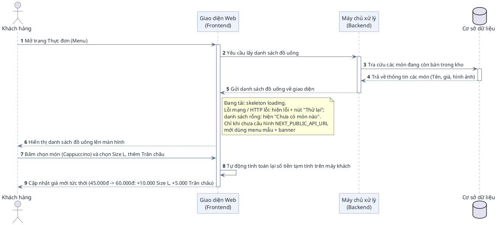
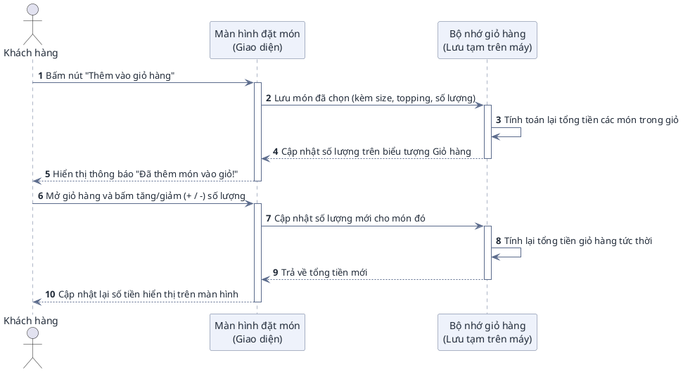
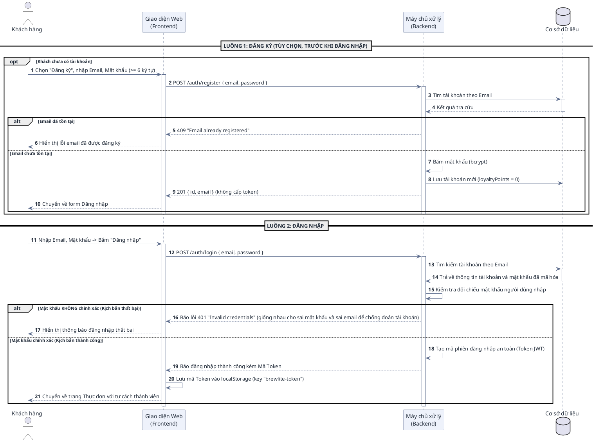
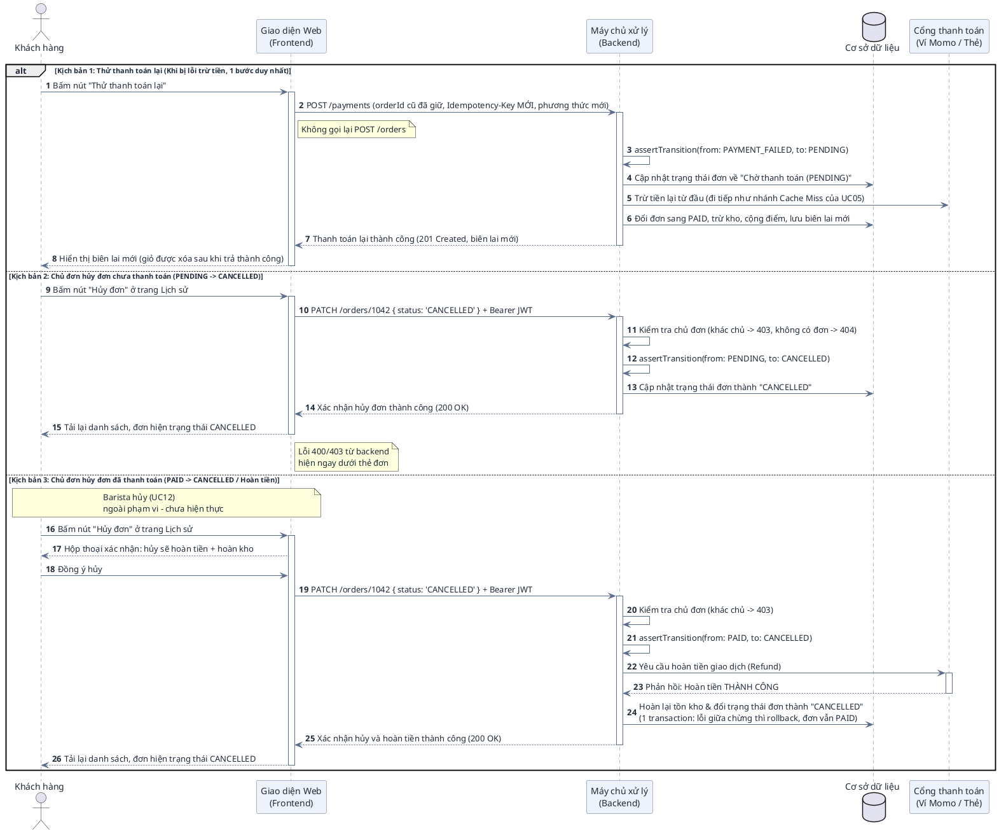
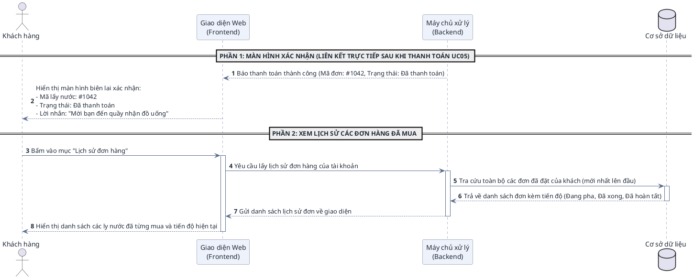

```plantuml
@startuml
skinparam DefaultFontColor #1f2937
skinparam ArrowColor #5b6b8c
skinparam SequenceParticipantBackgroundColor #eef2fb
skinparam SequenceParticipantBorderColor #5b6b8c
skinparam SequenceLifeLineBorderColor #5b6b8c
skinparam NoteBackgroundColor #fef3c7
skinparam NoteBorderColor #d97706
skinparam NoteFontColor #1f2937

autonumber
actor "Khách hàng" as User
participant "Giao diện Web\n(Frontend)" as FE
participant "Máy chủ xử lý\n(Backend)" as BE
database "PostgreSQL\n(qua Prisma)" as DB
participant "Cổng thanh toán\n(Ví Momo / Thẻ)" as Gateway

User -> FE : Tôi muốn thanh toán giỏ hàng này
activate FE
FE --> User : Mở màn Thanh toán (chưa tạo đơn)
deactivate FE

== BƯỚC 1: ÁP MÃ GIẢM GIÁ (UC05a - TÙY CHỌN EXTEND) ==
opt Khách hàng có mã khuyến mãi
    User -> FE : Tôi có mã "BREWLITE10", áp giúp tôi nhé
    activate FE
    FE -> FE : Tự kiểm tra mã và tính lại tiền còn phải trả (tạm tính)
    FE --> User : Trừ 10% rồi nhé, còn phải trả 110.700đ
    deactivate FE
end

== BƯỚC 2a: TẠO ĐƠN HÀNG (UC04) - CHẠY KHI BẤM "XÁC NHẬN TRẢ" ==
User -> FE : Tôi chọn trả bằng ví, bấm "Xác nhận trả"
activate FE
opt Chưa có đơn (lần bấm đầu; lần thử lại đã giữ orderId thì bỏ qua)
    FE -> BE : POST /orders (giỏ hàng: món, số lượng, size, topping)
    note right of FE #fef3c7 : Gửi kèm token đăng nhập\nThiếu/sai token thì trả 401, dừng tại đây
    activate BE
    BE -> DB : Tra giá gốc từng món
    activate DB
    DB --> BE : Giá gốc các món
    deactivate DB
    BE -> BE : Tự tính giá: giá gốc + phụ thu size\n+ topping (bỏ qua giá client gửi)
    note right of BE #fef3c7 : Thiếu size -> M\nTopping lạ -> 400, món lạ -> 404
    BE -> DB : Lưu đơn mới, đơn đang chờ thanh toán (PENDING)
    activate DB
    DB --> BE : Xong rồi, đơn số #1042 đây nhé
    deactivate DB
    BE --> FE : 201 Tạo đơn thành công, mã đơn là #1042
    deactivate BE
end

== BƯỚC 2b: THANH TOÁN KHÔNG TIỀN MẶT (UC05) - GỌI NGAY SAU 2a ==
FE -> BE : POST /payments: thanh toán đơn #1042 bằng ví
note right of FE #fef3c7 : Gửi kèm Idempotency-Key MỚI cho mỗi lần bấm\nvà mã giảm giá (nếu có)
activate BE

alt Thiếu/sai token (JwtAuthGuard)
    BE --> FE : 401 Chưa đăng nhập / token sai hoặc hết hạn
    note right of BE #fef3c7 : Trả lỗi và DỪNG tại đây,\ngiỏ hàng giữ nguyên
else Token hợp lệ
    BE -> BE : Xếp hàng theo khóa trong tiến trình\n(theo Idempotency-Key, rồi theo orderId)
    note right of BE #fef3c7 : Request song song cùng key\nhoặc cùng đơn phải chờ nhau,\nrequest sau đọc lại kết quả mới

    alt Không phải chủ đơn (đọc đơn trước khi xét trùng lặp)
        BE --> FE : 404 Không có đơn / 403 Không phải đơn của bạn
        note right of BE #fef3c7 : Người lạ không thanh toán hộ, cũng không\nđọc được biên lai của người khác bằng key;\nnếu key trỏ biên lai của đơn khác thì\nđơn đó cũng phải của người gọi, nếu không -> 403
    else Đúng chủ đơn
        BE -> DB : Kiểm tra giúp xem mã giao dịch này đã dùng chưa
        note right of DB #fef3c7 : Tìm đúng 1 biên lai theo mã,\nkhóa này là duy nhất trong bảng
        activate DB
        DB --> BE : Đây là kết quả kiểm tra mã giao dịch
        deactivate DB

        alt Đơn này đã thu tiền rồi (Yêu cầu trùng lặp - Idempotent Cache Hit)
            BE --> FE : Đơn này trả rồi nhé, gửi lại kết quả cũ, không thu thêm
            note right of BE #fef3c7 : Trả HTTP 200, tuyệt đối\nkhông gọi lại cổng thanh toán
            FE --> User : Đơn của bạn đã thanh toán rồi, đây là biên lai nhé
        else Đây là lần thanh toán đầu tiên (Cache Miss)
            note over BE #fef3c7
                Tự kiểm tra mã "BREWLITE10" trong máy:
                đúng mã thì trừ floor(10% x tổng đơn server), sai thì thôi
            end note
            BE -> BE : Tự kiểm tra mã giảm giá và tính tiền còn lại

            BE -> Gateway : Nhờ trừ giúp tiền của khách qua ví nhé
            activate Gateway

            alt Trừ tiền thất bại
                Gateway --> BE : Trừ tiền thất bại rồi nhé
                BE -> BE : Tự chuyển đơn sang thanh toán lỗi
                BE -> DB : Lưu giúp đơn sang trạng thái thanh toán lỗi nhé
                BE --> FE : 400 Thanh toán lỗi rồi, giỏ hàng giữ nguyên nhé
                FE -> FE : Giữ orderId #1042 để lần thử lại\nchỉ gọi POST /payments (key mới)
                FE --> User : Thẻ/ví lỗi rồi, bạn thử lại nhé (giỏ vẫn còn)
            else Trừ tiền thành công
                Gateway --> BE : Trừ tiền thành công rồi nhé
                BE -> BE : Tự kiểm tra xem đơn có được chuyển\ntừ chờ thanh toán sang đã thanh toán không

                group 1 DB transaction (runInTransaction): thiếu một là rollback hết
                    BE -> DB : Trừ giúp tồn kho các món trong đơn nhé
                    note over BE, DB #fef3c7
                        Mỗi món trừ theo kiểu "đúng phiên bản mới trừ":
                        sai phiên bản hoặc hết hàng thì không trừ.
                        Kẹt thì thử lại 3 lần, vẫn kẹt thì ném 409
                        -> cả transaction rollback
                    end note
                    BE -> DB : Đổi giúp đơn #1042 sang đã thanh toán nhé
                    BE -> DB : Cộng giúp điểm tích lũy cho khách nhé
                    BE -> DB : Lưu giúp biên lai thanh toán kèm mã chống thu trùng nhé
                end

                alt Kẹt kho (409, transaction đã rollback)
                    BE -> Gateway : Hoàn lại số tiền vừa trừ (refund)
                    BE -> DB : Lưu đơn sang thanh toán lỗi (PAYMENT_FAILED)
                    BE --> FE : 409 Hết hàng
                    FE --> User : Món đã hết, tiền đã được hoàn (giỏ vẫn còn)
                else Transaction thành công
                    BE --> FE : Thanh toán xong rồi nhé, đơn #1042 đã được trả tiền
                    note right of BE #fef3c7 : Trả HTTP 201 cho lần thanh toán đầu tiên
                    FE --> User : Xong rồi, mời bạn xem biên lai đơn #1042 nhé
                end
            end
            deactivate Gateway
        end
    end
end
deactivate BE
deactivate FE
@enduml
```

# HƯỚNG DẪN ĐỌC HIỂU & ĐẶC TẢ CHI TIẾT BIỂU ĐỒ TUẦN TỰ (SEQUENCE DIAGRAM)
## PHÂN HỆ KHÁCH HÀNG – DỰ ÁN BREWLITE

> **Dự án:** BrewLite – Ứng dụng đặt cà phê không tiền mặt  
> **Môn học:** Công nghệ Phần mềm (Bài tập lớn 10 Task Agile Scrum)  
> **Phạm vi & Định vị tài liệu:**  
> • **Tài liệu này là Phụ lục chi tiết (Architecture Appendix) cho Developers & AI Agents** dùng để hiểu sâu bối cảnh, đối chiếu mã nguồn và viết test case.  
> • **Bản nộp chính cho giảng viên** tập trung vào 3 biểu đồ cốt lõi tinh gọn đã chốt (Use Case tổng 16 UC — UC01–UC15 + UC05a, trong đó phân hệ Khách hàng 8 UC: UC01–UC07 + UC05a; Activity luồng nghiệp vụ tổng, và Sequence thanh toán rút gọn).  
> **Đối tượng độc giả:**  
> 1. **Sinh viên & Giảng viên:** Tra cứu chi tiết từng bước, đối chiếu ma trận truy vết (Traceability) với 10 API endpoint và 10 Task Backlog.  
> 2. **AI Agents / Developers:** Đọc hiểu bối cảnh kiến trúc (Context Navigation), ánh xạ các bước của biểu đồ vào mã nguồn NestJS (Backend) và Next.js (Frontend) để lập trình và viết kiểm thử tự động.

---

# MỤC LỤC

1. [PHẦN I: CẨM NANG ĐỌC HIỂU BIỂU ĐỒ TUẦN TỰ (DÀNH CHO NGƯỜI DÙNG)](#phần-i-cẩm-nang-đọc-hiểu-biểu-đồ-tuần-tự)
   - 1.1 Khái niệm & Mục đích của Sequence Diagram
   - 1.2 Bốn thành phần cốt lõi
   - 1.3 Quy ước các loại đường nối & Mũi tên
   - 1.4 Giải mã các khối điều khiển đặc biệt (`alt`, `opt`, `group`)
2. [PHẦN II: ĐẶC TẢ CHI TIẾT 6 KỊCH BẢN TUẦN TỰ (PLANTUML TỰ NHIÊN)](#phần-ii-đặc-tả-chi-tiết-6-kịch-bản-tuần-tự)
   - 2.1 UC01: Xem menu & Tùy chọn món (Size, Topping)
   - 2.2 UC02: Quản lý giỏ hàng trên trình duyệt
   - 2.3 UC03: Đăng ký & Đăng nhập tài khoản (JWT)
   - 2.4 UC04 + UC05 + UC05a: Đặt hàng & Thanh toán không tiền mặt (Trọng tâm MVP)
   - 2.5 UC06: Hủy đơn / Thử lại thanh toán (Order State Machine)
   - 2.6 UC07: Xem xác nhận & Lịch sử đơn hàng
3. [PHẦN III: MA TRẬN NGỮ CẢNH KỸ THUẬT DÀNH CHO AI AGENTS & DEVELOPERS](#phần-iii-ma-trận-ngữ-cảnh-kỹ-thuật)
   - 3.1 Bảng ánh xạ Use Case sang Mã nguồn & CSDL
   - 3.2 Quy tắc điều hướng cho AI Agent khi sinh mã / kiểm thử

---

# PHẦN I: CẨM NANG ĐỌC HIỂU BIỂU ĐỒ TUẦN TỰ

### 1.1 Khái niệm & Mục đích
Biểu đồ Tuần tự (**Sequence Diagram**) là biểu đồ thể hiện **sự tương tác qua lại giữa các đối tượng theo trục thời gian**. Nếu Use Case Diagram trả lời câu hỏi *"Ai làm chức năng gì?"*, thì Sequence Diagram trả lời câu hỏi: *"Để hoàn thành chức năng đó, các bộ phận trong hệ thống phải trao đổi thông điệp với nhau theo thứ tự nào?"*.

### 1.2 Bốn thành phần cốt lõi trên biểu đồ
1. **Tác nhân (Actor):** Con người tương tác trực tiếp với giao diện (Khách hàng).
2. **Đối tượng tham gia (Participants / Lifelines):** Đại diện cho các tầng kiến trúc của BrewLite:
   - `Giao diện Web (Frontend Next.js)`: Nơi người dùng bấm nút, xem dữ liệu.
   - `Máy chủ xử lý (Backend NestJS)`: Nơi tiếp nhận yêu cầu, kiểm tra nghiệp vụ và xử lý logic.
   - `Cơ sở dữ liệu (PostgreSQL qua Prisma)`: Nơi lưu trữ vĩnh viễn đơn hàng, sản phẩm, tài khoản (5 bảng mục 12.2). Task 8-10 cắm qua 4 adapter `PrismaOrder/Product/Payment/UserRepo`; khi thiếu `DATABASE_URL` thì dùng bản In-Memory trên RAM để chạy/test độc lập.
   - `Cổng thanh toán (Mock Gateway)`: Đơn vị trung gian xử lý trừ tiền Ví/Thẻ.
3. **Đường gióng thời gian (Lifeline):** Đường thẳng đứng nét đứt chạy dọc từ trên xuống dưới, thể hiện sự tồn tại của đối tượng theo thời gian. **Càng ở phía dưới thì sự kiện diễn ra càng muộn**.
4. **Vạch kích hoạt (Activation Bar):** Hình chữ nhật mỏng nằm đè lên đường nét đứt, thể hiện khoảng thời gian mà đối tượng đó **đang tích cực xử lý công việc** (chưa xong).

### 1.3 Quy ước các loại đường nối & Mũi tên (Cực kỳ quan trọng)

| Loại thông điệp | Hình dáng trên biểu đồ | Cú pháp PlantUML | Ý nghĩa nghiệp vụ |
| :--- | :--- | :--- | :--- |
| **Thông điệp gửi đi (Request / Call)** | **Đường nét liền, mũi tên nhọn (`->`)** | `A -> B : Gửi yêu cầu` | Đối tượng A gửi một yêu cầu sang B và chờ B xử lý. |
| **Thông điệp phản hồi (Response / Return)** | **Đường nét đứt, mũi tên hở (`-->`)** | `B --> A : Trả kết quả` | Đối tượng B đã xử lý xong và gửi kết quả về cho A. |
| **Xử lý nội bộ (Self-Call)** | **Mũi tên uốn vòng lại chính nó** | `A -> A : Tự tính toán` | Đối tượng tự thực hiện một logic của chính mình (ví dụ: tự so sánh mật khẩu, tự cộng tiền). |

### 1.4 Giải mã các khối điều khiển đặc biệt (Combined Fragments)

* **Khối `alt` (Alternatives – Tương đương `IF - ELSE`):**
  - **Ý nghĩa:** Dùng khi gặp một ngã rẽ có **hai kịch bản loại trừ lẫn nhau (chỉ xảy ra 1 trong 2)**.
  - **Cách đọc:** Nửa trên là trường hợp xảy ra khi điều kiện đúng (ví dụ: Mật khẩu đúng), nửa dưới sau vạch chia `else` là trường hợp xảy ra khi điều kiện sai (ví dụ: Mật khẩu sai).
* **Khối `opt` (Option – Tương đương `IF` đơn lẻ, không có `ELSE`):**
  - **Ý nghĩa:** Dùng cho hành động **tùy chọn (làm cũng được, không làm cũng không sao)**.
  - **Cách đọc:** Nếu người dùng thỏa mãn điều kiện thì thực hiện các bước trong hộp `opt`, nếu không có thì hệ thống bỏ qua và chạy thẳng xuống dưới (ví dụ: Áp mã giảm giá).
* **Khối `group` (Giao dịch an toàn / Transaction):**
  - **Ý nghĩa:** Đánh dấu một chuỗi nhiều thao tác ghi vào CSDL bắt buộc phải **cùng thành công 100% hoặc cùng hủy bỏ (All or Nothing)** để tránh lỗi hệ thống (ví dụ: Đổi trạng thái đơn VÀ trừ kho VÀ cộng điểm).

---

# PHẦN II: ĐẶC TẢ CHI TIẾT 6 KỊCH BẢN TUẦN TỰ

---

### 2.1 UC01: Xem menu & Tùy chọn món (Size, Topping)

#### A. Bối cảnh nghiệp vụ
Khách hàng truy cập trang chủ của ứng dụng BrewLite. Hệ thống cần lấy danh mục các món đồ uống đang có sẵn để hiển thị kèm giá và hình ảnh. Khi khách chọn một món, khách có thể chọn kích cỡ (S/M/L) hoặc Topping; giao diện sẽ tự động tính lại tổng tiền tạm tính mà không cần phải gọi lại máy chủ.

#### B. Sơ đồ tuần tự (PlantUML)

#### C. Bảng đối chiếu kỹ thuật cho AI Agent
* **Backend Endpoint:** `GET /products` (`GET /products/:id` cho màn chi tiết)
* **Controller / Service:** `ProductController.list()` / `detail()` $\rightarrow$ `ProductService.listAvailable()` / `getById()`
* **Thực thể CSDL:** Bảng `Product` (lọc điều kiện `stock > 0`)
* **Xử lý Frontend:** Quản lý state hiển thị bằng React State (`useState` + `fetch`), không dùng React Query.
* **Lỗi / rỗng / menu mẫu:** `getProducts()` (`frontend/src/lib/api.ts`) đọc `NEXT_PUBLIC_API_URL` lúc gọi. **Chưa cấu hình** → trả `MOCK_PRODUCTS` kèm `fromMock: true` (không gọi mạng, `ProductGrid` hiện banner "menu mẫu"; dùng để demo UI không cần backend). **Đã cấu hình** (compose luôn set) → lỗi mạng / HTTP lỗi **ném `Error`** (`MenuPage` bắt, `ProductGrid` hiện thông báo lỗi + nút "Thử lại"), danh sách rỗng trả `[]` (hiện "Chưa có món nào"); không còn rơi về menu mẫu vì khách sẽ thêm được món có id không có trong DB. Test: `frontend/src/lib/api.test.ts`.
* **Size / Topping:** `ProductDto` (`id, name, price, imageUrl, stock, version`) **không** chứa size/topping. Bảng giá cố định nằm ở `frontend/src/lib/pricing.ts` (tính tạm trên máy khách) và bản sao `backend/src/order/pricing.ts` (server tính lại khi `POST /orders`): S +0, M +5.000 (mặc định), L +10.000; Trân châu 5.000, Kem cheese 8.000, Thạch cà phê 6.000. Sửa bảng giá phải sửa cả 2 file.

---

### 2.2 UC02: Quản lý giỏ hàng trên trình duyệt

#### A. Bối cảnh nghiệp vụ
Theo yêu cầu Task 5 trong tài liệu đồ án, giỏ hàng được quản lý hoàn toàn ở phía máy khách (Client-side State) để mang lại trải nghiệm mượt mà tức thì cho khách hàng. Các thao tác thêm món, tăng/giảm số lượng hoặc xóa món được tính toán tự động và lưu tạm vào bộ nhớ trình duyệt (LocalStorage).

#### B. Sơ đồ tuần tự (PlantUML)

#### C. Bảng đối chiếu kỹ thuật cho AI Agent
* **Công nghệ Frontend:** Quản lý bằng `Zustand` store hoặc `React Context`.
* **Cơ chế lưu trữ:** Đồng bộ vào `window.localStorage` để F5 không bị mất giỏ hàng.
* **Cấu trúc dữ liệu:** `CartItem { productId, name, size, toppings: [], quantity, unitPrice, lineTotal }`.

---

### 2.3 UC03: Đăng ký & Đăng nhập tài khoản (JWT)

#### A. Bối cảnh nghiệp vụ
UC03 gồm 2 luồng tách biệt trên cùng trang `/login` (nút chuyển chế độ Đăng nhập / Đăng ký):
1. **Luồng Đăng ký (tùy chọn, chạy trước Đăng nhập):** `POST /auth/register`. Máy chủ tra email; **trùng email → 409** "Email already registered". Chưa có thì băm mật khẩu bằng bcrypt, lưu tài khoản mới (`loyaltyPoints = 0`) và trả `{ id, email }` — **không** cấp token. Giao diện chuyển về form Đăng nhập để khách tự đăng nhập.
2. **Luồng Đăng nhập:** máy chủ tra cứu tài khoản trong cơ sở dữ liệu và kiểm tra mật khẩu đã được mã hóa an toàn (bằng bcrypt).
* **Khối `alt` của luồng Đăng nhập:**
  - **Nhánh 1 (Thất bại):** Nếu mật khẩu sai $\rightarrow$ Báo lỗi và dừng lại.
  - **Nhánh 2 (Thành công):** Nếu mật khẩu đúng $\rightarrow$ Máy chủ phát một mã khóa phiên làm việc dạng Token (JWT) để trình duyệt lưu lại. Khách hàng chính thức trở thành Thành viên.

#### B. Sơ đồ tuần tự (PlantUML)

#### C. Bảng đối chiếu kỹ thuật cho AI Agent
* **Backend Endpoint:** `POST /auth/register` (luồng 1, trả 201 `{ id, email }`, trùng email 409) và `POST /auth/login` (luồng 2, trả 200 `{ accessToken, user }`)
* **Controller / Service:** `AuthController.register()` / `login()` $\rightarrow$ `AuthService.register()` / `login()`
* **Validate đầu vào:** `RegisterDto` (`@IsEmail`, mật khẩu `@MinLength(6)`), `LoginDto` (`@IsEmail`).
* **Bảo mật:** đăng ký `bcrypt.hash(password, 10)`; đăng nhập `bcrypt.compare(plainPassword, user.passwordHash)`
* **Mã phiên JWT:** Cấp chuỗi Bearer Token chứa `{ sub: user.id, email: user.email }` có thời hạn hết hạn (`expiresIn`).

---

### 2.4 UC04 + UC05 + UC05a: Đặt hàng & Thanh toán không tiền mặt

#### A. Bối cảnh nghiệp vụ
Đây là **trọng tâm nghiệp vụ lớn nhất của dự án BrewLite** (Bao gồm Task 6, 8 và 10):
1. **Bước 1 (UC05a - Khối `opt`):** Trên màn Thanh toán, khách có mã giảm giá (`BREWLITE10`) thì nhập mã để giao diện tính giảm trừ tạm (hành động tùy chọn). Mã này được gửi kèm yêu cầu thanh toán để máy chủ xác thực và tính lại nội bộ (không tạo thêm endpoint hay bảng ngoài đề bài).
2. **Bước 2 (UC04 + UC05 - bấm "Xác nhận trả"):** Một lần bấm chạy **liền 2 lời gọi**: `POST /orders` rồi ngay sau đó `POST /payments`. Nghĩa là đơn chỉ được tạo **sau** bước áp voucher, không có bước tạo đơn riêng trước màn thanh toán.
   - **`POST /orders` (UC04):** Gửi giỏ (`productId, quantity, size, toppings`) kèm token JWT; thiếu/sai token → 401. **Máy chủ tự tính giá**: `unitPrice = product.price + phụ thu size + tổng giá topping` theo `backend/src/order/pricing.ts`, giá client gửi lên bị bỏ qua. Thiếu size → mặc định `M`; topping lạ → 400; sản phẩm lạ → 404. Đơn lưu ở `PENDING`.
   - **`POST /payments` (UC05):** Khách chọn Ví/Thẻ. Mỗi lần bấm sinh một **Idempotency-Key** mới. Voucher và số tiền tính lại trên `order.total` của server.
   - **Thử lại sau khi lỗi:** giao diện đã giữ `orderId` của đơn vừa tạo nên lần bấm tiếp theo **chỉ gọi `POST /payments`** với `orderId` cũ và key mới (UC06 KB1), không tạo đơn mới.
3. **Xử lý trong `POST /payments`** (thứ tự cố định: **guard → chủ đơn → cache → charge**):
   - **Xác thực & phân quyền (chạy trước mọi nhánh):** `JwtAuthGuard` — thiếu/sai token → 401, dừng ngay. Sau khi vào khóa, `processPayment()` **đọc đơn trước khi xét trùng lặp**: đơn không có → 404, `order.userId !== req.user.id` → 403. Bước này chạy **trước** nhánh Cache Hit nên người lạ không thanh toán hộ được và không đọc được biên lai của người khác bằng key; nếu key trỏ tới biên lai của đơn khác (`dto.orderId`) thì đơn đó cũng phải là của người gọi, nếu không → 403.
   - **Tuần tự hóa request song song:** request cùng Idempotency-Key, hoặc khác key nhưng cùng đơn, phải xếp hàng chờ nhau (khóa trong tiến trình theo key + `orderId`). Request đến sau đọc lại biên lai/trạng thái mới nên chỉ trừ tiền 1 lần.
   - **Nhánh Trùng lặp (Cache Hit):** Nếu khóa đã tồn tại trong CSDL $\rightarrow$ trả về kết quả cũ đã lưu (HTTP 200), **tuyệt đối không gọi lại Cổng thanh toán để tránh trừ tiền 2 lần**.
   - **Nhánh Mới (Cache Miss):** Gọi Cổng thanh toán trừ tiền. Trừ tiền lỗi → đơn sang `PAYMENT_FAILED`, trả 400. Trừ tiền thành công → `assertTransition('PENDING' -> 'PAID')` rồi **mọi lệnh ghi sau charge nằm trong 1 `runInTransaction`**: trừ kho (Optimistic Locking, thử lại 3 lần mỗi món), đổi đơn sang `PAID`, cộng điểm tích lũy, lưu biên lai. Kẹt kho → transaction rollback (phần kho đã trừ tự hủy) + hoàn tiền + đơn sang `PAYMENT_FAILED` + trả 409.

#### B. Sơ đồ tuần tự (PlantUML)

#### C. Bảng đối chiếu kỹ thuật cho AI Agent
* **Backend Endpoints:**
  - Tạo đơn: `POST /orders` (Body: `items[] { productId, quantity, size?, toppings? }`, Header: `Bearer JWT`)
  - Thanh toán: `POST /payments` (Body: `{ orderId, paymentMethod, voucherCode? }`, Header: `Idempotency-Key: <UUID>`, `Bearer JWT`)
* **Thứ tự gọi ở Frontend:** `PaymentForm` → `ApiPaymentGateway.pay()` gọi `POST /orders` rồi `POST /payments` trong cùng một lần bấm "Xác nhận trả". Lỗi sau khi đơn đã tạo ném `PaymentError` mang `orderId`; `PaymentForm` giữ `orderId` đó, lần thử lại chỉ gọi `POST /payments` với key mới (`newIdempotencyKey()` mỗi lần bấm).
* Tạo đơn yêu cầu Bearer JWT, thiếu token trả 401 (khớp Task 7). `POST /payments` cũng gắn `@UseGuards(JwtAuthGuard)` (thiếu/sai token → 401) và `PaymentController.pay()` truyền `req.user.id` vào `PaymentService.processPayment(userId, dto, key)`. FE (`ApiPaymentGateway`) gửi `Authorization: Bearer <brewlite-token>` cho cả `/orders` lẫn `/payments`; 401/403 ném `PaymentError` mang `orderId`.
* **Chỉ chủ đơn mới thanh toán được:** trong khóa `order:<orderId>`, `processPayment()` đọc đơn trước: không có → 404, `order.userId !== userId` → 403 (`ForbiddenException`, giống `cancelOrderAs()` / `advanceOrder()`). Bước này chạy **trước** nhánh cache `Idempotency-Key` nên người lạ không đọc được biên lai của người khác bằng key; nếu key trỏ tới biên lai của đơn khác `dto.orderId` thì đơn đó cũng phải là của người gọi, nếu không trả 403.
* **Giá do server tính (`OrderService.create()`):** `unitPrice = product.price + SIZE_UPCHARGE[size] + Σ TOPPING_PRICES` (`backend/src/order/pricing.ts`), `total = Σ quantity × unitPrice`. DTO không có trường `unitPrice`; FE (`ApiPaymentGateway.createOrderId()`) chỉ gửi `{ productId, quantity, size, toppings }` cho mỗi dòng, không gửi `unitPrice` / `name` / `key` / `lineTotal` (có test); `ValidationPipe({ whitelist: true })` vẫn là lớp chặn thứ hai. Thiếu `size` → `M`; topping ngoài bảng → 400; `productId` lạ → 404.
* **Tuần tự hóa song song:** `PaymentService.processPayment()` bọc xử lý trong `withLock('key:<Idempotency-Key>')` rồi `withLock('order:<orderId>')`; `cancelOrder()` / `advanceOrder()` dùng chung khóa `order:<orderId>`. Đây là khóa trong tiến trình, chỉ đúng khi chạy 1 instance backend (như compose hiện tại).
* **Xác thực Voucher:** Validate nội bộ trong `PaymentService` theo cấu hình chiết khấu (Task 10), không tạo thêm endpoint riêng ngoài 10 endpoint chính.
* **Chống trừ tiền trùng (Idempotent Test Criteria b):** Tra đúng 1 biên lai theo mã (`Payment` tìm theo `idempotencyKey` duy nhất). Nhánh Hit trả 200 OK kết quả cũ (kèm đúng discount/points đã lưu), nhánh Miss mới gọi Gateway. Chỉ lần trả **thành công** mới lưu biên lai theo key; key của lần trả lỗi không được cache, vì vậy FE luôn sinh key mới cho mỗi lần thử lại.
* **Kiểm soát tồn kho đồng thời (Concurrency Test Criteria c):** Trừ kho nguyên tử bằng lệnh `updateMany` kèm điều kiện `version` khớp và `stock >= số lượng` (sai là không trừ), thử lại 3 lần rồi vẫn kẹt thì ném 409.
* **Transaction sau charge:** Trừ kho + `PAID` + cộng điểm + lưu biên lai chạy trong `orders.runInTransaction(tx => ...)` (Prisma: `$transaction`; In-Memory: snapshot/rollback tuần tự trong `in-memory-tx.ts`). Kẹt kho → rollback, rồi **ngoài transaction**: `gateway.refund()` + đơn sang `PAYMENT_FAILED` + ném lại 409.
* **State Machine (Test Criteria a):** Thực thi `assertTransition('PENDING' -> 'PAID')` trước khi lưu vào CSDL.
* **Chọn kho dữ liệu:** Có `DATABASE_URL` thì cắm 4 adapter Prisma (Postgres thật), không thì dùng bản In-Memory để test độc lập — logic `PaymentService` giữ nguyên.

---

### 2.5 UC06: Hủy đơn / Thử lại thanh toán

#### A. Bối cảnh nghiệp vụ
Phục vụ máy trạng thái **Order State Machine** tại Mục 9.1 tài liệu môn học (`docs:301-322`). 
* Khối `alt` mô tả 3 ngã rẽ xử lý trạng thái theo chuẩn REST (`PATCH /orders/:id`):
  - **Kịch bản 1 (Thử lại):** Khi cổng thanh toán báo trừ tiền lỗi, đơn hàng ở trạng thái `PAYMENT_FAILED`. Khách bấm "Thử lại", hệ thống gọi lại thanh toán hoặc chuyển trạng thái đơn quay về `PENDING` (`PAYMENT_FAILED` $\rightarrow$ `PENDING`).
  - **Kịch bản 2 (Khách hủy đơn chưa trả):** Khi đơn hàng chưa thanh toán, khách có quyền hủy đơn (`PENDING` $\rightarrow$ `CANCELLED`; `PAYMENT_FAILED` $\rightarrow$ `CANCELLED` cũng hợp lệ).
  - **Kịch bản 3 (Hủy đơn đã thanh toán - Hoàn tiền):** Khi đơn đã trả tiền (`PAID`) và khách yêu cầu hủy kịp thời, hệ thống hủy đơn kèm hoàn tiền + hoàn kho (`PAID` $\rightarrow$ `CANCELLED` theo đúng `docs:313`).
* **Hiện trạng code cho KB2/KB3:**
  - **Frontend có nút "Hủy đơn" ở `/history`** cho đơn `PENDING` / `PAYMENT_FAILED` / `PAID` (helper `cancelOrder()` trong `frontend/src/lib/api.ts`): gọi `PATCH /orders/:id { status: 'CANCELLED' }` kèm Bearer JWT, đơn `PAID` hỏi xác nhận (có hoàn tiền) trước khi gọi, lỗi 400/403 hiện ngay dưới thẻ đơn, thành công thì tải lại danh sách. Màn biên lai không có nút này.
  - **Chỉ CHỦ ĐƠN được hủy:** `PaymentService.cancelOrderAs()` so `order.userId` với user trong token; khác chủ → 403, đơn không tồn tại → 404.
  - Barista hủy đơn khi hết nguyên liệu (UC12) **ngoài phạm vi – chưa hiện thực**: không có vai trò Barista, không có phân quyền theo vai trò.

#### B. Sơ đồ tuần tự (PlantUML)

#### C. Bảng đối chiếu kỹ thuật cho AI Agent
* **Backend Endpoints:**
  - `POST /payments` (gửi lại yêu cầu thanh toán khi thử lại)
  - `PATCH /orders/:id` (Bearer JWT, chỉ chủ đơn; `{ status: 'CANCELLED' }` để hủy, `PREPARING`/`READY`/`COMPLETED` để tiến đơn)
* **Controller / Service:** `PaymentController.update()` (route `PATCH /orders/:id` đang nằm ở `PaymentController`) $\rightarrow$ `PaymentService.cancelOrderAs()` khi `status = CANCELLED`, ngược lại `PaymentService.advanceOrder()`. Cả hai kiểm tra chủ đơn (403/404) và chạy dưới khóa `order:<orderId>`.
* **Frontend:** nút "Hủy đơn" ở `frontend/src/app/history/page.tsx` (hiện khi `canCancelOrder(status)`: `PENDING` / `PAYMENT_FAILED` / `PAID`) → `cancelOrder(orderId, token)` trong `frontend/src/lib/api.ts` (test `api.test.ts`). 401/403/404 ánh xạ thành thông báo tiếng Việt, 400 hiện thông điệp backend.
* **Quy tắc State Machine (Task 10):**
  - `assertTransition('PAYMENT_FAILED' -> 'PENDING')`: Hợp lệ.
  - `assertTransition('PENDING' -> 'CANCELLED')`, `assertTransition('PAYMENT_FAILED' -> 'CANCELLED')`: Hợp lệ.
  - `assertTransition('PAID' -> 'CANCELLED')`: Hợp lệ (kèm nghiệp vụ hoàn đúng số tiền thực thu — cộng mọi biên lai `SUCCESS` của đơn — và hoàn lại tồn kho; refund gọi cổng ngoài trước, rồi hoàn kho mọi món + `CANCELLED` nằm trong 1 `runInTransaction` — lỗi giữa chừng thì rollback, đơn vẫn `PAID` và kho không bị hoàn dở. Giới hạn: refund nằm ngoài transaction nên nếu transaction lỗi sau refund thì tiền đã hoàn mà đơn vẫn `PAID`).
  - `assertTransition('PREPARING' -> 'CANCELLED')`: **Không hợp lệ** (Bị chặn ném lỗi 400 Bad Request vì barista đang pha chế).

---

### 2.6 UC07: Xem xác nhận & Lịch sử đơn hàng

#### A. Bối cảnh nghiệp vụ
Tương ứng Task 9 trong đề tài:
1. **Phần 1 (Biên lai ngay sau khi đặt):** Được kích hoạt **ngay lập tức khi `POST /payments` ở UC05 trả về thành công (HTTP 201)**. Màn hình xác nhận hiển thị mã đơn số to `#1042`, trạng thái `PAID` và lời nhắn nhắc khách tới quầy nhận nước (khớp Wireframe 5).
2. **Phần 2 (Xem lại lịch sử):** Khi khách bấm vào trang cá nhân "Lịch sử đơn", hệ thống gọi `GET /orders/me` để hiển thị danh sách toàn bộ các đơn đã từng mua, ngày đặt và trạng thái hiện tại (`PAID`, `PREPARING`, `READY`, `COMPLETED`).

#### B. Sơ đồ tuần tự (PlantUML)

#### C. Bảng đối chiếu kỹ thuật cho AI Agent
* **Backend Endpoint:** `GET /orders/me` (Được bảo vệ bởi `@UseGuards(JwtAuthGuard)`)
* **Controller / Service:** `OrderController.mine()` $\rightarrow$ `OrderService.listMine()` $\rightarrow$ `findByUserId()` (mới-nhất-trước)
* **Truy vấn CSDL:** `SELECT * FROM "Order" WHERE "userId" = :userId ORDER BY "createdAt" DESC`
* **Giao diện Wireframe:** Khớp với Wireframe (5) Xác nhận tại Mục 7 tài liệu môn học.

---

# PHẦN III: MA TRẬN NGỮ CẢNH KỸ THUẬT DÀNH CHO AI AGENTS & DEVELOPERS

Bảng ma trận dưới đây đảm bảo **Tính truy vết tuyệt đối 100% (Full Traceability)** với đúng **10 API Endpoints chính** (Mục 12.1) và **5 Thực thể CSDL tối thiểu** (Mục 12.2) trong tài liệu gốc `BrewLite-CongNghePhanMem-fixed.md`:

| Mã UC | Tên Ca Sử Dụng | Endpoint REST Chuẩn | Controller / Service (NestJS) | Bảng CSDL (5 Thực thể tối thiểu) | Cơ Chế Bảo Vệ / Logic Cốt Lõi (Task 10) |
| :--- | :--- | :--- | :--- | :--- | :--- |
| **UC01** | Xem menu & Tùy chọn món | `GET /products` `GET /products/:id` | `ProductController.list()` / `detail()` `ProductService.listAvailable()` / `getById()` | `Product` | Lọc `stock > 0`; `ProductDto` (`id, name, price, imageUrl, stock, version`) **không** có size/topping — bảng giá size/topping nằm ở `frontend/src/lib/pricing.ts` + `backend/src/order/pricing.ts` |
| **UC02** | Quản lý giỏ hàng | *(Client-side)* | *(Không gọi API)* | *(LocalStorage)* | Zustand Store, tự tính toán `lineTotal` và `cartTotal` |
| **UC03** | Đăng ký & Đăng nhập | `POST /auth/register` `POST /auth/login` | `AuthController` `AuthService.login()` / `register()` | `User` | `bcrypt.compare`, cấp JWT Access Token |
| **UC04** | Tạo đơn hàng mới | `POST /orders` | `OrderController` `OrderService` | `Order`, `OrderItem` | Khởi tạo đơn `PENDING`, validate dữ liệu giỏ qua `class-validator`, Bearer JWT (401 nếu thiếu); **server tự tính giá** từ `product.price` + `order/pricing.ts` (bỏ qua giá client, thiếu size → M, topping lạ → 400) |
| **UC05 / UC05a** | Thanh toán & Voucher | `POST /payments` | `PaymentController` `PaymentService` (+ `PrismaPaymentRepo` / `PrismaProductRepo` khi có `DATABASE_URL`) | `Payment`, `Order`, `Product`, `User` | `@UseGuards(JwtAuthGuard)` (thiếu JWT → 401), kiểm tra chủ đơn trước cache (đơn không có → 404, khác chủ → 403, kể cả khi trúng cache Idempotency-Key), header `Idempotency-Key` (alt hit/miss), khóa trong tiến trình theo key + `orderId` (request song song chỉ charge 1 lần), validate voucher `BREWLITE10` nội bộ (Task 10), ghi sau charge trong 1 `runInTransaction` (trừ kho `updateMany` kèm `version` retry 3, `PAID`, điểm, biên lai); kẹt kho → rollback + hoàn tiền + `PAYMENT_FAILED` + 409 |
| **UC06** | Hủy đơn / Thử lại | `PATCH /orders/:id` *(hoặc `POST /payments`)* | `PaymentController.update()` `PaymentService.cancelOrderAs()` / `advanceOrder()` (route `PATCH` hiện nằm ở PaymentController) | `Order`, `Payment` | Chỉ chủ đơn (403/404); hàm `assertTransition()` cưỡng chế State Machine: `PENDING->CANCELLED`, `PAYMENT_FAILED->PENDING`, `PAID->CANCELLED` (hoàn đúng số thực thu + hoàn kho, hoàn kho + `CANCELLED` trong 1 transaction); FE có nút Hủy ở `/history` (`cancelOrder()` trong `lib/api.ts`) |
| **UC07** | Xác nhận & Lịch sử đơn | `GET /orders/me` | `OrderController.mine()` `OrderService.listMine()` | `Order`, `OrderItem` | `JwtAuthGuard` trích xuất `userId` từ token, sắp xếp giảm dần theo ngày |

UC08–UC15 (phân hệ Barista + Admin): **ngoài phạm vi – chưa hiện thực**, không có đặc tả riêng (xem `docs/use-case-specifications.md` mục 4).

### Hướng Dẫn Điều Hướng Cho AI Agent (Agent Rules):
1. **Tuyệt đối không tạo thêm bảng CSDL ngoài:** Hệ thống chỉ có 5 thực thể tối thiểu (`Product`, `User`, `Order`, `OrderItem`, `Payment`). Khuyến mãi và mã giảm giá `BREWLITE10` được cấu hình và validate nội bộ trong `PaymentService`.
2. **Tiêu chí chấm điểm Task 10:**
   - **(a) State Machine:** Mọi cập nhật trạng thái đơn phải đi qua `assertTransition()`.
   - **(b) Idempotency:** Gửi 2 lần cùng `Idempotency-Key` chỉ trừ tiền 1 lần (nhánh Cache Hit trả kết quả cũ đã lưu).
   - **(c) Concurrency:** Đặt hàng đồng thời sử dụng Optimistic Locking (`version` trên bảng `Product` + điều kiện `stock >= số lượng` trong cùng 1 lệnh `updateMany` nguyên tử), retry 3 lần, chạy trong cùng 1 `runInTransaction` với các ghi sau charge; hết kho thì rollback transaction + hoàn tiền + `PAYMENT_FAILED` rồi trả lỗi xung đột 409.
3. **Phạm vi nộp bài:** Tài liệu này đóng vai trò **Phụ lục kiến trúc chuyên sâu (Appendix)** cho đội ngũ phát triển và AI Agent. Khi nộp bài chính, nhóm sử dụng bộ 3 biểu đồ tổng quan tinh gọn đã chốt.

