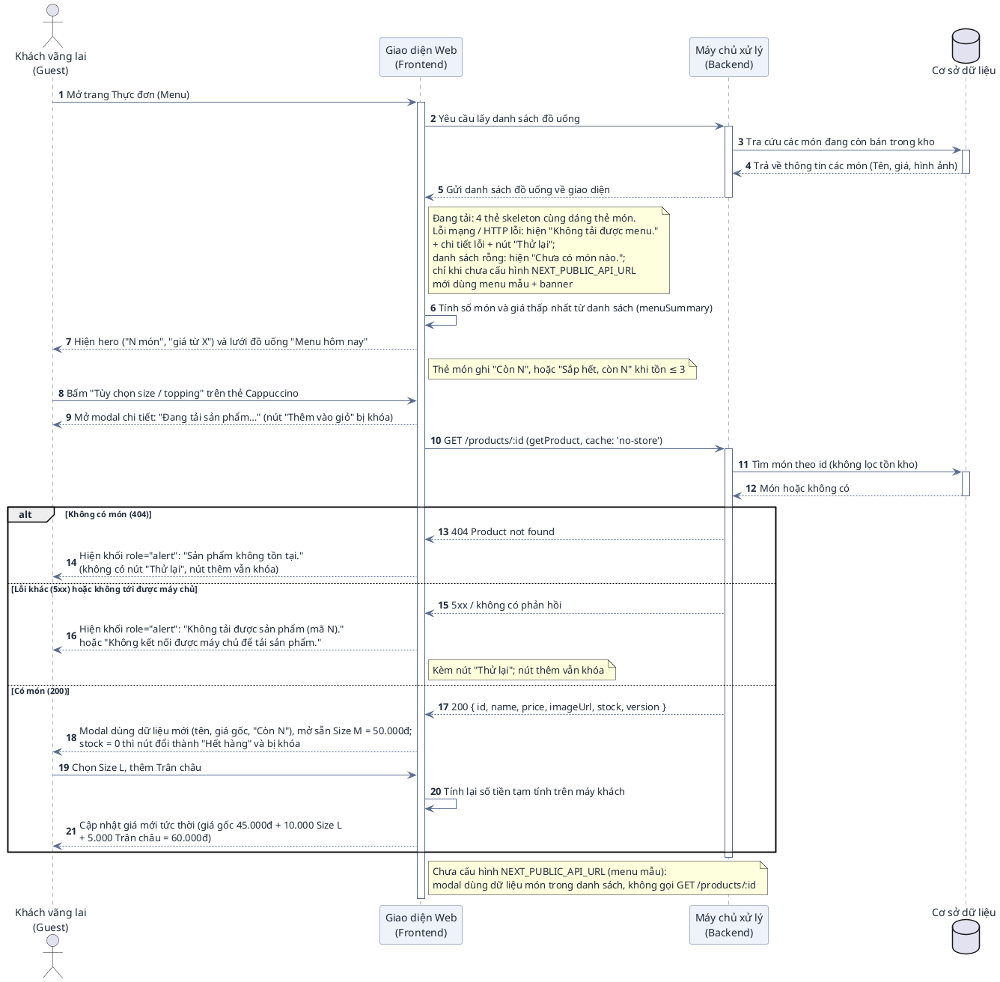
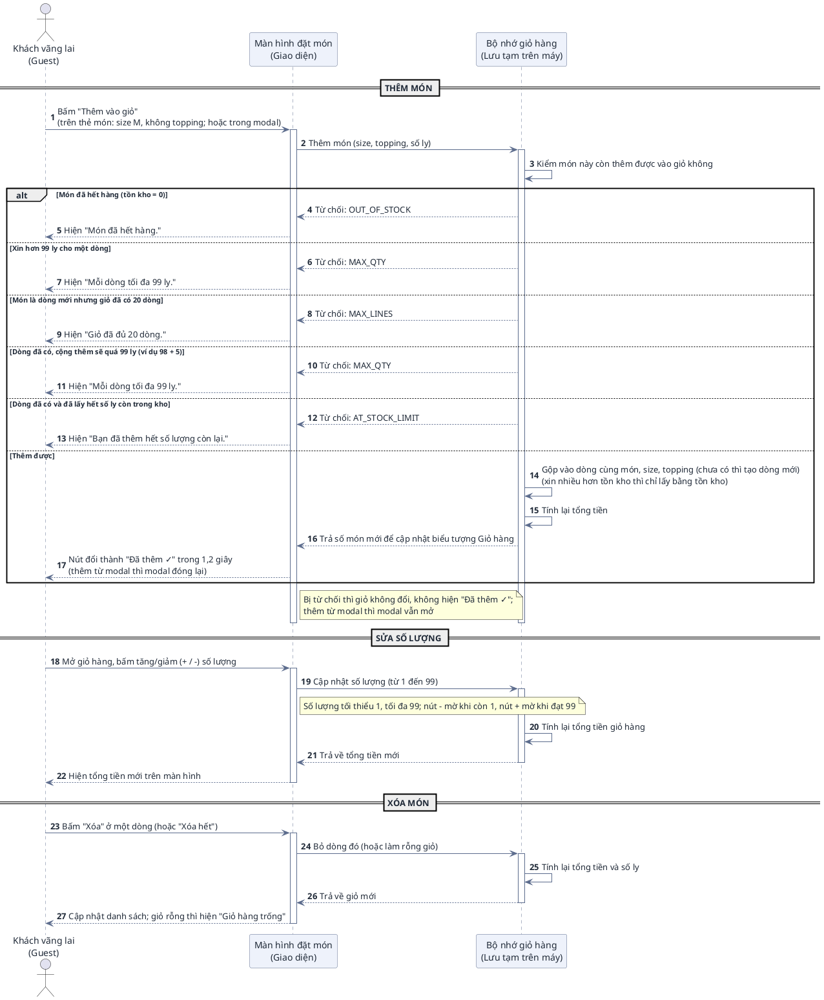
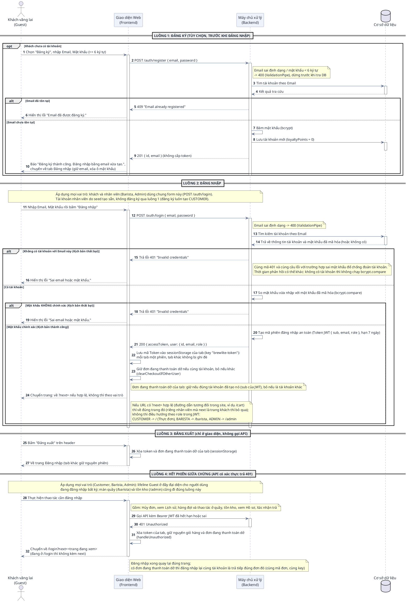
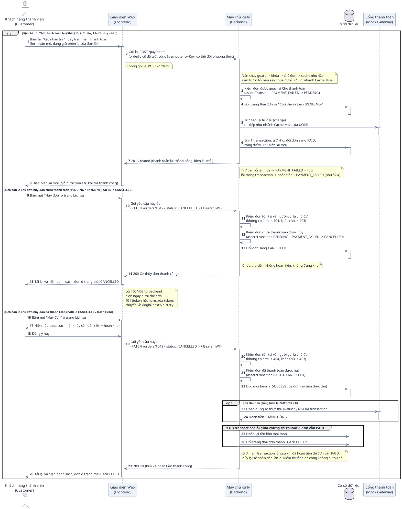
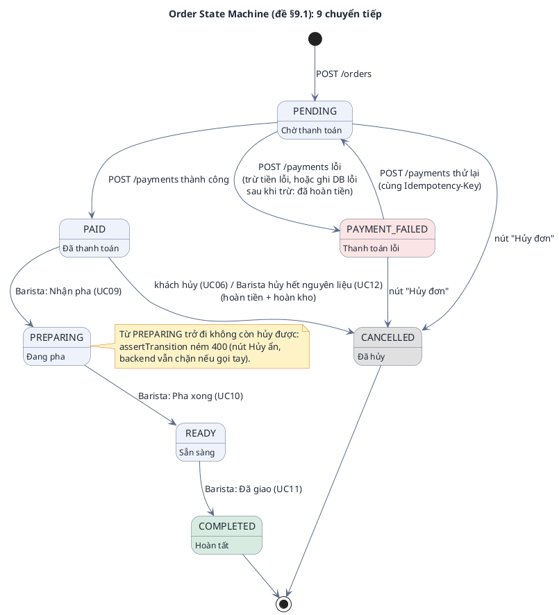
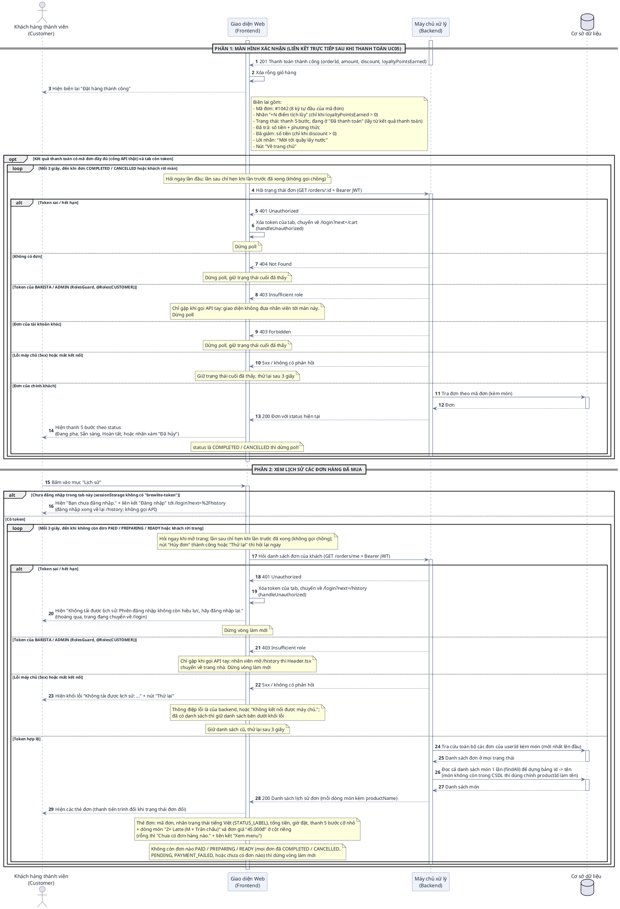
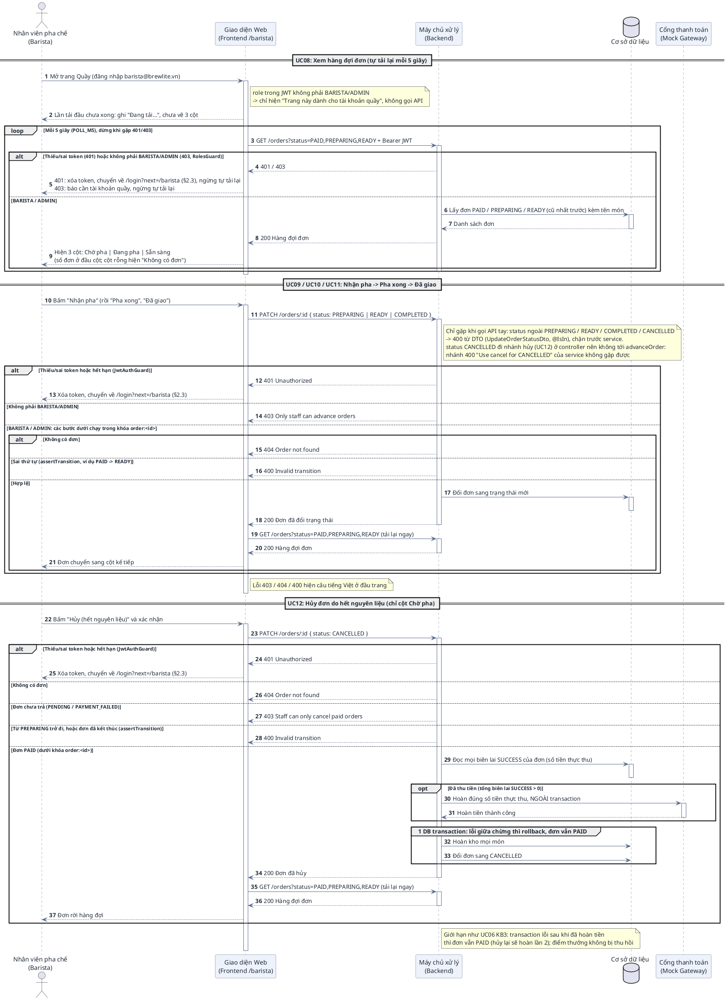
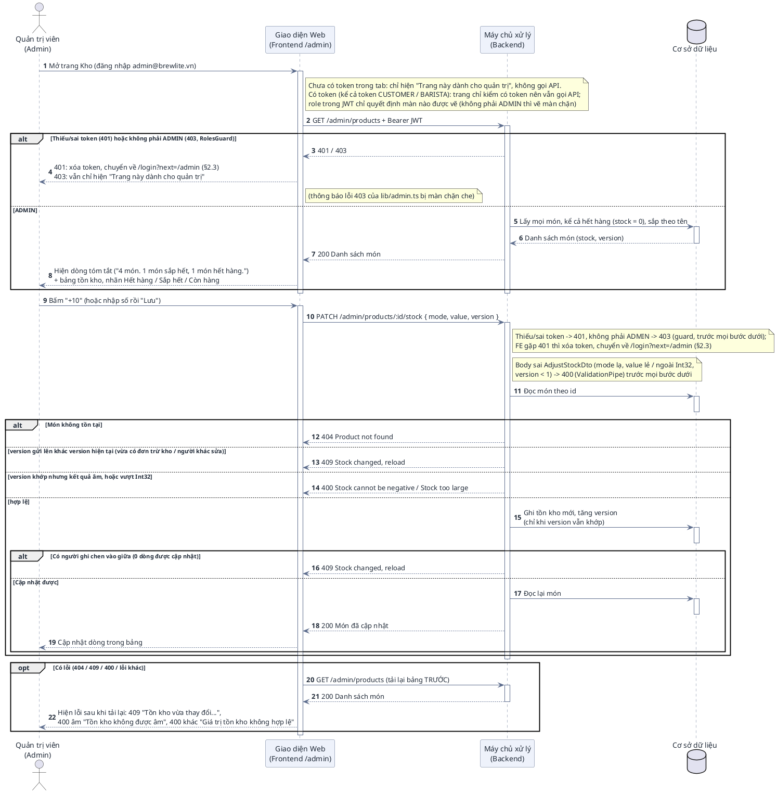
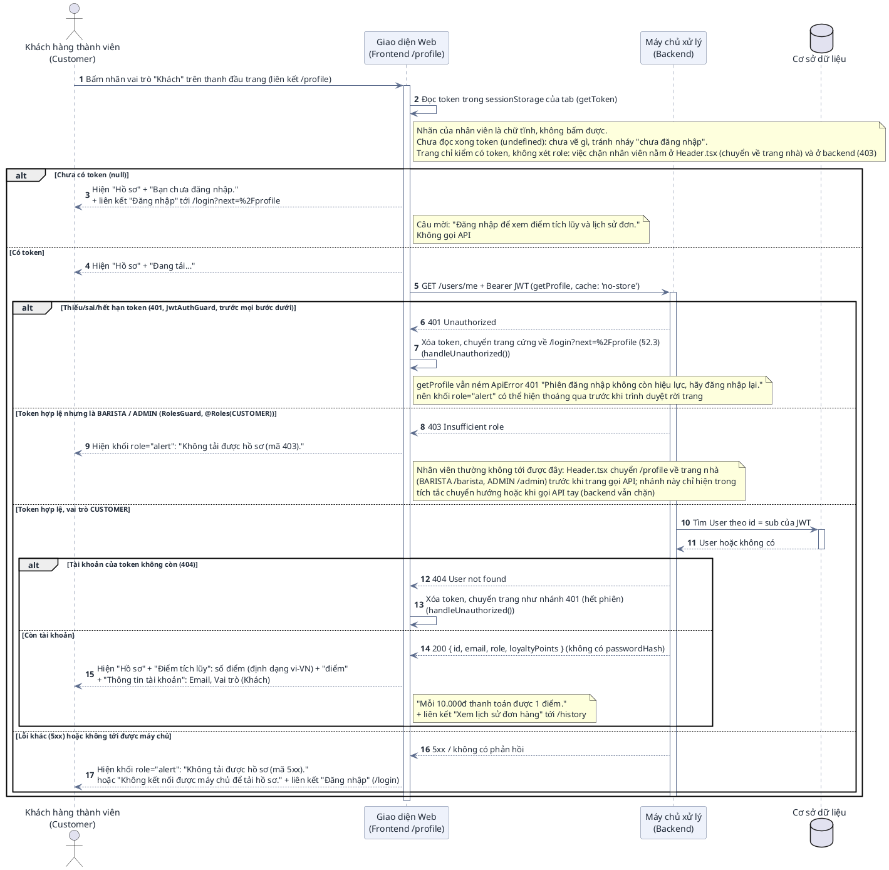

```plantuml
@startuml
skinparam DefaultFontColor #1f2937
skinparam ArrowColor #5b6b8c
skinparam SequenceParticipantBackgroundColor #eef2fb
skinparam SequenceParticipantBorderColor #5b6b8c
skinparam SequenceLifeLineBorderColor #5b6b8c
skinparam NoteBackgroundColor #fef3c7
skinparam NoteBorderColor #d97706
skinparam NoteFontColor #1f2937

autonumber
actor "Khách hàng thành viên\n(Customer)" as User
participant "Giao diện Web\n(Frontend)" as FE
participant "Máy chủ xử lý\n(Backend)" as BE
database "PostgreSQL\n(qua Prisma)" as DB
participant "Cổng thanh toán\n(Mock Gateway)" as Gateway

User -> FE : Bấm "Thanh toán" ở trang Giỏ hàng
activate FE
FE --> User : Hiện màn Thanh toán (chưa tạo đơn)
deactivate FE

== BƯỚC 1: ÁP MÃ GIẢM GIÁ (UC05a - TÙY CHỌN EXTEND) ==
opt Khách hàng có mã khuyến mãi
    User -> FE : Nhập mã "BREWLITE10", bấm "Áp dụng"
    activate FE
    FE -> FE : Kiểm mã và tính lại tiền phải trả (tạm tính)
    FE --> User : Hiện "Đã áp BREWLITE10: −12.300đ", thực trả 110.700đ
    deactivate FE
end

== BƯỚC 2a: TẠO ĐƠN HÀNG (UC04) - CHẠY KHI BẤM "XÁC NHẬN TRẢ" ==
User -> FE : Bấm "Xác nhận trả" (chọn Ví)
activate FE
opt Chưa có đơn (lần bấm đầu; lần thử lại đã giữ orderId thì bỏ qua)
    FE -> BE : POST /orders (giỏ hàng: món, số lượng, size, topping)\nkèm Idempotency-Key của đơn
    note right of FE #fef3c7 : Gửi kèm token đăng nhập.\nKey tạo đơn giữ nguyên tới khi rời màn Thanh toán\n(khác key của POST /payments).\nLỗi ở bước này (thiếu/sai token 401, token BARISTA / ADMIN 403 Insufficient role do RolesGuard chạy sau JwtAuthGuard và trước mọi bước nghiệp vụ, 400, 404, 422) thì dừng:\nkhông gọi POST /payments, lần bấm sau tạo đơn lại.\n401 còn xóa token và chuyển về /login?next=/cart (giỏ và đơn đang trả dở giữ nguyên;\nđăng nhập lại cùng tài khoản thì trả tiếp đúng đơn đó)
    activate BE
    BE -> DB : Tìm đơn đã tạo bằng Idempotency-Key này
    activate DB
    DB --> BE : Đơn đã tạo bằng key này (nếu có)
    deactivate DB
    alt Key đã có, cùng người (bấm lại, hoặc lần trước lỗi mạng)
        BE --> FE : 200 Trả lại đúng đơn cũ #1042, không tạo đơn mới
    else Key của người khác
        BE --> FE : 422 Idempotency-Key đã dùng bởi người khác
    else Key mới (hoặc không gửi key)
        BE -> DB : Tra giá gốc từng món
        activate DB
        DB --> BE : Giá gốc các món
        deactivate DB
        BE -> BE : Tính giá từng dòng: giá gốc + phụ thu size + topping\n(bỏ qua giá client gửi)
        note right of BE #fef3c7 : Thiếu size -> M\nGiỏ rỗng hoặc > 20 dòng, quantity ngoài 1..99,\nsize ngoài S/M/L -> 400 (DTO)\nTopping lạ -> 400, món lạ -> 404\nTổng đơn > 2147483647 -> 400
        BE -> DB : Lưu đơn mới ở trạng thái Chờ thanh toán (PENDING)
        activate DB
        note right of DB #fef3c7 : Cột idempotencyKey là duy nhất:\n2 request song song cùng key -> bên thua\nvi phạm chỉ số, đọc lại đơn bên thắng -> 200
        DB --> BE : Đơn #1042 đã lưu
        deactivate DB
        BE --> FE : 201 Đã tạo đơn #1042 (PENDING)
    end
    deactivate BE
end

== BƯỚC 2b: THANH TOÁN KHÔNG TIỀN MẶT (UC05) - GỌI NGAY SAU 2a ==
FE -> BE : POST /payments (đơn #1042, trả bằng Ví)
note right of FE #fef3c7 : Gửi kèm Idempotency-Key trả tiền (1 key cho cả phiên\nmàn Thanh toán, dùng lại khi thử lại) và mã giảm giá (nếu có)
activate BE

alt Thiếu/sai token (JwtAuthGuard)
    BE --> FE : 401 Chưa đăng nhập / token sai hoặc hết hạn
    note right of BE #fef3c7 : Trả lỗi và DỪNG tại đây,\ngiỏ hàng và đơn #1042 giữ nguyên.\nFE xóa token, chuyển về /login?next=/cart;\nđăng nhập lại cùng tài khoản thì trả tiếp đơn #1042
else Token hợp lệ nhưng là BARISTA / ADMIN (RolesGuard, @Roles(CUSTOMER))
    BE --> FE : 403 Insufficient role
    note right of BE #fef3c7 : Dừng trước mọi bước nghiệp vụ: không khóa, không đọc đơn,\nkhông gọi cổng thanh toán. Giao diện không cho nhân viên tới màn này\n(trang khách bị chuyển về trang nhà), nên chỉ gặp khi gọi API tay
else Token hợp lệ, vai trò CUSTOMER
    note right of BE #fef3c7 : Body sai DTO / thiếu hoặc quá dài (> 255 ký tự)\nheader Idempotency-Key -> 400, dừng trước khi vào khóa
    BE -> BE : Xếp hàng chờ theo khóa trong tiến trình\n(withLock: Idempotency-Key, rồi orderId)
    note right of BE #fef3c7 : Request song song cùng key\nhoặc cùng đơn phải chờ nhau,\nrequest sau đọc lại kết quả mới

    alt Không có đơn hoặc không phải chủ đơn (đọc đơn trước khi xét trùng lặp)
        BE --> FE : 404 Không có đơn / 403 Không phải đơn của bạn
        note right of BE #fef3c7 : Người lạ không thanh toán hộ, cũng không\nđọc được biên lai của người khác bằng key
    else Đúng chủ đơn
        BE -> DB : Tìm biên lai theo Idempotency-Key
        activate DB
        note right of DB #fef3c7 : Tìm đúng 1 biên lai theo mã,\nkhóa này là duy nhất trong bảng
        DB --> BE : Biên lai theo key (nếu có)
        deactivate DB

        alt Key đã có biên lai, nhưng của đơn khác (không phải #1042)
            BE -> DB : Đọc đơn của biên lai đó
            activate DB
            DB --> BE : Đơn kia (hoặc không có)
            deactivate DB
            BE --> FE : 404 Không có đơn kia / 403 Đơn kia không phải của bạn\n/ 422 Key đã dùng cho đơn khác (cùng chủ)
            note right of BE #fef3c7 : Đơn kia cũng phải của người gọi, nếu không -> 403;\nđúng chủ nhưng khác đơn -> 422: không trả biên lai\nđơn cũ như thể đơn này đã trả, không charge
        else Đơn này đã thu tiền rồi (Yêu cầu trùng lặp - Idempotent Cache Hit)
            BE --> FE : 200 Trả lại biên lai cũ, không thu thêm tiền
            note right of BE #fef3c7 : Trả HTTP 200, tuyệt đối\nkhông gọi lại cổng thanh toán.\nBấm lại sau khi mất phản hồi (cùng key)\ncũng vào nhánh này, nhận lại biên lai
            FE --> User : Hiện "Đặt hàng thành công" kèm biên lai đơn #1042
        else Đây là lần thanh toán đầu tiên (Cache Miss)
            note over BE #fef3c7
                Tự kiểm tra mã "BREWLITE10" trong máy:
                đúng mã thì trừ floor(10% x tổng đơn server), sai thì thôi
            end note
            BE -> BE : Kiểm mã giảm giá và tính số tiền phải thu
            BE -> BE : Kiểm đơn đang ở Chờ thanh toán hoặc Thanh toán lỗi\n(PENDING / PAYMENT_FAILED)
            note right of BE #fef3c7 : Đơn đã PAID / PREPARING / ... mà gửi key mới\n-> assertTransition ném 400, không gọi cổng thanh toán
            opt Đơn đang PAYMENT_FAILED (thử lại, UC06 KB1)
                BE -> DB : Đưa đơn về Chờ thanh toán\n(assertTransition PAYMENT_FAILED -> PENDING)
                activate DB
                deactivate DB
            end

            BE -> Gateway : Trừ tiền qua Ví (charge)
            activate Gateway

            alt Trừ tiền thất bại
                Gateway --> BE : Trừ tiền thất bại
                deactivate Gateway
                BE -> BE : Kiểm đơn được chuyển sang Thanh toán lỗi\n(assertTransition PENDING -> PAYMENT_FAILED)
                BE -> DB : Lưu đơn sang Thanh toán lỗi (PAYMENT_FAILED)
                activate DB
                deactivate DB
                BE --> FE : 400 Payment failed: cổng từ chối, giỏ hàng giữ nguyên
                FE -> FE : Ghi thêm mã đơn #1042 vào phiên thanh toán\n(rememberOrder, sessionStorage)
                note right of FE #fef3c7 : Hai key (đơn, trả tiền) đã được ghi khi mở màn Thanh toán (loadCheckout).\n400 "Payment failed" không bị bỏ phiên (dropsCheckout trả false):\nthử lại theo giỏ (orderId #1042), kể cả sau reload,\nchỉ gọi POST /payments (cùng key)
                FE --> User : Hiện "Thanh toán thất bại. Giỏ hàng được giữ nguyên. Bạn có thể thử lại."
            else Trừ tiền thành công
                activate Gateway
                Gateway --> BE : Trừ tiền thành công
                deactivate Gateway
                BE -> BE : Kiểm đơn được chuyển sang Đã thanh toán\n(assertTransition PENDING -> PAID)

                group 1 DB transaction (runInTransaction): thiếu một là rollback hết
                    activate DB
                    BE -> DB : Trừ tồn kho từng món trong đơn
                    note over BE, DB #fef3c7
                        Mỗi món trừ theo kiểu "đúng phiên bản mới trừ":
                        sai phiên bản hoặc hết hàng thì không trừ.
                        Kẹt thì thử lại 3 lần, vẫn kẹt thì ném 409
                        -> cả transaction rollback
                    end note
                    BE -> DB : Chuyển đơn #1042 sang Đã thanh toán (PAID)
                    BE -> DB : Cộng điểm tích lũy cho khách
                    BE -> DB : Lưu biên lai thanh toán kèm Idempotency-Key
                    deactivate DB
                end

                alt Lỗi trong transaction, đã rollback (kẹt kho 409 / món mất 404 / lỗi DB 500)
                    BE -> Gateway : Hoàn lại đúng số vừa trừ (refund, ngoài transaction)
                    activate Gateway
                    deactivate Gateway
                    BE -> DB : Lưu đơn sang Thanh toán lỗi (PAYMENT_FAILED)
                    activate DB
                    deactivate DB
                    BE --> FE : Trả lại lỗi gốc: 409 / 404 / 500
                    note right of BE #fef3c7 : Nếu chính bước hoàn tiền hoặc ghi PAYMENT_FAILED lỗi\nthì bỏ qua (chưa có sổ đối soát)
                    alt 409 hoặc 500: giữ phiên thanh toán
                        FE -> FE : Ghi thêm mã đơn #1042 vào phiên thanh toán\n(rememberOrder, sessionStorage)
                        note right of FE #fef3c7 : Hai key đã ghi từ loadCheckout, lần bấm sau\nchỉ gọi POST /payments với cùng key
                    else 404 (món không còn): bỏ phiên thanh toán
                        FE -> FE : Xóa phiên thanh toán, tạo phiên mới\n(dropsCheckout: clearCheckout, loadCheckout)
                        note right of FE #fef3c7 : Đơn #1042 không trả tiếp được:\nlần bấm sau tạo đơn mới với 2 key mới
                    end
                    FE --> User : Hiện lỗi hết hàng hoặc lỗi thanh toán (giỏ vẫn còn)
                    note right of FE #fef3c7 : Hiện thông báo lỗi theo mã.\n409: "Món đã hết hàng, tiền đã được hoàn lại";\nmã khác: "Thanh toán thất bại (mã ...)"
                else Transaction thành công
                    BE --> FE : 201 Đã trả tiền đơn #1042 (PAID)\n(kèm orderId, amount, discount, loyaltyPointsEarned)
                    note right of BE #fef3c7 : Trả HTTP 201 cho lần thanh toán đầu tiên
                    FE --> User : Hiện "Đặt hàng thành công" kèm biên lai đơn #1042
                end
            end
        end
    end
end
deactivate BE
deactivate FE
@enduml
```

# HƯỚNG DẪN ĐỌC HIỂU & ĐẶC TẢ CHI TIẾT BIỂU ĐỒ TUẦN TỰ (SEQUENCE DIAGRAM)
## PHÂN HỆ KHÁCH HÀNG, PHA CHẾ & QUẢN TRỊ – DỰ ÁN BREWLITE

> **Dự án:** BrewLite – Ứng dụng đặt cà phê không tiền mặt  
> **Môn học:** Công nghệ Phần mềm (Bài tập lớn 10 Task Agile Scrum)  
> **Phạm vi & Định vị tài liệu:**  
> • **Tài liệu này là Phụ lục chi tiết (Architecture Appendix) cho Developers & AI Agents** dùng để hiểu sâu bối cảnh, đối chiếu mã nguồn và viết test case.  
> • **Bản nộp chính cho giảng viên** tập trung vào các biểu đồ cốt lõi tinh gọn (Use Case Bản 1 tổng quan 17 UC & Bản 2 phân hệ Khách hàng 9 UC: UC01–UC07 + UC05a + UC16; Activity luồng nghiệp vụ theo đề §5 và luồng quầy pha chế (`docs/activity-diagrams.md`); State Machine đơn hàng theo đề §9.1, vẽ ở §2.5 mục B2; Class Diagram: domain model đề §12.2 và thiết kế backend (`docs/class-diagrams.md`)).  
> **Đối tượng độc giả:**  
> 1. **Sinh viên & Giảng viên:** Tra cứu chi tiết từng bước, đối chiếu ma trận truy vết (Traceability) với 7 API endpoint tối thiểu (+6 mở rộng) và 10 Task Backlog.  
> 2. **AI Agents / Developers:** Đọc hiểu bối cảnh kiến trúc (Context Navigation), ánh xạ các bước của biểu đồ vào mã nguồn NestJS (Backend) và Next.js (Frontend) để lập trình và viết kiểm thử tự động.

---

# MỤC LỤC

1. [PHẦN I: CẨM NANG ĐỌC HIỂU BIỂU ĐỒ TUẦN TỰ (DÀNH CHO NGƯỜI DÙNG)](#phần-i-cẩm-nang-đọc-hiểu-biểu-đồ-tuần-tự)
   - 1.1 Khái niệm & Mục đích của Sequence Diagram
   - 1.2 Bốn thành phần cốt lõi
   - 1.3 Quy ước các loại đường nối & Mũi tên
   - 1.4 Giải mã các khối điều khiển đặc biệt (`alt`, `opt`, `group`)
2. [PHẦN II: ĐẶC TẢ CHI TIẾT 9 KỊCH BẢN TUẦN TỰ (PLANTUML TỰ NHIÊN)](#phần-ii-đặc-tả-chi-tiết-9-kịch-bản-tuần-tự)
   - 2.1 UC01: Xem menu & Tùy chọn món (Size, Topping)
   - 2.2 UC02: Quản lý giỏ hàng (Thêm/Sửa/Xóa)
   - 2.3 UC03: Đăng ký / Đăng nhập (JWT)
   - 2.4 UC04 + UC05 + UC05a: Tạo đơn hàng (PENDING), Thanh toán không tiền mặt (Ví / Thẻ) & Áp mã giảm giá (Trọng tâm MVP)
   - 2.5 UC06: Hủy đơn / Thử lại thanh toán (Order State Machine)
   - 2.6 UC07: Xem xác nhận & Lịch sử đơn
   - 2.7 UC08–UC12: Quầy pha chế (Barista)
   - 2.8 UC14: Kiểm & điều chỉnh tồn kho món (Admin)
   - 2.9 UC16: Xem hồ sơ & điểm tích lũy
3. [PHẦN III: MA TRẬN NGỮ CẢNH KỸ THUẬT DÀNH CHO AI AGENTS & DEVELOPERS](#phần-iii-ma-trận-ngữ-cảnh-kỹ-thuật-dành-cho-ai-agents--developers)
   - 3.1 Bảng ánh xạ Use Case sang Mã nguồn & CSDL
   - 3.2 Quy tắc điều hướng cho AI Agent khi sinh mã / kiểm thử

---

# PHẦN I: CẨM NANG ĐỌC HIỂU BIỂU ĐỒ TUẦN TỰ

### 1.1 Khái niệm & Mục đích
Biểu đồ Tuần tự (**Sequence Diagram**) là biểu đồ thể hiện **sự tương tác qua lại giữa các đối tượng theo trục thời gian**. Nếu Use Case Diagram trả lời câu hỏi *"Ai làm chức năng gì?"*, thì Sequence Diagram trả lời câu hỏi: *"Để hoàn thành chức năng đó, các bộ phận trong hệ thống phải trao đổi thông điệp với nhau theo thứ tự nào?"*.

### 1.2 Bốn thành phần cốt lõi trên biểu đồ
1. **Tác nhân (Actor):** Con người tương tác trực tiếp với giao diện, **trùng với tác nhân trên biểu đồ Use Case gốc** (`docs/use-case-specifications.md` mục 2): `Khách vãng lai (Guest)` ở UC01–UC03, `Khách hàng thành viên (Customer)` ở UC04–UC07 và UC16 (Customer kế thừa Guest nên cũng làm được UC01–UC03), `Nhân viên pha chế (Barista)` ở UC08–UC12, `Quản trị viên (Admin)` ở UC14. Admin kế thừa Barista (`Admin --|> Barista` trên Bản 1) nên làm được UC08–UC12 trên cùng màn `/barista`; sơ đồ §2.7 vẽ lifeline Barista cho cả hai vai trò. Barista và Admin không kế thừa Customer / Guest nên không làm UC04–UC07, UC16: giao diện của nhân viên chỉ có "Quầy" (Admin thêm "Kho"), trang khách tự chuyển về trang nhà, API của khách trả 403 `Insufficient role`. Cổng thanh toán là tác nhân dịch vụ `Mock Gateway` của UC05 (trừ tiền) và UC06, UC12 (hoàn tiền khi hủy đơn `PAID`).
2. **Đối tượng tham gia (Participants / Lifelines):** Đại diện cho các tầng kiến trúc của BrewLite:
   - `Giao diện Web (Frontend Next.js)`: Nơi người dùng bấm nút, xem dữ liệu.
   - `Máy chủ xử lý (Backend NestJS)`: Nơi tiếp nhận yêu cầu, kiểm tra nghiệp vụ và xử lý logic.
   - `Cơ sở dữ liệu (PostgreSQL qua Prisma)`: Nơi lưu trữ vĩnh viễn đơn hàng, sản phẩm, tài khoản (5 bảng mục 12.2). Task 8-10 cắm qua 4 adapter `PrismaOrder/Product/Payment/UserRepo`; khi chạy backend **bắt buộc có `DATABASE_URL`**: thiếu thì `main.ts` ném lỗi `DATABASE_URL is required` và backend không khởi động (Postgres chạy qua `docker compose up -d db`). Bản In-Memory trên RAM (`backend/src/stubs`) chỉ để jest chạy test độc lập khi không đặt biến này, không dùng để chạy ứng dụng.
   - `Cổng thanh toán (Mock Gateway)`: Đơn vị trung gian xử lý trừ tiền Ví/Thẻ.
3. **Đường gióng thời gian (Lifeline):** Đường thẳng đứng nét đứt chạy dọc từ trên xuống dưới, thể hiện sự tồn tại của đối tượng theo thời gian. **Càng ở phía dưới thì sự kiện diễn ra càng muộn**.
4. **Vạch kích hoạt (Activation Bar):** Hình chữ nhật mỏng nằm đè lên đường nét đứt, thể hiện khoảng thời gian mà đối tượng đó **đang tích cực xử lý công việc** (chưa xong). Mọi mũi tên đều đi ra từ một vạch kích hoạt của bên gửi, kể cả mũi tên tự gọi (Self-Call); bên nhận một yêu cầu (`->`) được bật vạch kích hoạt ngay khi nhận. Kiểm bằng `node scripts/check-sequence-activation.mjs docs/user-sequence-specifications.md`.

### 1.3 Quy ước các loại đường nối & Mũi tên (Cực kỳ quan trọng)

| Loại thông điệp | Hình dáng trên biểu đồ | Cú pháp PlantUML | Ý nghĩa nghiệp vụ |
| :--- | :--- | :--- | :--- |
| **Thông điệp gửi đi (Request / Call)** | **Đường nét liền, mũi tên nhọn (`->`)** | `A -> B : Gửi yêu cầu` | Đối tượng A gửi một yêu cầu sang B và chờ B xử lý. |
| **Thông điệp phản hồi (Response / Return)** | **Đường nét đứt, mũi tên hở (`-->`)** | `B --> A : Trả kết quả` | Đối tượng B đã xử lý xong và gửi kết quả về cho A. |
| **Xử lý nội bộ (Self-Call)** | **Mũi tên uốn vòng lại chính nó** | `A -> A : Tự tính toán` | Đối tượng tự thực hiện một logic của chính mình (ví dụ: tự so sánh mật khẩu, tự cộng tiền). |

### 1.4 Giải mã các khối điều khiển đặc biệt (Combined Fragments)

* **Khối `alt` (Alternatives – Tương đương `IF - ELSE`):**
  - **Ý nghĩa:** Dùng khi gặp một ngã rẽ có **hai kịch bản loại trừ lẫn nhau (chỉ xảy ra 1 trong 2)**.
  - **Cách đọc:** Nửa trên là trường hợp xảy ra khi điều kiện đúng (ví dụ: Mật khẩu đúng), nửa dưới sau vạch chia `else` là trường hợp xảy ra khi điều kiện sai (ví dụ: Mật khẩu sai).
* **Khối `opt` (Option – Tương đương `IF` đơn lẻ, không có `ELSE`):**
  - **Ý nghĩa:** Dùng cho hành động **tùy chọn (làm cũng được, không làm cũng không sao)**.
  - **Cách đọc:** Nếu người dùng thỏa mãn điều kiện thì thực hiện các bước trong hộp `opt`, nếu không có thì hệ thống bỏ qua và chạy thẳng xuống dưới (ví dụ: Áp mã giảm giá).
* **Khối `group` (Giao dịch an toàn / Transaction):**
  - **Ý nghĩa:** Đánh dấu một chuỗi nhiều thao tác ghi vào CSDL bắt buộc phải **cùng thành công 100% hoặc cùng hủy bỏ (All or Nothing)** để tránh lỗi hệ thống (ví dụ: Đổi trạng thái đơn VÀ trừ kho VÀ cộng điểm).

---

# PHẦN II: ĐẶC TẢ CHI TIẾT 9 KỊCH BẢN TUẦN TỰ

**Đồng bộ với biểu đồ Use Case gốc** (`docs/use-case-specifications.md` mục 2, Bản 1): mỗi UC thuộc đúng một sơ đồ dưới đây, cùng mã, cùng tên, cùng tác nhân. UC04, UC05, UC05a chạy trong cùng một lần bấm "Xác nhận trả" nên chung sơ đồ §2.4; UC08–UC12 chung sơ đồ §2.7 (9 sơ đồ cho 15 UC đã hiện thực; UC13, UC15 chưa hiện thực nên chưa có sơ đồ).

| UC (biểu đồ gốc) | Tác nhân | Quan hệ trên biểu đồ gốc | Sơ đồ tuần tự |
| :--- | :--- | :--- | :--- |
| UC01: Xem menu & Tùy chọn món (Size, Topping) | Guest *(và Customer)* | `Guest --- UC01` | §2.1 |
| UC02: Quản lý giỏ hàng (Thêm/Sửa/Xóa) | Guest *(và Customer)* | `Guest --- UC02` | §2.2 |
| UC03: Đăng ký / Đăng nhập (JWT) | Guest *(Customer dùng lại)* | `Guest --- UC03` | §2.3 |
| UC04: Tạo đơn hàng (PENDING) | Customer | `Customer --- UC04` (độc lập, không `<<include>>`) | §2.4 bước 2a |
| UC05: Thanh toán không tiền mặt (Ví / Thẻ) | Customer, Mock Gateway | `Customer --- UC05`, `UC05 --- Gateway` | §2.4 bước 2b |
| UC05a: Áp mã giảm giá | Customer | `UC05a ..> UC05 : <<extend>>` | §2.4 bước 1 (khối `opt`) |
| UC06: Hủy đơn / Thử lại thanh toán | Customer, Mock Gateway | `Customer --- UC06`, `UC06 --- Gateway` (hoàn tiền) | §2.5 |
| UC07: Xem xác nhận & Lịch sử đơn | Customer | `Customer --- UC07` | §2.6 |
| UC08: Xem hàng đợi đơn (PAID / PREPARING / READY) | Barista *(Admin kế thừa)* | `Barista --- UC08`, `Admin --\|> Barista` | §2.7 |
| UC09: Tiếp nhận pha chế (PAID -> PREPARING) | Barista *(Admin kế thừa)* | `Barista --- UC09`, `Admin --\|> Barista` | §2.7 |
| UC10: Báo xong pha chế (PREPARING -> READY) | Barista *(Admin kế thừa)* | `Barista --- UC10`, `Admin --\|> Barista` | §2.7 |
| UC11: Xác nhận giao nước (READY -> COMPLETED) | Barista *(Admin kế thừa)* | `Barista --- UC11`, `Admin --\|> Barista` | §2.7 |
| UC12: Hủy đơn do hết nguyên liệu (PAID -> CANCELLED) | Barista *(Admin kế thừa)*, Mock Gateway | `Barista --- UC12`, `UC12 --- Gateway` (hoàn tiền), `Admin --\|> Barista` | §2.7 |
| UC14: Kiểm & điều chỉnh tồn kho món | Admin | `Admin --- UC14` | §2.8 |
| UC16: Xem hồ sơ & điểm tích lũy | Customer | `Customer --- UC16` | §2.9 |

---

### 2.1 UC01: Xem menu & Tùy chọn món (Size, Topping)

#### A. Bối cảnh nghiệp vụ
Khách hàng truy cập trang chủ của ứng dụng BrewLite. Hệ thống cần lấy danh mục các món đồ uống đang có sẵn để hiển thị kèm giá và hình ảnh. Khi khách mở chi tiết một món, giao diện tải lại món đó từ máy chủ (`GET /products/:id`) để có giá và tồn kho mới nhất, rồi mới cho chọn. Sau đó khách chọn kích cỡ (S/M/L) hoặc Topping; giao diện tự tính lại tổng tiền tạm tính mà không gọi lại máy chủ.

#### B. Sơ đồ tuần tự (PlantUML)

#### C. Bảng đối chiếu kỹ thuật cho AI Agent
* **Backend Endpoint:** `GET /products` (danh sách) và `GET /products/:id` (chi tiết, 404 `Product not found` khi không có). Modal chi tiết gọi `GET /products/:id` mỗi lần mở để lấy giá và tồn kho mới nhất (Task 4). Đã chốt (2026-10-09): `ProductDetailModal` là "màn hình chi tiết" của Task 4; wireframe đề §7 chỉ để tham khảo nên không cần trang riêng.
* **Ảnh món (đề §8 Task 2: JSON gồm id, tên, giá, ảnh):** `Product.imageUrl` là đường dẫn tương đối tới SVG tĩnh trong `frontend/public/images/` (`latte.svg`, `americano.svg`, `cappuccino.svg`, `tra-dao.svg`), trình duyệt tải từ chính frontend (`:3001`). `backend/prisma/seed.ts` đặt `imageUrl` cho p1–p4 ở cả `create` lẫn `update` nên DB cũ có ảnh sau khi backend khởi động lại. `ProductCard` hiện ảnh trong ô tỉ lệ 4:3 khi `imageUrl` khác rỗng (4 ảnh là SVG nét mực 240×180 đã có nền màu theo món, Task 7a), ngược lại để ô trống nền xám nhạt (không còn biểu tượng ☕). Menu mẫu (`frontend/src/lib/mock-products.ts`) dùng cùng bộ ảnh. Test: `backend/test/seed-images.spec.ts`, `frontend/src/lib/mock-products.test.ts`, `frontend/src/lib/doodles.test.ts`, `frontend/src/components/ProductCard.test.ts`.
* **Controller / Service:** `ProductController.list()` / `detail()` $\rightarrow$ `ProductService.listAvailable()` / `getById()`
* **Thực thể CSDL:** Bảng `Product`. Danh sách lọc điều kiện `stock > 0`; chi tiết (`findById`) không lọc, nên món vừa hết hàng vẫn trả 200 với `stock = 0`.
* **Xử lý Frontend:** `MenuPage` (`frontend/src/app/page.tsx`) gọi `getProducts()` qua hook `useAsync` (`frontend/src/lib/use-async.ts`, trả `{ data, error, loading, retry }`; phần lõi `createAsyncRunner` không phụ thuộc React và bỏ kết quả của lần gọi cũ về muộn), không dùng React Query. `ProductGrid` vẽ 3 trạng thái bằng `Skeleton` / `ErrorState` / `EmptyState` (`frontend/src/components/ui/`): đang tải = 4 thẻ skeleton (ô ảnh 4:3, 2 dòng chữ, nút) trong vùng `aria-busy`; lỗi = hình cốc nghiêng + "Không tải được menu." + chi tiết lỗi (prop `detail` của `ErrorState`, nằm trong cùng khối `role="alert"`, dưới câu tiêu đề) + nút "Thử lại" (gọi lại `retry`); rỗng = hình túi hạt + "Chưa có món nào." + "Menu đang trống. Quay lại sau nhé!". Test: `frontend/src/lib/use-async.test.ts`, `frontend/src/components/ProductGrid.test.ts`.
* **Nhãn tồn kho trên thẻ món:** `ProductCard` dùng cùng ngưỡng với màn Kho (`stockBadge`, `LOW_STOCK` = 3, định nghĩa ở `frontend/src/lib/stock.ts`, không kéo theo client API admin): "Còn N"; "Sắp hết, còn N" khi `stock` ≤ 3; nhãn "Hết hàng" khi `stock` ≤ 0, lúc đó ảnh mờ và xám, cả "Thêm vào giỏ" (đổi chữ thành "Hết hàng") lẫn "Tùy chọn size / topping" đều vô hiệu. `GET /products` đã lọc `stock > 0` nên thẻ "Hết hàng" chỉ là phòng hờ khi danh sách có món tồn 0. Test: `frontend/src/components/ProductCard.test.ts`.
* **Hero và đầu lưới:** trên lưới là `MenuHero` (`frontend/src/components/menu/MenuHero.tsx`), tiêu đề "Cà phê mỗi ngày / pha đúng vị". Hai số ở cột trái chỉ lấy từ `frontend/src/lib/promo.ts`: "10%" là `VOUCHER_PERCENT` (= `VOUCHER_RATE` × 100) kèm "giảm với mã BREWLITE10", "+1" kèm "điểm cho mỗi 10.000đ" (`VND_FOR_ONE_POINT`, định dạng `formatVND`). Dòng "N món / giá từ X" ở cột phải tính bằng `menuSummary` (`frontend/src/lib/menu-summary.ts`: số món và giá gốc thấp nhất của danh sách vừa tải), ẩn khi đang tải, khi lỗi và khi menu rỗng. Nút "Đặt cà phê ↗" là liên kết neo `#menu` tới khối `MenuSection` ("Menu hôm nay" + dòng "Nhập mã BREWLITE10 khi thanh toán để giảm 10%." dựng từ `VOUCHER_CODE` và `VOUCHER_PERCENT`), không gọi API. Test: `frontend/src/lib/menu-summary.test.ts`, `frontend/src/components/menu/MenuHero.test.ts`, `frontend/src/components/menu/MenuPage.test.ts`.
* **Lỗi / rỗng / menu mẫu:** `getProducts()` (`frontend/src/lib/api.ts`) đọc `NEXT_PUBLIC_API_URL` lúc gọi. **Chưa cấu hình** → trả `MOCK_PRODUCTS` kèm `fromMock: true` (không gọi mạng, `ProductGrid` hiện banner "menu mẫu"; dùng để demo UI không cần backend). **Đã cấu hình** (compose luôn set) → lỗi mạng / HTTP lỗi **ném `ApiError`** (`Error` có thêm `status`: mã HTTP, 0 khi không tới được máy chủ; câu `message` giữ như cũ; `useAsync` bắt, `ProductGrid` hiện "Không tải được menu." + chi tiết lỗi + nút "Thử lại"), danh sách rỗng trả `[]` (hiện "Chưa có món nào."); không còn rơi về menu mẫu vì khách sẽ thêm được món có id không có trong DB. Test: `frontend/src/lib/api.test.ts`.
* **Size / Topping:** `ProductDto` (`id, name, price, imageUrl, stock, version`) **không** chứa size/topping. Bảng giá cố định nằm ở `frontend/src/lib/pricing.ts` (tính tạm trên máy khách) và bản sao `backend/src/order/pricing.ts` (server tính lại khi `POST /orders`): S +0, M +5.000 (mặc định), L +10.000; Trân châu 5.000, Kem cheese 8.000, Thạch cà phê 6.000. Sửa bảng giá phải sửa cả 2 file.
* **Tải chi tiết món:** `ProductCard` truyền `loadFromApi` = có `NEXT_PUBLIC_API_URL`. Khi bật, `ProductDetailModal` gọi `getProduct(id)` (`frontend/src/lib/api.ts`: `fetch` `GET /products/<id đã encodeURIComponent>` kèm `cache: 'no-store'`) qua `useAsync`. Trong lúc tải, modal chỉ hiện tiêu đề "Chi tiết sản phẩm" và "Đang tải sản phẩm…" (`role="status"`, `aria-busy`), ẩn size / topping / giá cũ, nút "Thêm vào giỏ" bị khóa. Lỗi: 404 → `ApiError` "Sản phẩm không tồn tại." (không có nút "Thử lại"); mã khác → "Không tải được sản phẩm (mã N)."; không tới được máy chủ → "Không kết nối được máy chủ để tải sản phẩm." (status 0). Hai lỗi sau có nút "Thử lại" (`retry` của `useAsync`). Lỗi không bao giờ rơi về menu mẫu. Tải xong thì modal dùng dữ liệu mới thay cho dữ liệu trong danh sách; `stock = 0` thì nút đổi thành "Hết hàng" và bị khóa, `handleAdd()` cũng không thêm. Không có `NEXT_PUBLIC_API_URL` (menu mẫu) thì modal dùng dữ liệu món sẵn có, không gọi API. Test: `frontend/src/lib/product-detail.test.ts`, `frontend/src/components/ProductDetailLoading.test.ts`.
* **Modal chi tiết (`ProductDetailModal`):** mở từ nút "Tùy chọn size / topping" của thẻ món. Size và topping là các chip có `aria-pressed`, ghi phụ phí lấy từ `pricing.ts` (mở sẵn size M, chưa topping); số lượng chỉnh bằng nút −/+; dòng "Giá gốc: … • Còn N", "Tạm tính" và nút "Thêm vào giỏ • …" tính lại ngay trên máy khách. Khung là `role="dialog"` có `aria-modal="true"` và `aria-labelledby` trỏ tới tên món. Đóng bằng nút "Đóng", bấm ra nền tối, hoặc phím Esc. Lúc mở, focus vào khung; Tab / Shift+Tab chỉ quay vòng trong modal; đóng thì focus trở về nút đã mở. Phần quyết định là các hàm thuần `nextFocusIndex()`, `isTrapTab()` (Tab trần hoặc Shift+Tab mới bị bẫy) và `isCloseEscape()` (Esc, trừ khi đang soạn bằng IME hoặc widget lồng đã dùng phím; dùng `isEscapeKey()` bên trong) trong `frontend/src/lib/focus-trap.ts`. Test: `frontend/src/lib/focus-trap.test.ts`, `frontend/src/components/ProductDetailModal.test.ts`.

---

### 2.2 UC02: Quản lý giỏ hàng (Thêm/Sửa/Xóa)

#### A. Bối cảnh nghiệp vụ
Theo yêu cầu Task 5 trong tài liệu đồ án, giỏ hàng được quản lý hoàn toàn ở phía máy khách (Client-side State) để mang lại trải nghiệm mượt mà tức thì cho khách hàng. Các thao tác thêm món, tăng/giảm số lượng hoặc xóa món được tính toán tự động và lưu tạm vào bộ nhớ trình duyệt (LocalStorage).

#### B. Sơ đồ tuần tự (PlantUML)

#### C. Bảng đối chiếu kỹ thuật cho AI Agent
* **Công nghệ Frontend:** Zustand store `useCart` (`frontend/src/store/cart.ts`), bảng giá ở `frontend/src/lib/pricing.ts`. Test: `frontend/src/store/cart.test.ts`.
* **Cơ chế lưu trữ:** middleware `persist` ghi vào `window.localStorage` key `brewlite-cart` để F5 không bị mất giỏ hàng.
* **Cấu trúc dữ liệu:** `CartItem { key, productId, name, imageUrl?, size, toppings: [], quantity, unitPrice, lineTotal }`, với `key = productId|size|topping (đã sắp xếp)`: cùng key thì gộp số lượng, khác size/topping thì tách dòng.
* **Tồn kho:** `addItem` cắt số lượng xuống `product.stock` khi xin nhiều hơn tồn kho (vẫn tính là thêm được); món hết hàng (`stock <= 0`) bị từ chối với lý do `OUT_OF_STOCK`; còn hàng nhưng dòng đã giữ hết số còn lại nên không thêm được gì thì bị từ chối với lý do `AT_STOCK_LIMIT` (thẻ vẫn ghi "Còn N" hoặc "Sắp hết, còn N", nên câu báo không nói "hết hàng"). Tăng số lượng trong giỏ (`updateQty`) chỉ giữ trong khoảng 1 đến 99, không chặn theo tồn kho, nên vượt kho thì đến lúc thanh toán backend trả 409 (§2.4).
* **Giới hạn 20 dòng và 99 ly:** `MAX_LINES = 20` và `MAX_QTY = 99` (định nghĩa ở `lib/cart-limits.ts`, `store/cart.ts` re-export) khớp `@ArrayMaxSize(20)` và `@Max(99)` của `CreateOrderDto` ở `POST /orders`, để giỏ không gửi được đơn bị backend từ chối 400. `addItem` trả `{ ok: true }` hoặc `{ ok: false, reason }`, tính ngoài callback `set` của zustand và không đổi giỏ khi từ chối: dòng mới khi giỏ đã đủ 20 dòng là `MAX_LINES`; số lượng xin lớn hơn 99, hoặc dòng cũ cộng thêm quá 99 (ví dụ 98 + 5), là `MAX_QTY` (từ chối hẳn, không cắt về 99). Khác size hoặc topping của cùng món là dòng mới. Câu hiển thị ở `lib/cart-limits.ts` (`addItemMessage`): "Giỏ đã đủ 20 dòng.", "Mỗi dòng tối đa 99 ly.", "Món đã hết hàng.", "Bạn đã thêm hết số lượng còn lại." (dựng từ hai hằng trên, không viết cứng số); `ProductCard` và `ProductDetailModal` hiện câu này trong phần tử `role="status"` thay cho "Đã thêm ✓". Phần tử đó là `LiveNotice` (`frontend/src/components/ui/LiveNotice.tsx`) và luôn có mặt trong DOM: rỗng và `visually-hidden` (không chiếm chỗ) khi không có thông báo, chỉ đổi nội dung bên trong khi có, vì trình đọc màn hình hay bỏ qua vùng live vừa được chèn kèm chữ (`ProductCard` còn một vùng live riêng, cũng luôn có mặt, cho "Đã thêm ✓"). bộ chọn số lượng trong `ProductDetailModal` dừng ở `maxModalQty(stock)` = min(tồn kho, 99) (nút + mờ kèm title) và thông báo trong modal tự xóa khi đổi số lượng, size hoặc topping; `updateQty` vẫn kẹp 1 đến 99; `QtyStepper` làm mờ nút + ở 99 (title "Tối đa 99 ly mỗi dòng"); trang giỏ hiện "Giỏ đã đủ 20 dòng." khi giỏ có 20 dòng (cũng qua `LiveNotice`, vùng luôn có mặt).
* **Trang giỏ (`/cart`):** `frontend/src/app/cart/page.tsx` giữ 3 bước `cart` → `payment` → `success` trên cùng route; bước `cart` vẽ bằng `CartView` (`frontend/src/components/cart/CartView.tsx`). Tiêu đề "Giỏ hàng (n món)" với n là tổng số ly (`count`). Mỗi dòng có ô ảnh, tên món, "Size M • Kem cheese" (không topping thì "Size M • Không topping"), "… / ly", `QtyStepper` (nút "Giảm số lượng", "Tăng số lượng", "Xóa món") và thành tiền. Khối tổng bên phải ghi "Tổng", câu "Mã giảm giá nhập ở bước thanh toán.", nút "Thanh toán • <tổng>" (chuyển sang bước `payment`, không gọi API) và "Xóa hết" (`clear()`). Giỏ rỗng hiện "Giỏ hàng trống", "Hãy chọn vài món ngon từ menu nhé!" và liên kết "Về Menu" tới `/`. Test: `frontend/src/components/cart/CartView.test.ts`, `frontend/src/components/QtyStepper.test.ts`.

---

### 2.3 UC03: Đăng ký / Đăng nhập (JWT)

#### A. Bối cảnh nghiệp vụ
UC03 gồm 2 luồng tách biệt trên cùng trang `/login` (nút chuyển chế độ Đăng nhập / Đăng ký):
1. **Luồng Đăng ký (tùy chọn, chạy trước Đăng nhập):** `POST /auth/register`. Máy chủ tra email; **trùng email → 409** "Email already registered". Chưa có thì băm mật khẩu bằng bcrypt, lưu tài khoản mới (`loyaltyPoints = 0`) và trả `{ id, email }` — **không** cấp token. Giao diện báo "Đăng ký thành công. Đăng nhập bằng email vừa tạo." và chuyển về tab Đăng nhập (giữ email vừa nhập, xóa ô mật khẩu) để khách tự đăng nhập; trùng email thì báo "Email đã được đăng ký.".
2. **Luồng Đăng nhập:** máy chủ tra cứu tài khoản trong cơ sở dữ liệu và kiểm tra mật khẩu đã được mã hóa an toàn (bằng bcrypt).
* **Khối `alt` của luồng Đăng nhập:**
  - **Nhánh 1 (Thất bại):** Nếu mật khẩu sai $\rightarrow$ Báo lỗi "Sai email hoặc mật khẩu." và dừng lại.
  - **Nhánh 2 (Thành công):** Nếu mật khẩu đúng $\rightarrow$ Máy chủ phát một mã khóa phiên làm việc dạng Token (JWT) để trình duyệt lưu lại. Khách hàng chính thức trở thành Thành viên. Giao diện đọc `role` trong token để điều hướng: khách về `/`, tài khoản quầy về `/barista`, quản trị về `/admin`.
* **Nhân viên đăng nhập (Barista, Admin):** dùng chung luồng 2 trên cùng form `/login` (`POST /auth/login`); JWT mang claim `role`, nên sau đăng nhập giao diện về `/barista` hoặc `/admin`. `?next=` trỏ tới trang khách (`/`, `/cart`, `/history`, `/profile`) bị bỏ qua khi là nhân viên (không nháy qua trang khách); `?next=` khác vẫn được giữ, ví dụ `?next=/admin` (trang `/admin` tự kiểm quyền). Nhân viên không đi luồng 1: `POST /auth/register` luôn tạo `CUSTOMER`, tài khoản nhân viên do `backend/prisma/seed.ts` tạo sẵn. Luồng 3 (đăng xuất) và luồng 4 (hết phiên) cũng áp dụng mọi vai trò. Vì vậy trên biểu đồ Use Case, Barista và Admin không nối với UC03 (`docs/use-case-specifications.md` §5.2 Câu 6); lifeline của sơ đồ dưới ghi Guest nhưng đại diện cho bất kỳ ai đang ở trang `/login`.

#### B. Sơ đồ tuần tự (PlantUML)

#### C. Bảng đối chiếu kỹ thuật cho AI Agent
* **Backend Endpoint:** `POST /auth/register` (luồng 1, trả 201 `{ id, email }`, trùng email 409) và `POST /auth/login` (luồng 2, trả 200 `{ accessToken, user }`)
* **Controller / Service:** `AuthController.register()` / `login()` $\rightarrow$ `AuthService.register()` / `login()`
* **Validate đầu vào:** `RegisterDto` (`@IsEmail`, mật khẩu `@MinLength(6)`), `LoginDto` (`@IsEmail`).
* **Chuẩn hóa email:** `normalizeEmail()` (`backend/src/auth/dto.ts`: `trim()` + `toLowerCase()`) chạy trong `@Transform` của cả hai DTO và lại trong `AuthService.register()` / `login()`; `findByEmail` tra không phân biệt hoa thường (Prisma `mode: 'insensitive'`). Vì vậy `" A@B.vn "` và `a@b.vn` là cùng một tài khoản. Hai lần đăng ký cùng email chạy song song: lần sau vướng ràng buộc unique của DB (Prisma `P2002` trên cột `email`) và cũng trả 409 "Email already registered". Test: `backend/test/task47-auth.spec.ts`.
* **Bảo mật:** đăng ký `bcrypt.hash(password, 10)`; đăng nhập `bcrypt.compare(plainPassword, user.passwordHash)`
* **Mã phiên JWT:** Cấp chuỗi Bearer Token chứa `{ sub: user.id, email: user.email, role }` có thời hạn hết hạn (`expiresIn: '7d'`); đăng nhập trả `{ accessToken, user: { id, email, role } }`. Khóa ký lấy từ biến môi trường `JWT_SECRET` và là bắt buộc: thiếu hoặc rỗng thì backend dừng ngay khi khởi động với lỗi `JWT_SECRET is required` (`backend/src/auth/auth.module.ts`, `JwtModule.registerAsync`); compose đặt sẵn `JWT_SECRET: ${JWT_SECRET:-dev-secret}`. `JwtAuthGuard` trả 401 khi token sai chữ ký, hết hạn, hoặc thiếu `sub` / `email` dạng chuỗi khác rỗng.
* **Vai trò (`User.role`):** `CUSTOMER` (mặc định) / `BARISTA` / `ADMIN`. Đăng ký công khai luôn tạo `CUSTOMER`; tài khoản quầy và quản trị chỉ có từ seed (`barista@brewlite.vn`, `admin@brewlite.vn`). `JwtAuthGuard` đưa `role` vào `req.user` (token cũ thiếu `role` coi là `CUSTOMER`), `RolesGuard` + `@Roles(...)` chặn theo vai trò (403). Giao diện chỉ đọc `role` từ JWT để điều hướng (`/` khách, `/barista`, `/admin`) và ẩn/hiện mục header; nhân viên mở trang khách thì `Header.tsx` gọi `staffRedirect()` (`frontend/src/lib/nav.ts`) rồi `router.replace()` về trang nhà (chuyển phía client nên trang khách có thể hiện trong tích tắc), quyền thật do backend chặn (API khách trả 403).
* **Phiên đăng nhập theo tab:** token lưu ở `sessionStorage` (`saveToken()` / `getToken()` / `clearToken()` trong `frontend/src/lib/auth.ts`): đăng nhập barista ở tab này không đổi phiên khách ở tab khác, reload vẫn giữ, tab mở mới bằng URL phải đăng nhập lại. Test: `frontend/src/lib/auth.test.ts`.
* **Hết phiên giữa chừng (401) và `?next=`:** `handleUnauthorized()` (`frontend/src/lib/session.ts`) xóa token của tab (`clearToken()`) rồi chuyển hẳn (`window.location.replace`) về `/login?next=<đường dẫn + query đang xem, đã mã hóa>`; đang ở `/login` thì về `/login` không kèm `next`; giỏ hàng và phiên thanh toán của tab không bị xóa. Gọi từ `cancelOrder()`, `advanceOrder()` (chung `patchOrderStatus`), `getProfile()` (cả khi 404: tài khoản của token không còn) và `getMyOrders()` (lịch sử, UC07) trong `frontend/src/lib/api.ts`, từ `fetchQueue()` (`frontend/src/lib/barista.ts`, màn quầy) và `call()` (`frontend/src/lib/admin.ts`, màn tồn kho) khi nhận 401, luôn trước khi ném lỗi với câu tiếng Việt như cũ (`ApiError` 401, `QueueAuthError`, `Error`), và từ `PaymentForm` khi `isUnauthorizedPayment(e)` (`PaymentError.status === 401`: lỗi 401 của `POST /orders` hoặc `POST /payments`; hàm nằm ở `frontend/src/lib/payment/checkout-session.ts`). Hàm chuyển trang đổi được bằng `setRedirect()` để test. Sau đăng nhập, trang `/login` gọi `postLoginTarget(window.location.search, role)` (cùng file `session.ts`), đọc `next` qua `safeNext()`: chỉ nhận đường dẫn tương đối bắt đầu bằng đúng một `/`; `//host`, `/\host`, URL tuyệt đối (`://`), `javascript:`, ký tự điều khiển bị bỏ (chống open redirect) và khi đó về trang theo role. Phiên thanh toán dở của tab gắn với tài khoản: `loadCheckout()` ghi `userId` (claim `sub` của JWT, đọc bằng `userIdFromToken()` trong `auth.ts`) vào `CheckoutState`; sau đăng nhập `/login` gọi `clearCheckoutIfOtherUser(userId)`: đăng nhập lại **cùng tài khoản** (hết phiên giữa lúc trả tiền) thì giữ phiên, lần trả sau dùng lại đúng mã đơn và 2 key (không tạo đơn thứ hai), còn **tài khoản khác**, phiên lưu trước khi có `userId` hoặc dữ liệu hỏng thì bỏ phiên (giỏ còn). Đăng xuất vẫn `clearCheckout()` (luồng 3). Test: `frontend/src/lib/session.test.ts` (kể cả `postLoginTarget`), `frontend/src/lib/api.test.ts` (nhóm "401 ở hàm có xác thực"), `frontend/src/lib/barista.test.ts`, `frontend/src/lib/admin.test.ts`, `frontend/src/lib/auth.test.ts` (`userIdFromToken`), `frontend/src/lib/payment/checkout-session.test.ts` (`clearCheckoutIfOtherUser`, `isUnauthorizedPayment`).
* **Header và Đăng xuất:** `frontend/src/components/Header.tsx` đọc lại phiên của tab mỗi lần đổi trang rồi đưa cho `HeaderView.tsx` vẽ: pill vai trò hiện icon người + nhãn vai trò (`ROLE_LABEL`: Khách / Quầy / Quản trị), link tới `/profile` khi là Customer (nhân viên: `` cùng kiểu, không bấm được; nhân viên cũng không có nút "Xem giỏ hàng", logo trỏ về `/barista` hoặc `/admin`, nav chỉ có "Quầy" và "Kho" cho Admin), email nằm ở `title` của pill (để demo nhiều tab vẫn nhìn ra tab nào là ai); "Đăng xuất" gọi `clearToken()` + `clearCheckout()` rồi về `/login`, chỉ tab đó bị đăng xuất. JWT không bị thu hồi ở backend (stateless, hết hạn sau 7 ngày).
* **Màn `/login` (giao diện):** `frontend/src/app/login/page.tsx` giữ state, `fetch` và logic sau đăng nhập; `frontend/src/components/LoginView.tsx` chỉ vẽ: panel trái (h1 theo tab: "Đăng nhập để đặt món và theo dõi đơn" hoặc "Đăng ký để đặt món và theo dõi đơn", câu về điểm tính từ `VND_FOR_ONE_POINT`), thẻ form với 2 tab "Đăng nhập" / "Đăng ký" (`aria-pressed`), nhãn đặt trên ô Email và Mật khẩu, gợi ý "Ít nhất 6 ký tự." dưới ô mật khẩu (`required`, `minLength={6}`), nút gửi hiện "Đang xử lý…" khi chờ. Câu lỗi lấy từ `authErrorMessage(status, message, mode)` (`frontend/src/lib/login.ts`), hiện trong khối `role="alert"`; giao diện không hiện câu tiếng Anh của backend (backend giữ nguyên "Email already registered", "Invalid credentials"):
  - 409 khi đăng ký: "Email đã được đăng ký."; 401 khi đăng nhập: "Sai email hoặc mật khẩu.";
  - 400 (ValidationPipe, chỉ gặp khi email lọt qua kiểm tra của trình duyệt mà sai `@IsEmail`): "Email không hợp lệ hoặc mật khẩu chưa đủ 6 ký tự." (đăng ký) / "Email hoặc mật khẩu không hợp lệ." (đăng nhập);
  - không có phản hồi: "Không kết nối được máy chủ."; mã khác: "Không xử lý được yêu cầu (lỗi <mã>). Thử lại sau."; backend trả câu tiếng Việt thì nối lại bằng ", " như cũ.

  Đăng ký thành công (`afterRegister()`): về tab Đăng nhập, giữ email, xóa mật khẩu, thông báo "Đăng ký thành công. Đăng nhập bằng email vừa tạo." trong vùng `role="status"`; đổi tab (`switchMode()`) xóa lỗi và thông báo. Test: `frontend/src/lib/login.test.ts`, `frontend/src/components/LoginView.test.ts`.

---

### 2.4 UC04 + UC05 + UC05a: Tạo đơn hàng (PENDING), Thanh toán không tiền mặt (Ví / Thẻ) & Áp mã giảm giá

#### A. Bối cảnh nghiệp vụ
Đây là **trọng tâm nghiệp vụ lớn nhất của dự án BrewLite** (Bao gồm Task 6, 8 và 10):
1. **Bước 1 (UC05a - Khối `opt`):** Trên màn Thanh toán, khách có mã giảm giá (`BREWLITE10`) thì nhập mã để giao diện tính giảm trừ tạm (hành động tùy chọn). Mã này được gửi kèm yêu cầu thanh toán để máy chủ xác thực và tính lại nội bộ (không tạo thêm endpoint hay bảng ngoài đề bài).
2. **Bước 2 (UC04 + UC05 - bấm "Xác nhận trả"):** Một lần bấm chạy **liền 2 lời gọi**: `POST /orders` rồi ngay sau đó `POST /payments`. Nghĩa là đơn chỉ được tạo **sau** bước áp voucher, không có bước tạo đơn riêng trước màn thanh toán.
   - **`POST /orders` (UC04):** Gửi giỏ (`productId, quantity, size, toppings`) kèm token JWT; thiếu/sai token → 401. **Máy chủ tự tính giá**: `unitPrice = product.price + phụ thu size + tổng giá topping` theo `backend/src/order/pricing.ts`, giá client gửi lên bị bỏ qua. Thiếu size → mặc định `M`; topping lạ (kể cả tên trùng khóa prototype như `constructor`) → 400; sản phẩm lạ → 404. Giới hạn đầu vào: tối đa 20 dòng, mỗi dòng `quantity` từ 1 đến 99 (DTO, 400); tổng đơn vượt Int32 (2147483647, cột `total` là `Int`) → 400 `Order total too large`. Đơn lưu ở `PENDING`. Header `Idempotency-Key` (tùy chọn, giao diện luôn gửi; đề §9 tiêu chí b): key đã dùng bởi cùng người → trả lại đúng đơn cũ với **200**, không tạo đơn mới; key của người khác → 422; không gửi key → luôn tạo đơn mới (201). Hai request song song cùng key vẫn chỉ ra 1 đơn nhờ chỉ số unique `Order.idempotencyKey`.
   - **`POST /payments` (UC05):** Khách chọn Ví/Thẻ. Giao diện giữ **một Idempotency-Key trả tiền cho cả phiên màn Thanh toán** (rời màn thì sinh lại) và dùng lại khi thử lại, nên bấm lại sau khi mất phản hồi nhận lại biên lai cũ (200), không bị 400. Voucher và số tiền tính lại trên `order.total` của server.
   - **Kết quả hiện trên biên lai:** `POST /payments` trả `{ orderId, amount, discount, loyaltyPointsEarned, ... }` (bản cache 200 trả đúng giá trị đã lưu). `ApiPaymentGateway` chuẩn hóa vào `PaymentResult` (`discount: Number(json.discount ?? 0)`, `loyaltyPointsEarned: Number(json.loyaltyPointsEarned ?? 0)`); `PaymentSuccess` hiện "Đã giảm: <số tiền>" khi `discount > 0` và nhãn "+N điểm tích lũy" khi `loyaltyPointsEarned > 0`. Cổng mock trả `discount: 0` (`req.amount` đã là số tiền sau giảm, mock không biết tổng gốc) và `loyaltyPointsEarned = floor(amount * LOYALTY_RATE / VND_PER_POINT)`. Hằng số `VOUCHER_CODE`, `VOUCHER_RATE`, `LOYALTY_RATE`, `VND_PER_POINT` nằm ở `frontend/src/lib/promo.ts`, copy từ `backend/src/payment/payment.service.ts`; `promo.test.ts` đọc file backend và so từng giá trị nên lệch là test đỏ. Tổng điểm tích lũy xem ở `/profile` (`GET /users/me`).
  - **Thử lại sau khi lỗi:** giao diện giữ `orderId` của đơn vừa tạo cùng 2 key (`orderKey`, `payKey`) trong `sessionStorage` của tab, gắn với nội dung giỏ, nên lần bấm tiếp theo **chỉ gọi `POST /payments`** với `orderId` cũ và **cùng key trả tiền** (UC06 KB1), không tạo đơn mới, kể cả sau khi reload hoặc quay lại giỏ rồi vào lại (giỏ không đổi). Dùng lại key an toàn vì lần trả lỗi không lưu key (xem mục C). Giỏ đổi, hoặc backend báo đơn không trả tiếp được (400 sai trạng thái, 403, 404, 422), thì bỏ phiên đó và tạo đơn mới.
3. **Xử lý trong `POST /payments`** (thứ tự cố định: **guard → validate → khóa → chủ đơn → cache → kiểm trạng thái → charge**):
   - **Validate (trước khóa):** body sai `CreatePaymentDto` (`orderId` phải là chuỗi, `paymentMethod` thuộc `WALLET` | `CARD`) → 400 (ValidationPipe); thiếu header `Idempotency-Key` → 400 `Missing Idempotency-Key`; key dài hơn 255 ký tự → 400 `Idempotency-Key too long` (chỉ số unique của Postgres từ chối key quá dài bằng lỗi 500, nên chặn ở biên API). Giao diện luôn gửi key hợp lệ nên các lỗi này chỉ gặp khi gọi API tay.
   - **Xác thực & phân quyền (chạy trước mọi nhánh):** `JwtAuthGuard` — thiếu/sai token → 401, dừng ngay; rồi `RolesGuard` + `@Roles(CUSTOMER)` — token BARISTA / ADMIN → 403 `Insufficient role`, dừng ngay (trước khóa, trước đọc đơn, không charge). Sau khi vào khóa, `processPayment()` **đọc đơn trước khi xét trùng lặp**: đơn không có → 404, `order.userId !== req.user.id` → 403. Bước này chạy **trước** nhánh Cache Hit nên người lạ không thanh toán hộ được và không đọc được biên lai của người khác bằng key; nếu key trỏ tới biên lai của một đơn khác `dto.orderId` (`hit.orderId !== dto.orderId`) thì đơn đó cũng phải là của người gọi, nếu không → 403. Đúng chủ nhưng key đã dùng cho đơn khác → 422 `Idempotency-Key already used for another order`: không trả biên lai đơn cũ, không charge, đơn đang thanh toán giữ nguyên (không dùng 409 vì giao diện gán 409 cho "hết hàng, đã hoàn tiền").
   - **Tuần tự hóa request song song:** request cùng Idempotency-Key, hoặc khác key nhưng cùng đơn, phải xếp hàng chờ nhau (khóa trong tiến trình theo key + `orderId`). Request đến sau đọc lại biên lai/trạng thái mới nên chỉ trừ tiền 1 lần.
   - **Nhánh Trùng lặp (Cache Hit):** Nếu khóa đã tồn tại trong CSDL $\rightarrow$ trả về kết quả cũ đã lưu (HTTP 200), **tuyệt đối không gọi lại Cổng thanh toán để tránh trừ tiền 2 lần**.
   - **Nhánh Mới (Cache Miss):** Tính voucher trên `order.total`. Kiểm trạng thái trước khi gọi cổng: đơn không ở `PENDING` / `PAYMENT_FAILED` (ví dụ đã `PAID` mà gửi key mới) → `assertTransition` ném 400, không trừ tiền; đơn `PAYMENT_FAILED` thì chuyển về `PENDING` trước (UC06 KB1). Rồi gọi Cổng thanh toán trừ tiền. Trừ tiền lỗi → đơn sang `PAYMENT_FAILED`, trả 400. Trừ tiền thành công → `assertTransition('PENDING' -> 'PAID')` rồi **mọi lệnh ghi sau charge nằm trong 1 `runInTransaction`**: trừ kho (Optimistic Locking, thử lại 3 lần mỗi món), đổi đơn sang `PAID`, cộng điểm tích lũy, lưu biên lai. **Mọi lỗi** trong transaction sau charge → rollback (phần kho đã trừ tự hủy) + hoàn đúng số đã thu + đơn sang `PAYMENT_FAILED` rồi ném lại lỗi gốc: kẹt kho trả 409, sản phẩm không còn trả 404, lỗi DB hoặc lỗi khác trả 500. Nhờ vậy thử lại bằng key mới không bị trừ tiền lần 2.

#### B. Sơ đồ tuần tự (PlantUML)

#### C. Bảng đối chiếu kỹ thuật cho AI Agent
* **Backend Endpoints:**
  - Tạo đơn: `POST /orders` (Body: `items[] { productId, quantity, size?, toppings? }`, Header: `Bearer JWT`, `Idempotency-Key` tùy chọn, tối đa 255 ký tự)
  - Thanh toán: `POST /payments` (Body: `{ orderId, paymentMethod, voucherCode? }`, Header: `Idempotency-Key: <UUID>`, `Bearer JWT`)
* **Thứ tự gọi ở Frontend:** `PaymentForm` → `ApiPaymentGateway.pay()` gọi `POST /orders` rồi `POST /payments` trong cùng một lần bấm "Xác nhận trả". Lỗi ném `PaymentError` mang `orderId` (khi đơn đã tạo), mã HTTP (`status`, không có khi mất kết nối) và message backend (`detail`). Phiên thanh toán của tab nằm ở `frontend/src/lib/payment/checkout-session.ts`: `loadCheckout(items)` trả `{ orderKey, payKey, orderId?, userId? }` lưu `sessionStorage` (key `brewlite-checkout`) theo dấu vân tay giỏ (`cartFingerprint`) và theo tài khoản đang đăng nhập (`userId` = `sub` của JWT), nên reload hoặc quay lại giỏ rồi vào lại mà giỏ không đổi vẫn trả tiếp đúng đơn với đúng `payKey`; `rememberOrder()` ghi `orderId`; trả xong hoặc đăng xuất thì `clearCheckout()`; đăng nhập thì `clearCheckoutIfOtherUser(userId)` (giữ phiên khi đăng nhập lại cùng tài khoản sau khi hết phiên, bỏ khi là tài khoản khác hoặc phiên không có `userId`, xem §2.3 mục C). `dropsCheckout(e)` bỏ phiên khi đơn đang giữ không trả tiếp được (400 khác "Payment failed", 403, 404, 422), giữ phiên khi mất kết nối, 5xx, 400 "Payment failed", 401, 409. Test: `frontend/src/lib/payment/checkout-session.test.ts`, `frontend/src/lib/payment/api-gateway.test.ts`.
* **Màn Thanh toán (`PaymentForm`):** state và logic thanh toán nằm ở `PaymentForm` như trên; phần vẽ là `PaymentFormView` (cùng file, `PaymentForm.module.css`), hai cột. Thẻ form bên trái: "Tổng: <tổng>"; ô "Mã giảm giá" có `<label>` ở trên, gợi ý "Ví dụ: BREWLITE10" ở dưới (lấy từ `VOUCHER_CODE`, không dùng placeholder làm nhãn) và nút "Áp dụng"; kết quả "Đã áp BREWLITE10: −<số tiền>" (nền ok) hoặc "Mã <mã> không hợp lệ, tính giá gốc" (nền danger) nằm trong một vùng `role="status"` luôn có sẵn; "Thực trả" chữ lớn; "Phương thức" là `fieldset` có `legend`, gồm 2 `input type="radio"` thật cùng `name="payment-method"` (Ví điện tử, Thẻ ngân hàng theo `PAYMENT_METHODS`) và dòng "Không dùng tiền mặt"; lỗi của cổng thanh toán trong `role="alert"`; nút "← Quay lại giỏ" và "Xác nhận trả • <thực trả>" (khi đang gửi thì hai nút này, nút "Áp dụng", ô mã và radio đều bị vô hiệu). Khối "Đơn của bạn" bên phải chỉ đọc các dòng giỏ ("n× Tên (size + topping)" và thành tiền), không sửa được giỏ. Test: `frontend/src/components/PaymentForm.test.ts`.
* **Giảm giá và điểm thưởng trên biên lai:** `PaymentResult` có `discount` và `loyaltyPointsEarned` (số, mặc định 0). `ApiPaymentGateway.pay()` lấy hai trường từ body `POST /payments` (cả bản 201 lẫn bản cache 200; thiếu hoặc `null` thì 0); cổng mock trả `discount: 0` và `loyaltyPointsEarned = floor(amount * LOYALTY_RATE / VND_PER_POINT)`. `PaymentSuccess` (`PaymentReceipt`) hiện "Đã giảm: <số tiền>" khi `discount > 0` và nhãn "+N điểm tích lũy" (`toLocaleString('vi-VN')`) khi `loyaltyPointsEarned > 0`. `PaymentForm` dùng `VOUCHER_CODE` / `VOUCHER_RATE` từ `frontend/src/lib/promo.ts` (cùng tên, cùng giá trị với `payment.service.ts`: `BREWLITE10`, 0.1, `LOYALTY_RATE` 0.1, `VND_PER_POINT` 1000, nên 1 điểm = 10.000 đ). Test: `frontend/src/lib/promo.test.ts` (đọc `backend/src/payment/payment.service.ts` và so 4 giá trị), `frontend/src/lib/payment/api-gateway.test.ts`, `frontend/src/lib/payment/mock-gateway.test.ts`, `frontend/src/components/PaymentSuccess.test.ts`.
* Tạo đơn yêu cầu Bearer JWT, thiếu token trả 401 (khớp Task 7); `POST /orders` gắn `@UseGuards(JwtAuthGuard, RolesGuard)` + `@Roles(CUSTOMER)` nên token BARISTA / ADMIN → 403 `Insufficient role`. `POST /payments` cũng gắn `@UseGuards(JwtAuthGuard, RolesGuard)` + `@Roles(CUSTOMER)` (thiếu/sai token → 401, nhân viên → 403) và `PaymentController.pay()` truyền `req.user.id` vào `PaymentService.processPayment(userId, dto, key)`. FE (`ApiPaymentGateway`) gửi `Authorization: Bearer <brewlite-token>` cho cả `/orders` lẫn `/payments`; 401/403 ném `PaymentError` mang `orderId`. `PaymentForm` bắt `PaymentError` có `status === 401` (`isUnauthorizedPayment()`) thì gọi `handleUnauthorized()` (xóa token, chuyển về `/login?next=/cart`, xem §2.3 mục C); giỏ hàng và phiên thanh toán dở giữ nguyên, đăng nhập lại cùng tài khoản thì trả tiếp đúng đơn đó (không tạo đơn thứ hai). Lỗi khác cũng ném `PaymentError` mang `orderId` với câu tiếng Việt lấy từ `message` của body JSON (không hiện JSON thô): 400 "Thanh toán thất bại…" (message dạng mảng của validate thì nối lại), 409 "Món đã hết hàng, tiền đã được hoàn lại", mã khác kèm mã và thông điệp backend; body không phải JSON thì chỉ báo mã. Giỏ hàng luôn được giữ nguyên.
* **Idempotency-Key cho `POST /orders` (đề §9 tiêu chí b):** `OrderController.create()` đọc header `idempotency-key` và đặt 200 (trả lại đơn cũ) / 201 (đơn mới) như `PaymentController.pay()`. `OrderService.create()` tra `IOrderRepository.findByIdempotencyKey()` trước khi tính giá: có đơn cùng người → trả lại (`isCached: true`), khác người → 422 `Idempotency-Key already used by another user`. Hai request song song: bên thua vi phạm chỉ số unique `Order.idempotencyKey` (Prisma `P2002`; bản In-Memory giả lập bằng lỗi trùng key) nên service đọc lại theo key và trả đơn của bên thắng. Cột `Order.idempotencyKey String? @unique` (migration `20261009120000_order_idempotency_key`), vẫn 5 thực thể. Key dài hơn 255 ký tự → 400 `Idempotency-Key too long` (helper `backend/src/common/idempotency-key.ts`, dùng chung với `POST /payments`; key ngẫu nhiên dài vài nghìn ký tự làm chỉ số unique của Postgres trả 500). Không so sánh nội dung giỏ giữa hai lần gửi cùng key (giao diện giữ 1 key cho 1 giỏ: `PaymentForm` lấy key từ phiên thanh toán của tab bằng `loadCheckout(items)` (`frontend/src/lib/payment/checkout-session.ts`, `orderKey` sinh bằng `newIdempotencyKey()` và giữ lại khi giỏ không đổi, kể cả sau reload) và gửi qua `PaymentRequest.orderIdempotencyKey`, `ApiPaymentGateway.createOrderId()` đặt vào header; key này khác key của `POST /payments`). Test: `backend/test/order-product.spec.ts`, `backend/test/pg-payment.integration.spec.ts`, `frontend/src/lib/payment/api-gateway.test.ts`.
* **Chỉ chủ đơn mới thanh toán được:** trong khóa `order:<orderId>`, `processPayment()` đọc đơn trước: không có → 404, `order.userId !== userId` → 403 (`ForbiddenException`, giống `cancelOrderAs()` khi khách hủy đơn của người khác). Bước này chạy **trước** nhánh cache `Idempotency-Key` nên người lạ không đọc được biên lai của người khác bằng key; nếu key trỏ tới biên lai của đơn khác `dto.orderId` thì đơn đó cũng phải là của người gọi, nếu không trả 403; đúng chủ nhưng khác đơn thì trả 422 `Idempotency-Key already used for another order` (theo bản nháp IETF `Idempotency-Key`: dùng lại key cho payload khác là lỗi), không charge và không trả biên lai đơn cũ.
* **Giá do server tính (`OrderService.create()`):** `unitPrice = product.price + SIZE_UPCHARGE[size] + Σ TOPPING_PRICES` (`backend/src/order/pricing.ts`), `total = Σ quantity × unitPrice`. DTO không có trường `unitPrice`; FE (`ApiPaymentGateway.createOrderId()`) chỉ gửi `{ productId, quantity, size, toppings }` cho mỗi dòng, không gửi `unitPrice` / `name` / `key` / `lineTotal` (có test); `ValidationPipe({ whitelist: true })` vẫn là lớp chặn thứ hai. Thiếu `size` → `M`; topping ngoài bảng → 400 (so bằng `hasOwnProperty`, nên tên trùng khóa prototype như `constructor` cũng bị chặn, không ra `unitPrice` NaN); `productId` lạ → 404. DTO giới hạn tối đa 20 dòng (`@ArrayMaxSize`) và `quantity` 1–99 (`@Max(99)`); tổng đơn vượt Int32 → 400 `Order total too large` (nếu không, Postgres ném 500).
* **Tuần tự hóa song song:** `PaymentService.processPayment()` bọc xử lý trong `withLock('key:<Idempotency-Key>')` rồi `withLock('order:<orderId>')`; `cancelOrder()` / `advanceOrder()` dùng chung khóa `order:<orderId>`. Đây là khóa trong tiến trình, chỉ đúng khi chạy 1 instance backend (như compose hiện tại).
* **Xác thực Voucher:** Validate nội bộ trong `PaymentService` theo cấu hình chiết khấu (Task 10), không tạo thêm endpoint riêng cho voucher.
* **Chống trừ tiền trùng (Idempotent Test Criteria b):** Tra đúng 1 biên lai theo mã (`Payment` tìm theo `idempotencyKey` duy nhất). Nhánh Hit trả 200 OK kết quả cũ (kèm đúng discount/points đã lưu), nhánh Miss mới gọi Gateway. Chỉ lần trả **thành công** mới lưu biên lai theo key; key của lần trả lỗi không được cache, vì vậy FE dùng lại cùng key khi thử lại: lần trước lỗi (cổng từ chối, kẹt kho đã hoàn tiền) thì key chưa được lưu nên đi nhánh Cache Miss và trừ tiền lại được; lần trước đã trả thành công mà mất phản hồi thì trúng cache, nhận lại biên lai 200 thay vì 400 `PAID -> PAID` (gọi API tay với key mới cho đơn đã `PAID` vẫn bị 400). Test: `backend/test/order-payment.integration.spec.ts`, `backend/test/payment-failure.spec.ts`.
* **Kiểm soát tồn kho đồng thời (Concurrency Test Criteria c):** Trừ kho nguyên tử bằng lệnh `updateMany` kèm điều kiện `version` khớp và `stock >= số lượng` (sai là không trừ), thử lại 3 lần rồi vẫn kẹt thì ném 409. Giới hạn có chủ đích (ghi chú `ponytail: sequential stock loop` trong `payment.service.ts`): vòng trừ kho chạy tuần tự từng món trong transaction, đủ cho đơn nhỏ (tối đa 20 dòng); cần thông lượng lớn thì gom hoặc chạy song song theo món.
* **Transaction sau charge:** Trừ kho + `PAID` + cộng điểm + lưu biên lai chạy trong `orders.runInTransaction(tx => ...)` (Prisma: `$transaction`; In-Memory: snapshot/rollback tuần tự trong `in-memory-tx.ts`). Lỗi bất kỳ trong transaction (kẹt kho 409, `NotFoundException` khi sản phẩm mất, lỗi DB…) → rollback, rồi **ngoài transaction**: `gateway.refund(order.id, finalAmount)` + đơn sang `PAYMENT_FAILED` (`assertTransition(PENDING → PAYMENT_FAILED)`) + ném lại đúng lỗi gốc. Nếu chính bước bù lỗi (hoàn tiền hoặc ghi trạng thái) thì bỏ qua, chưa có sổ đối soát (ghi chú `ponytail:` trong `payment.service.ts`).
* **State Machine (Test Criteria a):** Thực thi `assertTransition('PENDING' -> 'PAID')` trước khi lưu vào CSDL.
* **Mock Gateway (cổng thanh toán giả):** `MockPaymentGatewayService.charge()` mặc định luôn thành công. Biến môi trường backend `MOCK_GATEWAY_DECLINE_METHOD` (`CARD` hoặc `WALLET`, đọc lúc gọi, mặc định tắt) làm phương thức đó luôn bị từ chối, để demo nhánh trừ tiền lỗi (`PAYMENT_FAILED`, 400 `Payment failed`) mà không sửa code; `failNextCharge()` là hook riêng cho test. Compose truyền biến qua `docker-compose.yml` (mặc định rỗng = tắt). Test: `backend/test/payment-failure.spec.ts`.
* **Chọn kho dữ liệu:** Chạy thật bắt buộc có `DATABASE_URL` (thiếu thì `main.ts` ném lỗi, backend không khởi động) và cắm 4 adapter Prisma (Postgres thật). Bản In-Memory chỉ dành cho jest: không đặt `DATABASE_URL` thì các module chọn bản này; nó lưu và trả bản sao (`structuredClone`) như Prisma trả hàng mới mỗi lần đọc. Các adapter Prisma dùng chung một `PrismaService` (`PrismaModule` toàn cục); chỉ `IOrderRepository.runInTransaction` mở transaction (Prisma `$transaction`, In-Memory snapshot/rollback), các repo còn lại nhận `tx` đó. Logic `PaymentService` giữ nguyên.

---

### 2.5 UC06: Hủy đơn / Thử lại thanh toán

#### A. Bối cảnh nghiệp vụ
Phục vụ máy trạng thái **Order State Machine** tại Mục 9.1 tài liệu môn học (`BrewLite-CongNghePhanMem-fixed.md` §9.1).
* Khối `alt` mô tả 3 kịch bản của UC06 (`POST /payments` để thử lại, `PATCH /orders/:id` để hủy). Sơ đồ trạng thái B2 bên dưới vẽ đủ 9 chuyển tiếp của đề §9.1 và ghi từng chuyển do thao tác nào kích hoạt (khách hay Barista):
  - **Kịch bản 1 (Thử lại):** Khi cổng thanh toán báo trừ tiền lỗi, đơn hàng ở trạng thái `PAYMENT_FAILED`. Màn Thanh toán giữ `orderId` của đơn lỗi (lưu `sessionStorage` của tab, nên reload hoặc quay lại giỏ rồi vào lại mà giỏ không đổi vẫn giữ); khách bấm lại "Xác nhận trả" (giao diện không có nút "Thử lại" riêng, trang `/history` cũng không thanh toán lại được), hệ thống chuyển đơn về `PENDING` (`PAYMENT_FAILED` $\rightarrow$ `PENDING`) rồi trừ tiền lại như lần đầu. Cách gây lỗi khi demo: đặt `MOCK_GATEWAY_DECLINE_METHOD=CARD` cho backend (xem README), trả bằng Thẻ thì cổng giả từ chối, đổi sang Ví thì thanh toán được.
  - **Kịch bản 2 (Khách hủy đơn chưa trả):** Khi đơn hàng chưa thanh toán, khách có quyền hủy đơn (`PENDING` $\rightarrow$ `CANCELLED`; `PAYMENT_FAILED` $\rightarrow$ `CANCELLED` cũng hợp lệ).
  - **Kịch bản 3 (Hủy đơn đã thanh toán - Hoàn tiền):** Khi đơn đã trả tiền (`PAID`) và khách yêu cầu hủy kịp thời, hệ thống hủy đơn kèm hoàn tiền + hoàn kho (`PAID` $\rightarrow$ `CANCELLED`, mũi tên "hủy" từ `PAID` của đề §9.1).
* **Hiện trạng code cho KB2/KB3:**
  - **Frontend có nút "Hủy đơn" ở `/history`** cho đơn `PENDING` / `PAYMENT_FAILED` / `PAID` (helper `cancelOrder()` trong `frontend/src/lib/api.ts`): gọi `PATCH /orders/:id { status: 'CANCELLED' }` kèm Bearer JWT, đơn `PAID` hỏi xác nhận (có hoàn tiền) trước khi gọi, lỗi 400/403 hiện ngay dưới thẻ đơn, 401 thì xóa token và chuyển về `/login?next=/history` (`handleUnauthorized()`, §2.3 mục C), thành công thì làm mới danh sách ngay (hỏi lại `GET /orders/me` không chờ chu kỳ 3 giây, xem §2.6). Màn biên lai không có nút này.
  - **Khách chỉ hủy được đơn CỦA MÌNH:** `PaymentService.cancelOrderAs(actor, id)` so `order.userId` với user trong token khi `actor.role = CUSTOMER`; khác chủ → 403, đơn không tồn tại → 404. Khách **không** tự tiến đơn: `PREPARING` / `READY` / `COMPLETED` chỉ BARISTA/ADMIN (khách 403, xem §2.7).
  - **Thanh tiến trình:** `/history` và màn biên lai hiện **thanh 5 bước** `Chờ thanh toán → Đã thanh toán → Đang pha → Sẵn sàng → Hoàn tất` (component `OrderStatusTrack`; `Thanh toán lỗi` đỏ, `Đã hủy` xám). Khách chỉ xem; các bước `Đang pha → Sẵn sàng → Hoàn tất` do Barista bấm ở `/barista` (UC09–UC11, §2.7). Hai màn **tự cập nhật** thanh này mỗi 3 giây (biên lai poll `GET /orders/:id` đến khi đơn `COMPLETED` / `CANCELLED`; `/history` poll `GET /orders/me` đến khi không còn đơn `PAID` / `PREPARING` / `READY`), khách không cần tải lại trang (§2.6).
  - Barista hủy đơn hết nguyên liệu: UC12, xem §2.7.

#### B. Sơ đồ tuần tự (PlantUML)

#### B2. Sơ đồ trạng thái đơn hàng (PlantUML, đề §9.1)
Đúng **9 chuyển tiếp** của sơ đồ §9.1; `COMPLETED` và `CANCELLED` là trạng thái cuối. Mỗi mũi tên ghi chuyển trạng thái do thao tác nào kích hoạt. Bảng này khớp `ALLOWED` trong `backend/src/state-machine/order-state.machine.ts` và `TRANSITIONS` trong `frontend/src/lib/order-status.ts` (test `order-status.test.ts` đọc thẳng file backend để so).

#### C. Bảng đối chiếu kỹ thuật cho AI Agent
* **Backend Endpoints:**
  - `POST /payments` (gửi lại yêu cầu thanh toán khi thử lại)
  - `PATCH /orders/:id` (Bearer JWT; khách chỉ gửi `{ status: 'CANCELLED' }` để hủy đơn của mình; `PREPARING` / `READY` / `COMPLETED` chỉ BARISTA/ADMIN, khách bị 403, xem §2.7; có thể gọi qua màn `/barista` hoặc `scripts/demo-state-machine.sh`)
* **Controller / Service:** `PaymentController.update()` (route `PATCH /orders/:id` đang nằm ở `PaymentController`) $\rightarrow$ `PaymentService.cancelOrderAs(actor, id)` khi `status = CANCELLED`, ngược lại `PaymentService.advanceOrder(actor, id, status)` (`actor = { id, role }` lấy từ JWT). `cancelOrderAs` kiểm tra chủ đơn với khách (403/404); `advanceOrder` từ chối khách (403, chỉ BARISTA/ADMIN, xem §2.7). Khóa `order:<orderId>` (khóa trong tiến trình, §2.4 mục C): `cancelOrderAs` đọc đơn và kiểm chủ đơn / vai trò **ngoài khóa**, rồi gọi `cancelOrder()`; chỉ `cancelOrder()` lấy khóa và bên trong khóa `cancel()` đọc lại đơn, chạy `assertTransition` rồi hoàn tiền / hoàn kho / đổi trạng thái. `advanceOrder` kiểm `status` và vai trò trước, rồi đọc đơn + `assertTransition` + đổi trạng thái trong khóa.
* **Frontend:** nút "Hủy đơn" ở `frontend/src/app/history/page.tsx` (hiện khi `canCancel(status)` trong `lib/order-status.ts`: `PENDING` / `PAYMENT_FAILED` / `PAID`) → `cancelOrder(orderId, token)` trong `frontend/src/lib/api.ts` (test `api.test.ts`). Lỗi ném `ApiError` (có `status`). 401/403/404 ánh xạ thành thông báo tiếng Việt, riêng 401 còn gọi `handleUnauthorized()` (xóa token, về `/login?next=...`, §2.3 mục C); 400 "Invalid transition A -> B" dịch thành câu tiếng Việt theo nhãn trạng thái, thông điệp 400 khác giữ nguyên. `advanceOrder(orderId, status, token)` (cùng `patchOrderStatus`, cùng `PATCH /orders/:id`) chỉ do màn `/barista` gọi (§2.7), `/history` không có nút tiến đơn. Bảng chuyển trạng thái FE (`TRANSITIONS`), nhãn, `nextStatus`, `statusTrack` nằm ở `frontend/src/lib/order-status.ts`; test `order-status.test.ts` ghim đúng 9 mũi tên §9.1 và đọc thẳng `ALLOWED` của backend để 2 bên không lệch.
* **Quy tắc State Machine (Task 10):**
  - `assertTransition('PAYMENT_FAILED' -> 'PENDING')`: Hợp lệ.
  - `assertTransition('PENDING' -> 'CANCELLED')`, `assertTransition('PAYMENT_FAILED' -> 'CANCELLED')`: Hợp lệ.
  - `assertTransition('PAID' -> 'CANCELLED')`: Hợp lệ cho khách chủ đơn (UC06 KB3) và cho BARISTA/ADMIN (UC12, §2.7) (kèm nghiệp vụ hoàn đúng số tiền thực thu — cộng mọi biên lai `SUCCESS` của đơn; không có biên lai thì chưa thu đồng nào nên **không gọi hoàn tiền**, không hoàn theo `order.total` — và hoàn lại tồn kho; refund gọi cổng ngoài trước, rồi hoàn kho mọi món + `CANCELLED` nằm trong 1 `runInTransaction` — lỗi giữa chừng thì rollback, đơn vẫn `PAID` và kho không bị hoàn dở. Giới hạn: refund nằm ngoài transaction nên nếu transaction lỗi sau refund thì tiền đã hoàn mà đơn vẫn `PAID`, hủy lại sẽ hoàn lần 2; điểm thưởng đã cộng lúc thanh toán không bị thu hồi).
  - `assertTransition('PAID' -> 'PREPARING')`, `assertTransition('PREPARING' -> 'READY')`, `assertTransition('READY' -> 'COMPLETED')`: Hợp lệ (UC09–UC11, `PaymentService.advanceOrder(actor, …)`, chỉ BARISTA/ADMIN, khách 403); nhảy cóc (`PAID -> READY`) hay đi lùi bị 400.
  - `assertTransition('PREPARING' -> 'CANCELLED')`: **Không hợp lệ** (Bị chặn ném lỗi 400 Bad Request vì barista đang pha chế, kể cả khi người gọi là BARISTA/ADMIN).
  - `COMPLETED` và `CANCELLED` là trạng thái cuối: mọi chuyển đi từ chúng đều bị 400 (tiêu chí (a) của đề: có test chứng minh chặn chuyển sai; `backend/src/state-machine/order-state.machine.spec.ts`, `backend/test/order-advance.spec.ts`).

---

### 2.6 UC07: Xem xác nhận & Lịch sử đơn

#### A. Bối cảnh nghiệp vụ
Tương ứng Task 9 trong đề tài:
1. **Phần 1 (Biên lai ngay sau khi đặt, tự cập nhật trạng thái):** Được kích hoạt **ngay lập tức khi `POST /payments` ở UC05 trả về thành công (HTTP 201)**: màn hình vẽ ngay từ kết quả thanh toán, không chờ thêm lời gọi nào. Giỏ hàng được xóa rỗng, màn `PaymentSuccess` hiện cốc minh họa và tiêu đề "Đặt hàng thành công", rồi thẻ biên lai gồm mã đơn (`#` + 8 ký tự đầu của mã đơn) kèm nhãn "+N điểm tích lũy" (chỉ khi `loyaltyPointsEarned > 0`, N định dạng `vi-VN`), thanh 5 bước đang ở "Đã thanh toán", số tiền đã trả + phương thức, dòng "Đã giảm: <số tiền>" (chỉ khi `discount > 0`), dải lời nhắn "Mời tới quầy lấy nước"; dưới thẻ là nút "Về trang chủ" (khớp Wireframe 5; dấu ✓ phía trên tiêu đề của wireframe được thay bằng cốc minh họa). Sau đó, khi kết quả thanh toán có mã đơn đầy đủ (`PaymentResult.orderId`, chỉ cổng API thật có) và tab còn token, biên lai **tự cập nhật**: gọi `GET /orders/:id` ngay rồi lặp lại **mỗi 3 giây** (lần sau chỉ hẹn khi lần trước đã xong, không bao giờ có 2 request chồng nhau), nên khi Barista bấm ở `/barista` (UC09–UC11) hoặc đơn bị hủy (UC12) thì thanh 5 bước đổi theo trong vòng khoảng 3 giây mà khách không cần tải lại. Dừng khi đơn `COMPLETED` / `CANCELLED`, khi khách rời màn, hoặc khi gặp 401 / 403 / 404; mất kết nối hoặc 5xx thì giữ trạng thái cuối đã thấy và thử lại sau 3 giây. Cổng mock (không có backend, không có `orderId`) thì không poll.
2. **Phần 2 (Xem lại lịch sử, tự cập nhật):** Khi khách (Customer) bấm "Lịch sử" trên thanh điều hướng (nhân viên không có mục này, và `/history` chuyển nhân viên về trang nhà; `GET /orders/me`, `GET /orders/:id` trả 403 `Insufficient role` cho BARISTA / ADMIN), trang `/history` gọi `GET /orders/me` để hiển thị toàn bộ các đơn, ngày đặt, món (mỗi dòng món hiện **tên món** do backend gắn vào `productName`, không còn hiện mã món) và trạng thái hiện tại (đủ 7 trạng thái: thanh 5 bước cho `PENDING` → `COMPLETED`, nhãn đỏ `PAYMENT_FAILED`, nhãn xám `CANCELLED`) kèm nút "Hủy đơn" của UC06. Chưa đăng nhập thì trang chỉ báo "Bạn chưa đăng nhập" kèm liên kết đăng nhập có `?next=` về lại `/history`, không gọi API. Trang **tự làm mới**: hỏi `GET /orders/me` ngay khi mở rồi lặp lại mỗi 3 giây (cùng quy tắc không chồng request) đến khi **không còn đơn nào ở `PAID` / `PREPARING` / `READY`** (ba trạng thái do quầy đẩy; đơn `PENDING` / `PAYMENT_FAILED` hoặc trạng thái lạ không giữ vòng làm mới, chưa có đơn nào cũng dừng ngay sau lần tải đầu); trong lúc làm mới danh sách cũ vẫn ở trên màn, không nháy "Đang tải…". Lỗi tải hiện khối lỗi "Không tải được lịch sử: …" kèm nút "Thử lại" (hỏi lại ngay, khởi động lại vòng làm mới); lỗi xảy ra khi đã có danh sách thì giữ danh sách và khối lỗi nằm phía trên. 401 / 403 / 404 dừng vòng làm mới, mất kết nối hoặc 5xx thì vẫn thử lại sau 3 giây.

#### B. Sơ đồ tuần tự (PlantUML)

#### C. Bảng đối chiếu kỹ thuật cho AI Agent
* **Backend Endpoint:** `GET /orders/me` (lịch sử) và `GET /orders/:id` (biên lai tự cập nhật trạng thái); cả hai được bảo vệ bởi `@UseGuards(JwtAuthGuard, RolesGuard)` + `@Roles(CUSTOMER)` (BARISTA / ADMIN → 403 `Insufficient role`).
* **Controller / Service:** `OrderController.mine()` $\rightarrow$ `OrderService.listMine()` $\rightarrow$ `findByUserId()` (mới-nhất-trước) $\rightarrow$ `withProductNames()` (cùng hàm `listQueue()` dùng ở §2.7: gắn `productName` cho từng dòng món). `OrderController.byId()` $\rightarrow$ `OrderService.getById(userId, id)`: `findById` (không có đơn → 404 `Order not found`), rồi so `order.userId` với user trong token (khác chủ → 403 `Not your order`); khách chỉ đọc được đơn của mình. Backend không đổi cho việc tự cập nhật: giao diện chỉ gọi hai endpoint có sẵn lặp lại.
* **Truy vấn CSDL:** `SELECT * FROM "Order" WHERE "userId" = :userId ORDER BY "createdAt" DESC`, kèm `OrderItem` của từng đơn (Prisma `include: { items: true }`). Frontend sắp lại mới-nhất-trước một lần nữa. Tên món: `ProductRepo.findAll()` đúng 1 lần cho cả danh sách đơn, dựng `Map` `id` → `name` (như hàng đợi quầy), không gọi `findById` từng món nên số lần truy vấn không tăng theo số món (comment `ponytail:` trong `withProductNames()`: thực đơn nhỏ nên đọc cả bảng `Product`).
* **Dạng response:** mảng đơn `{ id, userId, status, total, createdAt, idempotencyKey?, items: [{ productId, productName, quantity, unitPrice, size, toppings }] }` (`idempotencyKey` là key của `POST /orders`, chỉ có khi đơn được tạo kèm key; chủ đơn và quầy (§2.7) đọc được; key chỉ dùng chống tạo trùng nên không ẩn). `productName` ở **từng dòng món** (không nối tên ở cấp đơn); món không còn trong CSDL thì `productName` bằng `productId`. `GET /orders/:id` trả một đơn `{ id, userId, status, total, items: [{ productId, quantity, unitPrice, size, toppings }], createdAt, idempotencyKey? }`, dòng món không có `productName` (giao diện chỉ cần `status`; kiểu `OrderDetail` ở `frontend/src/lib/types.ts`).
* **Frontend (tự cập nhật):** lõi `startPolling()` trong `frontend/src/lib/use-order-poll.ts`, không phụ thuộc React: hỏi ngay lần đầu rồi hẹn lần sau `POLL_INTERVAL_MS = 3000` **sau khi lần trước xong** (không gọi chồng); tự dừng khi `isDone(data)`, hoặc khi lỗi 401 / 403 / 404 (sau khi báo lỗi); mất kết nối (`ApiError.status = 0`), 5xx hoặc lỗi khác thì báo lỗi, giữ data cuối và hỏi tiếp; `stop()` bỏ cả kết quả của request đang bay. Hook `usePolling()` (cùng file) chỉ nối lõi vào `useState` / `useEffect` (rời màn thì dừng, `refresh()` xóa lỗi và hỏi lại ngay, data cũ vẫn hiện). Biên lai: `PaymentSuccess` gọi `useOrderPoll(result.orderId)` $\rightarrow$ `getOrder(orderId, token)` (`frontend/src/lib/api.ts`, `GET /orders/:id`, ném `ApiError`: 401 xóa token và gọi `handleUnauthorized()` như §2.3 mục C, 403 "Đây không phải đơn của bạn.", 404 "Không tìm thấy đơn."), dừng khi `isTerminal(status)` (`frontend/src/lib/order-status.ts`: `COMPLETED`, `CANCELLED`; trạng thái lạ thì chưa cuối); hiện trạng thái đã poll, trước phản hồi đầu tiên (hoặc khi không có `orderId`: cổng mock, hoặc chưa đăng nhập) hiện `PaymentResult.status` (`receiptStatus()`). `PaymentResult.orderId` do `ApiPaymentGateway` điền bằng mã đơn đầy đủ (`frontend/src/lib/payment/api-gateway.ts`); cổng mock để trống. Vùng `aria-live="polite"` để trình đọc màn hình báo khi bước đổi chỉ đặt MỘT chỗ, ở biên lai (`PaymentReceipt` bọc `OrderStatusTrack`); `OrderStatusTrack` và `/history` (nhiều thẻ đơn cùng poll) không có vùng live.
* **Frontend (hiển thị):** biên lai `frontend/src/components/PaymentSuccess.tsx` (phần hiển thị `PaymentReceipt`, `PaymentSuccess.module.css`; gọi từ `frontend/src/app/cart/page.tsx`): cốc minh họa với 3 sao bật lên một lần (chỉ khi trình duyệt không bật giảm chuyển động), tiêu đề "Đặt hàng thành công", thẻ biên lai gồm "Mã đơn: #xxxxxxxx" kèm nhãn "+N điểm tích lũy" nền ok, "Trạng thái:" và thanh 5 bước, "Đã trả: <số tiền> (<phương thức>)", "Đã giảm: <số tiền>" (khi có), dải cam "Mời tới quầy lấy nước", rồi nút viền "Về trang chủ". Thanh 5 bước (`OrderStatusTrack`, `OrderStatusTrack.module.css`): mỗi bước có chấm tròn (đã qua nền mực và nhãn có "✓ ", hiện tại nền cam và nhãn đậm mang `aria-current="step"`, bước sau nền trắng), nét nối liền tới bước hiện tại và đứt sau đó; "Thanh toán lỗi" (đỏ) và "Đã hủy" (xám) vẫn là nhãn riêng thay cho thanh. Lịch sử `frontend/src/app/history/page.tsx` dùng `usePolling()` với `getMyOrders(token)` (`frontend/src/lib/api.ts`, ném `ApiError`; 401 xóa token và gọi `handleUnauthorized()`, §2.3 mục C) và `needsPolling()` (`frontend/src/lib/history.ts`; trang dùng `isDone = !needsPolling`: còn ít nhất một đơn `PAID` / `PREPARING` / `READY` thì poll tiếp, ngược lại dừng; danh sách rỗng cũng dừng); danh sách là state của vòng poll nên lúc làm mới (sau khi hủy đơn thành công gọi `refresh()`, hoặc bấm "Thử lại") danh sách cũ vẫn ở trên màn đến khi có danh sách mới. Phần vẽ nằm ở `frontend/src/components/HistoryView.tsx` (+ `HistoryView.module.css`; đang tải "Đang tải…", chưa đăng nhập, rỗng, danh sách, khối lỗi `ErrorState` có cốc minh họa, câu "Không tải được lịch sử: …" kèm "Thử lại"); mọi nhánh (khối lỗi, đang tải, chưa đăng nhập, "Chưa có đơn hàng nào." và danh sách) đều nằm trong cùng một `<section>` có tiêu đề "Lịch sử đơn hàng", rộng tối đa 860px. Chưa đăng nhập dùng `GuestState` (`frontend/src/components/GuestState.tsx`, chung với `/profile`): hạt cà phê, "Bạn chưa đăng nhập.", câu gợi ý và liên kết "Đăng nhập" tới `/login?next=%2Fhistory` (prop `nextPath="/history"`; `/profile` truyền `/profile`; không truyền thì chỉ `/login`): đăng nhập xong `postLoginTarget()` / `safeNext()` (`frontend/src/lib/session.ts`) đưa khách về đúng trang thay vì `/`. Rỗng: túi hạt, "Chưa có đơn hàng nào." và liên kết "Xem menu ↗" về `/`. Mỗi thẻ đơn: mã đơn `#xxxxxxxx`, nhãn trạng thái tiếng Việt do `statusBadge()` (`STATUS_LABEL`, màu theo bước; không còn dòng "#id • STATUS • total" có mã trạng thái tiếng Anh), tổng tiền, giờ đặt, thanh 5 bước cỡ nhỏ (`OrderStatusTrack compact`), các dòng món (ô ảnh 44px là hình hạt trang trí vì `GET /orders/me` không trả ảnh món; chữ `itemLine()`; đơn giá ở cột riêng) và nút viền đỏ "Hủy đơn" khi `canCancel`. Đơn `CANCELLED` / `PAYMENT_FAILED` (`isFaded()`) mờ đi, không có thanh 5 bước, chỗ nhãn trạng thái là nhãn riêng của `OrderStatusTrack` ("Đã hủy" xám, "Thanh toán lỗi" đỏ). Dòng món do `itemLine()` ("2× Latte (M + Trân châu)", không kèm giá; dùng `productName` khi là chuỗi không rỗng, thiếu hoặc rỗng thì rơi về 8 ký tự đầu của `productId`, không in "undefined") và thứ tự mới-nhất-trước do `sortNewestFirst()` (`frontend/src/lib/history.ts`); kiểu `HistoryOrder` / `HistoryItem` ở `frontend/src/lib/types.ts`; thanh tiến trình `OrderStatusTrack` (test `OrderStatusTrack.test.ts`, `OrderStatusTrack.dots.test.ts`, `OrderStatusTrack.compact.test.ts`, `order-status.test.ts`). Test backend: `backend/test/order-product.spec.ts` (`listMine returns newest-first`; nhóm `listMine kèm productName`: đơn một món, nhiều món, món không còn trong CSDL, lấy tên bằng đúng 1 lần `findAll` không gọi `findById` cho cả `listMine` và `listQueue`, `GET /orders/:id` không đổi). Test frontend: `api.test.ts` (nhóm `getOrder`, `getMyOrders`, 401), `history.test.ts` (`itemLine`, `sortNewestFirst`, `needsPolling`, `statusBadge`, `isFaded`), `use-order-poll.test.ts` (nhịp 3 giây, không gọi chồng, dừng khi xong / `stop()` / 401 403 404, tiếp tục khi mất mạng hoặc 5xx, không poll khi thiếu `orderId` hoặc token), `order-status.test.ts` (`isTerminal`), `payment/api-gateway.test.ts` (`orderId`, `discount`, `loyaltyPointsEarned`), `payment/mock-gateway.test.ts`, `PaymentSuccess.test.ts` (kể cả "Đã giảm", "+N điểm tích lũy", đúng một vùng `aria-live` và CSS sao bật lên), `HistoryView.test.ts`, `HistoryView.layout.test.ts`, `GuestState.test.ts`.
* **Giới hạn:** tên món lấy theo tên **hiện tại** của sản phẩm, không lưu cố định lúc đặt (`OrderItem` không có cột tên): đổi tên món thì lịch sử các đơn cũ hiện tên mới. Tự cập nhật bằng hỏi lại theo chu kỳ cố định 3 giây (comment `ponytail:` trong `use-order-poll.ts`): vẫn hỏi khi tab bị ẩn và không có đẩy từ server (WebSocket / SSE), nên mỗi tab đang mở biên lai gây 1 request mỗi 3 giây đến khi đơn xong, còn tab lịch sử gây 1 request mỗi 3 giây trong lúc có đơn `PAID` / `PREPARING` / `READY` (Ruling R14: đơn `PENDING` / `PAYMENT_FAILED` không giữ vòng làm mới, nên đơn `PENDING` được thanh toán ở tab khác chỉ hiện sau khi tải lại `/history`); đủ cho demo.
* **Giao diện Wireframe:** Khớp với Wireframe (5) Xác nhận tại Mục 7 tài liệu môn học về thứ tự phần tử và chữ ("Mã đơn: #xxxxxxxx", "Trạng thái:", "Mời tới quầy lấy nước", "Về trang chủ"). Hai chỗ lệch có chủ đích (ui-visual-plan.md §6 mục 7): dấu ✓ trên tiêu đề được thay bằng cốc minh họa, và "Trạng thái: PAID" được thay bằng thanh 5 bước nhãn tiếng Việt ("Đã thanh toán", `STATUS_LABEL` trong `frontend/src/lib/order-status.ts`; §6 mục 10 cho thẻ Lịch sử là tiền lệ liên quan). Bảng đối chiếu cả 5 màn: `docs/checkpoints/2026-10-11-ui-wireframe-diff.md`.

---

### 2.7 UC08–UC12: Quầy pha chế (Barista)

#### A. Bối cảnh nghiệp vụ
Phân hệ Pha chế là **mở rộng ngoài đề §3.2** nhưng **có trên biểu đồ Use Case gốc (Bản 1)**: Barista vận hành quầy theo Order State Machine §9.1 thay vì để khách tự bấm các bước. Đăng nhập tài khoản demo `barista@brewlite.vn` / `barista1234` thì giao diện tự điều hướng tới `/barista` (đọc `role` từ JWT). Đây là tài khoản demo do `backend/prisma/seed.ts` tạo; seed chạy lại mỗi lần container backend khởi động nên mật khẩu bị đặt lại về giá trị này (xem README, mục "Lưu ý bảo mật").
1. **UC08 (Xem hàng đợi đơn):** `GET /orders?status=PAID,PREPARING,READY` hiện 3 cột `Chờ pha` | `Đang pha` | `Sẵn sàng` (số đơn ở đầu mỗi cột; cột rỗng ghi "Không có đơn"), đơn cũ trước (FIFO), mỗi dòng món kèm tên món. Trước khi lần tải đầu xong, trang ghi "Đang tải…" thay cho 3 cột (không nháy "Không có đơn"). Trang tự tải lại mỗi 5 giây (polling) và ghi "Tự tải lại mỗi 5 giây." dưới tiêu đề.
2. **UC09 / UC10 / UC11:** nút **Nhận pha** (`PAID -> PREPARING`), **Pha xong** (`PREPARING -> READY`), **Đã giao** (`READY -> COMPLETED`); mỗi lần bấm là một `PATCH /orders/:id`.
3. **UC12 (Hủy đơn do hết nguyên liệu):** nút **Hủy (hết nguyên liệu)** chỉ có ở cột `Chờ pha` (đơn `PAID`) và có hộp xác nhận. Backend hoàn đúng số tiền thực thu qua Mock Gateway trước (ngoài transaction), rồi hoàn kho các món và đặt `CANCELLED` trong 1 transaction. Quầy **không** hủy được đơn chưa trả (`PENDING` / `PAYMENT_FAILED` → 403 `Staff can only cancel paid orders`); từ `PREPARING` trở đi `assertTransition` chặn bằng 400.
4. **Phân quyền:** khách gọi các endpoint của quầy bị 403; khách cũng không tự tiến đơn qua `PATCH /orders/:id`. Chiều ngược lại cũng chặn: nhân viên không đặt món hay trả tiền được (`POST /orders`, `POST /payments` → 403 `Insufficient role`, §2.4), header của Barista chỉ có "Quầy", không có "Menu", "Lịch sử", giỏ hàng, và viên vai trò "Quầy" là nhãn tĩnh.
5. **Admin dùng cùng màn `/barista`:** Admin kế thừa Barista (`Admin --|> Barista` trên Bản 1, `docs/use-case-specifications.md` §5.2 Câu 5): `GET /orders` gắn `@Roles(BARISTA, ADMIN)`, `PATCH /orders/:id` cho phép cả hai vai trò (`isStaff`), màn `/barista` mở cho cả hai. Đăng nhập Admin thì giao diện về `/admin` (UC14, §2.8); muốn vận hành quầy thì bấm mục "Quầy" trên thanh đầu trang (`navLinks()` trong `frontend/src/lib/nav.ts` hiện "Quầy" cho BARISTA và ADMIN, "Kho" chỉ cho ADMIN). Sơ đồ dưới vẽ lifeline Barista, các bước giống hệt khi người dùng là Admin. Chiều ngược lại không có: Barista vào `/admin` không được (UC14 chỉ `ADMIN`).

#### B. Sơ đồ tuần tự (PlantUML)

#### C. Bảng đối chiếu kỹ thuật cho AI Agent
* **Backend Endpoints:**
  - UC08: `GET /orders?status=PAID,PREPARING,READY` (Bearer JWT, chỉ BARISTA/ADMIN; bỏ `status` thì mặc định cả ba trạng thái; trạng thái ngoài ba cột hoặc không có thật → 400).
  - UC09–UC12: `PATCH /orders/:id` với `{ status: 'PREPARING' | 'READY' | 'COMPLETED' | 'CANCELLED' }`.
* **Controller / Service:** `OrderController.queue()` $\rightarrow$ `OrderService.listQueue()` $\rightarrow$ `findByStatuses()` (cũ-nhất-trước, thêm `productName` cho từng dòng món). `PaymentController.update()` (route `PATCH /orders/:id`, truyền `actor = { id, role }`) $\rightarrow$ `PaymentService.advanceOrder(actor, id, status)` (UC09–UC11) hoặc `PaymentService.cancelOrderAs(actor, id)` (UC12).
* **Dạng response:** `GET /orders` trả mảng đơn `{ id, userId, status, total, createdAt, idempotencyKey?, items: [{ productId, productName, quantity, unitPrice, size, toppings }] }` (cùng dạng `GET /orders/me` ở §2.6 mục C; `idempotencyKey` chỉ có khi đơn được tạo kèm key). `PATCH /orders/:id` trả đơn sau khi đổi trạng thái, cùng dạng nhưng dòng món không có `productName`.
* **Phân quyền:** `JwtAuthGuard` đưa `role` trong JWT vào `req.user`; `RolesGuard` + `@Roles(BARISTA, ADMIN)` chặn khách ở `GET /orders` (403 `Insufficient role`). `PATCH /orders/:id` kiểm vai trò trong service: `advanceOrder` ném 403 `Only staff can advance orders` cho khách; `cancelOrderAs` cho khách chỉ hủy đơn của mình, còn BARISTA/ADMIN chỉ hủy được đơn `PAID` (`PENDING` / `PAYMENT_FAILED` → 403 `Staff can only cancel paid orders`).
* **State Machine:** mọi lần đổi trạng thái đi qua `assertTransition()`: nhảy cóc, đi lùi hoặc hủy từ `PREPARING` trở đi đều 400. `advanceOrder` (sau khi kiểm vai trò) và `cancelOrder()` chạy dưới khóa `order:<orderId>`; `cancelOrderAs` kiểm chủ đơn / vai trò ngoài khóa rồi mới gọi `cancelOrder()` (§2.5 mục C).
* **Hủy hết nguyên liệu (UC12):** `cancelOrderAs()` $\rightarrow$ `cancelOrder()`: `gateway.refund` đúng số thực thu (cộng mọi biên lai `SUCCESS` của đơn; không có biên lai thì không gọi hoàn tiền), rồi 1 `runInTransaction` { hoàn kho mọi món + `CANCELLED` }. Giới hạn như UC06 KB3: refund nằm ngoài transaction.
* **Frontend:** `frontend/src/app/barista/page.tsx` (polling `POLL_MS = 5000`, PATCH, hộp xác nhận hủy) vẽ bằng `frontend/src/components/BaristaView.tsx` (3 cột bằng `groupQueue()`, số đơn ở đầu cột, cột rỗng "Không có đơn"; nút trên thẻ đơn do `cardActions()` quyết: nhãn `ACTION_LABEL`, đang chuyển thì "Đang chuyển…", "Hủy (hết nguyên liệu)" chỉ ở cột Chờ pha; dòng "Tự tải lại mỗi 5 giây." do `pollNote()` tính từ `POLL_MS`; chặn vai trò bằng `isStaff()`); `POLL_MS`, `pollNote()`, `cardActions()`, `fetchQueue()` trong `frontend/src/lib/barista.ts` (`isStaff()` định nghĩa ở `frontend/src/lib/auth.ts`, dùng chung với `lib/nav.ts`; `barista.ts` re-export) (`QueueOrder` / `QueueItem` là tên khác của `HistoryOrder` / `HistoryItem`); `advanceOrder()` / `cancelOrder()` trong `frontend/src/lib/api.ts` (cả ba nhận 401 thì gọi `handleUnauthorized()`: xóa token, về `/login?next=/barista`, §2.3 mục C; riêng `fetchQueue()` vẫn ném `QueueAuthError` như cũ nên vòng tự tải lại tự dừng và báo lỗi tại chỗ, 403 chỉ báo lỗi, không xóa token). Test: `frontend/src/lib/barista.test.ts`, `frontend/src/components/BaristaView.test.ts`. Sau đăng nhập, `roleFromToken()` / `homeFor()` (`frontend/src/lib/auth.ts`) điều hướng `CUSTOMER` → `/`, `BARISTA` → `/barista`, `ADMIN` → `/admin`; giao diện chỉ ẩn/hiện, quyền thật do backend chặn.
* **Test:** `backend/test/barista-queue.spec.ts`, `backend/test/roles.spec.ts`, `backend/test/order-advance.spec.ts`; `frontend/src/lib/barista.test.ts`, `frontend/src/components/BaristaView.test.ts`, `frontend/src/lib/auth.test.ts`, `frontend/src/lib/api.test.ts` (`advanceOrder` / `cancelOrder`).

---

### 2.8 UC14: Kiểm & điều chỉnh tồn kho món (Admin)

#### A. Bối cảnh nghiệp vụ
UC14 là **mở rộng ngoài đề §3.2** nhưng **có trên biểu đồ Use Case gốc (Bản 1)**. Admin đăng nhập tài khoản demo `admin@brewlite.vn` / `admin1234` (seed tạo lại mỗi lần container backend khởi động, như §2.7), giao diện tự điều hướng tới `/admin`: bảng mọi món **kể cả món `stock = 0`**, kèm nhãn `Hết hàng` / `Sắp hết` (`stock` ≤ 3) / `Còn hàng`. Admin chỉnh `Product.stock` bằng nút `−1` / `+1` / `+10` (mode `delta`) hoặc nhập số rồi `Lưu` (mode `set`). Dưới tiêu đề có dòng tóm tắt, ví dụ "4 món. 1 món sắp hết, 1 món hết hàng."; các nút chỉnh nhanh có nhãn cho trình đọc màn hình ("Giảm 1 Latte", "Tăng 1 Latte", "Tăng 10 Latte").
* **Chỉ chỉnh tồn kho món:** không có bảng nguyên liệu, không thêm/sửa/xóa món (UC13 là backlog) và không có voucher (UC15 là backlog).
* **Khóa lạc quan:** mỗi lần gửi kèm `version` đang thấy. Nếu trong lúc đó có đơn vừa trừ kho hoặc người khác vừa sửa thì backend trả 409, giao diện tải lại bảng và báo thử lại trên số mới. Kết quả âm hoặc vượt giới hạn `Int` 32-bit thì 400.
* **Tồn kho giữ qua các lần khởi động:** `seed.ts` chỉ đặt tồn kho 10 khi tạo món mới; món đã có giữ nguyên số Admin chỉnh và số đã bán sau khi container backend khởi động lại.
* **Liên hệ UC01:** `GET /products` của khách vẫn lọc `stock > 0`, nên món Admin đặt về 0 biến mất khỏi menu và hiện lại khi Admin cộng kho.

#### B. Sơ đồ tuần tự (PlantUML)

#### C. Bảng đối chiếu kỹ thuật cho AI Agent
* **Backend Endpoints:**
  - `GET /admin/products` (Bearer JWT, chỉ ADMIN): mọi món kể cả `stock = 0`, sắp theo tên.
  - `PATCH /admin/products/:id/stock` (Bearer JWT, chỉ ADMIN): body `{ mode: 'set' | 'delta', value, version }`.
* **Controller / Service:** `AdminProductController.list()` / `adjust()` (`@Controller('admin/products')`, `@UseGuards(JwtAuthGuard, RolesGuard)`, `@Roles(ADMIN)`; barista/khách → 403 `Insufficient role`, thiếu token → 401) $\rightarrow$ `ProductService.listAll()` / `adjustStock()`. Món lạ → 404.
* **Validate đầu vào:** `AdjustStockDto`: `mode` thuộc `set` | `delta` (`@IsIn`), `value` số nguyên (`@IsInt`, âm khi `delta` nghĩa là trừ), `version` số nguyên ≥ 1 (`@IsInt @Min(1)`).
* **Optimistic lock:** `ProductService.adjustStock()` so `dto.version` với `version` hiện tại (lệch → 409 `Stock changed, reload`), tính `next` (`set`: `value`; `delta`: `stock + value`), `next < 0` → 400 `Stock cannot be negative`, `next` vượt `2147483647` (cộng dồn `delta`) → 400 `Stock too large`, rồi gọi `setStockWithOptimisticLock(id, next, version)`: `updateMany` kèm điều kiện `version` khớp và `version + 1`; trả `false` (có người chen vào giữa chừng) → cũng 409. Dùng chung cơ chế `version` với trừ kho lúc thanh toán (§9 ý 3 của đề), nên một đơn vừa trả tiền cũng làm Admin nhận 409.
* **Frontend:** `frontend/src/app/admin/page.tsx` (tải bảng, PATCH) vẽ bằng `frontend/src/components/InventoryView.tsx` (dòng tóm tắt `inventorySummary()`, lỗi `role="alert"` nền warn phía trên bảng, bảng cuộn ngang trong khung, nút `−1` / `+1` / `+10` từ `quickSteps()` có `aria-label` "Giảm 1 …" / "Tăng 1 …" / "Tăng 10 …", ô "Đặt số" có `<label>` ẩn, `Lưu` khóa khi `parseStockDraft()` trả null) và `frontend/src/lib/admin.ts` (`fetchInventory()`, `adjustStock()`, `inventorySummary()`, `parseStockDraft()`, `quickSteps()`; `stockBadge()` và `LOW_STOCK = 3` định nghĩa ở `frontend/src/lib/stock.ts`, `admin.ts` re-export). Cả hai hàm đi qua `call()`: gặp 401 thì gọi `handleUnauthorized()` (xóa token, về `/login?next=/admin`, §2.3 mục C) rồi ném cùng câu "Phiên đăng nhập hết hạn…"; 403 chỉ báo lỗi. Khi gọi lỗi (409, 400 hoặc lỗi khác), trang tải lại bảng trước rồi mới hiện thông báo lỗi.
* **Không thêm bảng:** vẫn đúng 5 thực thể; `User.role` chỉ là một cột của `User`.
* **Test:** `backend/test/admin-inventory.spec.ts`, `frontend/src/lib/admin.test.ts`, `frontend/src/components/InventoryView.test.ts`.

---

### 2.9 UC16: Xem hồ sơ & điểm tích lũy

#### A. Bối cảnh nghiệp vụ
UC16 là **mở rộng ngoài đề §12.1** (endpoint `GET /users/me`) và **có trên biểu đồ Use Case gốc (Bản 1)** với tác nhân Customer. Sau khi đăng nhập (§2.3), thanh đầu trang của Customer hiện viên nhãn vai trò "Khách" là liên kết tới `/profile` (viên của nhân viên, "Quầy" / "Quản trị", là nhãn tĩnh không bấm được). Trang `/profile` hiện tiêu đề "Hồ sơ", khối "Điểm tích lũy" (số điểm hiện có, chữ "điểm" và câu "Mỗi 10.000đ thanh toán được 1 điểm."), thẻ "Thông tin tài khoản" (Email, Vai trò) và liên kết "Xem lịch sử đơn hàng" về `/history` (§2.6).
* **Vì sao cần endpoint riêng:** `POST /auth/login` và JWT không mang điểm; `POST /payments` chỉ trả điểm cộng thêm của lần đó (`loyaltyPointsEarned`, biên lai hiện "+N điểm tích lũy", §2.4). Tổng điểm chỉ đọc được từ `GET /users/me`. Điểm được cộng ở bước ghi sau charge của `POST /payments` (§2.4), UC16 chỉ đọc.
* **Chưa đăng nhập:** `GuestState` thay cho hồ sơ, không gọi API; liên kết "Đăng nhập" mang `?next=%2Fprofile` nên đăng nhập xong khách quay lại đúng `/profile` (§2.3).
* **Hết phiên:** token hết hạn hoặc sai (401), hoặc tài khoản của token đã bị xóa (404): đều coi là hết phiên, xóa token và về `/login?next=%2Fprofile`.
* **Chỉ CUSTOMER:** backend gắn `JwtAuthGuard` + `RolesGuard` + `@Roles(CUSTOMER)`, nên token BARISTA / ADMIN nhận 403 `Insufficient role`; ở giao diện, `Header.tsx` chuyển nhân viên mở `/profile` về trang nhà (BARISTA `/barista`, ADMIN `/admin`). Chuyển hướng chạy phía client nên trang có thể hiện trong tích tắc trước khi chuyển; bảo mật không phụ thuộc vào đó vì backend đã chặn. Điểm tích lũy chỉ có ý nghĩa với khách.
* **Ghi chú trong đề:** dòng `GET /users/me` ở bảng endpoint mở rộng của nhóm dưới đề §12.1 còn ghi endpoint này chưa thành UC riêng; ghi chú đó có trước UC16 và được giữ nguyên vì tài liệu này không sửa đề (xem Phần III).

#### B. Sơ đồ tuần tự (PlantUML)

#### C. Bảng đối chiếu kỹ thuật cho AI Agent
* **Backend Endpoint:** `GET /users/me` (Bearer JWT, chỉ CUSTOMER). Không có tham số, không có body: danh tính lấy từ `sub` của JWT, nên người dùng chỉ đọc được hồ sơ của chính mình.
* **Controller / Service:** `UserController.me()` (`@Controller('users')`, `@Get('me')`, `@UseGuards(JwtAuthGuard, RolesGuard)`, `@Roles(CUSTOMER)`; thiếu hoặc sai token → 401 `Unauthorized`, BARISTA / ADMIN → 403 `Insufficient role`) $\rightarrow$ `AuthService.profile(id)` $\rightarrow$ `IUserRepository.findById()`. Không có user → 404 `User not found` (token còn hạn nhưng tài khoản đã bị xóa). `UserController` đăng ký cùng `AuthController` trong `AuthModule`.
* **Truy vấn CSDL:** `PrismaUserRepo.findById()` $\rightarrow$ `user.findUnique({ where: { id } })` trên bảng `User` (một lần đọc, không transaction, không ghi).
* **Dạng response:** `{ id, email, role, loyaltyPoints }`. `role` qua `toRole()` (giá trị lạ coi là `CUSTOMER`); `passwordHash` không có trong response. Kiểu `Profile` ở `frontend/src/lib/api.ts`.
* **Frontend:** `frontend/src/app/profile/page.tsx` (đọc token bằng `getToken()` trong `useEffect`; có token thì gọi `getProfile(token)` rồi `setProfile`, lỗi thì `setError`, với `e` không phải `Error` thì "Lỗi không xác định") vẽ bằng `frontend/src/components/ProfileView.tsx` (thứ tự nhánh: token `undefined` → không vẽ; `null` → `GuestState nextPath="/profile"`; có `error` → `role="alert"` kèm liên kết "Đăng nhập" về `/login`, không `?next=`; chưa có `profile` → "Đang tải…"; còn lại → hồ sơ). Số điểm dùng `toLocaleString('vi-VN')`; câu "Mỗi 10.000đ…" tính từ `VND_FOR_ONE_POINT` (`frontend/src/lib/promo.ts`, `VND_PER_POINT / LOYALTY_RATE`, được `promo.test.ts` đối chiếu với `payment.service.ts`) qua `formatVND()`; nhãn vai trò từ `ROLE_LABEL` (`frontend/src/lib/auth.ts`). Token nằm trong `sessionStorage` của tab (mỗi tab một phiên, §2.3 mục C), không phải `localStorage`. Viên vai trò dẫn tới `/profile` nằm ở `frontend/src/components/HeaderView.tsx`, chỉ là liên kết khi phiên là Customer (nhân viên thấy `` cùng kiểu, có `title` là email, không bấm được).
* **`getProfile()` (`frontend/src/lib/api.ts`):** `fetch` kèm `Authorization: Bearer …` và `cache: 'no-store'` (Next 14 cache `fetch` phía server theo mặc định; điểm đổi sau mỗi lần thanh toán nên không được dùng bản cũ). Lỗi mạng → `ApiError` status 0 "Không kết nối được máy chủ để tải hồ sơ."; 401 hoặc 404 → gọi `handleUnauthorized()` (xóa token, về `/login?next=…` kèm đường dẫn đang xem, §2.3 mục C) rồi ném `ApiError` "Phiên đăng nhập không còn hiệu lực, hãy đăng nhập lại."; mã khác không ok → "Không tải được hồ sơ (mã N)."
* **Giới hạn:** (1) Trang chỉ tải một lần khi mở (không poll như `/history`, §2.6): điểm mới cộng ở tab khác hiện sau khi tải lại trang. (2) Backend bắt buộc có `JWT_SECRET` (§2.3 mục C); giá trị mặc định `dev-secret` của compose là công khai, chỉ dành cho demo cục bộ (README "Lưu ý bảo mật"). (3) Không có DTO hay validate đầu vào vì endpoint không nhận dữ liệu.
* **Không thêm bảng:** vẫn đúng 5 thực thể; `User.loyaltyPoints` và `User.role` là cột của `User`.
* **Test:** `backend/test/auth.spec.ts` (`profile: trả {id,email,role,loyaltyPoints} …`, `profile: user không còn trong DB → 404`), `frontend/src/lib/api.test.ts` (nhóm `getProfile`; nhóm "fetch GET có xác thực gửi cache: 'no-store'"), `frontend/src/components/ProfileView.test.ts`, `frontend/src/components/ProfileView.layout.test.ts`, `frontend/src/components/GuestState.test.ts`.

---

# PHẦN III: MA TRẬN NGỮ CẢNH KỸ THUẬT DÀNH CHO AI AGENTS & DEVELOPERS

Bảng ma trận dưới đây đảm bảo **Tính truy vết tuyệt đối 100% (Full Traceability)** với **7 API Endpoint tối thiểu** (Mục 12.1 đề gốc) + 6 endpoint mở rộng của nhóm (`PATCH /orders/:id`, `GET /orders/:id`, `GET /orders?status=`, `GET /admin/products`, `PATCH /admin/products/:id/stock`, `GET /users/me` — hồ sơ + điểm tích lũy, UC16, §2.9; FE `getProfile()` nhận 401 hoặc 404 thì gọi `handleUnauthorized()`, xem §2.3 mục C) và **5 Thực thể CSDL tối thiểu** (Mục 12.2; `User.role` chỉ là một cột) trong tài liệu gốc `BrewLite-CongNghePhanMem-fixed.md`.

Ghi chú: bảng 6 endpoint mở rộng của nhóm dưới đề §12.1 (dòng `GET /users/me`) còn ghi endpoint này chưa thành UC riêng. Ghi chú đó viết trước khi có UC16 và được giữ nguyên vì tài liệu này không sửa đề; ánh xạ hiện hành là `GET /users/me` → UC16 (§2.9, `docs/use-case-specifications.md` §4).

| Mã UC | Tên Ca Sử Dụng | Endpoint REST Chuẩn | Controller / Service (NestJS) | Bảng CSDL (5 Thực thể tối thiểu) | Cơ Chế Bảo Vệ / Logic Cốt Lõi (Task 10) |
| :--- | :--- | :--- | :--- | :--- | :--- |
| **UC01** | Xem menu & Tùy chọn món (Size, Topping) | `GET /products` `GET /products/:id` | `ProductController.list()` / `detail()` `ProductService.listAvailable()` / `getById()` | `Product` | Lọc `stock > 0`; `ProductDto` (`id, name, price, imageUrl, stock, version`) **không** có size/topping — bảng giá size/topping nằm ở `frontend/src/lib/pricing.ts` + `backend/src/order/pricing.ts`; FE `useAsync` + `ProductGrid` hiện 3 trạng thái: 4 thẻ skeleton / "Không tải được menu." + "Thử lại" (lỗi là `ApiError` có `status`) / "Chưa có món nào."; hero "N món / giá từ X" tính bằng `menuSummary` trên máy khách (ẩn khi đang tải / lỗi / rỗng); thẻ món ghi "Còn N" / "Sắp hết, còn N" (≤ `LOW_STOCK`) / "Hết hàng" theo `stockBadge`; modal chi tiết tải lại món bằng `GET /products/:id` (`getProduct`, `cache: 'no-store'`): "Đang tải sản phẩm…" khóa nút thêm, 404 "Sản phẩm không tồn tại." không có "Thử lại", lỗi khác có "Thử lại"; modal là `role="dialog"` `aria-modal`, chip size/topping `aria-pressed`, đóng bằng Esc, bẫy focus (`lib/focus-trap.ts`) |
| **UC02** | Quản lý giỏ hàng (Thêm/Sửa/Xóa) | *(Client-side)* | *(Không gọi API)* | *(LocalStorage)* | Zustand Store, tự tính toán `lineTotal` và `cartTotal`; `addItem` từ chối khi vượt 20 dòng / 99 ly / hết hàng / dòng đã giữ hết số còn lại (khớp `CreateOrderDto`); trang `/cart` vẽ bằng `CartView` (giỏ trống: "Giỏ hàng trống" + liên kết "Về Menu") |
| **UC03** | Đăng ký / Đăng nhập (JWT) | `POST /auth/register` `POST /auth/login` | `AuthController` `AuthService.login()` / `register()` | `User` | `bcrypt.compare`, cấp JWT Access Token; FE: 401 giữa phiên → `handleUnauthorized()` xóa token + về `/login?next=...`, đăng nhập xong về `next` nếu qua `postLoginTarget()` / `safeNext()` (chỉ đường dẫn tương đối trong site); đơn đang thanh toán dở giữ khi đăng nhập lại cùng tài khoản (`userId` = `sub` của JWT), bỏ khi tài khoản khác (`clearCheckoutIfOtherUser()`); lỗi hiện câu tiếng Việt qua `authErrorMessage()` (409 "Email đã được đăng ký.", 401 "Sai email hoặc mật khẩu.", mất kết nối "Không kết nối được máy chủ."); đăng ký xong báo "Đăng ký thành công. Đăng nhập bằng email vừa tạo." và về tab Đăng nhập (giữ email) |
| **UC04** | Tạo đơn hàng (PENDING) | `POST /orders` | `OrderController` `OrderService` | `Order`, `OrderItem` | Khởi tạo đơn `PENDING`, validate dữ liệu giỏ qua `class-validator`, Bearer JWT (401 nếu thiếu); **server tự tính giá** từ `product.price` + `order/pricing.ts` (bỏ qua giá client, thiếu size → M, topping lạ → 400; tối đa 20 dòng, `quantity` 1–99, tổng vượt Int32 → 400); header `Idempotency-Key` tùy chọn, tối đa 255 ký tự (quá dài → 400): cùng key chỉ tạo 1 đơn (cùng người → 200 trả lại đơn cũ, người khác → 422; song song nhờ unique `Order.idempotencyKey`) |
| **UC05 / UC05a** | Thanh toán không tiền mặt (Ví / Thẻ) / Áp mã giảm giá | `POST /payments` | `PaymentController` `PaymentService` (+ `PrismaPaymentRepo` / `PrismaProductRepo`; chạy thật bắt buộc có `DATABASE_URL`) | `Payment`, `Order`, `Product`, `User` | `@UseGuards(JwtAuthGuard, RolesGuard)` + `@Roles(CUSTOMER)` (thiếu JWT → 401; BARISTA / ADMIN → 403 `Insufficient role`, trước mọi bước còn lại), kiểm tra chủ đơn trước cache (đơn không có → 404, khác chủ → 403, kể cả khi trúng cache Idempotency-Key; cùng chủ nhưng key đã dùng cho đơn khác → 422), header `Idempotency-Key` (alt hit/miss), khóa trong tiến trình theo key + `orderId` (request song song chỉ charge 1 lần), validate voucher `BREWLITE10` nội bộ (Task 10), ghi sau charge trong 1 `runInTransaction` (trừ kho `updateMany` kèm `version` retry 3, `PAID`, điểm, biên lai); mọi lỗi trong transaction → rollback + hoàn tiền + `PAYMENT_FAILED` + ném lại lỗi gốc (kẹt kho 409, món mất 404, lỗi DB 500); thiếu hoặc quá dài (> 255 ký tự) `Idempotency-Key`, hoặc đơn không ở `PENDING` / `PAYMENT_FAILED` → 400, không charge; FE dùng lại cùng key khi thử lại (lần lỗi không lưu key, lần đã trả trúng cache); FE nhận 401 (`PaymentError.status`, `isUnauthorizedPayment()`) → `handleUnauthorized()`, giỏ và phiên thanh toán dở giữ nguyên (đăng nhập lại cùng tài khoản thì trả tiếp đúng đơn, không tạo đơn thứ hai); FE đưa `discount` và `loyaltyPointsEarned` của response vào `PaymentResult` (thiếu → 0) để biên lai hiện "Đã giảm: <số tiền>" (khi `discount > 0`) và "+N điểm tích lũy" (khi `loyaltyPointsEarned > 0`); hằng số voucher / điểm của FE (`frontend/src/lib/promo.ts`) được `promo.test.ts` so với `payment.service.ts`; màn Thanh toán (`PaymentFormView`): `fieldset` "Phương thức" có 2 radio thật, ô "Mã giảm giá" có nhãn và gợi ý "Ví dụ: BREWLITE10", khối "Đơn của bạn" chỉ đọc |
| **UC06** | Hủy đơn / Thử lại thanh toán | `PATCH /orders/:id` *(hoặc `POST /payments`)* | `PaymentController.update()` `PaymentService.cancelOrderAs()` (route `PATCH` hiện nằm ở PaymentController) | `Order`, `Payment` | Khách chỉ hủy đơn của mình (403/404) và không tự tiến đơn (`advanceOrder` → 403); hàm `assertTransition()` cưỡng chế State Machine: `PENDING->CANCELLED`, `PAYMENT_FAILED->PENDING`, `PAID->CANCELLED` (hoàn đúng số thực thu + hoàn kho, hoàn kho + `CANCELLED` trong 1 transaction); FE có nút Hủy ở `/history` (`cancelOrder()` trong `lib/api.ts`, 401 → `handleUnauthorized()`); thanh tiến trình 5 bước chỉ để xem (tiến đơn là việc của Barista, UC09–UC11) |
| **UC07** | Xem xác nhận & Lịch sử đơn | `GET /orders/me` `GET /orders/:id` (biên lai) | `OrderController.mine()` / `byId()` `OrderService.listMine()` / `getById()` | `Order`, `OrderItem`, `Product` (lấy `productName`) | `JwtAuthGuard` + `RolesGuard` (`@Roles(CUSTOMER)`: BARISTA / ADMIN → 403 `Insufficient role`) trích xuất `userId` từ token, sắp xếp giảm dần theo ngày; mỗi dòng món kèm `productName` (cùng cách `listQueue()`: 1 lần `ProductRepo.findAll()` dựng `Map` id → tên, không gọi `findById` từng món; món không còn thì rơi về `productId`); `GET /orders/:id` chỉ chủ đơn (không có đơn → 404, khác chủ → 403), dòng món không có `productName`; FE `getMyOrders()` / `getOrder()` nhận 401 thì gọi `handleUnauthorized()`; `itemLine()` thiếu hoặc rỗng `productName` thì dùng 8 ký tự đầu của `productId`; biên lai hiện thêm "Đã giảm: <số tiền>" (khi `PaymentResult.discount > 0`) và "+N điểm tích lũy" (khi `loyaltyPointsEarned > 0`) lấy từ response `POST /payments`; **tự cập nhật trạng thái** (`startPolling()`, `frontend/src/lib/use-order-poll.ts`): biên lai poll `GET /orders/:id` (khi `PaymentResult.orderId` có, tức cổng API thật), `/history` poll `GET /orders/me`, mỗi 3 giây sau khi request trước xong (không gọi chồng), dừng khi `isTerminal` (`COMPLETED` / `CANCELLED`; `/history` khi không còn đơn `PAID` / `PREPARING` / `READY`, `needsPolling()`), khi rời màn, hoặc khi 401 / 403 / 404; mất kết nối và 5xx giữ dữ liệu cuối và thử lại; hỏi cả khi tab ẩn, không có đẩy từ server (`ponytail:`) |
| **UC08** | Xem hàng đợi đơn (PAID / PREPARING / READY) | `GET /orders?status=PAID,PREPARING,READY` | `OrderController.queue()` `OrderService.listQueue()` | `Order`, `OrderItem`, `Product` (lấy `productName`) | `JwtAuthGuard` + `RolesGuard` (`@Roles(BARISTA, ADMIN)`, khách 403); cũ trước (FIFO); `/barista` tự tải lại mỗi 5 giây (`POLL_MS`, dòng "Tự tải lại mỗi 5 giây." dưới tiêu đề), `BaristaView` vẽ 3 cột kèm số đơn, cột rỗng "Không có đơn"; FE `fetchQueue()` nhận 401 → `handleUnauthorized()` (xóa token, về `/login?next=/barista`), 403 chỉ báo lỗi |
| **UC09** | Tiếp nhận pha chế (PAID -> PREPARING) | `PATCH /orders/:id` `{ status: 'PREPARING' }` | `PaymentController.update()` `PaymentService.advanceOrder(actor…)` | `Order` | Khách 403 (chỉ BARISTA/ADMIN); `assertTransition(PAID → PREPARING)`; khóa `order:<orderId>`; nút Nhận pha; FE `advanceOrder()` nhận 401 → `handleUnauthorized()` (xóa token, về `/login?next=/barista`) |
| **UC10** | Báo xong pha chế (PREPARING -> READY) | `PATCH /orders/:id` `{ status: 'READY' }` | `PaymentController.update()` `PaymentService.advanceOrder(actor…)` | `Order` | Như UC09; `assertTransition(PREPARING → READY)`; nút Pha xong |
| **UC11** | Xác nhận giao nước (READY -> COMPLETED) | `PATCH /orders/:id` `{ status: 'COMPLETED' }` | `PaymentController.update()` `PaymentService.advanceOrder(actor…)` | `Order` | Như UC09; `assertTransition(READY → COMPLETED)`; nút Đã giao |
| **UC12** | Hủy đơn do hết nguyên liệu (PAID -> CANCELLED) | `PATCH /orders/:id` `{ status: 'CANCELLED' }` | `PaymentController.update()` `PaymentService.cancelOrderAs(actor…)` | `Order`, `Payment`, `Product` | BARISTA/ADMIN chỉ hủy đơn `PAID` (`PENDING` / `PAYMENT_FAILED` → 403, từ `PREPARING` `assertTransition` chặn 400); hoàn đúng số thực thu qua Gateway trước (ngoài transaction), rồi hoàn kho + `CANCELLED` trong 1 transaction (như UC06 KB3); FE 401 → `handleUnauthorized()` như UC09 |
| **UC14** | Kiểm & điều chỉnh tồn kho món | `GET /admin/products` `PATCH /admin/products/:id/stock` | `AdminProductController.list()` / `adjust()` `ProductService.listAll()` / `adjustStock()` | `Product` | `RolesGuard` `@Roles(ADMIN)` (barista/khách 403); `AdjustStockDto`; optimistic lock theo `version` qua `setStockWithOptimisticLock` (lệch → 409, kết quả âm hoặc vượt Int32 → 400, món lạ → 404); FE `InventoryView`: dòng tóm tắt `inventorySummary()` ("4 món. 1 món sắp hết, 1 món hết hàng."), nhãn `stockBadge` bằng chữ, nút chỉnh nhanh có `aria-label` (`quickSteps()`), ô "Đặt số" có nhãn ẩn; FE `fetchInventory()` / `adjustStock()` nhận 401 → `handleUnauthorized()` (xóa token, về `/login?next=/admin`) |
| **UC16** | Xem hồ sơ & điểm tích lũy | `GET /users/me` | `UserController.me()` `AuthService.profile()` | `User` | `JwtAuthGuard` + `RolesGuard` (`@Roles(CUSTOMER)`: BARISTA / ADMIN → 403 `Insufficient role`; thiếu/sai token → 401); `Header.tsx` chuyển nhân viên mở `/profile` về trang nhà (client-side); danh tính lấy từ `sub` của JWT, không nhận tham số; tài khoản không còn → 404 `User not found`; trả `{ id, email, role, loyaltyPoints }`, không có `passwordHash`; một lần đọc, không ghi (điểm do `POST /payments` cộng, §2.4); FE `/profile` (`ProfileView`): chưa đăng nhập → `GuestState` với `?next=%2Fprofile`, `getProfile()` gửi `cache: 'no-store'`, 401 / 404 → `handleUnauthorized()`; tải một lần khi mở trang, không poll |

UC13, UC15: chưa hiện thực (backlog) nên chưa có sơ đồ tuần tự và chưa có dòng trong ma trận (xem `docs/use-case-specifications.md` mục 1).

### Hướng Dẫn Điều Hướng Cho AI Agent (Agent Rules):
1. **Tuyệt đối không tạo thêm bảng CSDL ngoài:** Hệ thống chỉ có 5 thực thể tối thiểu (`Product`, `User`, `Order`, `OrderItem`, `Payment`). Khuyến mãi và mã giảm giá `BREWLITE10` được cấu hình và validate nội bộ trong `PaymentService`.
2. **Tiêu chí chấm điểm Task 10:**
   - **(a) State Machine:** Mọi cập nhật trạng thái đơn phải đi qua `assertTransition()`.
   - **(b) Idempotency:** Gửi 2 lần cùng `Idempotency-Key` chỉ tạo 1 đơn (`POST /orders`) và chỉ trừ tiền 1 lần (`POST /payments`, nhánh Cache Hit trả kết quả cũ đã lưu).
   - **(c) Concurrency:** Kho bị trừ lúc thanh toán (`POST /payments`), không phải lúc tạo đơn (`POST /orders` không kiểm tồn kho). Thanh toán đồng thời sử dụng Optimistic Locking (`version` trên bảng `Product` + điều kiện `stock >= số lượng` trong cùng 1 lệnh `updateMany` nguyên tử), retry 3 lần, chạy trong cùng 1 `runInTransaction` với các ghi sau charge; hết kho thì rollback transaction + hoàn tiền + `PAYMENT_FAILED` rồi trả lỗi xung đột 409.
3. **Phạm vi nộp bài:** Tài liệu này đóng vai trò **Phụ lục kiến trúc chuyên sâu (Appendix)** cho đội ngũ phát triển và AI Agent. Khi nộp bài chính, nhóm dùng các sơ đồ nộp chính đang có: Use Case Bản 1 (17 UC) và Bản 2 (phân hệ Khách hàng, 9 UC) trong `docs/use-case-specifications.md`, Activity luồng nghiệp vụ theo đề §5 và luồng quầy pha chế (`docs/activity-diagrams.md`), State Machine đơn hàng theo đề §9.1 (§2.5 mục B2), Class Diagram: domain model đề §12.2 và thiết kế backend (`docs/class-diagrams.md`).

